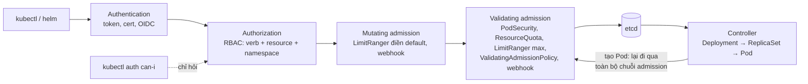
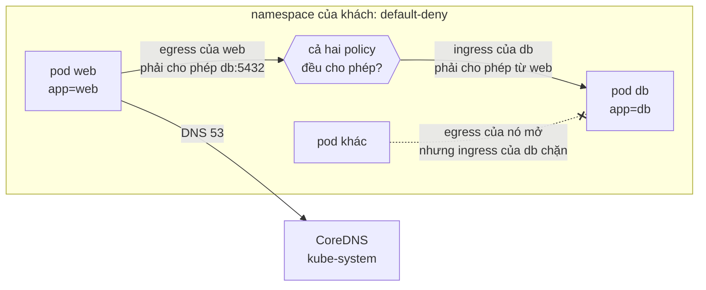
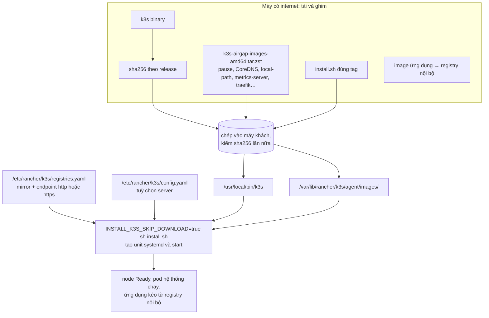

# Cài lên Kubernetes của khách

Khi khách nói "chúng tôi có Kubernetes", điều đó hiếm khi nghĩa là "bạn có cluster". Thường bạn nhận một kubeconfig chỉ
thấy một namespace, một registry nội bộ không có image nào của bạn, và một bộ luật do đội platform đặt từ trước khi họ
biết sản phẩm của bạn tồn tại: Pod Security Admission, ResourceQuota, LimitRange, NetworkPolicy chặn sẵn. Chart Helm của
vendor được viết cho một cluster dễ dãi; việc của FDE là làm nó chạy **trong luật của khách** mà không xin nới luật.
Có khi khách chưa có cluster nào và bạn phải dựng một k3s trên máy không ra internet. Có khi khách sắp chuyển sang
OpenShift, nơi cùng một manifest bị từ chối vì những lý do khác hẳn.

Sau module này bạn sẽ:

- Đọc được mình được làm gì trong cluster (RBAC) và phân biệt nó với những gì cluster sẽ chấp nhận (admission).
- Viết values file theo hồ sơ khách: registry nội bộ, securityContext qua PSA `restricted`, resources vừa quota và node,
  và kiểm trước bằng `helm template` + `--dry-run=server` thay vì thử trên production.
- Đưa image vào registry nội bộ khi không có Docker hay quyền root.
- Viết NetworkPolicy đúng bảng luồng và chứng minh bằng kết nối thật.
- Dựng k3s air-gapped từ đúng các tệp đã mang vào.
- Nói trước được những gì gãy khi khách đổi sang OpenShift, và viết yêu cầu quyền tối thiểu cho platform team.

## 0. Cài đặt

Hai máy khách của module là golden đã dựng sẵn công cụ: `lawfirm-prod` (k3s `v1.37.1+k3s1` do IT quản, `kubectl
v1.37.1`, `helm v3.22.1`, `fde` không sudo, chỉ có kubeconfig trong namespace `quillo`) và `lawfirm-staging` (Docker,
không ra internet, có sudo). Chi tiết hồ sơ ở [setup/fde/README.md](../../../../setup/fde/README.md).

```bash
nice -n 15 uv run python -m fdekit prepare lawfirm-prod
nice -n 15 uv run python -m fdekit prepare lawfirm-staging
nice -n 15 uv run python tracks/fde/product/release.py build --version 1.0.0 --out tracks/fde/product/dist
```

Bài intermediate 02 cần ba tệp k3s air-gap (cùng bản và cùng sha256 với golden `lawfirm-prod`, ghim trong
`setup/fde/cloud-init/lib.sh`) và BusyBox tĩnh đã ghim ở module 04. Tải một lần vào `data/raw/fde-tools/` (thiếu thì test
skip kèm đúng lệnh):

| Tệp | Bản (ngày phát hành) | Nguồn | sha256 |
| --- | --- | --- | --- |
| `k3s` | `v1.37.1+k3s1` (2026-09-30) | GitHub release `k3s-io/k3s` | `92b94582eb7b34a8cf532e6006842b9ed215a6783cf56a3dd6271fd35243b2c0` |
| `k3s-airgap-images-amd64.tar.zst` | như trên, 194 MB | như trên | `865b2a63ad7a63fc0db17b7fc2985bf4ae11d5ae93ca1472be6218d20aeb6b23` |
| `install.sh` | đúng tag `v1.37.1+k3s1` | `raw.githubusercontent.com/k3s-io/k3s/<tag>/install.sh` | `ed01f89fd977bf20ac1516bbebf8370bf3ddbaa55dac8aba610956a4c78cc00b` |
| `busybox` | 1.35.0 x86_64 musl | busybox.net | `6e123e7f3202a8c1e9b1f94d8941580a25135382b99e8d3e34fb858bba311348` |

```bash
d=data/raw/fde-tools/k3s-v1.37.1+k3s1 && mkdir -p "$d" && cd "$d"
r=https://github.com/k3s-io/k3s/releases/download/v1.37.1%2Bk3s1
curl -fLO "$r/k3s" && curl -fLO "$r/k3s-airgap-images-amd64.tar.zst"
curl -fLo install.sh https://raw.githubusercontent.com/k3s-io/k3s/v1.37.1+k3s1/install.sh
sha256sum -c - <<'EOF'
92b94582eb7b34a8cf532e6006842b9ed215a6783cf56a3dd6271fd35243b2c0  k3s
865b2a63ad7a63fc0db17b7fc2985bf4ae11d5ae93ca1472be6218d20aeb6b23  k3s-airgap-images-amd64.tar.zst
ed01f89fd977bf20ac1516bbebf8370bf3ddbaa55dac8aba610956a4c78cc00b  install.sh
EOF
```

Không cần cài gì lên máy của bạn: `kubectl`, `helm`, k3s chỉ chạy trong VM. Không cần snapshot dẫn xuất: bài nặng nhất
(intermediate 01, cài cả quillo) ~90 s kể cả boot và chép bundle 1,1 GB. Gỡ: xoá `data/raw/fde-tools/k3s-v1.37.1+k3s1/`.

## 1. Đứng trong namespace của người khác

Câu hỏi đầu tiên ở khách không phải "cài thế nào" mà là "tôi là ai trong cluster này". Kubeconfig IT đưa có thể là
token của một ServiceAccount, một user OIDC, hay một chứng chỉ client; context có thể trỏ sẵn namespace hay không.

```sh
kubectl auth whoami                              # username + group như API server thấy
kubectl config view --minify -o jsonpath='{..namespace}'
kubectl auth can-i create deployments            # yes/no cho một câu hỏi
kubectl auth can-i --list                        # mọi luật áp cho bạn trong namespace hiện tại
kubectl auth can-i create pods --subresource=exec
```

Mỗi request tới API server đi qua một chuỗi cố định. RBAC chỉ là một mắt xích, và `auth can-i` chỉ hỏi mắt xích đó:



Ba hệ quả thực tế:

- **"yes" của `can-i` chưa phải lời hứa.** RBAC không có "mọi NetworkPolicy trừ cái tên X"; IT muốn giữ một object thì
  chặn ở admission (ValidatingAdmissionPolicy, webhook, Kyverno/Gatekeeper). `can-i delete networkpolicy/<tên>` vẫn
  `yes`, lệnh thật bị từ chối. Muốn biết admission nói gì mà không đổi gì: `--dry-run=server` (admission chạy cả với
  dry-run, không ghi etcd).
- **Lỗi của pod không nằm ở lệnh của bạn.** Bạn tạo Deployment; pod do controller tạo về sau, bằng danh tính của
  controller, và bị admission từ chối lúc đó. Lý do nằm trong event của ReplicaSet/StatefulSet (`kubectl get events`,
  `kubectl describe rs`), không trong output của `kubectl apply` hay `helm`.
- **"no" và "không hỏi được" trông giống nhau.** `kubectl auth can-i` thoát mã 1 cho cả "no" lẫn lỗi kết nối; script
  kiểm quyền phải đọc stdout (`yes`/`no`) và coi mọi thứ khác là lỗi.

Quyền tối thiểu để cài một chart thường gồm: workload (`deployments`, `statefulsets`), `services`, `configmaps`,
`secrets` (Helm 3 lưu **mỗi revision** của release trong một Secret cùng namespace), `persistentvolumeclaims`,
`networkpolicies`, đọc `pods`/`events`/`pods/log`, và `pods/exec`, `pods/portforward` cho vận hành. Không có quyền cấp
cluster thì không đọc được `nodes`, `storageclasses`, CRD: những câu đó phải hỏi IT bằng văn bản, không đoán.

## 2. Helm khi không có cluster-admin

Helm 3 không có thành phần chạy trong cluster: nó dùng đúng quyền của kubeconfig bạn đang có. Hệ quả:

| Chart làm gì | Cần quyền | Khi chỉ có một namespace |
| --- | --- | --- |
| Tạo object namespaced | Theo từng kind | Được, nếu Role cho |
| Lưu release | `secrets` create/get/list/update trong namespace release | Thiếu là lỗi ngay ở bước ghi release |
| `crds/`, ClusterRole, ClusterRoleBinding, PriorityClass, StorageClass | Quyền cluster | Hỏng; tách phần cluster-scoped cho platform team cài trước (`--skip-crds`) |
| `lookup` trong template | `get` object đó | Rỗng khi `helm template` hay `--dry-run` phía client: giá trị "sinh một lần" (mật khẩu) phải được thiết kế để không đổi qua upgrade |
| `--create-namespace` | `create namespaces` | Không bao giờ có; namespace do IT tạo và gắn nhãn |

**Values theo khách** là một tệp riêng cho từng khách, nằm trong repo triển khai, review như mã: `image.registry`,
`imagePullSecrets`, securityContext, resources, NetworkPolicy, StorageClass, kích thước PVC. Values mẫu vendor đi kèm là
điểm xuất phát; con số trong đó được tính cho một namespace trống, không phải cho namespace đã có người dùng chung.

**Kiểm trước, không thử trên production:**

```sh
helm template quillo chart.tgz -n quillo -f values-khach.yaml > rendered.yaml   # render, không cần cluster
grep -E '^kind:|image:' rendered.yaml | sort | uniq -c                            # có gì cluster-scoped? image nào?
kubectl apply --dry-run=server -f rendered.yaml                                   # admission thật của khách
helm upgrade --install … --dry-run=server                                          # như trên, có lookup
```

Đọc kỹ dòng `Warning:` khi dry-run Deployment: PSA `enforce` chỉ áp cho Pod, nên ở mức Deployment nó chỉ **cảnh báo**
"would violate PodSecurity"; ReplicaSet tạo Pod sau đó mới bị từ chối thật. `helm install` báo `STATUS: deployed` nghĩa
là API server đã nhận object, không phải pod đã chạy; dùng `--wait --timeout` để Helm chờ workload sẵn sàng và thất bại
có lý do.

**Image ở registry nội bộ.** Cluster air-gapped chỉ kéo được từ registry của khách, và registry đó chỉ có những gì ai đó
đã đẩy lên. Đường đi của một image từ bundle tới node:

- Có Docker/Podman ở một máy với tới registry: `load` → `tag` → `push` (registry HTTP thì máy đó phải khai insecure).
- Không có Docker, không root: OCI layout (`docker save` đời mới, `skopeo`, `ops/models_image.py` của quillo đều tạo
  ra) đẩy thẳng bằng `skopeo copy oci-archive:…`, `crane push`, `regctl image import`, hoặc vài chục dòng Python gọi
  Registry HTTP API v2 (`POST /v2/<repo>/blobs/uploads/`, `PUT …?digest=`, rồi `PUT /v2/<repo>/manifests/<tag>`). Binary
  mang vào phải ghim sha256 như mọi thứ khác trong bundle.
- `ctr images import` / `k3s ctr` nạp thẳng vào containerd của node cần root trên node; có quyền đó thì không còn là
  khách "không cluster-admin".

Tên image là hợp đồng giữa chart và registry: chart quyết định `<registry>/<đường dẫn>:<tag>` (bỏ host gốc như `ghcr.io`
hay giữ), registry phải có đúng tên đó. `imagePullPolicy: IfNotPresent` che lỗi: node đã có image trong cache thì pod
chạy dù registry trống, đến khi pod sang node khác. Kiểm bằng registry (`curl http://<registry>/v2/<repo>/tags/list`),
không bằng "pod đã chạy một lần".

## 3. PSA restricted, quota và LimitRange

**Pod Security Admission** đọc nhãn namespace `pod-security.kubernetes.io/enforce|warn|audit`. Mức `restricted` (bản
`latest`) đòi mọi container, kể cả initContainer và ephemeral container:

| Trường | Phải là |
| --- | --- |
| `securityContext.runAsNonRoot` (pod hoặc container) | `true`; và `runAsUser` nếu đặt thì khác `0` |
| `allowPrivilegeEscalation` | `false` |
| `capabilities` | `drop: [ALL]`, chỉ được `add: [NET_BIND_SERVICE]` |
| `seccompProfile.type` | `RuntimeDefault` hoặc `Localhost` |
| `privileged`, `hostNetwork`, `hostPID`, `hostIPC`, `hostPort` | không dùng |
| Volume | chỉ `configMap`, `secret`, `emptyDir`, `persistentVolumeClaim`, `projected`, `downwardAPI`, `csi`, `ephemeral` (không `hostPath`) |

PSA chỉ đọc **manifest**. Image chạy root theo mặc định (nhiều image database, image build sẵn của upstream) mà pod chỉ
đặt `runAsNonRoot: true` thì qua admission, rồi kubelet từ chối container: `CreateContainerConfigError: container has
runAsNonRoot and image will run as root`. Phải đặt `runAsUser` khớp user mà image được dựng cho (đọc `USER` bằng
`skopeo inspect --config` hay từ Dockerfile), và nghĩ tới quyền ghi: thư mục dữ liệu trên PVC nhận `fsGroup` (trừ volume
kiểu hostPath như local-path, nơi provisioner tự mở quyền), thư mục tạm cần emptyDir.

**ResourceQuota** giới hạn tổng của namespace. Khi quota đếm một tài nguyên (`requests.cpu`, `limits.memory`…), **mọi**
pod mới phải khai tài nguyên đó, nếu không bị từ chối "must specify". Quota kiểm từng pod với phần còn lại, không kiểm
tổng một release: release 5 pod có thể lên 4 pod rồi kẹt pod thứ năm.

**LimitRange** có hai kiểu khác nhau một trời một vực:

- Kiểu `Container` có `default`/`defaultRequest`: container không khai thì được điền hộ (mutating). Tiện, nhưng điền
  `limits.memory` 512Mi cho một LLM là OOM-kill.
- Kiểu `Pod` chỉ có `min`/`max` (validating), **không** điền gì. Có `max` cho một tài nguyên thì mọi pod phải khai
  `limits` của tài nguyên đó ("No limit is specified").

Đọc cả ba trước khi viết values: `kubectl describe resourcequota,limitrange`, `kubectl get ns <ns> --show-labels`.

Cách tính tài nguyên một pod: theo từng loại, lấy **max(tổng các container, initContainer lớn nhất)**. Cộng cho cả
release, nhớ ba thứ hay quên:

- **Pod thêm lúc rolling update** (Deployment `RollingUpdate`, `maxSurge` 25% làm tròn lên ⇒ 1 pod cho replica 1): quota
  phải chứa được cả pod cũ lẫn pod mới, không thì nâng cấp kẹt giữa chừng.
- **Người khác trong namespace**: agent backup, sidecar của IT đã dùng một phần; đọc `status.used`, đừng đọc `hard`.
- **Node thật**: quota là con số hành chính; scheduler xếp theo allocatable của node trừ requests của mọi pod (cả pod hệ
  thống). Quota còn mà node hết thì pod `Pending` với `Insufficient cpu`. Không xem được `nodes` thì hỏi IT con số đó.

`requests` là thứ scheduler đặt chỗ, `limits.memory` là ngưỡng OOM-kill, `limits.cpu` là throttle. Hạ requests cho vừa
quota thì được; hạ `limits.memory` dưới nhu cầu thật của tiến trình thì không.

## 4. NetworkPolicy chặn sẵn

Namespace của khách thường có một policy `default-deny` chọn mọi pod, chặn ingress và egress (thường chừa DNS). Từ đó
mọi luồng phải được mở tường minh, và mở ở **cả hai đầu**:



Luật cần nhớ:

- Policy chỉ **cộng** quyền. Một pod bị policy nào chọn (theo `podSelector`) và có `policyTypes` chứa `Ingress`/`Egress`
  thì chiều đó chỉ còn những gì các policy chọn nó cho phép. Không có policy "deny" để trừ.
- Ingress của bạn phải tự đứng được: đừng dựa vào việc pod khác "chưa có egress". Một policy khác (của IT, của team khác)
  mở egress cho pod của họ là ingress của bạn thành cửa duy nhất.
- Trong một phần tử `from`/`to`, `podSelector` + `namespaceSelector` là **và**; hai phần tử là **hoặc**.
- `podSelector: {}` trong `from` = mọi pod của namespace này; `namespaceSelector: {}` = mọi namespace. Kết hợp sai là
  mở cho cả cluster.
- Egress tới thứ ngoài cluster (IdP, registry, API ngoài) dùng `ipBlock`; nhiều nền tảng còn có lớp riêng
  (`EgressFirewall` của OpenShift, firewall của khách).
- NetworkPolicy áp cho traffic **giữa pod** do CNI thực thi (k3s dùng kube-router tích hợp; flannel thuần thì không
  thực thi gì). Probe của kubelet và `kubectl port-forward` đi đường khác; kiểm luồng bằng pod thử, không bằng
  port-forward.

Viết policy theo một **bảng luồng** (từ, tới, cổng, vì sao) gửi IT duyệt trước, rồi chứng minh bằng kết nối thật: pod thử
mang đúng nhãn, `nc -z -w 2 <IP> <cổng>` cho từng dòng của bảng và cho các luồng phải tắc. `kubectl describe
networkpolicy` cho biết policy nói gì, không cho biết CNI có làm theo.

## 5. k3s air-gapped khi khách chưa có cluster

k3s là một binary chứa API server, kubelet, containerd, flannel, CoreDNS và các addon (traefik, servicelb,
local-path-provisioner, metrics-server dạng manifest). Cài trên máy có internet chỉ cần `curl -sfL https://get.k3s.io`;
trên máy air-gapped mọi thứ phải mang vào và đặt đúng chỗ **trước** lần khởi động đầu:



- **Image air-gap** là tarball của đúng bản k3s; k3s nạp mọi tarball trong `agent/images/` mỗi lần khởi động. Thiếu thì
  containerd đi tìm image ở registry gốc (Docker Hub) như máy có mạng.
- **`registries.yaml`** cấu hình containerd của k3s: `mirrors` (tên registry → endpoint, kể cả `http://`), `configs`
  (TLS, CA, đăng nhập). Đọc lúc khởi động; sửa xong phải restart k3s. Đây là cấu hình riêng của k3s, không liên quan
  `daemon.json` của Docker trên cùng máy.
- **`install.sh`** với `INSTALL_K3S_SKIP_DOWNLOAD=true` chỉ tạo unit systemd, symlink `kubectl`/`crictl` và start;
  `INSTALL_K3S_VERSION` để ghi đúng bản. Chạy lại là restart với cấu hình hiện tại: script cài của bạn nên viết cấu hình
  trước, chạy lại được, và không xoá `/var/lib/rancher/k3s/server` (dữ liệu cluster).
- k3s một node không phải HA: ghi rõ cho khách (backup etcd/SQLite bằng `k3s etcd-snapshot` hay sao lưu
  `/var/lib/rancher/k3s/server/db`, kế hoạch nâng cấp bằng cùng quy trình air-gap với bản mới).

## 6. OpenShift khác gì

OpenShift là Kubernetes, nhưng một manifest chạy được dưới PSA restricted của k3s có thể bị từ chối ở OpenShift vì một
triết lý khác: cluster **chọn** danh tính cho pod, không chỉ kiểm.

| Chủ đề | Kubernetes + PSA restricted | OpenShift 4 |
| --- | --- | --- |
| Kiểm soát pod | PSA: kiểm theo mức, không đổi pod | SCC (`restricted-v2` mặc định): kiểm **và gán** UID, GID, fsGroup, SELinux, seccomp; PSA label được đồng bộ theo SCC |
| UID | Bạn chọn (`runAsUser: 999`), miễn khác 0 | UID ngẫu nhiên trong dải của namespace (`openshift.io/sa.scc.uid-range`); `runAsUser` cố định ngoài dải bị từ chối |
| Quyền ghi | Theo UID bạn chọn | GID chính là `0`: thư mục ghi phải là volume hoặc `chgrp 0` + `chmod g=u` trong image |
| Đường vào | Ingress / Gateway API | `Route` (edge/passthrough/re-encrypt TLS); Ingress được chuyển thành Route |
| Image | Registry bất kỳ | Internal registry `image-registry.openshift-image-registry.svc:5000`, ImageStream; pull secret theo project |
| Tenant | Namespace | Project (namespace + annotation), user thường tự tạo được project nếu cluster cho |
| Egress ra ngoài | NetworkPolicy `ipBlock` | NetworkPolicy + `EgressFirewall`/`EgressIP` (OVN-Kubernetes) |
| CLI | `kubectl` | `oc` (gồm `kubectl` và thêm `oc new-project`, `oc adm policy`, `oc debug`…) |

Cách làm đúng khi khách đổi nền tảng: thử từng image với SCC mặc định trước khi cài cả chart (pod `sleep`, ghi thử vào
đường dẫn ứng dụng cần ghi). Image không chạy được với UID tuỳ ý là việc của vendor (sửa image), không phải lý do xin
`anyuid`. Xin SCC rộng hơn là quyết định bảo mật của khách, cần lý do bằng văn bản như mọi yêu cầu quyền khác.

## 7. Ôn nhanh: Kubernetes

Module này giả định bạn đã quen Pod, Deployment, StatefulSet, Service, PVC, Helm chart và `kubectl` cơ bản. Ôn ở track
MLOps: [13 · Kubernetes cho ML](../../../mlops/modules/13-kubernetes-for-ml/README.md) (object cơ bản, Helm, chạy workload
ML trên cluster) và [14 · Kubernetes cho ML production](../../../mlops/modules/14-kubernetes-ml-production/README.md)
(autoscaling, tài nguyên, vận hành). Điểm khác của FDE so với MLOps: ở đó bạn là chủ cluster; ở đây bạn là khách trong
namespace của người khác, và mọi luật ở mục 1–4 là của họ.

## 8. Tài liệu tham khảo

- Kubernetes: [Pod Security Standards](https://kubernetes.io/docs/concepts/security/pod-security-standards/),
  [Pod Security Admission](https://kubernetes.io/docs/concepts/security/pod-security-admission/),
  [Resource Quotas](https://kubernetes.io/docs/concepts/policy/resource-quotas/),
  [Limit Ranges](https://kubernetes.io/docs/concepts/policy/limit-range/),
  [Network Policies](https://kubernetes.io/docs/concepts/services-networking/network-policies/),
  [Using RBAC Authorization](https://kubernetes.io/docs/reference/access-authn-authz/rbac/),
  [Validating Admission Policy](https://kubernetes.io/docs/reference/access-authn-authz/validating-admission-policy/),
  [kubectl auth can-i](https://kubernetes.io/docs/reference/kubectl/generated/kubectl_auth/kubectl_auth_can-i/),
  [Resource Management for Pods and Containers](https://kubernetes.io/docs/concepts/configuration/manage-resources-containers/).
- Helm: [Role-based Access Control](https://helm.sh/docs/topics/rbac/),
  [helm template](https://helm.sh/docs/helm/helm_template/), [helm upgrade](https://helm.sh/docs/helm/helm_upgrade/)
  (`--wait`, `--dry-run=server`), [Custom Resource Definitions](https://helm.sh/docs/chart_best_practices/custom_resource_definitions/).
- k3s: [Air-Gap Install](https://docs.k3s.io/installation/airgap),
  [Private Registry Configuration](https://docs.k3s.io/installation/private-registry),
  [Requirements](https://docs.k3s.io/installation/requirements).
- OCI: [Distribution Specification](https://github.com/opencontainers/distribution-spec/blob/main/spec.md) (push blob và
  manifest), [skopeo](https://github.com/containers/skopeo), [crane](https://github.com/google/go-containerregistry/tree/main/cmd/crane).
- OpenShift: [Managing security context constraints](https://docs.redhat.com/en/documentation/openshift_container_platform/4.17/html/authentication_and_authorization/managing-pod-security-policies),
  [Creating images: support arbitrary user ids](https://docs.redhat.com/en/documentation/openshift_container_platform/4.17/html/images/creating-images),
  [Route configuration](https://docs.redhat.com/en/documentation/openshift_container_platform/4.17/html/ingress_and_load_balancing/routes).
- [roadmap.sh: Forward Deployed Engineer](https://roadmap.sh/forward-deployed-engineer).
