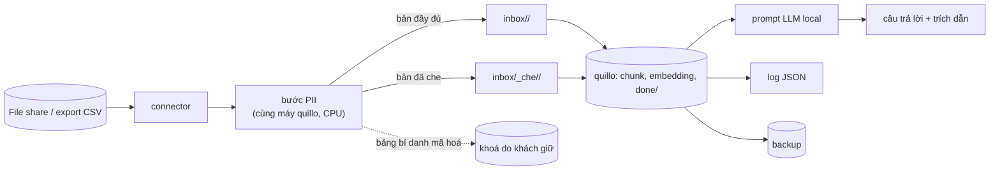

# Lời giải: xử lý dữ liệu cá nhân trước khi index

Bài mẫu rút gọn (đạt 18/20; thiếu số đo thật vì chưa chạy trên dữ liệu khách) và rubric chi tiết cho người chấm.

## Bài mẫu (rút gọn)

### 1. Phạm vi và dữ liệu

Hợp đồng dịch vụ, NDA, biên bản họp, hồ sơ tranh tụng (PDF/TXT từ file share; export CSV từ hệ thống hợp đồng). Dữ liệu
cá nhân cơ bản: họ tên, số CCCD/hộ chiếu, ngày sinh, địa chỉ, số điện thoại, email, số tài khoản ngân hàng, mã số thuế cá
nhân. Dữ liệu nhạy cảm (theo luật, cần mức bảo vệ cao hơn): sức khoẻ, tiền án tiền sự, đời sống riêng trong hồ sơ ly hôn,
thông tin tài chính cá nhân. Ví dụ đã che lấy từ 30 tài liệu mẫu IT khách chọn.

### 2. Yêu cầu

- Pháp lý (phòng pháp chế của khách xác nhận cách hiểu): xử lý tối thiểu cần thiết cho mục đích tra cứu nội bộ; dữ liệu
  không rời hệ thống của khách; xoá được theo yêu cầu của chủ thể khi không còn căn cứ lưu giữ; ghi nhận ai truy cập.
- Nghiệp vụ: luật sư phụ trách hồ sơ thấy đầy đủ; hành chính/thực tập sinh hỏi được nội dung pháp lý (điều khoản, thời
  hạn, mức phạt) mà không thấy danh tính đương sự.

### 3. Luồng dữ liệu và điểm xử lý

Nơi dữ liệu cá nhân nằm lại và cách xử lý: bản gốc trên share (của khách, ngoài phạm vi); bản trong `inbox/done/` (cả
hai góc nhìn; giữ bản đầy đủ chỉ khi luật sư cần, quyền 0750); chunk và embedding trong Postgres (góc nhìn che được index
riêng, **trước khi** tính embedding); prompt (chỉ chứa đoạn người hỏi được xem nhờ ACL); log (tên tệp: connector đổi tên
tệp đã che thành mã ổn định, vd. `HD-2024-0007.txt`, không mang tên đương sự); backup (cùng chính sách xoá, xem mục 8);
support bundle (không có tài liệu, che secret).

### 4. Phát hiện

| Thực thể | Phương pháp | Kiểm tra hợp lệ |
| --- | --- | --- |
| CCCD (12 số), CMND (9 số), hộ chiếu | regex + ngữ cảnh ("CCCD", "số định danh") | 3 số đầu là mã tỉnh hợp lệ, số thứ 4 là giới tính/thế kỷ hợp lệ |
| Điện thoại | regex đầu số Việt Nam (`0`/`+84` + 9 số), nhiều cách viết (dấu cách, dấu chấm) | đầu số di động/cố định có thật |
| Email, số tài khoản, mã số thuế | regex + ngữ cảnh ("STK", "tại ngân hàng") | độ dài theo ngân hàng; MST 10/13 số |
| Họ tên, địa chỉ | NER tiếng Việt chạy local (model nhỏ CPU, ghim sha256) + từ điển họ Việt + danh sách bên tham gia lấy từ chính export hợp đồng | không có; đo bằng bộ nhãn |
| Dữ liệu nhạy cảm | không tự động che từng câu; phân loại cả tài liệu theo thư mục/loại hồ sơ ⇒ chỉ góc nhìn đầy đủ, không có góc nhìn che | phòng pháp chế duyệt danh sách thư mục |

Regex đủ cho thực thể có cấu trúc; **không** đủ cho tên và địa chỉ tiếng Việt (không viết hoa nhất quán trong văn bản
scan, tên trùng từ thường như "Bình", "An").

### 5. Biến đổi

- Góc nhìn đầy đủ: không đổi, chỉ nhóm luật sư (ACL thư mục gốc).
- Góc nhìn che: thực thể có cấu trúc ⇒ nhãn loại (`[CCCD]`, `[SĐT]`); người và tổ chức là bên ký ⇒ **bí danh nhất quán**
  `[NGƯỜI_<HMAC-SHA256(khoá, tên chuẩn hoá)[:6]>]` để câu hỏi về quan hệ giữa các hợp đồng vẫn trả lời được; khoá HMAC do
  khách giữ (tệp 0400 hoặc Vault), không lưu bảng tra ngược trong quillo. Hash không khoá bị loại: số CCCD có không gian
  nhỏ, dò ngược được.
- ACL: thêm tiền tố `_che/` cho nhóm hành chính/thực tập (`QUILLO_ACL=intern:_che/,legal:Ph_p ch_/,…`), không cần đổi
  sản phẩm.

### 6. Ảnh hưởng

Câu hỏi về điều khoản (thời hạn, mức phạt, luật áp dụng) không đổi chất lượng; câu hỏi về danh tính chỉ góc nhìn đầy đủ
trả lời được (đúng ý định). Bí danh làm embedding của đoạn có tên khác bản gốc: đo truy hồi riêng cho góc nhìn che. Bộ
nhớ và thời gian nạp tăng ~2 lần cho tài liệu có hai góc nhìn.

### 7. Kiểm thử và đo

200 đoạn lấy mẫu có gắn nhãn tay (hai người gắn, đo độ đồng thuận). Chỉ số: recall theo loại thực thể (ngưỡng chấp nhận:
có cấu trúc ≥ 99 %, họ tên ≥ 95 %), precision (≥ 90 %, che thừa làm hỏng câu trả lời), recall@4 của truy hồi và tỉ lệ trả
lời đúng trên bộ câu hỏi nghiệp vụ trước/sau che (giảm ≤ 5 điểm). Chạy lại mỗi khi đổi model NER hay quy tắc; bộ kiểm thử
nằm ở máy khách.

### 8. Vận hành

Yêu cầu xoá của chủ thể: tìm theo bí danh/tên trong cả hai góc nhìn, xoá tài liệu (quillo 1.0.0 chưa có API xoá ⇒ runbook
SQL theo `doc_id` + `done/`), xoá khỏi backup theo chu kỳ giữ của backup (ghi trong chính sách). Khoá HMAC: xoay hằng
năm ⇒ index lại góc nhìn che. Sự cố (lộ góc nhìn đầy đủ cho nhóm sai): thu hồi ACL, đổi token quản trị để huỷ phiên UI,
báo phòng pháp chế theo quy trình thông báo vi phạm của khách. Người quyết định: phòng pháp chế (danh sách dữ liệu nhạy
cảm, thời gian lưu), IT (khoá, backup), FDE (cài đặt, đo).

### 9. Rủi ro còn lại

Che sót tên trong PDF scan chất lượng thấp; thông tin gián tiếp nhận diện được người (chức danh + công ty + ngày); bản gốc
vẫn trên file share của khách. Khách cần quyết định: có giữ bản đầy đủ trong `done/` không, thời gian lưu backup, ai được
gỡ che.

## Rubric chi tiết

| Tiêu chí | 0 | Một nửa | Đủ |
| --- | --- | --- | --- |
| Luồng dữ liệu (4) | Chỉ nói "che trước khi index" | Có chunk/embedding, thiếu `done/`, log hoặc backup | Mọi nơi trong bối cảnh + cách xử lý từng nơi |
| Phát hiện (4) | Chỉ regex cho mọi thứ | Có NER nhưng không nói tiếng Việt/không đo | Theo từng loại, có kiểm tra hợp lệ, chạy local, có đo |
| Biến đổi theo người dùng (4) | Một kiểu che cho mọi người | Hai góc nhìn nhưng không gắn ACL hay bí danh không khoá | Hai góc nhìn gắn ACL hiện có, bí danh có khoá do khách giữ, lý do |
| Đo (3) | Không | Có chỉ số, không ngưỡng | Bộ nhãn, recall/precision theo loại, ảnh hưởng truy hồi, ngưỡng |
| Vận hành/pháp lý (3) | Không | Một trong xoá/khoá/sự cố | Đủ, có người quyết định |
| Giới hạn (2) | Hứa "an toàn tuyệt đối" | Liệt kê chung chung | Rủi ro cụ thể + câu hỏi cho khách |

## Sai lầm thường gặp

- Che ở tầng trả lời (lọc output của LLM): đoạn có PII vẫn nằm trong DB, embedding và prompt.
- Dùng một API "PII detection" trên cloud: dữ liệu rời hệ thống của khách, vi phạm chính yêu cầu.
- `sha256(cccd)` làm bí danh: 10^12 khả năng nhưng cấu trúc (mã tỉnh, năm sinh) thu nhỏ còn vài tỉ, dò được trong vài
  giờ trên GPU.
- Quên tên tệp: `NDA - Nguyễn Văn A.pdf` nằm trong log và trong trích dẫn.
