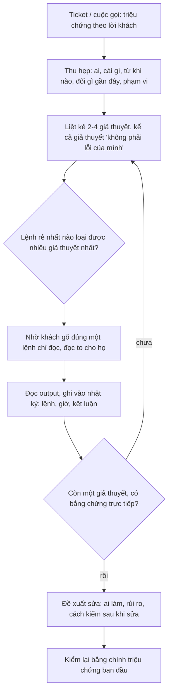
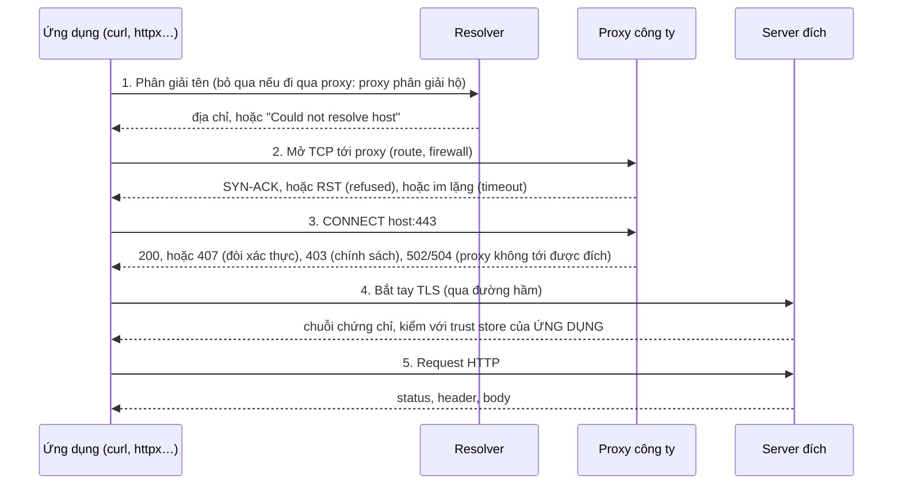
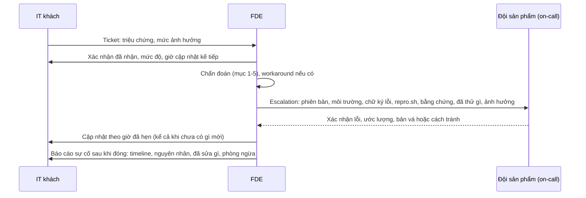

# Xử lý sự cố tại hiện trường

Ở công ty, khi hệ thống hỏng bạn có shell, có quyền root, có dashboard, có đồng nghiệp ngồi cạnh. Ở khách thì gần như
không có gì trong số đó: máy nằm trong mạng bạn không vào được, IT của khách gõ lệnh hộ bạn qua một cuộc gọi chia sẻ màn
hình, có khi bạn chỉ nhận được một tệp log đính kèm email lúc 11 giờ đêm. Người báo lỗi tả triệu chứng theo cách họ thấy
("quillo chết rồi"), không theo cách hệ thống hỏng. Kỹ năng FDE ở đây là **chẩn đoán có hệ thống bằng ít lệnh nhất**:
biết hỏi gì, đọc output thế nào, thu bằng chứng mà không lấy theo secret hay dữ liệu của khách, tái hiện được ở lab, và
chuyển cho đội sản phẩm một ticket mà họ hành động được ngay.

Sau module này bạn sẽ:

- Dẫn một buổi chẩn đoán qua tay người khác: giả thuyết, lệnh rẻ nhất phân biệt được các giả thuyết, đọc kết quả, lặp.
- Đọc nhanh máy Linux theo tầng (tài nguyên, tiến trình, socket, syscall, mạng) và biết lệnh nào cần quyền gì.
- Đọc output `curl -v`, `openssl s_client`, `getent`, `ss` để chỉ ra một kết nối dừng ở bước nào.
- Viết support bundle chạy không cần root, đủ thông tin mà không mang theo secret hay dữ liệu nghiệp vụ.
- Dựng timeline từ log nhiều dịch vụ, tái hiện lỗi của khách ở lab và so bằng chữ ký lỗi.
- Viết ticket escalation cho đội sản phẩm và báo cáo sự cố cho khách.

## 0. Cài đặt

Các bài VM dùng golden `lab-open`, `hospital` và hai snapshot dẫn xuất: `07-customer-integration-quillo` (`lab-open`
chạy quillo 1.0.0, có từ module 07) và `08-field-troubleshooting-hospital` (`hospital` chạy quillo 1.0.0). Bài support
bundle cần busybox tĩnh (đã dùng ở module 04 và 06) để dựng image container nhỏ của khách.

```bash
nice -n 15 uv run python -m fdekit prepare lab-open
nice -n 15 uv run python -m fdekit prepare hospital
nice -n 15 uv run python tracks/fde/product/release.py build --version 1.0.0 --out tracks/fde/product/dist
nice -n 15 uv run python -m fdekit derive 07-customer-integration-quillo
nice -n 15 uv run python -m fdekit derive 08-field-troubleshooting-hospital
docker pull mitmproxy/mitmproxy:12.2.3@sha256:00b77b5d8804c8ad18cb6caefbf9d5849e895e8986c5ce011f4ae30f4385962f
```

| Thành phần | Bản | Ghi chú |
| --- | --- | --- |
| Snapshot `08-field-troubleshooting-hospital` | dựng ~85 s, ~3,5 GB trong `data/raw/fde-images/derived/` | Cần binary compose v5.6.1 trong `data/raw/fde-tools/` (tải ở mục 0 của module 03); bundle, script hay binary đổi thì test skip kèm lệnh `derive` |
| busybox | 1.35.0 x86_64 musl, sha256 `6e123e7f3202…` | `data/raw/fde-tools/busybox-1.35.0/busybox`; thiếu thì test skip kèm lệnh tải và kiểm sha256 |
| mitmproxy | 12.2.3, ghim digest | Proxy công ty của `hospital` (`customer_site` tự chạy) |
| curl, OpenSSL trong VM | `hospital`: curl 7.68, OpenSSL 1.1.1f; `bank`: curl 7.61, OpenSSL 1.1.1k | Output của các bản cũ này là thứ bạn sẽ gặp ở khách, khác bản trên laptop |

Kiểm: `uv run python -m fdekit derive --list` báo hai snapshot trên là `có`. Gỡ: xoá
`08-field-troubleshooting-hospital-*.qcow2` trong `data/raw/fde-images/derived/`. Thư mục `.fde-lab/08-field-incident/`
(bundle và nhật ký của bài intermediate 01) xoá tay được bất cứ lúc nào.

## 1. Chẩn đoán qua tay người khác

Một buổi xử lý sự cố ở khách thường bắt đầu bằng câu "nó không chạy". Việc đầu tiên **không phải** gõ lệnh mà là biến câu
đó thành thứ kiểm được: cái gì không chạy, với ai, từ lúc nào, thay đổi gì gần nhất, đang ảnh hưởng bao nhiêu người.
Sau đó đi theo một vòng lặp có kỷ luật:



Vài nguyên tắc làm vòng lặp này nhanh và an toàn:

- **Mỗi lệnh phải có lý do.** Trước khi nhờ khách gõ, nói được "nếu ra X thì loại giả thuyết A, nếu ra Y thì loại B".
  Lệnh không phân biệt được gì là lệnh tốn thời gian của khách và làm họ mất kiên nhẫn. Thực tế bạn có khoảng 3-5 lệnh
  trước khi IT của khách bắt đầu hỏi "anh định làm gì vậy".
- **Chỉ đọc trước, sửa sau.** Giai đoạn chẩn đoán chỉ dùng lệnh không đổi trạng thái (`df`, `ss`, `journalctl`,
  `docker inspect`). Restart "thử xem" xoá mất bằng chứng (log của container cũ, tiến trình đang treo, trạng thái bộ
  nhớ) và có thể làm sự cố tự hết mà bạn không biết vì sao, để rồi nó quay lại tuần sau.
- **Đọc to và giải thích.** Khách đang gõ lệnh vào máy production của họ. Nói rõ lệnh làm gì, không đổi gì, output có
  thể chứa gì (để họ che secret trước khi dán). Đừng bao giờ nhờ gõ lệnh in biến môi trường hay tệp cấu hình nguyên văn.
- **Triệu chứng không phải nguyên nhân.** `/healthz` trả 503, container restart liên tục, request chậm: đều là triệu
  chứng. Nguyên nhân là thứ mà khi bạn đổi nó, triệu chứng biến mất, và bạn chỉ ra được dấu vết của nó (một dòng log,
  một con số, một cấu hình). Báo cáo chẩn đoán tốt có cả hai và nói rõ cái nào là cái nào.
- **Đổi gì gần đây?** Phần lớn sự cố ở khách đến sau một thay đổi: bảo trì, vá OS, đổi cấu hình mạng, ai đó "dọn dẹp". Hỏi
  thẳng, rồi kiểm bằng dữ liệu (thời điểm tạo container, `journalctl --since`, mtime của tệp cấu hình), vì người được
  hỏi thường không biết hoặc không nhớ đồng nghiệp đã làm gì.
- **Ghi nhật ký buổi chẩn đoán.** Giờ, lệnh, output rút gọn, kết luận. Nó thành timeline cho báo cáo sự cố, và giúp
  người tiếp nhận (đồng nghiệp ca sau, đội sản phẩm) không hỏi lại khách những điều đã hỏi.

Khi chỉ có log gửi lại (không ai gõ hộ), vòng lặp vẫn vậy nhưng "lệnh" là câu hỏi bạn đặt cho log: grep một mẫu, đếm,
xếp theo thời gian. Khi thiếu dữ kiện thật sự, bạn hỏi thêm **một** thứ cụ thể, kèm lệnh chính xác khách cần chạy, thay
vì "gửi thêm log".

## 2. Đọc máy theo tầng, với quyền bạn có

Đi từ dưới lên giúp bạn không bỏ sót tầng nào và không đoán ở tầng trên khi tầng dưới đã hỏng. Mỗi tầng có vài lệnh trả
lời nhanh, và mỗi lệnh có một mức quyền: ở khách, quyền là thứ bạn phải xin, nên biết trước lệnh nào chạy được bằng user
thường.

| Tầng | Câu hỏi | Lệnh (user thường) | Cần thêm quyền khi |
| --- | --- | --- | --- |
| Tài nguyên | Còn chỗ, còn inode, còn RAM, có gì bị kill? | `df -h`, `df -i`, `free -m`, `uptime`, `cat /proc/pressure/*` | `dmesg` khi `kernel.dmesg_restrict=1` (cần root; kiểm `/proc/sys/kernel/dmesg_restrict`); `journalctl -k` cần nhóm `adm`/`systemd-journal` |
| Dịch vụ | Dịch vụ nào đang chạy, khởi động lại bao nhiêu lần, log nói gì? | `systemctl status`, `journalctl -u <unit>` (nhóm `systemd-journal`/`adm`), `docker ps -a`, `docker logs`, `docker inspect` | Unit hệ thống của người khác, log journal toàn máy |
| Tiến trình | Tiến trình nào ăn tài nguyên, đang chờ gì, mở tệp gì? | `ps -eo pid,user,rss,etime,args --sort=-rss`, `top -b -n1`, `/proc/<pid>/status` (của mình) | `/proc/<pid>/fd`, `environ` của tiến trình user khác |
| Socket | Ai đang nghe cổng nào, kết nối tới đâu, trạng thái gì? | `ss -ltn`, `ss -tan state established` | `ss -p` để thấy tiến trình của user khác |
| Syscall | Tiến trình đang gọi gì, lỗi errno nào? | `strace -f -e trace=network,file -p <pid>` (tiến trình của chính mình) | Tiến trình user khác; `ptrace_scope` ≥ 1 chặn cả tiến trình cùng user không phải con |
| Mạng | Gói có đi ra, có trả lời không? | `ip addr`, `ip route`, `getent hosts`, `curl -v` | `tcpdump` (cần `CAP_NET_RAW`, thường phải xin root và xin phép bảo mật) |

Vài điều thường thấy ở hiện trường:

- **Tài nguyên cạn hiếm khi làm mọi thứ chết cùng lúc.** Thường chỉ những thao tác cần thêm đúng tài nguyên đó hỏng,
  phần còn lại vẫn chạy. Vì vậy hãy hỏi "thao tác nào hỏng, thao tác nào vẫn được" trước khi
  kết luận "hệ thống chết". `df` báo theo block, `df -i` theo inode: hết inode cũng báo "No space left on device".
- **Container che mất một tầng.** `docker ps` nói container "healthy" nghĩa là healthcheck **bên trong** container qua,
  không có nghĩa là các container khác gọi được nó. Cấu hình thật của một container (biến môi trường, mount, mạng,
  restart count, thời điểm tạo) nằm trong `docker inspect`, không phải trong tệp compose bạn đang mở: container chỉ
  nhận cấu hình lúc được **tạo**, nên tệp sửa sau đó không có tác dụng cho tới khi tạo lại.
- **`strace` và `tcpdump` là vũ khí cuối, không phải đầu.** Chúng trả lời câu hỏi rất hẹp (tiến trình này đang chờ
  syscall nào, gói này có tới không) và thường cần quyền mà khách phải duyệt. Dùng khi log và các lệnh trên đã thu hẹp
  về một tiến trình hay một kết nối cụ thể. `strace -f -tt -e trace=connect,openat,read -p <pid>` cho thấy tiến trình
  treo ở `connect()` tới đâu hay đọc tệp nào bị `EACCES`; `tcpdump -ni any host 10.20.0.5 and port 5432 -c 20` cho
  thấy SYN có đi ra và có SYN-ACK quay về không.
- **Đồng hồ.** So log hai máy mà không kiểm `timedatectl`/`chronyc tracking` là cách nhanh nhất để dựng sai timeline.
  Chứng chỉ TLS, token OIDC và Kerberos cũng hỏng khi đồng hồ lệch.

## 3. Đường đi của một kết nối

"Không kết nối được" có ít nhất bảy nguyên nhân khác nhau, mỗi cái do một đội khác nhau sửa. Một kết nối HTTPS qua proxy
công ty đi qua các bước sau, và output của `curl -v` cho biết nó dừng ở bước nào:



Cách đọc nhanh:

- **Bước 1, 2:** `curl` in `Trying <địa chỉ>...` sau khi phân giải xong. Có dòng `Uses proxy env variable https_proxy`
  nghĩa là curl đi qua proxy, và địa chỉ trong `Trying` là của **proxy**. Lỗi ở bước này nói về đường từ máy tới proxy
  (hoặc tới đích nếu không có proxy): resolver, route, firewall, tiến trình nghe cổng. `getent hosts <tên>` hỏi đúng
  resolver mà ứng dụng dùng (theo `/etc/nsswitch.conf`, gồm cả `/etc/hosts`), khác `nslookup`/`dig` chỉ hỏi DNS; không
  in gì và thoát `2` nghĩa là không phân giải được.
- **Refused, timeout, unreachable** khác nhau ở chỗ ai trả lời: refused là máy đích trả RST (máy sống, cổng không mở);
  timeout là không ai trả lời (gói bị bỏ ở firewall, đích tắt, hoặc proxy chờ đích hộ bạn); "No route to host"/"Network is
  unreachable" là kernel của chính máy gửi không biết đường đi, hoặc máy cùng subnet không trả lời ARP. Mã thoát của
  curl giúp phân biệt một phần (`6`, `7`, `28`, `35`, `56`, `60`), nhưng luôn đọc câu chữ đi kèm.
- **Bước 3:** mọi mã HTTP ở bước CONNECT là của **proxy**, không phải của server đích. `407` là proxy đòi xác thực;
  `502` từ proxy nghĩa là proxy không tới được đích (tên không phân giải được từ phía proxy, đích từ chối). Tương tự,
  một ứng dụng nhận `502 Bad Gateway` khi gọi một dịch vụ mà bản thân dịch vụ đó không bao giờ trả `502` là dấu hiệu có
  thứ gì đó **đứng giữa** trả lời thay.
- **Bước 4:** TLS hỏng theo hai kiểu cần người khác nhau sửa. "unable to get local issuer certificate", "self-signed
  certificate in certificate chain", "unable to verify the first certificate" là **chuỗi tin cậy**: trust store của ứng
  dụng không có CA đã ký chứng chỉ (CA nội bộ, proxy có TLS inspection). "Hostname mismatch", "no alternative certificate
  subject name matches" là **tên**: chứng chỉ đúng CA nhưng cấp cho tên khác với tên bạn gọi. Mỗi runtime có trust store
  riêng: curl và OpenSSL của OS dùng `/etc/ssl/certs`, Python `requests` dùng `certifi`, `httpx` dùng `certifi` hoặc CA
  bạn truyền vào, Java dùng `cacerts`, và **container mang trust store của image**, không phải của máy chủ.
  `openssl s_client -connect host:443 -servername host` in chuỗi chứng chỉ và `Verification error:` mà không cần ứng
  dụng; nó thoát `0` kể cả khi verify lỗi, nên đọc dòng verify, đừng đọc mã thoát.
- **Proxy là cấu hình của từng tiến trình, không phải của máy.** `http_proxy`/`https_proxy`/`no_proxy` chỉ có tác dụng
  với tiến trình nhận được các biến đó **và** thư viện của nó tôn trọng chúng. Daemon systemd không đọc
  `/etc/environment`; container chỉ có biến môi trường được truyền vào lúc tạo. `no_proxy` so theo tên/hậu tố tên, mỗi
  thư viện hiểu CIDR và ký tự đại diện một kiểu. Khi một kết nối "đi sai đường", hỏi: tiến trình **này** thực sự có những
  biến nào (`/proc/<pid>/environ` nếu đủ quyền, `docker inspect` với container), không phải shell của bạn có gì.

## 4. Support bundle: thu đủ, không thu thứ không được thu

Support bundle là gói chẩn đoán khách chạy một lệnh để gửi cho bạn. Nó quyết định 80% sự cố có giải được mà không cần
cuộc gọi hay không. Nó cũng là thứ dễ làm lộ dữ liệu nhất: bundle đi qua email, hệ thống ticket, Slack của nhà cung cấp,
và được giữ lâu hơn mọi người nghĩ.

```mermaid
flowchart LR
    subgraph may["Máy khách (user thường)"]
        cmd[Lệnh chỉ đọc<br/>df, ss, systemctl, journalctl,<br/>docker ps/logs/inspect] --> raw[output thô<br/>trong thư mục tạm 0700]
        cfg[Tệp cấu hình,<br/>phần cuối log] --> raw
        raw --> red[Che secret<br/>URL userinfo, key=value nhạy cảm,<br/>Authorization]
        red --> tar[bundle.tar.gz<br/>có giới hạn kích thước]
    end
    no[Không bao giờ thu:<br/>env của tiến trình, history,<br/>private key, thư mục dữ liệu,<br/>dump database] -.x.- raw
    tar --> ticket[Ticket / email<br/>ngoài tầm kiểm soát của khách]
```

**Thu gì.** Đủ để trả lời các câu ở mục 1-3 mà không phải hỏi lại: phiên bản OS/kernel, tài nguyên (`df -h`, `df -i`,
`free`, `uptime`), mạng (`ip addr`, `ip route`, socket đang nghe, `resolv.conf`, biến proxy của hệ thống sau khi che),
trạng thái dịch vụ (`systemctl status`, `docker ps -a`, restart count), cấu hình của **sản phẩm** đã che secret, phần
**cuối** của log (vài trăm tới vài nghìn dòng mỗi nguồn, giới hạn byte), health endpoint, và một tệp ghi những lệnh đã
lỗi. Lệnh lỗi (thiếu quyền, thiếu công cụ) **không** được làm hỏng cả bundle: ghi lại lỗi và chạy tiếp, vì "user này
không vào được Docker" cũng là một thông tin chẩn đoán.

**Không thu gì.** Biến môi trường nguyên văn của tiến trình (`env`, `/proc/*/environ`, `docker inspect` không che,
`systemctl show` của unit có `Environment=`), shell history, private key và keystore, thư mục dữ liệu nghiệp vụ (tài
liệu, hồ sơ bệnh án, dump database), toàn bộ log không giới hạn. Nguyên tắc: bundle chỉ chứa thứ bạn sẵn sàng thấy in
trong một ticket công khai của khách.

**Che thế nào.** Che theo **dạng**, không theo danh sách giá trị (bạn không biết giá trị secret của khách):

| Dạng | Ví dụ | Sau khi che |
| --- | --- | --- |
| Userinfo trong URL | `postgresql://app:S3cr3t@db:5432/x`, `http://u:p@proxy:3128` | `postgresql://app:***@db:5432/x` (giữ user, host, cổng: chúng là thông tin chẩn đoán) |
| Cặp khoá-giá trị có tên nhạy cảm | `db_password=…`, `API_TOKEN: …`, `"CLIENT_SECRET=…"` trong JSON | giữ tên khoá, thay giá trị |
| Header xác thực | `Authorization: Bearer eyJ…`, `Basic dXNlcjpw…` | giữ scheme, thay credential |
| Tệp chứa khoá | `*.key`, `*.pem` có private key, keystore | không thu |

Che **trên mọi tệp**, kể cả output lệnh (status của systemd in vài dòng log cuối; `docker inspect` có `Config.Env`), và
**giữ dòng**: xoá cả dòng có secret làm mất đúng dòng bạn cần đọc (lỗi kết nối tới đâu). Kiểm việc che bằng cách gieo
một secret ngẫu nhiên vào mọi chỗ có thể (cấu hình, env, log) rồi grep bundle: đó chính là cách test của bài support
bundle làm. Che theo regex không bao giờ hoàn hảo, nên giảm thứ phải che bằng cách không thu những nguồn rủi ro cao.

**Chạy thế nào.** Không cần root (khách sẽ hỏi vì sao một script chẩn đoán cần root, và họ đúng); dùng nhóm vận hành
có sẵn (`adm`, `systemd-journal`, `docker`). POSIX `sh`, không phụ thuộc Python hay `jq` (máy khách có thể không có).
Dựng trong thư mục tạm quyền `0700`, luôn dọn khi thoát (cả khi bị Ctrl-C), không để lại tệp nào ngoài bundle. Có giới
hạn thời gian cho từng lệnh treo được (`timeout 10 docker ...`). Một bundle tốt vẫn chạy được trên một máy đang gặp sự
cố, vì đó chính là lúc người ta chạy nó.

## 5. Từ log tới timeline, từ bundle tới lab

**Timeline trước, giả thuyết sau.** Log nhiều dịch vụ gom chung không theo thứ tự thời gian (`docker compose logs` in
từng container theo khối, xen kẽ tuỳ lúc), nhiều định dạng (JSON của ứng dụng, chữ của Postgres, của llama.cpp, của
uvicorn), và chứa cả những lần khởi động trước. Ba câu trả lời đầu tiên nên có trong 5 phút:

1. **Lỗi gì, bao nhiêu, khi nào:** gom các dòng cảnh báo/lỗi theo (dịch vụ, thông điệp), đếm, lấy lần đầu và lần cuối.
   Thông điệp có biến (tên tệp, id) thì gom theo phần cố định.
2. **Người dùng bị ảnh hưởng ra sao:** đếm request lỗi phía server (5xx) theo endpoint; một health check 503 mỗi 10 giây
   khác hẳn 300 request `/api/ask` thất bại.
3. **Một đợt hay nhiều đợt:** xếp mọi sự kiện xấu theo thời gian và tách ở khoảng lặng. Hai đợt cách nhau một phút có
   thể là hai nguyên nhân khác nhau, cũng có thể là một nguyên nhân bị che bởi một lần restart; khoảng lặng là câu hỏi
   bạn mang đi hỏi khách ("lúc 05:50 có ai làm gì không?").

Dòng lỗi **đầu tiên** trong một đợt thường gần nguyên nhân hơn dòng lỗi **nhiều nhất**: thác lỗi phía sau (retry,
timeout dây chuyền, health check) luôn đông hơn. Và nhớ rằng log có thể **thiếu**: log driver không ghi được, journal bị
xoay vòng, container cũ đã bị xoá cùng log của nó. Khoảng trống trong log là bằng chứng, không phải là "không có gì xảy
ra".

**Tái hiện ở lab.** Khi nguyên nhân nằm ở môi trường của khách mà bạn không được thử trên máy họ, bạn dựng lại **điều
kiện** đó ở lab:

- Lấy từ bundle mọi thứ cố định được: phiên bản sản phẩm, OS, cấu hình (đã che), thứ tự sự kiện, và **chữ ký lỗi**:
  dịch vụ, thông điệp, kiểu exception, phần lý do của thông báo lỗi. Bỏ phần đổi theo môi trường (host, cổng, thời gian,
  id, đường dẫn tạm).
- Dựng điều kiện tối thiểu gây ra đúng chữ ký đó, không phải "một lỗi giống giống". Hai lỗi TLS, hai lỗi kết nối, hai lỗi
  đĩa có thể có cùng thông điệp ngoài và khác nhau ở phần lý do; nếu chữ ký của bạn khác, bạn đang tái hiện một lỗi khác
  và cách sửa bạn đề xuất có thể sai.
- Script hoá việc tái hiện (`repro.sh`): chạy lại được nhiều lần, không cần dữ liệu thật của khách, không cần mạng ngoài,
  để đội sản phẩm chạy được trên máy họ. Một lỗi tái hiện được bằng một lệnh thì được sửa nhanh hơn mười lần một lỗi
  "chỉ xảy ra ở khách".
- Khi đã tái hiện được, thử cách sửa ở lab trước, rồi mới đề xuất cho khách cùng với cách kiểm sau khi sửa.

## 6. Escalation và giao tiếp sự cố

Không phải sự cố nào bạn cũng tự sửa được: lỗi nằm trong sản phẩm, cần quyết định của đội khác, hay vượt quá thời gian
bạn có. Escalation tốt là chuyển cho đúng người **một gói việc họ làm được ngay**, không phải chuyển nỗi lo.



**Ticket escalation** gửi đội sản phẩm cần: tiêu đề nêu chữ ký lỗi (không phải "khách X bị lỗi"); phiên bản chính xác
(bản phát hành, digest image, OS, runtime); môi trường khác mặc định ở điểm nào (proxy, CA nội bộ, không root, đĩa nhỏ);
cách tái hiện (lý tưởng là một script) hoặc lý do chưa tái hiện được; bằng chứng đã che secret (dòng log, output lệnh)
kèm nguồn; đã thử gì và kết quả; mức ảnh hưởng và workaround đang dùng; câu hỏi cụ thể bạn cần họ trả lời. Đội sản phẩm
đọc hàng chục ticket một ngày: ticket nào trả lời được "lỗi gì, ở đâu, tái hiện thế nào" trong 30 giây đầu thì được làm
trước.

**Mức độ** đo theo ảnh hưởng tới khách, không theo độ khó: không ai dùng được (sev1), một chức năng chính hỏng không có
workaround (sev2), hỏng có workaround hay ảnh hưởng ít người (sev3), câu hỏi hay yêu cầu (sev4). Mức độ quyết định nhịp
cập nhật, và **giữ đúng giờ cập nhật đã hẹn** quan trọng với khách hơn tốc độ sửa.

**Báo cáo sự cố cho khách** (sau khi đóng) viết cho người không ở trong cuộc gọi: tóm tắt một đoạn; timeline theo giờ của
khách; ảnh hưởng (ai, bao lâu, dữ liệu có mất không); nguyên nhân gốc nói thẳng, kể cả khi nằm ở phía khách, theo giọng
không đổ lỗi (mô tả hệ thống và quy trình, không gọi tên người); đã làm gì; việc phòng ngừa có người chịu trách nhiệm và
hạn. Đừng hứa điều bạn không kiểm soát (bản vá của đội sản phẩm), và đừng đưa vào báo cáo những gì bạn chưa chứng minh.

## 7. Ôn nhanh: observability ở phía sản phẩm

Support bundle và chẩn đoán qua tay khách là cách bù cho việc **không có** hệ thống quan sát ở máy khách. Mọi thứ sản
phẩm tự mang theo làm việc đó dễ hơn: log có cấu trúc (một dòng JSON mỗi sự kiện, có `ts`, `level`, thông điệp cố định và
trường biến tách riêng), health endpoint báo từng phụ thuộc (`/healthz` của quillo trả `checks` cho db, llm, embed),
metrics không cần auth và không chứa dữ liệu (`/metrics` của quillo chỉ có số đếm), phiên bản in ra lúc khởi động. Ba
trụ log, metrics, trace và cách dựng chúng cho hệ thống ML đã học ở
[MLOps 09: Monitoring và observability](../../../mlops/modules/09-monitoring-observability/README.md); quy trình xử lý
sự cố, runbook và postmortem ở [MLOps 10: Drift và incident](../../../mlops/modules/10-drift-incidents/README.md). Điểm
khác ở hiện trường: bạn không có Prometheus hay Grafana của mình bên trong mạng khách, nên những tín hiệu đó phải đọc được
bằng `curl` và một tệp log, và phải an toàn để khách gửi ra ngoài.

## 8. Tài liệu tham khảo

- Công cụ: [curl: `--verbose` và mã thoát](https://curl.se/docs/manpage.html#-v),
  [curl exit codes](https://everything.curl.dev/cmdline/exitcode.html),
  [OpenSSL `s_client`](https://docs.openssl.org/1.1.1/man1/s_client/),
  [ss(8)](https://man7.org/linux/man-pages/man8/ss.8.html), [getent(1)](https://man7.org/linux/man-pages/man1/getent.1.html),
  [strace(1)](https://man7.org/linux/man-pages/man1/strace.1.html), [tcpdump(1)](https://www.tcpdump.org/manpages/tcpdump.1.html),
  [journalctl(1)](https://www.freedesktop.org/software/systemd/man/latest/journalctl.html),
  [Yama `ptrace_scope`](https://www.kernel.org/doc/html/latest/admin-guide/LSM/Yama.html).
- Docker: [`docker inspect`](https://docs.docker.com/reference/cli/docker/inspect/),
  [`docker compose logs`](https://docs.docker.com/reference/cli/docker/compose/logs/),
  [Logging drivers](https://docs.docker.com/engine/logging/configure/).
- HTTP và TLS: [RFC 9110 §15.6.3 502 Bad Gateway, §15.5.8 407](https://www.rfc-editor.org/rfc/rfc9110),
  [RFC 9110 §9.3.6 CONNECT](https://www.rfc-editor.org/rfc/rfc9110#name-connect),
  [RFC 6125: kiểm tên trong chứng chỉ](https://www.rfc-editor.org/rfc/rfc6125).
- Support bundle và secret: [OWASP Logging Cheat Sheet](https://cheatsheetseries.owasp.org/cheatsheets/Logging_Cheat_Sheet.html),
  [OWASP Secrets Management Cheat Sheet](https://cheatsheetseries.owasp.org/cheatsheets/Secrets_Management_Cheat_Sheet.html),
  [GitLab: SOS (support bundle)](https://gitlab.com/gitlab-com/support/toolbox/gitlabsos),
  [Kubernetes: troubleshoot](https://github.com/replicatedhq/troubleshoot) (support bundle có redactor của Replicated).
- Sự cố và escalation: [Google SRE Book: Effective Troubleshooting](https://sre.google/sre-book/effective-troubleshooting/),
  [Google SRE Book: Postmortem Culture](https://sre.google/sre-book/postmortem-culture/),
  [PagerDuty Incident Response: severity levels](https://response.pagerduty.com/before/severity_levels/).
- [roadmap.sh: Forward Deployed Engineer](https://roadmap.sh/forward-deployed-engineer).
