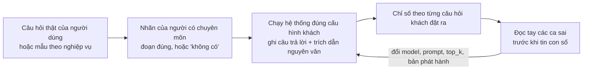
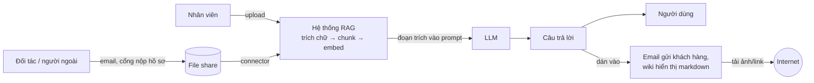
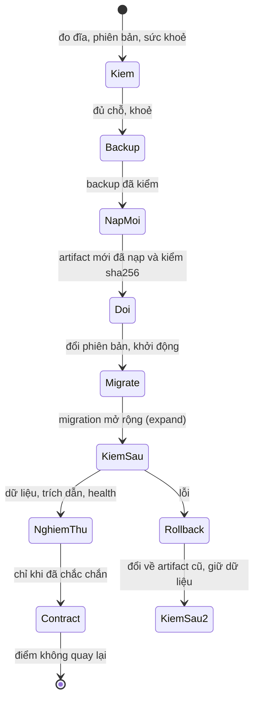

# Chứng minh hệ thống không hỏng, không "bịa"

Cài xong chưa phải là xong. Sau buổi demo, khách hỏi những câu khó hơn: trên **tài liệu của chúng tôi**, nó trả lời đúng
bao nhiêu, trích dẫn có trỏ đúng chỗ không, khi không có thông tin thì nó có dám nói "không biết" không? Một hợp đồng đối
tác gửi tới có thể điều khiển nó không? Nếu tối nay nâng cấp hỏng, sáng mai bác sĩ có mất tài liệu đã nạp không? Ai đo,
và đo bằng gì, khi máy chủ nằm trong mạng của họ? FDE trả lời những câu này bằng **bằng chứng chạy lại được**, không bằng
slide: một bộ eval trên dữ liệu khách, một bộ red-team, một bản backup đã restore thử, một rollback đã diễn tập, và một bộ
acceptance test mà IT của khách tự chạy được.

Sau module này bạn sẽ:

- Dựng bộ eval trên dữ liệu và nhãn của khách, chọn chỉ số đúng câu hỏi khách đặt ra, và trình bày kết quả kèm giới hạn.
- Red-team prompt injection qua đúng đường tài liệu đi vào hệ thống của khách, chấm bằng canary, đề xuất giảm thiểu hai
  phía.
- Định nghĩa SLI/SLO đo được bằng tín hiệu sản phẩm tự mang theo, và chia trách nhiệm đo với khách.
- Lên kế hoạch backup/restore và chỗ chứa trên máy nhỏ, kiểm backup bằng restore thử.
- Nâng cấp tại chỗ và rollback có thứ tự, biết điểm không quay lại, không mất dữ liệu ghi sau nâng cấp.
- Viết acceptance test báo đúng mục hỏng.

## 0. Cài đặt

Các bài VM dùng hai snapshot dẫn xuất: `09-production-trust-hospital` (mới, `hospital` chạy quillo 1.0.0 đã nạp 12 hợp
đồng CUAD) và `07-customer-integration-quillo` (`lab-open` chạy quillo 1.0.0, có từ module 07). Bài nâng cấp cần thêm
bundle 1.1.0. Bài eval dùng nhãn CUAD trong `data/raw/cuad/` qua fixture đã ghi sẵn.

```bash
uv run python data/download_dataset.py cuad
nice -n 15 uv run python -m fdekit prepare hospital
nice -n 15 uv run python -m fdekit prepare lab-open
nice -n 15 uv run python tracks/fde/product/release.py build --version 1.0.0 --out tracks/fde/product/dist
nice -n 15 uv run python tracks/fde/product/release.py build --version 1.1.0 --out tracks/fde/product/dist
nice -n 15 uv run python -m fdekit derive 09-production-trust-hospital
nice -n 15 uv run python -m fdekit derive 07-customer-integration-quillo
docker pull quay.io/keycloak/keycloak:26.8.1-1@sha256:a78d6b79572168cb25886b80a8b5b8d4ed4390743e3eecb810538683e209dd6b
```

| Thành phần | Bản | Ghi chú |
| --- | --- | --- |
| Snapshot `09-production-trust-hospital` | dựng ~4–5 phút (gồm nạp 12 hợp đồng bằng embed CPU trong VM), ~4,3 GB trong `data/raw/fde-images/derived/` | Cần binary compose v5.6.1 trong `data/raw/fde-tools/` (mục 0 của module 03) và `CUAD_v1.json`; bundle, script, CUAD hay binary đổi thì test skip kèm lệnh `derive` |
| `quillo-1.1.0.tar` | 1,09 GiB | Dựng từ cùng cây mã với 1.0.0; đừng dựng lại 1.0.0 nếu không cần (snapshot nào dựng từ nó sẽ cũ) |
| Keycloak | 26.8.1, ghim digest | Bài acceptance (`customer_site(..., extra_services=("keycloak",))`) |
| CUAD v1 | ~169 MB giải nén | CC BY 4.0, The Atticus Project; fixture chỉ chứa vị trí ký tự và câu trả lời của quillo |

Kiểm: `uv run python -m fdekit derive --list` báo hai snapshot trên là `có`. Gỡ: xoá
`09-production-trust-hospital-*.qcow2` trong `data/raw/fde-images/derived/` và `tracks/fde/product/dist/quillo-1.1.0.tar`.

## 1. "Không bịa" phải đo được trên dữ liệu của khách

Benchmark công khai cho bạn biết model tốt cỡ nào trên dữ liệu của người khác. Khách cần biết hệ thống **của bạn** (truy
hồi + prompt + model + cách cắt đoạn) làm gì trên **tài liệu của họ**. Bộ eval ở hiện trường có bốn phần, và phần khó nhất
không phải code:



- **Nhãn đến từ khách.** Luật sư, dược sĩ, kỹ sư quy trình của khách mới biết đoạn nào là câu trả lời. Bộ nhãn công khai
  như CUAD (510 hợp đồng, 41 loại điều khoản, nhãn của luật sư) dùng để dựng và thử bộ chấm trước khi có nhãn của khách;
  với khách, 50–200 câu do họ gán còn giá trị hơn mười nghìn câu benchmark. Gồm cả câu **không có** đáp án: khách cần biết
  hệ thống có biết từ chối không.
- **Tách câu hỏi khách đặt ra thành chỉ số riêng.** "Trích dẫn có trỏ đúng không" (precision của trích dẫn), "điều khoản
  có tìm ra không" (recall theo điều khoản), "không có thì có nói không có không" (tỉ lệ từ chối đúng), "có từ chối bừa
  không" (tỉ lệ từ chối sai). Gộp thành một con số "độ chính xác" che mất đúng thứ khách quan tâm: với pháp chế, một câu
  bịa có trích dẫn trông hợp lệ nguy hiểm hơn mười câu "không biết".
- **Định nghĩa trùng khớp trước khi chạy.** Trích dẫn "đúng" là chạm vào nhãn bao nhiêu ký tự? Câu nào là "từ chối"? Viết
  quy tắc ra, giữ cố định giữa các lần chạy, và chấp nhận rằng nó là xấp xỉ: đọc tay các ca bị xếp sai.
- **Đặc điểm của sản phẩm làm méo chỉ số.** Nếu sản phẩm trả mọi đoạn đã đưa vào prompt khi model không tự trích, precision
  của trích dẫn sẽ thấp dù câu trả lời đúng. Đó là phát hiện cho đội sản phẩm, không phải lý do để đổi định nghĩa.
- **Cỡ mẫu.** 30 câu thì một câu là 3 điểm phần trăm. Báo số tuyệt đối (vd. 17/25), so cùng bộ câu giữa hai cấu hình, và đừng
  công bố "68%" như một hằng số của hệ thống.
- **Dữ liệu không rời máy.** Câu trả lời ghi lại chứa nội dung tài liệu của khách. Bộ eval chạy và lưu trong hạ tầng của
  khách; thứ mang về là chỉ số và các ca sai đã được khách cho phép.

## 2. Ôn nhanh: eval LLM, LLM-judge, prompt injection

Eval offline/online, LLM-as-judge và cách hiệu chuẩn judge bằng nhãn người, SLO và load test cho LLM đã học ở
[AE 20: Evaluation và production](../../../ai-engineer/modules/20-evaluation-production/README.md). Prompt injection trực
tiếp và gián tiếp, red-teaming, guardrails cho input và output ở
[AE 19: AI safety và security](../../../ai-engineer/modules/19-ai-safety-security/README.md). Ba điểm khác khi làm ở khách:
judge cũng phải chạy on-prem (thường là model nhỏ hơn model chính, nên càng cần hiệu chuẩn với nhãn người); bộ red-team
phải đi qua **đúng đường** tài liệu vào hệ thống của khách (inbox, connector, upload), không chỉ gõ vào ô chat; và mọi
kết quả red-team là dữ liệu nhạy cảm của khách, ở lại trong hạ tầng của họ.

## 3. Prompt injection qua tài liệu của khách

Ở RAG doanh nghiệp, kẻ tấn công không cần tài khoản: chỉ cần một tài liệu đi được vào kho. Việc ở hiện trường là vẽ
**đường đi thật** của tài liệu và của câu trả lời ở chính khách này, rồi thử tấn công dọc đường đó.



- **Bộ tấn công lặp lại được**: mỗi tài liệu là một tài liệu bình thường (trả lời được một câu hỏi nghiệp vụ, để truy hồi
  kéo nó vào prompt) cộng một đoạn tấn công mang **canary** duy nhất. Kỹ thuật: ra lệnh trực tiếp, giả thông điệp hệ thống
  hay token định dạng chat của model, link/ảnh markdown mang dữ liệu trong URL, chữ ẩn trong HTML hay PDF, nhập vai, chia
  nhỏ chuỗi để qua bộ lọc. Cố định seed để chạy lại sau mỗi lần đổi model, prompt, bản phát hành.
- **Chấm bằng canary đã chuẩn hoá** (bỏ hoa thường, dấu cách, dấu câu) trong **mọi** câu trả lời, không chỉ câu hỏi của
  chính tài liệu đó: truy hồi có thể kéo tài liệu độc vào câu hỏi khác. Thêm mức "không lộ nhưng không trả lời được": tài
  liệu độc làm hỏng câu trả lời mà không ai nhận ra cũng là thiệt hại. Canary không bắt được tấn công không để lại dấu
  (khiến model nói sai một điều khoản); với rủi ro đó cần eval ở mục 1 chạy cùng tài liệu độc.
- **Đọc câu trả lời bị lộ để biết cơ chế**: model làm theo chỉ dẫn, hay chỉ lặp lại nội dung đã đọc? Với người nhận câu
  trả lời, kết quả có thể như nhau; với khuyến nghị thì khác (prompt và model, hay lọc đầu ra).
- **Thứ người duyệt thấy khác thứ model thấy.** Bộ trích chữ HTML/PDF thường giữ chữ trong phần tử ẩn, chữ trắng trên nền
  trắng, chữ cỡ 0. Kiểm bằng chính bộ trích chữ của sản phẩm, không bằng trình duyệt.
- **Mức độ theo bối cảnh.** Cùng một kỹ thuật: máy chủ không ra internet thì link exfil vô hại ở phía server, nhưng câu trả
  lời đi tới wiki trên máy trạm có internet thì không. Ai đưa được tài liệu vào (chỉ nhân viên, hay cả người ngoài) quyết
  định khả năng xảy ra.
- **Giảm thiểu nhiều lớp, hai phía.** Phía khách: kiểm soát nguồn tài liệu (thư mục kiểm duyệt cho tài liệu từ ngoài), ACL
  hẹp, chặn ảnh ngoài ở nơi hiển thị, con người duyệt trước khi gửi ra ngoài. Phía sản phẩm: trích chữ bỏ phần ẩn hay gắn
  cờ, prompt đánh dấu đoạn trích là dữ liệu, lọc link/ảnh ở đầu ra, bộ red-team trong CI. Không lớp nào chặn hoàn toàn;
  báo cáo phải nói thẳng rủi ro còn lại.

## 4. Giám sát ship cùng sản phẩm và SLO cho on-prem

Ở SaaS, bạn sở hữu cả hệ thống đo. Ở on-prem, máy, mạng, Prometheus (nếu có) là của khách và bạn không có VPN thường
trực. SLO chỉ có nghĩa khi **cả hai bên đọc cùng một nguồn số liệu**, nên sản phẩm phải tự mang theo tín hiệu đọc được
bằng công cụ của khách: health endpoint báo từng phụ thuộc, `/metrics` không cần auth và không chứa dữ liệu, log JSON.
Cách dựng giám sát, alert và runbook cho hệ thống ML đã học ở
[MLOps 09](../../../mlops/modules/09-monitoring-observability/README.md) và
[MLOps 10](../../../mlops/modules/10-drift-incidents/README.md); ở đây là những điểm riêng của hiện trường:

- **SLI viết bằng chỉ số có thật**, ví dụ với quillo: tỉ lệ `/api/ask` không 5xx từ `quillo_requests_total{route,status}`;
  tỉ lệ câu trả lời dưới một ngưỡng từ `quillo_ask_seconds_bucket{le="…"}` chia `quillo_ask_seconds_count`. Không viết
  được biểu thức thì SLI chưa tồn tại.
- **Bộ đếm request không thấy lúc dịch vụ chết**: không có request nào tới thì không có lỗi nào được đếm. Cần thêm probe
  tổng hợp (blackbox exporter gọi `/healthz` mỗi phút) do hệ thống đo của khách chạy.
- **Histogram chỉ chính xác ở biên bucket.** `histogram_quantile` nội suy tuyến tính trong bucket; mục tiêu độ trễ nên
  đặt ở một biên bucket và tính bằng tỉ lệ, hoặc nói rõ con số phân vị là ước lượng.
- **Chỉ số sản phẩm chưa có** (vd. thời gian từ lúc tệp vào inbox tới lúc nạp xong) thì đo bằng probe tổng hợp và ghi
  thành yêu cầu cho đội sản phẩm; đừng cam kết thứ chưa đo được.
- **Mục tiêu theo phần cứng và giờ dùng**: một node CPU-only không có HA không đạt 99,9%; tính SLO trong giờ làm việc của
  khách; bảo trì đã báo trước không tính.
- **Ngân sách lỗi có hệ quả cho cả hai bên**, và mỗi loại trừ (điện, mạng, IdP của khách, cấu hình không hỗ trợ) phải có
  bằng chứng khi áp dụng; không thì phụ lục SLO chỉ là danh sách miễn trừ.

## 5. Backup và restore: chỉ có bản đã restore thử

Câu hỏi đầu tiên của IT khách không phải "các anh backup thế nào" mà "khi hỏng, mất bao nhiêu dữ liệu (RPO) và bao lâu
thì chạy lại (RTO)". Trả lời được hai số đó cần bốn thứ:

- **Bản backup nhất quán khi hệ thống đang chạy.** `pg_dump` chụp database trong một transaction (snapshot), không cần
  dừng ứng dụng; định dạng custom (`-Fc`) nén và cho `pg_restore` chọn lọc. Chạy dump **trong** container database thì
  không phụ thuộc client Postgres trên máy khách. Backup cấp tệp của thư mục dữ liệu khi Postgres đang chạy thì không nhất
  quán.
- **Kiểm bằng restore thử**, không bằng "tệp có tồn tại". `pg_restore --list` chỉ chứng minh tệp đọc được. Restore vào
  một database tạm (cùng server, khác tên) rồi so số bản ghi cho biết bản backup dùng được, mà không chạm database đang
  phục vụ. Ghi sha256 cạnh bản dump để phát hiện hỏng khi chép.
- **Chỗ chứa là một phép tính**, đặc biệt trên máy nhỏ: dung lượng trống, kích thước database (bản dump thường nhỏ hơn
  nhiều vì nén, nhưng restore thử cần chỗ cỡ database), những gì lần thay đổi sắp tới sẽ đặt lên đĩa, và mức trống tối thiểu
  mà giám sát của khách yêu cầu. Database chạy trên cùng đĩa: hết đĩa giữa chừng là Postgres ngừng ghi.
- **Bản backup là dữ liệu của khách.** Quyền 0600, ở trong hạ tầng của khách, theo chính sách lưu giữ của họ. Mang dump
  về laptop "để phân tích" là đưa dữ liệu ra khỏi khách.

`restore` khác `rollback`: restore đưa **dữ liệu** về thời điểm backup và mất mọi thứ ghi sau đó; nó là đường lui khi dữ
liệu hỏng, không phải bước mặc định khi gỡ một bản phát hành.

## 6. Nâng cấp tại chỗ và rollback

Nâng cấp ở khách thường diễn ra trong cửa sổ bảo trì do CAB của họ duyệt, trên máy không ra internet, đĩa vừa đủ, và người
duyệt muốn thấy rollback **đã diễn tập**. Thứ tự an toàn:



- **Migration theo expand/contract.** Bản mới chỉ *thêm* (cột có `DEFAULT`, bảng mới, index); bản cũ vẫn chạy được trên
  schema mới. Bước *thu* (xoá cột, đổi kiểu) để tới một bản sau, khi không còn ai cần quay lại. Nhờ đó rollback chỉ là đổi
  artifact về bản cũ, giữ nguyên dữ liệu ghi trong lúc chạy bản mới. Đọc ghi chú phát hành để biết bản nào có bước thu:
  đó là **điểm không quay lại**, và từ đó đường lui duy nhất là restore (mất dữ liệu sau backup).
- **Giữ đường lui tới khi nghiệm thu.** Liệt kê rollback cần những gì của bản cũ và kiểm chúng còn dùng được trên máy
  của khách tại thời điểm cần rollback, không chỉ lúc bắt đầu.
- **Tài nguyên là một phép tính.** Đo những gì lần nâng cấp sẽ đặt lên máy (đĩa, RAM, thời gian dừng) so với những gì
  máy còn và mức khách yêu cầu giữ, trước khi chọn cách chuyển bản mới lên máy.
- **Script chịu được dừng giữa chừng.** Mỗi bước để máy ở trạng thái cũ hoặc mới (ghi tệp tạm rồi `mv`), chạy lại không
  làm hỏng gì, và rollback chạy được từ bất kỳ điểm nào, không chỉ từ "nâng cấp xong đẹp".
- **Giữ những gì khách đã cấu hình**: secret trong `.env`, đường dẫn cài đặt mà giám sát và backup đêm của khách trỏ vào.
  Nâng cấp sinh lại mật khẩu database là cách nhanh nhất để database cũ không mở được.

Pipeline dựng và kiểm bản phát hành phía nhà cung cấp đã học ở [MLOps 08](../../../mlops/modules/08-cicd-for-ml/README.md);
phần ở đây là nửa còn lại, chạy trên máy của khách.

## 7. Acceptance test cùng khách

Acceptance test là hợp đồng kỹ thuật giữa hai bên: chạy ở buổi nghiệm thu, sau mỗi lần nâng cấp, và bởi chính IT của
khách khi họ nghi ngờ. Vài nguyên tắc:

- **Mỗi mục kiểm một cam kết** (sẵn sàng, độ trễ, câu trả lời có trích dẫn đúng chỗ, phân quyền) và **báo đúng mục hỏng**
  kèm chi tiết đủ để hành động ("health FAIL: embed"), không chỉ PASS/FAIL tổng.
- **Các mục độc lập.** Một phụ thuộc chết không làm script dừng; mọi mục vẫn chạy và báo.
- **Ngưỡng đo tại chỗ, ghi vào biên bản**: độ trễ là cam kết tương đối với phần cứng của khách (vd. gấp đôi mốc đo lúc
  nghiệm thu). Đo bằng câu hỏi đa dạng: lặp một câu hỏi thì cache của model server cho ra con số đẹp giả.
- **Kiểm cả hai chiều của phân quyền**: người dùng không thấy tài liệu ngoài quyền **và** chỉ thấy đúng phần được cấp.
  Chỉ kiểm "không rò rỉ qua câu trả lời" thì quyền cấp thừa vẫn qua.
- **Tài khoản kiểm thử do khách cấp**, token không lưu trong báo cáo, báo cáo không chứa nội dung tài liệu.
- **Thử chính bộ test trên hệ thống hỏng** (tắt một phụ thuộc, cấu hình sai, ngưỡng không thể đạt): bộ test chưa
  từng thấy FAIL thì chưa biết nó có bắt được lỗi không.

## 8. Tài liệu tham khảo

- Eval và dữ liệu: [CUAD: An Expert-Annotated NLP Dataset for Legal Contract Review](https://arxiv.org/abs/2103.06268)
  (Hendrycks và cộng sự, NeurIPS 2021, dữ liệu CC BY 4.0 của The Atticus Project),
  [Ragas: các chỉ số cho RAG](https://docs.ragas.io/en/stable/concepts/metrics/available_metrics/),
  [Judging LLM-as-a-Judge with MT-Bench and Chatbot Arena](https://arxiv.org/abs/2306.05685).
- Prompt injection: [OWASP Top 10 for LLM Applications: LLM01 Prompt Injection](https://genai.owasp.org/llmrisk/llm01-prompt-injection/),
  [Greshake và cộng sự: Not what you've signed up for (indirect prompt injection)](https://arxiv.org/abs/2302.12173),
  [garak](https://github.com/NVIDIA/garak), [PyRIT](https://github.com/Azure/PyRIT).
- SLO: [Google SRE Book: Service Level Objectives](https://sre.google/sre-book/service-level-objectives/),
  [SRE Workbook: Implementing SLOs](https://sre.google/workbook/implementing-slos/),
  [SRE Workbook: Error Budget Policy](https://sre.google/workbook/error-budget-policy/),
  [Prometheus: Histograms and summaries](https://prometheus.io/docs/practices/histograms/),
  [blackbox exporter](https://github.com/prometheus/blackbox_exporter).
- Backup: [PostgreSQL 16: Backup and Restore](https://www.postgresql.org/docs/16/backup.html),
  [`pg_dump`](https://www.postgresql.org/docs/16/app-pgdump.html), [`pg_restore`](https://www.postgresql.org/docs/16/app-pgrestore.html).
- Nâng cấp: [Martin Fowler: Parallel Change (expand/contract)](https://martinfowler.com/bliki/ParallelChange.html),
  [`docker image load`](https://docs.docker.com/reference/cli/docker/image/load/),
  [`docker image save`](https://docs.docker.com/reference/cli/docker/image/save/).
- [roadmap.sh: Forward Deployed Engineer](https://roadmap.sh/forward-deployed-engineer).
