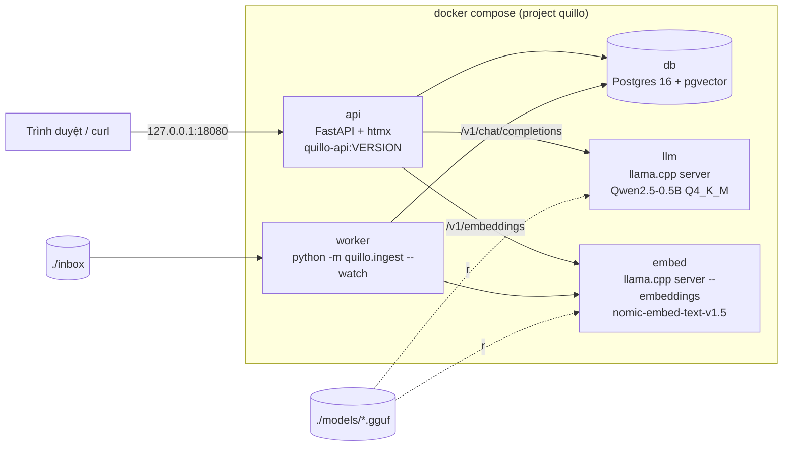

# Quillo — sản phẩm của "công ty" trong track FDE

Quillo là trợ lý hỏi đáp tài liệu nội bộ (RAG) mà "công ty" của bạn bán cho khách: khách nạp hợp đồng, quy trình,
hồ sơ (PDF/HTML/TXT), hỏi bằng ngôn ngữ tự nhiên, nhận câu trả lời **có trích dẫn** đoạn gốc. Mọi thứ chạy on-prem:
không gọi API ngoài, model nằm trong bundle. Sản phẩm là hư cấu (giấy phép MIT), là **công cụ** của các bài FDE: bạn
đóng gói, cài (air-gapped, sau proxy, trên VM bị khoá), chẩn đoán và tuỳ biến nó. Không cần đọc hết code, nhưng code
được giữ nhỏ để đọc được khi chẩn đoán.



## Bản phát hành

| Bản | Schema | Khác biệt |
| --- | --- | --- |
| `1.0.0` | 1 (`0001_init.sql`) | Tài liệu, chunk, embedding 768 chiều, hỏi đáp có trích dẫn, UI htmx, worker inbox |
| `1.1.0` | 2 (`+ 0002_v1_1_tags.sql`) | Cột `tags` cho tài liệu; `POST /api/documents` nhận field `tags` (phân tách bằng dấu phẩy) |

SSO (OIDC), ACL theo thư mục, `/metrics`, extension, Helm chart và script backup/restore (Phase 2) **không đổi schema**
nên có ở cả `1.0.0` lẫn `1.1.0` (xem các mục bên dưới).

Một cây mã nguồn dựng cả hai bản: `release.py build --version` truyền `QUILLO_VERSION` vào image và chỉ chép các
migration thuộc bản đó (`db.SCHEMA_FOR_RELEASE`). API khởi động thì chạy migration còn thiếu trong **một** transaction
có khoá advisory, ghi vào bảng `schema_migrations`; chạy lại không làm gì (idempotent). Bản cũ chạy trên schema mới hơn
(rollback) vẫn chạy được (cột `tags` có `DEFAULT`) và log cảnh báo `schema mới hơn bản đang chạy`.

## Cấu trúc

| Đường dẫn | Nội dung |
| --- | --- |
| `src/quillo/app.py` | FastAPI: `/healthz`, `/api/*`, UI (`/`, `/login`, `/ui/*`), giới hạn upload, header bảo mật, log truy cập JSON |
| `src/quillo/ingest.py` | Trích văn bản (TXT/MD/HTML/PDF qua `pypdf`), chunk ~1000 ký tự chồng 150, worker `--watch` |
| `src/quillo/rag.py` | Embed câu hỏi, tìm `top_k` chunk gần nhất (cosine, HNSW), prompt có đánh số, tách trích dẫn `[n]` |
| `src/quillo/llm.py` | Client API kiểu OpenAI (`/v1/chat/completions`, `/v1/embeddings`, `/health`) |
| `src/quillo/db.py` | Kết nối, migration, truy vấn (luôn tham số hoá) |
| `src/quillo/auth.py` | Người gọi (`User`): token tĩnh `QUILLO_ADMIN_TOKEN` (admin), access token OIDC, cookie phiên HMAC cho UI |
| `src/quillo/oidc.py` | Kiểm JWT qua JWKS (cache, xoay khoá), đăng nhập UI bằng authorization code + PKCE |
| `src/quillo/acl.py` | `QUILLO_ACL`: nhóm → tiền tố thư mục của tài liệu |
| `src/quillo/metrics.py` | `GET /metrics` (Prometheus) |
| `src/quillo/extensions.py` | Nạp extension của khách (`QUILLO_EXTENSIONS`), `ExtensionContext` |
| `src/quillo/config.py` | Đọc biến môi trường, log JSON một dòng mỗi sự kiện |
| `migrations/` | `0001_init.sql`, `0002_v1_1_tags.sql` |
| `Dockerfile`, `requirements.lock` | Image `quillo-api` (Python 3.12 slim ghim digest, pip `--require-hashes`, user 10001) |
| `compose.yaml`, `.env.example` | Triển khai một node; `compose.sso.yaml`, `compose.extensions.yaml` là tệp ghép thêm khi bật SSO/extension |
| `chart/quillo/` | Helm chart (chart version = bản phát hành); `chart/examples/` chứa values dùng cho test của chart (không nằm trong bundle) |
| `ops/backup.sh`, `ops/restore.sh` | Sao lưu/khôi phục database (compose, Podman hay `kubectl exec`) |
| `ops/models_image.py` | Dựng image `quillo-models` (cho initContainer của chart) từ chính bundle, không cần Docker |
| `REQUIREMENTS.yaml` | Yêu cầu tối thiểu của máy khách (chuẩn để bài survey/preflight so sánh) |
| `release.py` | `build` bundle offline, `verify` bundle theo `manifest.json` |
| `tests/` | Test của sản phẩm (model giả qua HTTP, Postgres thật qua `testkit.DockerLab`) |

## Chạy test

Từ **gốc repo** (môi trường chính đã có đủ thư viện; đừng `uv run` trong thư mục này, nó sẽ tạo `.venv` riêng):

```bash
uv run pytest tracks/fde/product -q
```

- LLM/embedding trong test là `tests/fake_llm.py`: server HTTP nhỏ nói đúng API của llama.cpp server, chạy trong tiến
  trình test; sản phẩm chỉ được trỏ `QUILLO_LLM_URL`/`QUILLO_EMBED_URL` sang nó, không có "chế độ giả" trong code.
- Postgres là container `pgvector/pgvector` qua `testkit.DockerLab`; mỗi test một database riêng. Thiếu Docker hay
  thiếu image thì test skip kèm lệnh `docker pull`.
- `test_release.py` dựng bundle 1.0.0 thật (build image, `docker save`, model GGUF) vào `dist/pytest-*` rồi xoá; bundle
  dựng một lần cho cả phiên test (fixture `bundle`).
- IdP OIDC trong test là `tests/fake_idp.py` (discovery, JWKS, authorize/token có PKCE, khoá RSA sinh mới mỗi lần).
  `test_keycloak_end_to_end` thì dùng Keycloak thật: `fdekit.customer_site("lab-open", extra_services=("keycloak",))`,
  cài bundle trong VM với `compose.sso.yaml`, rồi kiểm đăng nhập và ACL với token thật của các user trong realm. Thiếu
  golden/KVM/image Keycloak thì skip kèm lệnh.
- `test_chart.py` chạy `helm lint`/`helm template` trong container `alpine/helm:3.22.1` (ghim digest) với values mặc
  định và values trong `chart/examples/`.
- `test_backup.py` chạy `ops/*.sh` với `--exec "docker exec -i <container pgvector của test>"`.

## Dựng bundle offline

```bash
nice -n 15 uv run python tracks/fde/product/release.py build --version 1.0.0 --out tracks/fde/product/dist
uv run python tracks/fde/product/release.py verify tracks/fde/product/dist/quillo-1.0.0.tar
```

Cần Docker và mạng lúc build (pull image theo digest, tải model qua `fdekit.fetch_model` lần đầu). `--llm llm-medium`
đổi sang Qwen2.5-1.5B (nặng hơn ~0,6 GB, nên dùng khi khách có nhiều RAM/GPU). `dist/` nằm trong `.gitignore`.

```text
quillo-1.0.0/
├── manifest.json        {"version", "files": {đường dẫn: sha256}, "images": [ref@digest…, "quillo-api:1.0.0"],
│                         "derived": {"images/quillo-models.tar": {"sha256", "image", "from", "tool"}}}
├── compose.yaml  compose.sso.yaml  compose.extensions.yaml  .env.example  REQUIREMENTS.yaml  LICENSE
├── migrations/0001_init.sql
├── images/pgvector.tar  images/llama-cpp-server.tar  images/quillo-api.tar     (docker save, linux/amd64)
├── models/qwen2.5-0.5b-instruct-q4_k_m.gguf  models/nomic-embed-text-v1.5.Q8_0.gguf
├── chart/quillo-1.0.0.tgz                 (Helm chart, version = appVersion = 1.0.0)
└── ops/backup.sh  ops/restore.sh  ops/models_image.py
```

Image `quillo-models:<version>` cho initContainer của Helm chart **không** nằm sẵn trong bundle: nó chỉ là các layer
của `images/llama-cpp-server.tar` cộng một layer chứa `models/*.gguf`, mà cả hai đã có trong bundle; mang thêm một
bản GGUF làm bundle nặng ~1,7 GiB, vượt ngân sách và làm installer của capstone m02 hết chỗ đĩa ở lần cài thứ hai.
Người cài dựng nó tại chỗ, không cần Docker hay mạng (Python 3.8+ chuẩn), kết quả tái lập từng byte và được so với
sha256 ghi trong `manifest.json` → `derived`:

```bash
python3 ops/models_image.py . /var/tmp/quillo-models-1.0.0.tar     # chạy trong thư mục bundle đã giải nén
# → OCI archive: docker/podman load, ctr images import, hoặc đẩy lên registry nội bộ bằng skopeo/crane/regctl
```

`verify` thoát 1 khi tệp nào sai sha256, thiếu, thừa (không có trong manifest), tar bị cắt cụt, có đường dẫn
tuyệt đối/`..`/symlink, tệp nằm ngoài thư mục gốc `quillo-<version>/`, hoặc `manifest.json` ghi version khác tên thư
mục gốc. Tar không nén: layer image và GGUF vốn đã nén, gzip chỉ tốn thời gian.

Manifest nằm **trong** bundle nên chỉ bắt được hỏng hóc khi chép (tar cắt cụt, bit lỗi, thiếu tệp), không chống được
người cố ý sửa: kẻ sửa `compose.yaml` cũng sửa luôn sha trong manifest được. Muốn xác thực nguồn gốc, gửi sha256 của
chính tệp `quillo-<version>.tar` qua kênh khác (email/ticket) cho khách so, hoặc ký bundle (vd. `cosign`/GPG).

Bundle **không tái lập được từng byte**: build lại cùng bản cho ra image `quillo-api` khác digest (dấu thời gian lớp
image, attestation của buildx) và tar có mtime khác. Thứ cố định là các ref đã ghim, `requirements.lock` có hash và sha
của model; so hai bundle thì so `manifest.json` → `images`/sha của model, đừng so sha cả tệp tar.

| Thành phần (2026-11-11) | Ghim | Trong bundle |
| --- | --- | --- |
| `pgvector/pgvector:0.8.6-pg16` | `@sha256:ccc6e83d6e35…` (2026-08-13) | 156 MB |
| `ghcr.io/ggml-org/llama.cpp:server-b11718` (CPU) | `@sha256:4b7be0376002…` (2026-10-18) | 309 MB |
| `quillo-api:1.0.0` trên `python:3.12.14-slim-bookworm` | `@sha256:392307d22300…` (2026-09-19) | 65 MB |
| `qwen2.5-0.5b-instruct-q4_k_m.gguf` | `fdekit.MODELS["llm-small"]` | 491 MB |
| `nomic-embed-text-v1.5.Q8_0.gguf` | `fdekit.MODELS["embed-small"]` | 146 MB |
| `chart/quillo-1.0.0.tgz`, `ops/*` | | < 0,1 MB |
| **`quillo-1.0.0.tar`** (2026-11-11) | | **1,09 GiB** (1 168 076 800 byte; Phase 1: 1,08 GiB), ngân sách 1,5 GB |
| `quillo-models:1.0.0` dựng tại chỗ (`ops/models_image.py`, ~2 s) | layer llama.cpp + GGUF | ngoài bundle, 946 MB |

Compose dùng tên image **không kèm digest** (`pgvector/pgvector:0.8.6-pg16`): sau `docker load` image chỉ có tag, ref
`@sha256` không còn khớp trên mọi kiểu image store. Tính toàn vẹn do sha256 của `images/*.tar` trong manifest đảm bảo;
digest gốc ghi trong `manifest.json` → `images`.

## Cài từ bundle

```bash
release.py verify quillo-1.0.0.tar          # hoặc sha256sum từng tệp theo manifest.json
tar xf quillo-1.0.0.tar && cd quillo-1.0.0
for i in images/*.tar; do docker load -i "$i"; done
cp .env.example .env && chmod 600 .env       # điền QUILLO_ADMIN_TOKEN, QUILLO_DB_PASSWORD (openssl rand -hex 24)
sudo install -d -o 10001 -g 10001 -m 0750 inbox   # worker chạy uid 10001; không có sudo thì: mkdir inbox && chmod 0777 inbox
docker compose up -d --wait
curl -s http://127.0.0.1:18080/healthz
```

Cần Docker có plugin `docker compose` (v2). Gói `docker.io` của Ubuntu **không** kèm plugin này: máy có mạng thì cài
`docker-compose-v2`, máy air-gapped thì mang theo binary compose v2 độc lập. API chỉ nghe `127.0.0.1` của máy chủ;
muốn máy khác truy cập thì đặt `QUILLO_BIND` (vd. `0.0.0.0` hoặc IP nội bộ) và đặt reverse proxy TLS phía trước.

Trong VM lab (QEMU user-mode network), cổng forward của QEMU (`hostfwd`) đi vào card mạng của VM (`10.0.2.15`), không
vào `127.0.0.1` của VM, nên bài cài đặt/installer đặt `QUILLO_BIND=0.0.0.0` trong VM; cổng đó vẫn chỉ mở trên
`127.0.0.1` của máy host.

Worker kiểm lúc khởi động rằng `inbox/`, `inbox/done/`, `inbox/failed/` ghi được với uid 10001; không được thì thoát mã
2 với thông báo rõ (container sẽ restart lặp lại, `docker compose logs worker` cho thấy lý do).

| Biến (`.env`) | Mặc định | Ý nghĩa |
| --- | --- | --- |
| `QUILLO_VERSION` | bản của bundle | tag `quillo-api` dùng để chạy; nâng cấp = nạp image mới rồi đổi biến này |
| `QUILLO_ADMIN_TOKEN` | (bắt buộc) | token cho API (`Authorization: Bearer …`) và trang đăng nhập; ≥ 16 ký tự |
| `QUILLO_DB_PASSWORD` | (bắt buộc) | mật khẩu Postgres; chỉ chữ và số (nằm trong URL kết nối) |
| `QUILLO_BIND`, `QUILLO_PORT` | `127.0.0.1`, `18080` | địa chỉ/cổng publish phía host của `api` (dịch vụ khác không publish cổng) |
| `QUILLO_MAX_UPLOAD_MB` | `20` | giới hạn mỗi tệp (API trả 413) |
| `QUILLO_LLM_FILE`, `QUILLO_LLM_MODEL` | Qwen2.5-0.5B, `llm-small` | tệp GGUF trong `./models` và tên model trả về trong `/api/ask` |
| `QUILLO_LLM_THREADS`, `QUILLO_EMBED_THREADS` | `2` | số luồng CPU của llama.cpp |
| `QUILLO_LOG_LEVEL` | `INFO` | log JSON ra stdout (`docker compose logs api`) |
| `QUILLO_ACL` | (rỗng) | `nhóm:thư_mục[,nhóm:thư_mục…]`, xem mục SSO và ACL |
| `QUILLO_OIDC_ISSUER`, `QUILLO_OIDC_CLIENT_ID` | (rỗng) | đặt issuer là bật SSO; dùng cùng `compose.sso.yaml` |
| `QUILLO_OIDC_CLIENT_SECRET_FILE` | `compose.sso.yaml` đặt | **tệp** chứa client secret (`./oidc/client-secret`); không có biến chứa secret trực tiếp |
| `QUILLO_OIDC_GROUPS_CLAIM` | `groups` | claim trong token chứa danh sách nhóm |
| `QUILLO_OIDC_CA_FILE` | (rỗng) | CA của IdP khi IdP dùng chứng chỉ của CA nội bộ (vd. `/etc/quillo/oidc/ca.pem`) |
| `QUILLO_EXTENSIONS`, `QUILLO_EXTENSIONS_PATH` | (rỗng) | module extension và thư mục chứa chúng; dùng cùng `compose.extensions.yaml` |

## API

| Phương thức | Đường dẫn | Auth | Trả về |
| --- | --- | --- | --- |
| GET | `/healthz` | không | `{"status": "ok", "version": "1.0.0", "checks": {"db", "llm", "embed"}}`; 503 + `"degraded"` khi một check false |
| GET | `/metrics` | không | chỉ số Prometheus (text format 0.0.4) |
| GET | `/api/me` | token | `{"user", "groups", "admin"}`: quillo thấy người gọi là ai, thuộc nhóm nào (chẩn đoán SSO) |
| POST | `/api/documents` | token | multipart `file` (+ `folder`, + `tags` từ 1.1.0) → 201 `{"doc_id", "filename", "chunks"}`; 403/413/415/422 |
| GET | `/api/documents` | token | danh sách tài liệu người gọi được xem |
| POST | `/api/ask` | token | `{"question", "top_k": 4}` → `{"answer", "citations": [{"doc_id", "chunk", "text"}], "model"}` |
| GET | `/`, `/login` | cookie | UI htmx (htmx 2.0.11 vendor trong `static/`, không CDN) |
| GET | `/oidc/login`, `/oidc/callback` | không | đăng nhập SSO (authorization code + PKCE); 404 khi chưa bật OIDC |

"token" là `Authorization: Bearer <QUILLO_ADMIN_TOKEN>` (admin) hoặc `Bearer <access token OIDC>` khi bật SSO.

`doc_id` là 16 ký tự đầu sha256 của nội dung: nạp lại cùng tệp thì thay bản cũ. Worker nạp tệp thả vào `./inbox`
(chuyển sang `inbox/done/` hoặc `inbox/failed/`, trùng tên thì thêm hậu tố `-1`, `-2`…). Tệp sửa đổi chưa quá 2 chu kỳ
quét (mặc định 10 s) được coi là đang chép dở và chờ lượt sau; symlink, FIFO, thiết bị bị chuyển vào `failed/` mà không
đọc (mở bằng `O_NOFOLLOW` rồi `fstat` trên chính fd). Không kết nối được llm/embed hay database thì để nguyên tệp và
thử lại, chờ lùi dần tới 60 s. Model server trả 5xx cho một tệp thì tệp đó được thử lại ở các lượt sau, quá 5 lần thì
vào `failed/`; 4xx hay lỗi dữ liệu (SQLSTATE lớp 22/23/54) thì vào `failed/` ngay. Một tệp hỏng không chặn các tệp xếp
sau nó. Lỗi khác của database (sai mật khẩu 28P01, hết kết nối 53300, timeout 57014…) được coi là sự cố hạ tầng: tệp
ở lại, worker chờ rồi thử lại, không đẩy cả inbox vào `failed/`. Nạp xong mà không chuyển được vào `done/` (hay không
chuyển được vào `failed/`) thì tệp ở lại inbox và bị bỏ qua tới khi nó đổi (tên, inode hoặc mtime khác): thả lại tệp
cùng tên vẫn được nạp.

Giới hạn đã biết: tệp **luôn** gây lỗi kết nối (vd. tài liệu rất lớn làm embed vượt timeout, `ReadTimeout`) bị coi là
sự cố hạ tầng và giữ cả hàng đợi. Log `dịch vụ không với tới…` ghi tên tệp; người vận hành chuyển tệp đó ra khỏi
`inbox` bằng tay (hoặc cắt nhỏ) rồi worker chạy tiếp. Câu trả lời trích `[n]` thì `citations` là các đoạn được trích; model không trích thì trả mọi đoạn đã đưa vào prompt.

## SSO (OIDC) và ACL theo thư mục

```mermaid
sequenceDiagram
    participant U as Người dùng / script
    participant IdP as IdP của khách (Keycloak, AD FS…)
    participant Q as quillo api
    participant DB as Postgres
    U->>IdP: đăng nhập (UI: authorization code + PKCE qua /oidc/login)
    IdP-->>U: access token JWT (iss, aud/azp, exp, groups)
    U->>Q: POST /api/ask, Authorization: Bearer JWT
    Q->>IdP: discovery + JWKS (cache; tải lại khi gặp kid lạ)
    Q->>Q: kiểm chữ ký, iss, aud/azp, exp (lệch tối đa 60 s) → nhóm
    Q->>DB: tìm top_k đoạn WHERE đường dẫn bắt đầu bằng thư mục của nhóm
    Q-->>U: câu trả lời + trích dẫn chỉ từ thư mục được xem
```

- Bật bằng `QUILLO_OIDC_ISSUER`, `QUILLO_OIDC_CLIENT_ID` và tệp client secret (`QUILLO_OIDC_CLIENT_SECRET_FILE`). Đặt
  thiếu một trong ba thì api không khởi động và nói thiếu gì. Issuer phải khớp đúng chuỗi `issuer` trong discovery của
  IdP và claim `iss` của token (kể cả `http`/`https`, cổng, đường dẫn realm).
- API nhận `Authorization: Bearer <JWT>`: chữ ký kiểm bằng khoá trong JWKS (chỉ RS*/PS*/ES*, không nhận `none` hay
  HS*), `iss` đúng issuer, `aud` chứa client id hoặc `azp` là client id, `exp` còn hạn (lệch đồng hồ tối đa 60 s), có
  `sub`. Token bị từ chối thì 401 và log `token OIDC bị từ chối` kèm lý do. IdP không với tới (chưa từng tải được
  JWKS) thì 503 `IdP (OIDC) không phản hồi`.
- UI: `/login` có thêm link SSO; `/oidc/login` chuyển sang IdP với `state`, `nonce`, `code_challenge` (S256), các giá
  trị chờ nằm trong cookie ký HMAC (SameSite=Lax, 10 phút); `/oidc/callback` đổi code lấy token, kiểm ID token (`aud`,
  `nonce`) rồi cấp cookie phiên 8 giờ mang tên và nhóm lúc đăng nhập. `redirect_uri` là `<URL quillo>/oidc/callback`
  (sau reverse proxy thì chạy uvicorn với `--proxy-headers`); IdP phải cho phép đúng URL này.
- Nhóm lấy từ claim `QUILLO_OIDC_GROUPS_CLAIM` (mặc định `groups`); `/legal` (Keycloak "full path") được hiểu là
  `legal`. Xem `GET /api/me` để biết quillo thấy người gọi là ai, thuộc nhóm nào.
- `QUILLO_ACL="legal:legal/,finance:finance/"`: nhóm `legal` xem tài liệu có đường dẫn bắt đầu bằng `legal/`. Đường
  dẫn tài liệu là đường dẫn tương đối: worker giữ thư mục con trong inbox (`inbox/legal/nda-01.pdf` → `legal/nda-01.pdf`,
  chuyển xong vào `done/legal/`, sâu tối đa 8 cấp), upload qua API/UI nhận field `folder`. Mỗi phần của đường dẫn được
  làm sạch như tên tệp (mỗi đoạn ký tự ngoài `A-Za-z0-9._ -` thành một `_`); `QUILLO_ACL` so tiền tố với đường dẫn
  đã lưu, mà `GET /api/documents` (token quản trị) cho thấy. Tài liệu không khớp thư mục nào (kể cả tài liệu
  ở gốc inbox) **chỉ admin thấy**. ACL nằm trong chính câu truy vấn vector (`WHERE` + HNSW quét tiếp tới khi đủ
  `top_k`), không lọc sau khi đã lấy `top_k`, nên vừa không lộ đoạn của nhóm khác (kể cả vào prompt của LLM) vừa không
  trả thiếu đoạn. Người dùng SSO chỉ upload được vào thư mục mình xem được (403), kể cả khi nội dung trùng một
  tài liệu ở thư mục khác (cùng nội dung là cùng `doc_id`, nạp lại sẽ chuyển tài liệu đó sang thư mục mới).
- Token tĩnh `QUILLO_ADMIN_TOKEN` vẫn chạy và là admin (thấy mọi tài liệu); giữ nó như mật khẩu root.

Ví dụ (compose):

```bash
sudo install -d -o 10001 -g 10001 -m 0700 oidc
printf '%s' "$CLIENT_SECRET" | sudo install -o 10001 -g 10001 -m 0400 /dev/stdin oidc/client-secret
cat >> .env <<'ENV'
QUILLO_OIDC_ISSUER=https://sso.lawfirm.example/realms/lawfirm
QUILLO_OIDC_CLIENT_ID=quillo
QUILLO_ACL=legal:legal/,finance:finance/
ENV
docker compose -f compose.yaml -f compose.sso.yaml up -d
curl -s -H "Authorization: Bearer $ACCESS_TOKEN" http://127.0.0.1:18080/api/me
```

## `/metrics`

Không cần auth, chỉ có số đếm: `quillo_requests_total{route,status}` (route là mẫu đường dẫn như `/api/ask`, URL lạ
gom vào `unmatched`), `quillo_ask_seconds` (histogram thời gian trả lời `/api/ask`, `/ui/ask` thành công), `quillo_documents`,
`quillo_chunks` (đếm lúc scrape; database không trả lời thì `NaN`), `quillo_model_up{kind="llm"|"embed"}` (1 khi model
server trả `/health` 200). Compose chỉ publish cổng api trên `127.0.0.1`, nên Prometheus của khách cần đi qua reverse
proxy hoặc chạy cùng máy; trên Kubernetes thì scrape Service `<release>-api` cổng 8080.

## Extension

`QUILLO_EXTENSIONS=acme.report` nạp module `acme.report` từ `QUILLO_EXTENSIONS_PATH` (chỉ từ thư mục đó; tên trùng
module của Python hay `quillo` bị từ chối) và gọi `register(app, ctx)` lúc api khởi động:

```python
from fastapi import Depends


def register(app, ctx):
    @app.get("/ext/acme/report")
    def report(user=Depends(ctx.require_user)):
        rows = ctx.db_query("SELECT count(*) AS n FROM documents WHERE filename LIKE %s", ("legal/%",))
        return ctx.templates.get_template("report.html").render(n=rows[0]["n"], user=user.name)
```

`ExtensionContext`: `settings`; `ask(question, top_k, user)` (như `/api/ask`, áp ACL của `user`); `db_query(sql,
params)` (đúng **một** câu lệnh, transaction **chỉ đọc**, timeout 5 s, trả list dict, **không** áp ACL); `templates` (Jinja tìm trong
`<thư mục module>/templates` trước, rồi template của quillo); `require_user` (dependency trả `User`, 401 khi chưa
đăng nhập). Extension không import được, thiếu `register` hay `register` ném lỗi thì **api không lên**, log
`không nạp được extension <tên>` kèm lỗi.

Extension là mã **tin cậy** chạy trong tiến trình api: nó thấy `settings` (kể cả token admin, client secret) và kết
nối database bằng user của quillo (trong compose là superuser của Postgres). Chế độ chỉ đọc của `db_query` chỉ chặn
lỗi vô ý trong mã extension, **không** phải ranh giới bảo mật (vd. `COPY … TO PROGRAM`, `pg_read_file` vẫn chạy được
trong transaction chỉ đọc). Chỉ nạp extension đã review; khách cần cô lập hơn thì cho extension kết nối bằng một role
Postgres riêng chỉ có quyền `SELECT`. Compose: đặt mã trong `./extensions`, chạy với `-f compose.extensions.yaml`.

## Helm chart

`chart/quillo-<version>.tgz` trong bundle (nguồn: `chart/quillo/`). Cài: `helm upgrade --install quillo
chart/quillo-1.0.0.tgz -n quillo -f values-<khách>.yaml`.

| Value | Mặc định | Ý nghĩa |
| --- | --- | --- |
| `image.registry` | `""` | registry nội bộ; có thì ảnh là `<registry>/quillo-api:<version>`, `<registry>/pgvector/pgvector:…`, `<registry>/ggml-org/llama.cpp:…`, `<registry>/quillo-models:<version>` |
| `image.pullPolicy` | `IfNotPresent` | |
| `podSecurityContext`, `containerSecurityContext` | `{}` | chung cho mọi pod/container (kể cả initContainer); `<api|worker|db|llm|embed>.podSecurityContext` đè riêng |
| `resources` | `{}` | theo thành phần: `resources.api`, `.worker`, `.db`, `.llm`, `.embed`, `.models` (initContainer) |
| `networkPolicy.enabled` | `false` | NetworkPolicy cho đúng các luồng api→db/llm/embed, worker→db/embed, DNS; `apiFrom`, `apiExtraEgress` (vd. tới IdP) |
| `oidc.issuer`, `oidc.clientId`, `oidc.existingSecret`, `oidc.secretKey`, `oidc.groupsClaim`, `oidc.caConfigMap` | tắt | client secret lấy từ Secret có sẵn (tạo từ tệp), không nằm trong values |
| `acl` | `""` | như `QUILLO_ACL` |
| `extensions.configMap`, `extensions.items`, `extensions.modules` | tắt | mã extension từ ConfigMap, mount vào `/opt/quillo/extensions` |
| `persistence.size`, `persistence.inboxSize`, `persistence.storageClass` | `5Gi`, `1Gi`, mặc định của cluster | PVC của db (StatefulSet) và inbox của worker |
| `models.*` | GGUF của bundle | initContainer chép GGUF từ `quillo-models:<version>` (dựng bằng `ops/models_image.py`) vào emptyDir của pod llm/embed |
| `auth.existingSecret` | `""` | Secret có `admin-token`, `db-password`; rỗng thì chart tạo `<release>-auth` một lần (giữ qua upgrade, không xoá khi uninstall) |

Mỗi khách một tệp values riêng, điền các khoá trên theo cluster đích; `helm show values` in đủ values mặc định.

## Backup và restore

```bash
ops/backup.sh /backup/quillo                    # trong thư mục cài đặt compose; in đường dẫn tệp .dump
ops/restore.sh /backup/quillo/quillo-20261111T090000Z.dump            # từ chối nếu DB đang có tài liệu
ops/restore.sh --force /backup/quillo/quillo-20261111T090000Z.dump    # ghi đè (dừng api/worker trước)
COMPOSE="podman compose" ops/backup.sh /backup/quillo                 # Podman
ops/backup.sh --kubectl -n quillo /backup/quillo                       # kubectl exec vào statefulset/quillo-db
```

`backup.sh` chạy `pg_dump -Fc` **trong** container db (không cần cài client Postgres trên máy), ghi `.dump` và
`.dump.sha256`, kiểm lại bằng `pg_restore --list`, và từ chối khi đĩa trống ở đích nhỏ hơn 2 lần `pg_database_size`.
`restore.sh` kiểm sha256 trước, từ chối khi database đang có tài liệu trừ khi `--force`, rồi `pg_restore --clean
--if-exists --single-transaction` (lỗi giữa chừng thì database giữ nguyên). Đích k8s khác thì đặt `QUILLO_DB_TARGET`
(vd. `statefulset/acme-db`), runtime khác hẳn thì `--exec "<tiền tố chạy lệnh trong container db, nhận stdin>"`.

## Bảo mật (Phase 1)

- Token so sánh bằng `hmac.compare_digest`. Cookie phiên `<thời điểm cấp>.<HMAC(token, "v1:<thời điểm cấp>")>`
  (HttpOnly, SameSite=Strict): không chứa token, server từ chối khi quá 8 giờ kể từ lúc cấp hoặc chữ ký sai. Đổi token
  = mọi phiên cũ mất hiệu lực (kể cả phiên SSO, ký cùng khoá). OIDC: xem mục SSO ở trên.
- Upload phải có `Content-Length`; mọi POST bị chặn kích thước trước khi parse (trước cả kiểm token): upload tối đa
  `QUILLO_MAX_UPLOAD_MB`, các POST khác 64 KB. Upload chỉ nhận `.pdf .html .htm .txt .md`, tên tệp được làm sạch (bỏ thư
  mục, ký tự lạ, `-`/`.` đầu tên, tối đa 200 ký tự); không ghi tệp upload ra đĩa theo tên gốc. `tags`: tối đa 20, mỗi tag
  tối đa 64 ký tự.
- `/healthz` kiểm db/llm/embed song song: llm/embed tối đa 1,5 s, db tối đa ~3,5 s (`connect_timeout` 2 s, mức thấp
  nhất libpq cho phép, cộng `statement_timeout` 1,5 s), nên luôn trả trong thời hạn 5 s của HEALTHCHECK.
- UI: request htmx (`HX-Request`) hết phiên nhận 401 kèm `HX-Redirect: /login`.
- SQL luôn tham số hoá; template Jinja tự escape; CSP `default-src 'self'`, `nosniff`, `frame-ancestors 'none'`.
- Container `api`/`worker` chạy uid 10001, root filesystem chỉ đọc, `no-new-privileges`; `llm`/`embed` chạy uid 65534,
  model mount chỉ đọc. Chỉ `api` publish cổng, mặc định chỉ `127.0.0.1`.
- Bundle và image không chứa bí mật: `.env.example` để trống token/mật khẩu, compose từ chối chạy khi thiếu (`:?`),
  app từ chối token ngắn hơn 16 ký tự.

Còn lại (biết rõ, chưa xử lý ở Phase 1):

- `/logout` không cần phiên: nó chỉ xoá cookie ở trình duyệt, không thu hồi phiên phía server (phiên tự hết sau 8 giờ;
  muốn thu hồi tất cả thì đổi `QUILLO_ADMIN_TOKEN`). Không có giới hạn số lần đăng nhập sai.
- SameSite tính theo *site* (host), không theo cổng: ứng dụng khác chạy cùng host ở cổng khác vẫn là "same-site" với
  quillo. Đừng chạy ứng dụng không tin cậy cùng hostname.
- Cờ `Secure` của cookie chỉ bật khi request là https. Đặt sau reverse proxy TLS thì phải chạy uvicorn với
  `--proxy-headers --forwarded-allow-ips=<IP proxy>` để app thấy `https`, nếu không cookie đi được qua http thường.
- Prompt injection: nội dung tài liệu được đưa thẳng vào prompt, tài liệu độc có thể lái câu trả lời. Đây là bề mặt
  tấn công để dành cho module 09 (đánh giá và an toàn LLM).

## Số đo (2026-11-04)

Host: laptop của repo (16 core, NVMe, Docker 29.9.2). VM: hồ sơ `lab-open` (Ubuntu 22.04, 2 vCPU, 5120 MB, Docker
29.1.3 và `docker-compose-v2` 2.40.3 từ kho Ubuntu có sẵn trong golden; lần đo sau vòng sửa 1, `inbox` tạo bằng
`sudo install -o 10001`).

| Việc | Host | VM `lab-open` |
| --- | --- | --- |
| `release.py build --version 1.0.0` (image đã cache) | ~6 s | — |
| `release.py verify` (1,08 GiB) | ~1 s | — |
| `scp` bundle vào VM | — | 3,1 s |
| `tar xf` + kiểm sha256 theo manifest | — | 1,9 s |
| `docker load` 3 image | (đã có sẵn) | 14,6 s |
| `docker compose up -d --wait` tới khi mọi dịch vụ healthy | 13,1 s | 12,6 s |
| **load + up** (mục tiêu ≤ 180 s) | — | **27,2 s** |
| Nạp một hợp đồng CUAD ~15 KB (17–18 chunk) | 4,4–4,7 s | 4,8 s |
| `/api/ask` "What is the governing law?" (top_k 4, CPU, 2 luồng) | 4,2 s | 4,1 s |
| Nâng cấp tại chỗ 1.0.0 → 1.1.0 (đổi `QUILLO_VERSION`, `up -d --wait`, migration 0002) | 8 s | — |

RAM khi chạy rảnh trong VM: llm ~173 MiB, embed ~67 MiB, api ~49 MiB, worker ~27 MiB, db ~33 MiB (model GGUF được
mmap nên phần lớn nằm ở page cache).

Mẫu chất lượng (host, 3 hợp đồng CUAD: PFSFUNDS services — Massachusetts, CENTRACK hosting — Florida, LUCID distributor
PDF — New York): "What is the governing law?" → *"The governing law is the laws of the State of New York, USA."*;
với `top_k` 6, hai đoạn đầu là đúng hai điều khoản Governing Law (Florida, New York). Model 0.5B chỉ chọn một đáp án
khi câu hỏi mơ hồ giữa nhiều hợp đồng và hiếm khi tự trích `[n]`: đây là giới hạn đã biết của `llm-small`, hỏi cụ thể
theo hợp đồng ("…the distributor agreement with Lucid?") hoặc dùng `llm-medium` cho câu trả lời tốt hơn.
