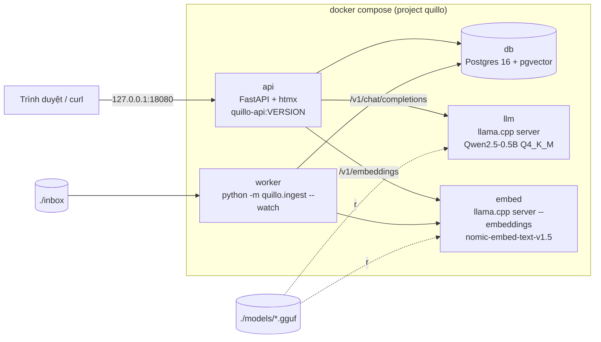

# Quillo — sản phẩm của "công ty" trong track FDE

Quillo là trợ lý hỏi đáp tài liệu nội bộ (RAG) mà "công ty" của bạn bán cho khách: khách nạp hợp đồng, quy trình,
hồ sơ (PDF/HTML/TXT), hỏi bằng ngôn ngữ tự nhiên, nhận câu trả lời **có trích dẫn** đoạn gốc. Mọi thứ chạy on-prem:
không gọi API ngoài, model nằm trong bundle. Sản phẩm là hư cấu (giấy phép MIT), là **công cụ** của các bài FDE: bạn
đóng gói, cài (air-gapped, sau proxy, trên VM bị khoá), chẩn đoán và tuỳ biến nó. Không cần đọc hết code, nhưng code
được giữ nhỏ để đọc được khi chẩn đoán.



## Bản phát hành

| Bản | Schema | Khác biệt |
| --- | --- | --- |
| `1.0.0` | 1 (`0001_init.sql`) | Tài liệu, chunk, embedding 768 chiều, hỏi đáp có trích dẫn, UI htmx, worker inbox |
| `1.1.0` | 2 (`+ 0002_v1_1_tags.sql`) | Cột `tags` cho tài liệu; `POST /api/documents` nhận field `tags` (phân tách bằng dấu phẩy) |

Một cây mã nguồn dựng cả hai bản: `release.py build --version` truyền `QUILLO_VERSION` vào image và chỉ chép các
migration thuộc bản đó (`db.SCHEMA_FOR_RELEASE`). API khởi động thì chạy migration còn thiếu trong **một** transaction
có khoá advisory, ghi vào bảng `schema_migrations`; chạy lại không làm gì (idempotent). Bản cũ chạy trên schema mới hơn
(rollback) vẫn chạy được (cột `tags` có `DEFAULT`) và log cảnh báo `schema mới hơn bản đang chạy`.

## Cấu trúc

| Đường dẫn | Nội dung |
| --- | --- |
| `src/quillo/app.py` | FastAPI: `/healthz`, `/api/*`, UI (`/`, `/login`, `/ui/*`), giới hạn upload, header bảo mật, log truy cập JSON |
| `src/quillo/ingest.py` | Trích văn bản (TXT/MD/HTML/PDF qua `pypdf`), chunk ~1000 ký tự chồng 150, worker `--watch` |
| `src/quillo/rag.py` | Embed câu hỏi, tìm `top_k` chunk gần nhất (cosine, HNSW), prompt có đánh số, tách trích dẫn `[n]` |
| `src/quillo/llm.py` | Client API kiểu OpenAI (`/v1/chat/completions`, `/v1/embeddings`, `/health`) |
| `src/quillo/db.py` | Kết nối, migration, truy vấn (luôn tham số hoá) |
| `src/quillo/auth.py` | Token tĩnh `QUILLO_ADMIN_TOKEN` (so sánh constant-time), cookie phiên HMAC cho UI |
| `src/quillo/config.py` | Đọc biến môi trường, log JSON một dòng mỗi sự kiện |
| `migrations/` | `0001_init.sql`, `0002_v1_1_tags.sql` |
| `Dockerfile`, `requirements.lock` | Image `quillo-api` (Python 3.12 slim ghim digest, pip `--require-hashes`, user 10001) |
| `compose.yaml`, `.env.example` | Triển khai một node |
| `REQUIREMENTS.yaml` | Yêu cầu tối thiểu của máy khách (chuẩn để bài survey/preflight so sánh) |
| `release.py` | `build` bundle offline, `verify` bundle theo `manifest.json` |
| `tests/` | Test của sản phẩm (model giả qua HTTP, Postgres thật qua `testkit.DockerLab`) |

## Chạy test

Từ **gốc repo** (môi trường chính đã có đủ thư viện; đừng `uv run` trong thư mục này, nó sẽ tạo `.venv` riêng):

```bash
uv run pytest tracks/fde/product -q
```

- LLM/embedding trong test là `tests/fake_llm.py`: server HTTP nhỏ nói đúng API của llama.cpp server, chạy trong tiến
  trình test; sản phẩm chỉ được trỏ `QUILLO_LLM_URL`/`QUILLO_EMBED_URL` sang nó, không có "chế độ giả" trong code.
- Postgres là container `pgvector/pgvector` qua `testkit.DockerLab`; mỗi test một database riêng. Thiếu Docker hay
  thiếu image thì test skip kèm lệnh `docker pull`.
- `test_release.py` dựng bundle 1.0.0 thật (build image, `docker save`, model GGUF) vào `dist/pytest-*` rồi xoá.

## Dựng bundle offline

```bash
nice -n 15 uv run python tracks/fde/product/release.py build --version 1.0.0 --out tracks/fde/product/dist
uv run python tracks/fde/product/release.py verify tracks/fde/product/dist/quillo-1.0.0.tar
```

Cần Docker và mạng lúc build (pull image theo digest, tải model qua `fdekit.fetch_model` lần đầu). `--llm llm-medium`
đổi sang Qwen2.5-1.5B (nặng hơn ~0,6 GB, nên dùng khi khách có nhiều RAM/GPU). `dist/` nằm trong `.gitignore`.

```text
quillo-1.0.0/
├── manifest.json        {"version", "files": {đường dẫn: sha256}, "images": [ref@digest…, "quillo-api:1.0.0"]}
├── compose.yaml  .env.example  REQUIREMENTS.yaml  LICENSE
├── migrations/0001_init.sql
├── images/pgvector.tar  images/llama-cpp-server.tar  images/quillo-api.tar     (docker save, linux/amd64)
└── models/qwen2.5-0.5b-instruct-q4_k_m.gguf  models/nomic-embed-text-v1.5.Q8_0.gguf
```

`verify` thoát 1 khi tệp nào sai sha256, thiếu, thừa (không có trong manifest), tar bị cắt cụt, hoặc có đường dẫn
tuyệt đối/`..`/symlink. Tar không nén: layer image và GGUF vốn đã nén, gzip chỉ tốn thời gian.

| Thành phần (2026-11-04) | Ghim | Trong bundle |
| --- | --- | --- |
| `pgvector/pgvector:0.8.6-pg16` | `@sha256:ccc6e83d6e35…` (2026-08-13) | 156 MB |
| `ghcr.io/ggml-org/llama.cpp:server-b11718` (CPU) | `@sha256:4b7be0376002…` (2026-10-18) | 309 MB |
| `quillo-api:1.0.0` trên `python:3.12.14-slim-bookworm` | `@sha256:392307d22300…` (2026-09-19) | 59 MB |
| `qwen2.5-0.5b-instruct-q4_k_m.gguf` | `fdekit.MODELS["llm-small"]` | 491 MB |
| `nomic-embed-text-v1.5.Q8_0.gguf` | `fdekit.MODELS["embed-small"]` | 146 MB |
| **`quillo-1.0.0.tar`** | | **1,08 GiB** (1 162 219 520 byte), ngân sách 1,5 GB |

Compose dùng tên image **không kèm digest** (`pgvector/pgvector:0.8.6-pg16`): sau `docker load` image chỉ có tag, ref
`@sha256` không còn khớp trên mọi kiểu image store. Tính toàn vẹn do sha256 của `images/*.tar` trong manifest đảm bảo;
digest gốc ghi trong `manifest.json` → `images`.

## Cài từ bundle

```bash
release.py verify quillo-1.0.0.tar          # hoặc sha256sum từng tệp theo manifest.json
tar xf quillo-1.0.0.tar && cd quillo-1.0.0
for i in images/*.tar; do docker load -i "$i"; done
cp .env.example .env && chmod 600 .env       # điền QUILLO_ADMIN_TOKEN, QUILLO_DB_PASSWORD (openssl rand -hex 24)
mkdir -p inbox
docker compose up -d --wait
curl -s http://127.0.0.1:18080/healthz
```

Cần Docker có plugin `docker compose` (v2). Gói `docker.io` của Ubuntu **không** kèm plugin này (cài thêm
`docker-compose-v2` hoặc mang theo binary). API chỉ nghe `127.0.0.1` của máy chủ; muốn máy khác truy cập thì đặt
`QUILLO_BIND` (vd. `0.0.0.0` hoặc IP nội bộ) và đặt reverse proxy TLS phía trước.

| Biến (`.env`) | Mặc định | Ý nghĩa |
| --- | --- | --- |
| `QUILLO_VERSION` | bản của bundle | tag `quillo-api` dùng để chạy; nâng cấp = nạp image mới rồi đổi biến này |
| `QUILLO_ADMIN_TOKEN` | (bắt buộc) | token cho API (`Authorization: Bearer …`) và trang đăng nhập; ≥ 16 ký tự |
| `QUILLO_DB_PASSWORD` | (bắt buộc) | mật khẩu Postgres; chỉ chữ và số (nằm trong URL kết nối) |
| `QUILLO_BIND`, `QUILLO_PORT` | `127.0.0.1`, `18080` | địa chỉ/cổng publish phía host của `api` (dịch vụ khác không publish cổng) |
| `QUILLO_MAX_UPLOAD_MB` | `20` | giới hạn mỗi tệp (API trả 413) |
| `QUILLO_LLM_FILE`, `QUILLO_LLM_MODEL` | Qwen2.5-0.5B, `llm-small` | tệp GGUF trong `./models` và tên model trả về trong `/api/ask` |
| `QUILLO_LLM_THREADS`, `QUILLO_EMBED_THREADS` | `2` | số luồng CPU của llama.cpp |
| `QUILLO_LOG_LEVEL` | `INFO` | log JSON ra stdout (`docker compose logs api`) |

## API

| Phương thức | Đường dẫn | Auth | Trả về |
| --- | --- | --- | --- |
| GET | `/healthz` | không | `{"status": "ok", "version": "1.0.0", "checks": {"db", "llm", "embed"}}`; 503 + `"degraded"` khi một check false |
| POST | `/api/documents` | token | multipart `file` (+ `tags` từ 1.1.0) → 201 `{"doc_id", "filename", "chunks"}`; 413/415/422 |
| GET | `/api/documents` | token | danh sách tài liệu |
| POST | `/api/ask` | token | `{"question", "top_k": 4}` → `{"answer", "citations": [{"doc_id", "chunk", "text"}], "model"}` |
| GET | `/`, `/login` | cookie | UI htmx (htmx 2.0.11 vendor trong `static/`, không CDN) |

`doc_id` là 16 ký tự đầu sha256 của nội dung: nạp lại cùng tệp thì thay bản cũ. Worker nạp tệp thả vào `./inbox`
(chuyển sang `inbox/done/` hoặc `inbox/failed/`); container chạy uid 10001 nên thư mục `inbox` phải ghi được với uid
đó. Câu trả lời trích `[n]` thì `citations` là các đoạn được trích; model không trích thì trả mọi đoạn đã đưa vào prompt.

## Bảo mật (Phase 1)

- Token so sánh bằng `hmac.compare_digest`; cookie phiên là HMAC của token (HttpOnly, SameSite=Strict, 8 giờ), không
  chứa token. Đổi token = mọi phiên cũ mất hiệu lực; đăng xuất chỉ xoá cookie phía trình duyệt. OIDC thêm ở Phase 2.
- Upload: kiểm `Content-Length` trước khi đọc body, giới hạn kích thước, chỉ nhận `.pdf .html .htm .txt .md`, tên tệp
  được làm sạch (bỏ thư mục, ký tự lạ, `-`/`.` đầu tên, tối đa 200 ký tự); không ghi tệp upload ra đĩa theo tên gốc.
- SQL luôn tham số hoá; template Jinja tự escape; CSP `default-src 'self'`, `nosniff`, `frame-ancestors 'none'`.
- Container `api`/`worker` chạy uid 10001, root filesystem chỉ đọc, `no-new-privileges`; `llm`/`embed` chạy uid 65534,
  model mount chỉ đọc. Chỉ `api` publish cổng, mặc định chỉ `127.0.0.1`.
- Bundle và image không chứa bí mật: `.env.example` để trống token/mật khẩu, compose từ chối chạy khi thiếu (`:?`),
  app từ chối token ngắn hơn 16 ký tự.

## Số đo (2026-11-04)

Host: laptop của repo (16 core, NVMe, Docker 29.9.2). VM: hồ sơ `lab-open` (Ubuntu 22.04, 2 vCPU, 5120 MB, Docker
29.1.3 từ kho Ubuntu, `docker-compose-v2` 2.40.3 cài bằng apt).

| Việc | Host | VM `lab-open` |
| --- | --- | --- |
| `release.py build --version 1.0.0` (image đã cache) | ~6 s | — |
| `release.py verify` (1,08 GiB) | ~1 s | — |
| `scp` bundle vào VM | — | 3,4 s |
| `tar xf` + kiểm sha256 theo manifest | — | 2,8 s |
| `docker load` 3 image | (đã có sẵn) | 14,0 s |
| `docker compose up -d --wait` tới khi mọi dịch vụ healthy | 13,1 s | 12,7 s |
| **load + up** (mục tiêu ≤ 180 s) | — | **26,8 s** |
| Nạp một hợp đồng CUAD ~15 KB (17–18 chunk) | 4,4–4,7 s | 4,7 s |
| `/api/ask` "What is the governing law?" (top_k 4, CPU, 2 luồng) | 4,2 s | 4,0 s |
| Nâng cấp tại chỗ 1.0.0 → 1.1.0 (đổi `QUILLO_VERSION`, `up -d --wait`, migration 0002) | 8 s | — |

RAM khi chạy rảnh trong VM: llm ~184 MiB, embed ~94 MiB, api ~48 MiB, worker ~29 MiB, db ~33 MiB (model GGUF được
mmap nên phần lớn nằm ở page cache).

Mẫu chất lượng (host, 3 hợp đồng CUAD: PFSFUNDS services — Massachusetts, CENTRACK hosting — Florida, LUCID distributor
PDF — New York): "What is the governing law?" → *"The governing law is the laws of the State of New York, USA."*;
với `top_k` 6, hai đoạn đầu là đúng hai điều khoản Governing Law (Florida, New York). Model 0.5B chỉ chọn một đáp án
khi câu hỏi mơ hồ giữa nhiều hợp đồng và hiếm khi tự trích `[n]`: đây là giới hạn đã biết của `llm-small`, hỏi cụ thể
theo hợp đồng ("…the distributor agreement with Lucid?") hoặc dùng `llm-medium` cho câu trả lời tốt hơn.
