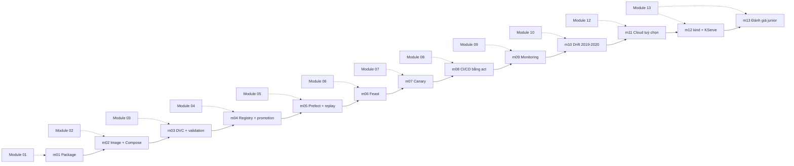

# Lộ trình MLOps

Lộ trình tự học MLOps bám theo [roadmap.sh/mlops](https://roadmap.sh/mlops). Bạn đã biết **xây** model (track
Data Scientist, AI Engineer); track này dạy phần **sau** notebook: nhận một model đã train và tự đưa nó vào vận
hành, gồm đóng gói, deploy, kiểm thử, theo dõi, quản lý version và xử lý sự cố, rồi chứng minh bằng một dự án
portfolio end-to-end.

Lộ trình gồm 19 module (00–18) chia hai tầng. Mỗi module có lý thuyết (`README.md`), câu hỏi phỏng vấn
(`interview.md`), khoảng 7 bài tập 3 mức Basic → Intermediate → Advanced chấm bằng `pytest`, và (với phần lớn
module) một milestone của capstone [Dịch vụ ETA cho taxi NYC](capstone/README.md).

## Mục tiêu hai tầng

| Tầng | Module | Đủ để |
| --- | --- | --- |
| **Lõi junior** | 00–13 | Ứng tuyển Junior/Fresher MLOps, hoặc AI Engineer thiên về deployment: tự đóng gói, deploy, giám sát, versioning, xử lý sự cố một service ML |
| **Senior** | 14–18 | Phủ **kiến thức** một Senior MLOps cần: K8s cho ML production, distributed training, streaming ML, nền tảng nhiều đội, bảo mật model, system design và dẫn dắt vận hành |

Nói thẳng: kiến thức senior **không thay được kinh nghiệm production thật**. Tầng senior giúp bạn trả lời phỏng
vấn và làm việc ở mức senior; chức danh senior vẫn cần kinh nghiệm bảo chứng (từng chịu on-call, từng
rollback lúc 2 giờ sáng, từng bị hoá đơn GPU bất ngờ). Đừng bỏ qua tầng lõi để nhảy thẳng lên tầng senior.

Năm năng lực xuyên suốt, mỗi năng lực có bài thực hành và milestone: **serving** (realtime và batch), **pipeline
training tái lập**, **quản lý version và cổng promotion** (code, data, model), **monitoring** (service, model,
data), **xử lý sự cố** (phát hiện, xác minh, đánh giá tác động, rồi quyết định retrain / rollback / giữ nguyên).

## Các module

| # | Module | Trọng tâm |
| --- | --- | --- |
| 00 | [`00-introduction`](modules/00-introduction/README.md) Giới thiệu MLOps | Vòng đời ML, maturity levels, vai trò, technical debt, bản đồ công cụ |
| 01 | [`01-engineering-foundations`](modules/01-engineering-foundations/README.md) Nền tảng kỹ thuật cho ML code | uv, package, config, logging, test cho ML, Makefile, Git flow |
| 02 | [`02-containers-for-ml`](modules/02-containers-for-ml/README.md) Container cho ML | Multi-stage, image nhỏ, CUDA base image, Compose, trivy |
| 03 | [`03-data-versioning-quality`](modules/03-data-versioning-quality/README.md) Data versioning & chất lượng | DVC, Pandera, data contract, lineage |
| 04 | [`04-tracking-registry`](modules/04-tracking-registry/README.md) Tracking & model registry | MLflow server thật, alias, cổng promotion, model card |
| 05 | [`05-training-pipelines`](modules/05-training-pipelines/README.md) Training pipeline & orchestration | Tái lập, Prefect 3, continuous training |
| 06 | [`06-feature-stores`](modules/06-feature-stores/README.md) Feature store & skew | Point-in-time, Feast, parity batch và online |
| 07 | [`07-model-serving`](modules/07-model-serving/README.md) Model serving | FastAPI production, shadow, canary, rollback, load test |
| 08 | [`08-cicd-for-ml`](modules/08-cicd-for-ml/README.md) CI/CD cho ML | GitHub Actions chạy bằng `act`, CT, cổng promotion |
| 09 | [`09-monitoring-observability`](modules/09-monitoring-observability/README.md) Monitoring & observability | Prometheus, Grafana, metric model, alert rule có test |
| 10 | [`10-drift-incidents`](modules/10-drift-incidents/README.md) Drift, nhãn về muộn & sự cố | Evidently, PSI/KS, nhãn về muộn, retrain / rollback / giữ, postmortem |
| 11 | [`11-deep-learning-serving`](modules/11-deep-learning-serving/README.md) Deploy model Deep Learning | SegFormer, ONNX Runtime CPU/CUDA, batching, GPU 4 GB, INT8 |
| 12 | [`12-ml-platform-governance`](modules/12-ml-platform-governance/README.md) Nền tảng ML, governance & cloud | Audit tái lập, governance, chi phí, cloud ML services |
| 13 | [`13-kubernetes-for-ml`](modules/13-kubernetes-for-ml/README.md) Kubernetes cho ML | kind, KServe, Argo Workflows |
| 14 | [`14-kubernetes-ml-production`](modules/14-kubernetes-ml-production/README.md) K8s cho ML production (senior) | HPA/KEDA, Triton dưới tải, GPU scheduling, Kueue |
| 15 | [`15-distributed-training`](modules/15-distributed-training/README.md) Distributed training (senior) | DDP, FSDP, ZeRO, torchrun gloo, Ray, checkpoint |
| 16 | [`16-streaming-realtime-ml`](modules/16-streaming-realtime-ml/README.md) Streaming & real-time ML (senior) | Kafka, Feast push, freshness, River, feedback loop |
| 17 | [`17-ml-platform-security`](modules/17-ml-platform-security/README.md) Nền tảng nhiều đội & bảo mật model (senior) | Golden path, FinOps, safetensors, modelscan, ký model |
| 18 | [`18-senior-system-design`](modules/18-senior-system-design/README.md) System design & dẫn dắt vận hành (senior) | SLO, error budget, incident command, design doc |

Module được phát hành theo giai đoạn (00–04 trước, rồi 05–10, 11–13, cuối cùng là tầng senior 14–18). Link tới
module chưa có sẽ hoạt động khi module đó được thêm.

```mermaid
flowchart LR
    subgraph Nền tảng
        M00[00 Giới thiệu] --> M01[01 Engineering] --> M02[02 Containers]
        M02 --> M03[03 Data versioning] --> M04[04 Tracking & registry]
    end
    subgraph Pipeline và serving
        M05[05 Training pipeline] --> M06[06 Feature store] --> M07[07 Serving]
        M07 --> M08[08 CI/CD]
    end
    subgraph Vận hành
        M09[09 Monitoring] --> M10[10 Drift & sự cố]
        M10 --> M11[11 DL serving] --> M12[12 Governance & cloud]
        M12 --> M13[13 K8s cho ML]
    end
    subgraph Senior
        M14[14 K8s production] --> M15[15 Distributed training] --> M16[16 Streaming ML]
        M16 --> M17[17 Platform & security] --> M18[18 System design]
    end
    M04 --> M05
    M08 --> M09
    M13 --> M14
```



## Capstone đi cùng module

Capstone là **dịch vụ ETA cho taxi NYC** (dữ liệu NYC TLC thật, 2019 rồi 2020) với 18 milestone. Mỗi milestone mở
ra sau một module (m11 và m12–m13 cùng gắn với module 12 và 13) và dùng lại kết quả của milestone trước. Chi tiết
và cách chấm ở [capstone/README.md](capstone/README.md). Module 11 không có milestone: nó có bài portfolio riêng
ở mức Advanced.



Từ m14 trở đi (tầng senior): K8s chịu tải, Ray retrain, feature streaming, onboard model thứ hai, và m18 đánh
giá mức senior.

## Đã học ở track khác, ôn ở đâu

Track này không dạy lại phần trùng. Mỗi module chỉ có **một** phần `## ` ôn nhanh, kèm link về module gốc; bài
tập đều khác bài của các track đó và tập trung vào tự động hoá, deploy, monitoring, rollback, tái lập.

| Bạn đã học | Ở track | Ôn nhanh trong module |
| --- | --- | --- |
| MLflow cơ bản, FastAPI, ONNX, PSI/KS | [DS 14 MLOps for DS](../data-science/modules/14-mlops-for-ds/README.md) | 04, 07, 10, 11 |
| LLM serving, eval, OpenTelemetry | [AE 20 Evaluation & production](../ai-engineer/modules/20-evaluation-production/README.md) | 07, 09 |
| Docker, CI, Terraform cơ bản | [DE 08 DevOps for data](../data-engineer/modules/08-devops-for-data/README.md) | 02, 08, 12 |
| Airflow, Prefect | [DE 05 Batch pipelines](../data-engineer/modules/05-batch-pipelines/README.md) | 05 |
| Kafka, streaming | [DE 07 Streaming Kafka](../data-engineer/modules/07-streaming-kafka/README.md) | 16 |
| Spark, Flink | [DE 06 Spark & big data](../data-engineer/modules/06-spark-big-data/README.md) | 12 |
| Kubernetes tổng quát (kiến trúc, RBAC, NetworkPolicy, Helm) | Track [DevOps](../devops/README.md) module 10–12 | 13, 14 (chỉ phần đặc thù ML) |

Track DevOps không phải điều kiện: module 13–14 ghi rõ phần nào kế thừa từ DevOps và chỉ dạy phần đặc thù ML.

## Dạng bài và cách chấm

`pytest` là bộ chấm duy nhất. Test **gọi công cụ thật** (docker, dvc, mlflow, act, kubectl…) khi được, và tự
`skip` kèm lời nhắc khi máy thiếu công cụ, dịch vụ chưa bật hay không có GPU. Test skip **không** tính là đạt.

| Dạng bài | Bạn làm gì | Test kiểm gì |
| --- | --- | --- |
| Code Python | Điền hàm/lớp có tên cố định trong `starter/` | Chạy trên dữ liệu nhỏ sinh trong test |
| File cấu hình | Sửa Dockerfile, `compose.yaml`, `dvc.yaml`, workflow, `prometheus.yml`, manifest K8s | Chạy thật: build image, `dvc repro`, `act`, `promtool`, gọi HTTP |
| Sự cố cố ý (từ module 07) | Đề chỉ tả triệu chứng; bạn chẩn đoán và sửa | Hành vi đúng sau khi sửa; nguyên nhân gốc chỉ nằm trong `solutions/` |
| Bài quyết định (module 10, capstone) | Nộp quyết định và lý do trong tệp YAML (`decision`, `reasons`) | Test kiểm phần `decision`; rubric chấm phần lý do |
| Chọn công cụ | Trắc nghiệm theo tình huống | `quiz-answers.yaml` |
| Advanced | Thiết kế, runbook, postmortem, review kiến trúc | Tự chấm theo rubric trong `SOLUTION.md` |

```bash
uv run pytest tracks/mlops/modules/<module>/exercises/<level>/<bài> -q -rs
SOLUTION=1 uv run pytest tracks/mlops/modules/<module>/exercises/<level>/<bài> -q -rs
```

`-rs` in lý do skip, nhờ đó bạn biết còn thiếu công cụ hay dịch vụ nào.

## Bật stack MLOps

Stack nằm ở [`setup/mlops/compose.yaml`](../../setup/mlops/compose.yaml): Postgres, MinIO và MLflow server. Cổng
mặc định nằm ở dải 2xxxx để không đụng stack khác trên máy (Postgres `25433`, MinIO `29000` / console `29001`,
MLflow `25000`), đổi được qua `setup/.env`.

```bash
docker compose -f setup/mlops/compose.yaml up -d
docker compose -f setup/mlops/compose.yaml down
```

Test cần stack mà chưa bật sẽ `skip` kèm đúng lệnh trên. Bài dùng được MLflow file store (cục bộ) thì **không**
đòi stack. Bật stack trước khi làm module 04 trở đi; tắt khi xong để nhường RAM. Công cụ mới (dvc, act, kind,
promtool…) được dạy cài ở module dùng nó lần đầu, trong phần `## 0. Cài đặt`, có kiểm checksum.

## Nguyên tắc model nhẹ, việc thật

Không chạy model nặng. Mỗi bài chạy trên laptop trong **≤5 phút CPU** (không kể lần đầu tải dữ liệu): model ETA
train trên mẫu 200 000 dòng của một tháng, bài distributed, GPU và Kubernetes dùng model nhỏ, mô phỏng bằng nhiều
tiến trình CPU hoặc kind nhiều node. Giá trị nằm ở **quy trình quanh model**: bài nào chỉ "chờ model chạy" mà
không dạy việc vận hành thì bị cắt. Bài GPU luôn có đường CPU; GPU và PC mạnh chỉ để đo thêm, test không bao giờ
cần.

## Nguyên tắc nội dung

- **CI/CD tách lớp:** CI/CD cho code (test, build, release) khác với lớp data/model (chất lượng data,
  versioning, tracking, điều kiện promotion); track dạy rõ ranh giới và chỗ hai lớp nối nhau.
- **Drift không có nghĩa là chất lượng giảm:** drift chỉ là tín hiệu; phải xác minh nguyên nhân và đo tác động
  trước khi hành động. Có bài mà đáp án đúng là **giữ nguyên model**.
- **Có quyết định thực tế, đánh đổi và lỗi hay gặp**, không dừng ở định nghĩa công cụ.
