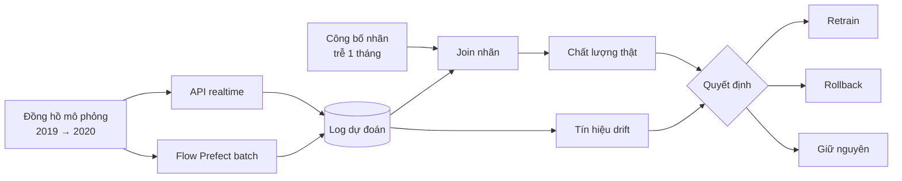
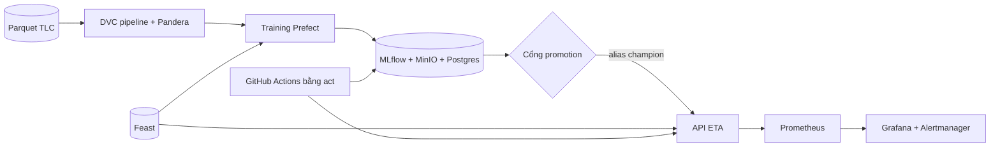
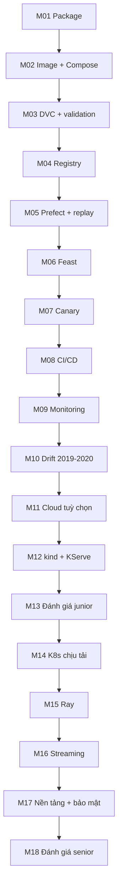

# Dịch vụ ETA cho taxi NYC

Dự án capstone xuyên suốt lộ trình MLOps. Bạn nhận một **notebook baseline** dự đoán thời gian chuyến đi taxi
NYC và biến nó thành một dịch vụ vận hành như production trên máy local: package có test, image, stack Compose,
DVC, registry có cổng promotion, pipeline Prefect, feature store, serving có canary, CI/CD bằng `act`, monitoring,
rồi xử lý sự cố drift có thật trong dữ liệu (COVID tháng 3/2020), và ở tầng senior là Kubernetes chịu tải, Ray,
streaming, nền tảng nhiều model và bảo mật.

Model chỉ cần "đủ tốt" (gradient boosting). Trọng tâm là **mọi thứ xung quanh model**.

## Bài toán

Dự đoán **thời gian chuyến đi (giây)** từ zone đón, zone trả, thời điểm và khoảng cách, trên dữ liệu
[NYC TLC](../../data/README.md) thật (`nyc-tlc` cho 2019, `nyc-tlc-2020` cho 2020; mỗi bài dùng mẫu xác định
theo `seed`, ví dụ 200 000 dòng của một tháng). Dữ liệu bẩn thật: thời lượng âm hoặc 0, khoảng cách bất thường,
ngày nằm ngoài tháng của tệp, zone 264/265 (Unknown). Bạn phải làm sạch theo luật cố định và đếm được số dòng còn lại.

## Hai đường gọi model

| Đường | Cách chạy | Việc của bạn |
| --- | --- | --- |
| **Realtime** | REST API (FastAPI) giả lập app đặt xe hỏi ETA | Load model theo alias, health/readiness, log mọi dự đoán (request id, version model, feature, dự đoán) |
| **Batch theo lịch** | Flow Prefect chấm cả ngày hoặc cả tháng | Retry, schedule, backfill, ghi kết quả |

## Phát lại 2019 → 2020, nhãn về muộn

Một **đồng hồ mô phỏng** đẩy dữ liệu từng tháng của 2019, rồi 2020, vào hệ thống như dữ liệu production. Thời
gian chuyến thật chỉ được "công bố" sau một độ trễ cấu hình được (mặc định **một tháng**, phỏng theo việc TLC
công bố dữ liệu chậm), rồi mới join với log dự đoán để tính chất lượng thật. Trong khoảng chưa có nhãn, bạn chỉ
có tín hiệu drift; đó là tình huống thật của người trực.

Sự cố có trong dữ liệu: mùa vụ, ngày lễ và **COVID tháng 3/2020** (lưu lượng sập, tốc độ đường phố tăng, phân phối
zone đổi). Bạn phải phân biệt drift **không** làm hỏng dự đoán với drift **làm hỏng**, rồi quyết định
retrain / rollback / giữ nguyên và bảo vệ quyết định bằng số.



## Kiến trúc đích



## 18 milestone

Mỗi milestone mở ra sau một module và dùng lại kết quả của milestone trước. Đề chi tiết ở `milestones/`.

| M | Sau module | Nội dung |
| --- | --- | --- |
| M01 | 01 | Biến notebook baseline ETA thành package có test, config, logging |
| M02 | 02 | Đóng gói training và serving thành image; stack Compose (API + MLflow + MinIO + Postgres) |
| M03 | 03 | DVC pipeline từ parquet thô tới tập train; data validation chặn tháng dữ liệu hỏng |
| M04 | 04 | Tracking, registry, cổng promotion có tiêu chí rõ |
| M05 | 05 | Flow Prefect: train theo lịch, batch inference, đồng hồ mô phỏng phát lại theo tháng |
| M06 | 06 | Feature (ví dụ tốc độ trung bình theo zone/giờ) qua Feast, không skew giữa batch và online |
| M07 | 07 | API production, shadow model mới, canary và rollback |
| M08 | 08 | Workflow GitHub Actions (chạy bằng `act`): CI code + CT model + deploy khi promotion qua |
| M09 | 09 | Prometheus + Grafana: dashboard service và model, alert rule có test |
| M10 | 10 | Phát lại 2019 → 2020: phát hiện, xác minh, quyết định retrain/rollback/giữ có số liệu; runbook + postmortem sự cố COVID |
| M11 | 12 | (Tuỳ chọn) Đưa một phần lên cloud free tier, có lệnh dọn |
| M12 | 13 | Chuyển service ETA sang kind + KServe; pipeline training trên Argo Workflows |
| M13 | 13 | Đánh giá độc lập mức junior: tình huống mới (ví dụ tháng dữ liệu lạ), tự chẩn đoán và vận hành theo rubric |
| M14 | 14 | ETA trên K8s chịu tải: autoscale theo custom metric, Kueue cho job retrain, quota tách serving và training |
| M15 | 15 | Retrain bằng Ray nhiều worker, checkpoint, chịu được worker bị kill giữa chừng |
| M16 | 16 | Feature real-time cho ETA (tốc độ theo zone 15 phút gần nhất) từ stream phát lại qua Kafka, đo freshness |
| M17 | 17 | Onboard model thứ hai (ví dụ dự đoán tiền tip) qua template nền tảng; model được ký và quét trước khi deploy; báo cáo chi phí theo model |
| M18 | 18 | Đánh giá độc lập mức senior: design doc cho nền tảng ETA nhiều thành phố, SLO và error budget, dẫn xử lý một sự cố dựng sẵn, postmortem; chấm theo rubric |

M01–M13 là mức junior (M11 tuỳ chọn); M14–M18 là tầng senior. M13 và M18 là bài đánh giá độc lập, chấm theo rubric.



## Cách làm và cách chấm

Code của bạn nằm ở `capstone/project/`; test chấm ở `capstone/project/tests`.

```bash
uv run pytest tracks/mlops/capstone/project/tests -q -rs
uv run pytest tracks/mlops/capstone/project/tests -q -rs -k m03
SOLUTION=1 uv run pytest tracks/mlops/capstone/project/tests -q -rs
```

- Tên test bắt đầu bằng `test_mNN_`, nên `-k mNN` chọn đúng một milestone.
- `SOLUTION=1` chấm lời giải tham chiếu ở `capstone/solutions/project/`.
- Test cần stack hoặc công cụ chưa có sẽ `skip` kèm lệnh bật (xem [README track](../README.md#bật-stack-mlops)); skip
  không tính là đạt.
- Phần quyết định (M10, M13, M18): nộp tệp YAML `decision` và `reasons`; test kiểm `decision`, rubric chấm
  `reasons`.
- Tài nguyên Docker do test dựng có nhãn `mlops-ex=1` và tiền tố `mlops-ex-`, được dọn khi test kết thúc hoặc
  bị ngắt.
