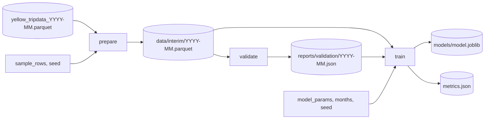

# M03: Pipeline DVC và validation chặn tháng dữ liệu hỏng

## Mục tiêu

Đến M02, "train lại" vẫn là một lệnh bạn nhớ trong đầu, và không có gì ngăn một tệp parquet hỏng đi thẳng vào model.
TLC từng phát hành tệp có cột đổi kiểu, tháng có hàng nghìn chuyến năm 2008, hay thời lượng âm hàng loạt do lỗi đồng
hồ của một hãng xe. Model train trên tháng như vậy vẫn ra số, chỉ là số sai, và bạn sẽ biết sau khi khách phàn nàn.

Milestone này dựng pipeline DVC ba stage `prepare → validate → train`:

- **Tái lập và rẻ**: chạy lại khi không đổi gì thì không stage nào chạy; đổi hyperparameter thì chỉ `train` chạy lại,
  không đọc lại 110 MB parquet.
- **Có cổng dữ liệu**: `validate` dùng schema Pandera; tháng vi phạm thì pipeline dừng, `train` không bao giờ chạy trên
  dữ liệu đó.
- **Có version dữ liệu**: `dvc.lock` ghi hash của từng input và output; MinIO của stack làm remote.

Đây là bài tích hợp sau [module 03](../../modules/03-data-versioning-quality/README.md).

## Việc cần làm

### 1. CLI cho hai stage mới

Thêm vào `eta.cli` (giữ `train` của M01):

```text
python -m eta.cli prepare --config params.yaml --month 2019-01 --out data/interim/2019-01.parquet
python -m eta.cli validate data/interim/2019-01.parquet --month 2019-01 [--report reports/validation/2019-01.json]
python -m eta.cli train --config params.yaml --input data/interim --model-out models/model.joblib --metrics-out metrics.json
```

- `prepare`: `load_month(<data_dir>/yellow_tripdata_<month>.parquet, sample_rows, seed)` rồi ghi parquet. Đây là dữ liệu
  **thô đã lấy mẫu** (5 cột `COLUMNS`, chưa `clean`): validation phải nhìn thấy dữ liệu như nó đến.
- `validate <parquet> --month YYYY-MM`: đọc parquet (đúng 5 cột `COLUMNS`), gọi `eta.validate.validate_month`. Hợp lệ:
  exit 0 (ghi `--report` nếu có). Vi phạm: in từng lỗi (cột, check) ra stderr và **exit 1**.
- `train --input DIR`: đọc `DIR/<month>.parquet` cho từng tháng trong config thay vì đọc tệp thô, rồi làm như M01.

### 2. `eta.validate`: schema Pandera

- `SCHEMA` là `pandera.DataFrameSchema` cho một mẫu thô; `validate_month(df, month)` dùng `SCHEMA` cộng kiểm theo tháng,
  gọi `validate(df, lazy=True)` để gom **mọi** lỗi, và raise `pandera.errors.SchemaErrors` khi vi phạm.
- Dữ liệu thật **luôn** bẩn một chút (xem bảng ở M01), nên schema không đòi "không có dòng bẩn nào"; nó chặn tháng bẩn
  **bất thường**. Đo trên mẫu 200 000 dòng mỗi tháng của 2019: thời lượng âm tối đa 0,02%, khoảng cách âm tối đa 0,09%
  (tháng 11), pickup ngoài tháng tối đa 0,01%, zone luôn trong `1..265`. Bản tham chiếu dùng:

| Check | Loại | Ngưỡng |
| --- | --- | --- |
| Đúng 5 cột `COLUMNS`, không thừa (`strict=True`) | cột | |
| pickup, dropoff là datetime; zone `int64`; `trip_distance` `float64`; không null | cột | |
| `PULocationID`, `DOLocationID` trong `1..265` | cột | |
| Không rỗng | bảng | |
| Tỷ lệ dòng `dropoff < pickup` | bảng | ≤ 1% |
| Tỷ lệ `trip_distance < 0` | bảng | ≤ 1% |
| Tỷ lệ pickup ngoài tháng `month` | bảng | ≤ 1% |

  Bạn được chọn ngưỡng khác, miễn là: một tháng sạch như dữ liệu giả của test (hoặc như mọi tháng thật của 2019) qua
  được, và một tháng có **5%** dòng thời lượng âm bị chặn. Ghi lý do chọn ngưỡng vào README: ngưỡng quá chặt thì
  pipeline dừng vì nhiễu bình thường, người trực quen tắt validation; quá lỏng thì nó không chặn gì.
- Validation (cổng: có train hay không) khác `clean` (luật lọc từng dòng). Tháng qua validation vẫn phải `clean`.

### 3. `params.yaml` và `dvc.yaml`

`params.yaml` là tệp config của M01 (cùng khoá với `Config`), đặt ở `capstone/project/`. `dvc.yaml` cạnh nó có ba
stage tên **`prepare`**, **`validate`**, **`train`** (dùng `foreach: ${months}` cho hai stage đầu thì tên thành
`prepare@2019-01`; được chấp nhận):



- `prepare` phụ thuộc tệp thô `${data_dir}/yellow_tripdata_${item}.parquet` (nằm ngoài repo, DVC hash nó như một
  dependency ngoài) và code đọc dữ liệu; `params` chỉ `sample_rows`, `seed`.
- `validate` phụ thuộc output của `prepare` và code validation; output là báo cáo.
- `train` phụ thuộc **cả** dữ liệu đã prepare **và** báo cáo validation (đây là thứ buộc `train` chạy sau và chỉ chạy
  khi `validate` thành công), code train, `params` `model_params` (và `months`, `seed`). Output `models/model.joblib`,
  `metrics.json` khai ở `metrics` với `cache: false`.
- Đổi `model_params` **chỉ** làm `train` chạy lại: đừng khai `model_params` (hay cả tệp `params.yaml` làm dep) ở hai
  stage đầu.
- Lệnh trong stage tự đặt `PYTHONPATH=src` (ví dụ `cmd: PYTHONPATH=src python -m eta.cli prepare ...`): DVC chạy lệnh
  bằng shell, và test chạy trong môi trường sạch không có `PYTHONPATH`.
- `.gitignore` cho `data/`, `models/`; commit `dvc.yaml`, `dvc.lock`, `params.yaml`.

Khởi tạo DVC trong thư mục con của repo lớn. Vì `capstone/project/` có `pyproject.toml` riêng (M01), `uv run` đứng
trong thư mục này sẽ tạo một venv mới cho package `eta`; thêm `--project ../../../..` để dùng môi trường của repo:

```bash
cd tracks/mlops/capstone/project
uv run --project ../../../.. dvc init --subdir
uv run --project ../../../.. dvc repro
uv run --project ../../../.. dvc repro            # lần hai: "didn't change, skipping" cho mọi stage
uv run --project ../../../.. dvc params diff      # sau khi sửa params.yaml
```

### 4. Remote MinIO

Stack có bucket `dvc` trên MinIO (`127.0.0.1:29000`). Khoá truy cập để trong `.dvc/config.local` (không commit):

```bash
uv run --project ../../../.. dvc remote add -d minio s3://dvc/eta
uv run --project ../../../.. dvc remote modify minio endpointurl http://127.0.0.1:29000
uv run --project ../../../.. dvc remote modify --local minio access_key_id minioadmin
uv run --project ../../../.. dvc remote modify --local minio secret_access_key minioadmin
uv run --project ../../../.. dvc push
```

Xoá `data/interim` và `.dvc/cache` rồi `dvc pull` để thấy dữ liệu về đúng phiên bản trong `dvc.lock`.

### 5. Test chấm làm gì

Test chép `src/`, `dvc.yaml`, `params.yaml` của bạn vào một repo tạm, chạy `git init` và `dvc init`, sửa `params.yaml`
(`data_dir` thành đường dẫn tuyệt đối tới một thư mục ngoài repo chứa `yellow_tripdata_2019-01.parquet` giả có đủ cột
thô, `months: ["2019-01"]`, `sample_rows: 1500`, `seed: 0`, `model_params.max_iter: 20`; các khoá khác giữ nguyên), rồi
chạy `dvc repro` trong sandbox (chỉ thư mục tạm ghi được, `PATH` có `python` và `dvc` của môi trường repo).

- `test_m03_dvc_repro_idempotent`: lần một cả ba stage chạy, exit 0; lần hai không stage nào chạy; đổi
  `model_params.max_iter` thì đúng một stage `train` chạy.
- `test_m03_validate_blocks_bad_month`: `eta.cli validate` trên một tháng giả sạch exit 0, trên tháng có 5% thời lượng
  âm exit 1; `dvc repro` với tháng hỏng làm dữ liệu thô exit khác 0 và stage `train` không chạy.

```bash
uv run pytest tracks/mlops/capstone/project/tests -q -rs -k m03
```

## Kết quả nộp

- `capstone/project/src/eta/validate.py`, `cli.py` có `prepare` và `validate`.
- `capstone/project/dvc.yaml`, `params.yaml`, `dvc.lock` (sau một lần `dvc repro` trên dữ liệu thật), `.dvc/config`
  có remote MinIO.
- Mục "Dữ liệu" trong README: sơ đồ pipeline, bảng check và ngưỡng kèm lý do, cách thêm một tháng mới.

## Tiêu chí đạt

- [ ] `uv run pytest tracks/mlops/capstone/project/tests -q -rs -k m03` pass, không skip.
- [ ] `dvc repro` lần hai không chạy gì; đổi hyperparameter chỉ chạy lại `train`.
- [ ] Tháng vi phạm schema: `validate` exit 1 kèm lỗi đọc được, `train` không chạy.
- [ ] Ngưỡng validation có lý do, mọi tháng thật của 2019 đều qua.
- [ ] (Tự đánh giá) `dvc push` lên MinIO, xoá cache local rồi `dvc pull` lấy lại đúng dữ liệu.
- [ ] (Tự đánh giá) Thử `PYTHONPATH=src uv run --project ../../../.. python -m eta.cli validate` trên vài tháng 2019 thật
      (sau `prepare`), ghi kết quả.
