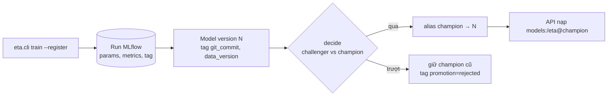

# M04: Tracking, registry và cổng promotion

## Mục tiêu

Sau M03 bạn train lại được bằng một lệnh, nhưng chưa trả lời được ba câu mà người trực sẽ hỏi lúc 2 giờ sáng:

1. API đang chạy model nào, train từ commit nào, trên dữ liệu nào?
2. Model mới có **thật sự** tốt hơn model đang chạy không, theo tiêu chí ai đặt ra?
3. Model mới làm hỏng việc thì quay lại bản cũ mất bao lâu?

Milestone này đưa mọi lần train vào MLflow của stack (Postgres + MinIO), đăng ký model vào registry với tag lineage, và
đặt một **cổng promotion** có luật viết thành code: chỉ khi qua cổng, alias `champion` mới chuyển sang version mới. API
(M02) luôn nạp `models:/eta@champion`, nên promote và rollback đều chỉ là đổi alias, không build lại image. Đây là bài
tích hợp sau [module 04](../../modules/04-tracking-registry/README.md).

Cổng có hai tiêu chí vì MAE tổng che được thất bại cục bộ: model mới có thể giỏi hơn ở chuyến nội đô (chiếm đa số) mà
tệ đi rõ ở chuyến sân bay, đúng nhóm chuyến dài, đắt và hay bị khiếu nại.



## Việc cần làm

### 1. Cấu hình client MLflow

Bật stack (`docker compose -f setup/mlops/compose.yaml up -d --wait`), rồi trên máy host:

```bash
export MLFLOW_TRACKING_URI=http://127.0.0.1:25000
export MLFLOW_ENABLE_PROXY_MULTIPART_DOWNLOAD=false
```

Biến thứ hai là bắt buộc với stack này: server dùng `--serve-artifacts`, nhưng với artifact lớn client MLflow 3 xin URL
tải trực tiếp từ MinIO, và URL đó trỏ vào `minio:9000`, tên chỉ tồn tại trong network Docker. Không tắt thì
`load_model` treo. Đặt biến này ở mọi chỗ tải artifact: shell của bạn, test, container API (`compose.yaml`).

### 2. `eta.registry.log_and_register`

```python
log_and_register(model, metrics: dict, config: Config, data_version: str) -> str
```

- Dùng `config.mlflow_uri`; experiment tên **`config.model_name`** (test tạo experiment tên ngẫu nhiên và xoá khi xong).
- Mở một run: log params (tháng, `sample_rows`, `seed`, `model_params`), log `metrics`, tag run `git_commit` và
  `data_version`.
- Log model bằng flavor **`mlflow.sklearn`** (để `mlflow.sklearn.load_model("models:/<name>@champion")` trả lại đúng
  Pipeline) và đăng ký vào registered model tên `config.model_name`.
- Gắn tag cho **model version**: `git_commit` (không rỗng: `git rev-parse HEAD`, thêm `-dirty` nếu cây có sửa chưa
  commit, hoặc biến `GIT_COMMIT` trong container) và `data_version` (đúng chuỗi được truyền vào; CLI dùng hash của
  các tệp dữ liệu input).
- Trả số version dạng chuỗi (`"3"`).

Hai bẫy của MLflow 3.17:

- Mặc định `mlflow.sklearn` lưu model bằng **skops** và từ chối lưu `HistGradientBoostingRegressor` vì có kiểu "không
  tin cậy" (`TreePredictor`...). Truyền `skops_trusted_types=[...]` đúng danh sách kiểu trong thông báo lỗi, sau khi đọc
  vì sao chúng không được tin mặc định; đừng chuyển sang pickle cho nhanh mà không ghi lý do.
- Không truyền `pip_requirements` thì MLflow tự suy dependency bằng cách nạp model trong tiến trình con, chậm và hay
  kéo cả môi trường repo vào. Ghim tay `scikit-learn`, `pandas`, `numpy` đúng phiên bản.

### 3. `eta.promotion`: luật cổng

```python
@dataclass
class Policy:
    max_mae_regression: float = 0.0
    max_airport_regression: float = 0.05

decide(challenger: dict, champion: dict | None, policy: Policy) -> Decision   # Decision(promote: bool, reasons: list[str])
```

`challenger` và `champion` là dict metric như `evaluate` trả (`mae`, `p90_abs_err`, `mae_airport`). Luật:

| Tình huống | Kết quả |
| --- | --- |
| `champion is None` (chưa có champion) | promote |
| Champion có nhưng thiếu `mae` hoặc `mae` là `nan` | không promote, `reasons` có chữ `mae` |
| `challenger["mae"] > champion["mae"] * (1 + max_mae_regression)` | không promote, `reasons` có chữ `mae` |
| `challenger["mae_airport"] > champion["mae_airport"] * (1 + max_airport_regression)` | không promote, `reasons` có chữ `airport` |
| Còn lại (kể cả bằng nhau đúng ngưỡng) | promote |

- `reasons` luôn là `list[str]` **không rỗng**, kể cả khi promote: ghi từng tiêu chí, số của challenger, champion và
  ngưỡng. Đây là thứ người review đọc và thứ bạn dán vào changelog.
- `p90_abs_err` không chặn promotion ở M04 (chỉ log). Thêm tiêu chí là quyết định có chủ đích, không phải mặc định.
- Ví dụ: champion `mae=150, mae_airport=300`; challenger `mae=140, mae_airport=330` (tệ hơn 10% ở sân bay) → **không**
  promote dù MAE tổng tốt hơn; `mae_airport=309` (tệ hơn 3%, trong 5%) → promote.
- Metric thiếu hoặc `nan` ở challenger thì không promote.
- Champion thiếu `mae` hoặc `mae` là `nan`: **không** promote, `reasons` có chữ `mae`. Champion không có số đo chính là
  dấu hiệu registry hỏng (run bị xoá, log metric lỗi); cổng không được mở chỉ vì không so được.
- Champion không có `mae_airport` (không có chuyến sân bay trong tập test của nó) thì bỏ qua tiêu chí đó và ghi vào
  `reasons`.

```python
promote_if_better(name: str, version: str, policy: Policy) -> Decision
```

- Dùng tracking URI hiện hành (`MLFLOW_TRACKING_URI` hoặc `mlflow.set_tracking_uri`).
- Lấy metric của run sinh ra `version` (challenger) và của version đang giữ alias `champion` (nếu có), gọi `decide`.
- Qua cổng: `set_registered_model_alias(name, "champion", version)`. Trượt: alias giữ nguyên.
- Nên ghi kết quả vào tag của version (`promotion=passed|rejected`, lý do) để registry tự kể lịch sử.

### 4. CLI và API

- `python -m eta.cli train --config params.yaml --register`: train như M01 rồi `log_and_register`, in JSON có thêm
  `model_version`.
- `python -m eta.cli promote --config params.yaml --version N`: in quyết định dạng JSON; exit 0 khi promote, exit khác 0
  khi bị chặn (CI ở M08 dựa vào exit code này để quyết định có deploy hay không).
- `eta.serve` (M02) khi không có `ETA_MODEL_PATH`: nạp `models:/<ETA_MODEL_NAME, mặc định eta>@champion` từ
  `MLFLOW_TRACKING_URI`, và `/healthz`, `/predict` trả `model_version` là **số version** của champion lúc nạp. Nạp theo
  số version đã phân giải (`models:/eta/<N>`), không nạp lại alias ở mỗi request: API phải trả lời nhất quán tới khi
  được khởi động lại có chủ đích.

### 5. Rollback

Rollback là đổi alias về version cũ rồi khởi động lại API (hoặc gọi endpoint reload nếu bạn làm ở M07):

```python
MlflowClient().set_registered_model_alias("eta", "champion", "<version cũ>")
```

Viết thành runbook ngắn trong README: lệnh, thời gian thực đo được, cách kiểm API đã chạy đúng version (`/healthz`).

### 6. Test chấm làm gì

- `test_m04_promotion_rules`: bảng các ca ở mục 3 (tốt hơn, sân bay tệ hơn 10%, sân bay tệ hơn 3%, MAE tệ hơn, bằng
  nhau, MAE tệ hơn 1,3% với `max_mae_regression=0.02`, chưa có champion, champion thiếu `mae`, champion có
  `mae` là `nan`), dùng `Policy()` mặc định trừ ca có ghi
  ngưỡng. Không cần stack.
- `test_m04_alias_rollback` (cần stack MLflow, skip kèm lệnh bật nếu chưa có): tạo `Config` với `model_name` ngẫu nhiên,
  đăng ký v1 (model yếu), promote (chưa có champion); đăng ký v2 (tốt hơn), kiểm tag `git_commit`, `data_version` của
  v2, promote; đăng ký v3 tốt hơn về MAE nhưng tệ hơn 14% ở sân bay, cổng phải chặn và alias vẫn là v2; đặt alias về
  v1 (rollback), `mlflow.sklearn.load_model("models:/<name>@champion")` phải dự đoán giống hệt model v1; rồi chạy
  `eta.serve.app` (với `ETA_MODEL_NAME=<name>`) và kiểm `/healthz`, `/predict` báo `model_version` v1. Cuối test xoá
  registered model và experiment.

```bash
uv run pytest tracks/mlops/capstone/project/tests -q -rs -k m04
```

## Kết quả nộp

- `capstone/project/src/eta/registry.py`, `promotion.py`, CLI `train --register` và `promote`.
- Ít nhất hai version `eta` trong MLflow của bạn train trên dữ liệu thật (ví dụ 2019-01 và 2019-01 + 2019-02), một lần
  promote và một lần bị chặn hoặc rollback, nhìn thấy được trong UI (`http://127.0.0.1:25000`).
- Mục "Registry" trong README: luật cổng và lý do chọn ngưỡng, runbook rollback, một model card ngắn cho champion
  (dữ liệu train, metric tổng và sân bay, giới hạn đã biết: chưa có dữ liệu 2020, chưa có thời tiết...).

## Tiêu chí đạt

- [ ] `uv run pytest tracks/mlops/capstone/project/tests -q -rs -k m04` pass, không skip (stack đã bật).
- [ ] Mỗi model version có tag `git_commit` và `data_version`; từ version truy ngược được run, params, metric.
- [ ] Luật cổng nằm trong code, có test của bạn cho từng nhánh, `reasons` đọc được.
- [ ] Promote và rollback chỉ là đổi alias; API báo đúng version đang chạy.
- [ ] (Tự đánh giá) Runbook rollback đã chạy thử thật, có thời gian đo được.
- [ ] (Tự đánh giá) Model card cho champion hiện tại.
