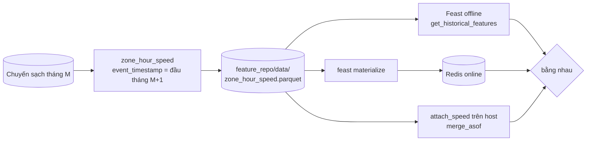

# M06: Feature tốc độ theo zone/giờ qua Feast, không skew giữa batch và online

## Mục tiêu

Thời gian chuyến phụ thuộc mạnh vào **đường đang nhanh hay chậm**. Tháng 4/2020 tốc độ trung vị toàn thành phố nhảy từ
khoảng 10 lên 15 dặm/giờ (COVID, đường vắng); model chỉ biết zone và giờ sẽ không thấy điều đó. Milestone này thêm một
feature: **tốc độ trung vị theo zone đón và giờ, tính từ tháng trước**, và phục vụ nó qua Feast cho cả hai đường:

- **Offline** (train, batch): join point-in-time, mỗi chuyến chỉ thấy feature đã tồn tại **trước** giờ đón.
- **Online** (API): đọc từ Redis, giá trị phải **giống hệt** offline cho cùng entity và thời điểm.

Hai lỗi kinh điển ở đây: feature từ tương lai lọt vào tập train (model offline đẹp, production tệ), và training-serving
skew (train và serve tính feature bằng hai đoạn code, hai mặc định khác nhau). Đây là bài tích hợp sau
[module 06](../../modules/06-feature-stores/README.md).



## Việc cần làm

**Feast chỉ chạy trong container** `mlops-feast:0.67.0` (`feast[redis]` kéo pandas xuống 2.3.3, không vào môi trường
mặc định): code Python trên host chỉ dùng pandas để **tính** feature; `feast apply`, `materialize`, đọc feature chạy trong
container qua `mlopskit.feast_run` / `mlopskit.feast_python`, nối network `mlops_default` để thấy Redis. Bật Redis:

```bash
docker compose -f setup/mlops/compose.yaml --profile feast up -d --wait
```

### 1. `eta.zone_features`

```python
SPEED_FEATURE = "avg_speed_mph"
DEFAULT_SPEED_MPH = 10.1
MIN_TRIPS = 5
zone_hour_speed(df: pd.DataFrame, month: str) -> pd.DataFrame
attach_speed(trips: pd.DataFrame, features: pd.DataFrame) -> pd.DataFrame
```

**`zone_hour_speed(df, month)`**, `df` là chuyến **sạch** của `month` (có `duration_s`):

- Tốc độ từng chuyến = `trip_distance / (duration_s / 3600)` (dặm/giờ).
- Nhóm theo `PULocationID` và `pickup_hour` (giờ của `tpep_pickup_datetime`), `avg_speed_mph` = **trung vị** tốc độ từng
  chuyến trong nhóm (trung vị, không phải trung bình: dữ liệu thật có chuyến 100 dặm trong 2 phút). Chỉ giữ nhóm có
  **ít nhất `MIN_TRIPS` = 5** chuyến.
- Cột đúng thứ tự `PULocationID`, `pickup_hour`, `avg_speed_mph`, `event_timestamp`; mỗi `(zone, giờ)` một dòng.
- **`event_timestamp` = 00:00 ngày đầu tháng sau** (`2019-01` → `2019-02-01`): số liệu tháng 1 chỉ "tồn tại" khi tháng 1
  kết thúc, nên chỉ dùng được cho chuyến từ tháng 2.
- Không sửa `df` đầu vào.

**`DEFAULT_SPEED_MPH = 10.1`**: trung vị tốc độ từng chuyến toàn thành phố trên mẫu 2019-01 (200 000 dòng, `seed=0`, sau
`clean`). Test chấp nhận 9.5–10.5. Đây là **một** mặc định dùng ở mọi nơi (train, batch, API); mặc định khác nhau giữa
hai đường là một dạng skew.

**`attach_speed(trips, features)`**: thêm cột `avg_speed_mph` vào bản sao của `trips` (cần `tpep_pickup_datetime`,
`PULocationID`):

- Point-in-time bằng `pd.merge_asof` theo thời gian (`by=["PULocationID", "pickup_hour"]`, `direction="backward"`): mỗi
  chuyến lấy feature **mới nhất có `event_timestamp <= giờ đón`**. Feature tháng `M` không bao giờ gắn vào chuyến tháng `M`.
- **TTL 62 ngày** (`tolerance=pd.Timedelta(days=62)`), khớp TTL của feature view Feast: feature cũ hơn 62 ngày so với
  giờ đón coi như không có.
- Không có feature (zone/giờ lạ, chưa có tháng trước, quá TTL) → `DEFAULT_SPEED_MPH`. Kết quả không có `NaN`.
- Giữ nguyên số dòng, thứ tự và index của `trips` (`merge_asof` cần sắp theo thời gian: sắp, gộp, rồi trả về thứ tự cũ).
  Không sửa `trips` đầu vào.

### 2. Feature tuỳ chọn trong model

`avg_speed_mph` là feature **tuỳ chọn**, quyết định theo dữ liệu: `make_features` / `build_features` thêm cột
`avg_speed_mph` vào **cuối** `FEATURES` khi DataFrame đầu vào có cột đó, và giữ đúng 5 feature của M01 khi không có.
`FEATURES` vẫn là 5 tên của M01 (test M01–M04 không đổi). `train` và `evaluate` dùng các cột feature có mặt trong `X`
(5 hoặc 6), không cắt cứng về `X[FEATURES]`. Pipeline lưu `feature_names_in_`, nên khi serve biết model có cần
`avg_speed_mph` hay không.

Vì sao theo dữ liệu thay vì cờ trong config: hàm dựng feature là **một**, train và serve gọi chung; cờ config là một chỗ
nữa có thể lệch giữa hai đường. Muốn train có tốc độ thì gắn cột trước (`attach_speed`), không có cờ ẩn.

### 3. Feature repo `capstone/project/feature_repo/`

`feature_store.yaml`:

- `project: eta`, `provider: local`, `registry: data/registry.db`.
- `offline_store: {type: file}`.
- `online_store: {type: redis, connection_string: "redis:6379"}`: tên `redis` chỉ phân giải trong network
  `mlops_default`, nên mọi lệnh Feast chạy với `network="mlops_default"`.
- `entity_key_serialization_version: 3`.

`features.py`:

- Entity `pu_zone`, join key `PULocationID`, `ValueType.INT64`. Feast 0.67 chỉ cho **một** join key mỗi entity, nên giờ
  là entity thứ hai `pickup_hour`, join key `pickup_hour`, `ValueType.INT64`. Feature view dùng cả hai.
- `FileSource` đường dẫn **`data/zone_hour_speed.parquet`** (tương đối với thư mục repo), `timestamp_field="event_timestamp"`.
- `FeatureView` tên **`zone_hour_speed`**, `entities=[pu_zone, pickup_hour]`, `ttl=timedelta(days=62)`, schema một field
  `avg_speed_mph` kiểu `Float64`, `online=True`.
- `.gitignore` chặn `data/` (parquet, `registry.db` sinh ra, không commit).

Chạy tay (từ gốc repo, thư mục repo mount `/repo` trong container):

```bash
uv run python -c "import mlopskit; from pathlib import Path; r = Path('tracks/mlops/capstone/project/feature_repo'); \
print(mlopskit.feast_run(r, 'apply', network='mlops_default').stdout)"
```

### 4. Test chấm làm gì

- `test_m06_zone_hour_speed_table`: đúng cột, mỗi `(zone, giờ)` một dòng, `event_timestamp` = đầu tháng sau, giá trị bằng
  trung vị tốc độ từng chuyến của nhóm có ≥ `MIN_TRIPS` chuyến, không sửa input.
- `test_m06_point_in_time_no_future`: bảng feature tháng 1 và tháng 2; chuyến tháng 2 chỉ nhận giá trị tháng 1 (hoặc mặc
  định), chuyến tháng 1 toàn mặc định; giữ index, thứ tự, không `NaN`, không sửa input.
- `test_m06_default_for_unknown_zone`: `DEFAULT_SPEED_MPH` trong 9.5–10.5; zone không có feature → mặc định; zone có
  feature → giá trị đó; cùng zone nhưng giờ đón 108 ngày sau feature (quá TTL) → mặc định.
- `test_m06_build_features_optional_speed`: không có cột → 5 feature của M01; có cột → thêm `avg_speed_mph` ở cuối, train
  và `evaluate` chạy được.
- `test_m06_online_offline_parity` (cần Redis, skip kèm lệnh bật nếu chưa có): chép `feature_repo/` sang thư mục tạm, đổi
  `project` thành tên ngẫu nhiên, ghi `data/zone_hour_speed.parquet` từ `zone_hour_speed` của hai tháng giả, `feast apply`,
  `feast materialize 2019-01-01T00:00:00 2019-03-15T00:00:00`, rồi trong container đọc `get_historical_features` và
  `get_online_features` cho 20 `(zone, giờ)` lúc 2019-03-10; online, offline và `attach_speed` trên host phải bằng nhau
  (sai số 1e-6). Cuối test `feast teardown` xoá key trong Redis.

```bash
uv run pytest tracks/mlops/capstone/project/tests -q -rs -k m06
```

## Kết quả nộp

- `capstone/project/src/eta/zone_features.py`, `feature_repo/feature_store.yaml`, `feature_repo/features.py`.
- Bảng MAE thật trong README: train có và không có `avg_speed_mph` (ví dụ train 2019-02 với feature từ 2019-01, đánh
  giá trên 2019-03 với feature từ 2019-02), kèm nhận xét feature có đáng giữ không. Không có kết quả "phải tốt hơn":
  đo rồi quyết định.
- Mục "Feature" trong README: định nghĩa feature, `event_timestamp` và TTL, mặc định, cách materialize hằng tháng.

## Tiêu chí đạt

- [ ] `uv run pytest tracks/mlops/capstone/project/tests -q -rs -k m06` pass, không skip (Redis đã bật).
- [ ] Không chuyến nào nhận feature có `event_timestamp` sau giờ đón; feature tháng `M` không vào chuyến tháng `M`.
- [ ] Một hàm tính feature, một mặc định, dùng chung cho train, batch và serve.
- [ ] Online (Redis) bằng offline cho cùng entity và thời điểm.
- [ ] (Tự đánh giá) Bảng MAE có/không có feature trên dữ liệu thật, quyết định có lý do.
- [ ] (Tự đánh giá) Giải thích khi nào capstone này **không** cần feature store.
