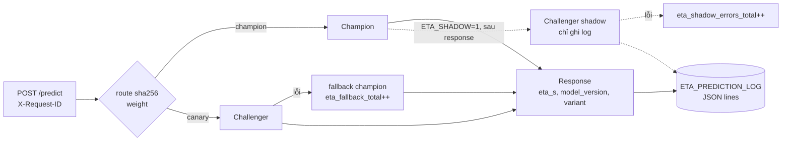

# M07: API production, shadow, canary và rollback

## Mục tiêu

API của M02 trả được ETA, nhưng chưa sẵn sàng cho ngày đưa model mới lên: nó không phân biệt "đang sống" với "sẵn sàng
nhận request", không chạy được model mới bên cạnh model cũ, và rollback cần khởi động lại container. Milestone này nâng
API thành bản production:

- **Readiness thật**: `/readyz` chỉ 200 khi model đã nạp **và** đã warmup; trước đó và khi đang tắt trả 503.
- **Shadow**: challenger chấm cùng request nhưng **không** ảnh hưởng response; chỉ ghi log để so.
- **Canary**: một tỉ lệ request (định tuyến ổn định theo `request_id`) do challenger trả lời; challenger lỗi thì
  **fallback** về champion và đếm.
- **Rollback trong vài giây**: đổi alias trong registry rồi `POST /admin/reload`, không rebuild, không restart.
- **Log dự đoán** cùng định dạng với batch (M05) để M09 đếm và M10 join nhãn.
- **Tải thử k6** có ngưỡng p95.

Nguyên tắc xuyên suốt: **đường mới không bao giờ được làm hỏng đường chính**. Đây là bài tích hợp sau
[module 07](../../modules/07-model-serving/README.md).



## Việc cần làm

Giữ mọi hợp đồng của M02 và M04 (`/healthz`, `/predict` 200/422, `model_version`, nạp theo số version đã phân giải).
**Đọc mọi biến môi trường lúc khởi động** (trong `lifespan`), không lúc import: test đổi biến rồi khởi động app nhiều
lần trong cùng một tiến trình.

### 1. Nguồn model: champion và challenger

| Chế độ | Champion | Challenger (tuỳ chọn) |
| --- | --- | --- |
| Tệp (`ETA_MODEL_PATH` không rỗng) | `joblib.load(ETA_MODEL_PATH)`, version `ETA_MODEL_VERSION` (mặc định `file:<tên tệp>`) | `ETA_CHALLENGER_PATH`, version `ETA_CHALLENGER_VERSION` (mặc định `file:<tên tệp>`) |
| Registry | `models:/<ETA_MODEL_NAME>@champion` theo số version | alias `challenger` nếu có; không có alias → không có challenger |

Không có challenger thì mọi request do champion trả lời, bỏ qua canary và shadow.

### 2. Readiness, liveness, warmup, tắt êm

- `GET /healthz` (liveness): luôn 200 khi tiến trình sống, `{"status": "ok", "model_version": <champion hoặc null>}`.
- `GET /readyz` (readiness): **503** khi chưa chạy xong `lifespan` (chưa nạp hoặc chưa warmup) và **sau khi tắt**
  (sau `yield` của `lifespan`, đặt lại trạng thái chưa sẵn sàng); **200** sau warmup với JSON có `model_version` của
  champion (nên có thêm `challenger`, `canary_weight`, `shadow`).
- Warmup: chấm một chuyến mẫu bằng champion (và challenger nếu có) trước khi báo sẵn sàng, để request đầu không trả giá
  cho lần đầu chạy code. Challenger warmup lỗi thì log và vẫn sẵn sàng (readiness chỉ phụ thuộc champion).
- `POST /predict` khi chưa sẵn sàng: 503.
- Image: `HEALTHCHECK` và healthcheck của Compose gọi `/readyz`; uvicorn có `--timeout-graceful-shutdown`.

### 3. Định tuyến canary

```python
route(request_id: str, weight: float) -> str   # "champion" hoặc "canary"
```

- Băm **sha256** của `request_id`, lấy 8 byte đầu thành số nguyên rồi chia `2**64` được `bucket` trong `[0, 1)`;
  `bucket < weight` → `"canary"`. `weight <= 0` → luôn `"champion"`; `weight = 1` → luôn `"canary"`.
- Ổn định: cùng `request_id` luôn cùng nhánh (không dùng `random`, không dùng `hash()` của Python vì nó đổi giữa các tiến
  trình). Với 2 000 id ngẫu nhiên và `weight=0.1`, tỉ lệ canary phải trong `[0.07, 0.13]`.
- `ETA_CANARY_WEIGHT` (0–1, mặc định 0; ngoài khoảng thì app không khởi động).

### 4. `/predict` mới

- `request_id`: header `X-Request-ID` nếu có, không thì tự sinh (`uuid4().hex`); **luôn** trả lại trong header
  `X-Request-ID` của response.
- Response: `{"eta_s": float, "model_version": str, "variant": str}`; `variant` là `"champion"` hoặc `"canary"`,
  `model_version` là version của model **đã trả lời**.
- Canary lỗi (exception khi chấm) → chấm lại bằng champion, `variant = "champion"`, tăng counter
  **`eta_fallback_total`**, response 200.
- `ETA_SHADOW=1` và có challenger và request do champion trả lời → chạy challenger **sau** khi trả response (FastAPI
  `BackgroundTasks`), không đổi response; thành công thì ghi một dòng log `variant = "shadow"`; lỗi thì tăng
  **`eta_shadow_errors_total`**, không bao giờ thành 5xx.
- `GET /metrics`: text Prometheus (`prometheus_client`, thêm `prometheus-client==0.26.0` vào `requirements-serve.in`
  rồi sinh lại `requirements-serve.txt` như M02) có hai counter trên. M09 thêm metric khác.

### 5. Log dự đoán

`ETA_PREDICTION_LOG` (đường dẫn, rỗng thì bỏ qua): mỗi dự đoán một dòng JSON, **khoá đúng `PREDICTION_LOG_COLUMNS`
theo đúng thứ tự** (M05). Request do champion/canary trả lời ghi một dòng `variant` tương ứng, theo thứ tự request; shadow
ghi dòng riêng `variant = "shadow"` với version của challenger, cùng `request_id`. Ghi có khoá (`threading.Lock`): uvicorn
chạy endpoint đồng bộ trên nhiều thread. Vẫn giữ log JSON ra stderr như M02.

### 6. Reload và rollback

`POST /admin/reload`: nạp lại champion và challenger theo nguồn ở mục 1 (registry: alias `champion`, `challenger` lúc gọi),
warmup bản mới, rồi **thay một lần** (request đang chạy dùng bộ model cũ tới hết). Trả `{"champion": "<version>",
"challenger": "<version>" | null}`. Nạp lỗi → 5xx và **giữ** model cũ. Đặt `ETA_ADMIN_TOKEN` thì đòi header
`X-Admin-Token` khớp (403 nếu sai). API **không** tự đọc lại alias ở mỗi request.

Runbook rollback: `set_registered_model_alias("eta", "champion", "<version cũ>")` → `curl -X POST .../admin/reload` →
`/readyz` báo version cũ.

### 7. Tải thử `loadtest/eta.js` (k6)

- Đọc địa chỉ API từ `__ENV.TARGET` (ví dụ `http://127.0.0.1:28080`), gửi `POST /predict` với chuyến ngẫu nhiên hợp lệ và
  `X-Request-ID`, `check` status 200.
- `options.thresholds` có **đúng** `http_req_duration: ["p(95)<200"]` và `http_req_failed: ["rate<0.01"]` (thêm ngưỡng
  khác tuỳ bạn), tổng **≥ 200 request**, chạy dưới 1 phút. Nên có pha warmup ngắn và tải theo tốc độ cố định
  (`constant-arrival-rate`) để p95 so được giữa các lần.

```bash
uv run python -c "import mlopskit; from pathlib import Path; \
r = mlopskit.k6_run(Path('tracks/mlops/capstone/project/loadtest/eta.js'), {'TARGET': 'http://127.0.0.1:28080'}); print(r.stderr)"
```

### 8. Test chấm làm gì

Test dùng `fastapi.testclient.TestClient` với model joblib train trong test (champion, challenger khác champion, và một
model "hỏng" học trên cột khác nên `predict` ném lỗi).

- `test_m07_readyz_before_load`: `/readyz` 503 khi chưa chạy `lifespan`, 200 với `model_version == ETA_MODEL_VERSION`
  khi đã chạy, 503 lại sau khi tắt; `/healthz` 200.
- `test_m07_canary_split`: tỉ lệ và tính ổn định của `route` (mục 3), `weight` 0 và 1; rồi với `ETA_CANARY_WEIGHT=0.5`,
  40 request có `X-Request-ID`: `variant` bằng `route(id, 0.5)`, `model_version` là version challenger khi canary, header
  `X-Request-ID` trả lại đúng; request không có header vẫn nhận header tự sinh.
- `test_m07_prediction_log_columns`: shadow bật với challenger tốt, 5 request: mọi dòng log đúng khoá và thứ tự, 5 dòng
  `champion` đúng `request_id` theo thứ tự, 5 dòng `shadow` với version challenger.
- `test_m07_shadow_failure_does_not_break`: shadow là model hỏng → 3 request đều 200, `eta_s` bằng champion,
  `eta_shadow_errors_total` tăng đúng 3; canary 100% là model hỏng → 3 request đều 200, `variant == "champion"`, version
  champion, `eta_fallback_total` tăng đúng 3.
- `test_m07_reload_rollback` (MLflow SQLite trong thư mục tạm, không cần stack): champion v1; đổi alias sang v2 và
  `challenger` sang v1 → request vẫn v1 tới khi `/admin/reload` (trả `champion: v2, challenger: v1`); đặt lại v1, xoá alias
  `challenger`, reload → `champion: v1, challenger: null`, `eta_s` bằng lần đầu.
- `test_m07_loadtest_thresholds` (cần Docker): build `Dockerfile.serve`, chạy với `ETA_MODEL_PATH` (512 MB RAM), chờ
  `/readyz`, chạy `loadtest/eta.js` bằng `mlopskit.k6_run`: summary có hai ngưỡng trên, ≥ 200 request, k6 exit 0.

```bash
uv run pytest tracks/mlops/capstone/project/tests -q -rs -k m07
```

## Kết quả nộp

- `capstone/project/src/eta/serve.py` (bản M07), `Dockerfile.serve`, `compose.yaml` (thêm `ETA_CANARY_WEIGHT`,
  `ETA_SHADOW`, `ETA_PREDICTION_LOG`, `ETA_ADMIN_TOKEN`, healthcheck `/readyz`), `requirements-serve.*`, `loadtest/eta.js`.
- Mục "Serving" trong README: kết quả k6 (p50, p95, p99, req/s) trên máy bạn, quy trình đưa model mới
  shadow → canary 10% → 50% → 100% kèm tiêu chí dừng, runbook rollback có thời gian đo được.

## Tiêu chí đạt

- [ ] `uv run pytest tracks/mlops/capstone/project/tests -q -rs -k m07` pass, không skip (Docker sẵn sàng).
- [ ] Challenger lỗi hay chậm không bao giờ làm request lỗi hoặc đổi kết quả của champion.
- [ ] Cùng `request_id` luôn cùng nhánh; tỉ lệ canary khớp trọng số.
- [ ] Rollback bằng đổi alias + reload, không restart; `/readyz` báo đúng version.
- [ ] Log dự đoán đúng `PREDICTION_LOG_COLUMNS`, có `variant`.
- [ ] (Tự đánh giá) Số k6 thật và giải thích warmup ảnh hưởng p99 thế nào.
- [ ] (Tự đánh giá) Quy trình canary có tiêu chí dừng bằng số (tỉ lệ fallback, độ lệch dự đoán shadow so với champion).
