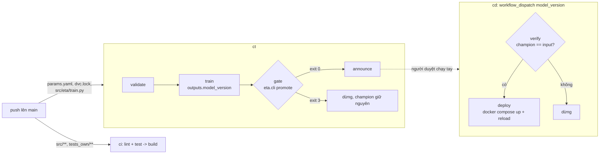

# M08: Workflow GitHub Actions chạy bằng act: CI code, CT model, deploy khi promotion qua

## Mục tiêu

Tới M07, mọi bước đưa model ETA ra production vẫn là lệnh gõ tay: chạy test, train, so với champion, đổi alias, dựng lại
container. Milestone này biến chúng thành ba workflow GitHub Actions, chạy được trên máy bằng `act` (không cần GitHub,
không cần mạng):

- **CI** (`ci.yml`): lint, test, đóng gói mỗi khi code đổi. Test hỏng thì đỏ, `build` không chạy.
- **CT** (`ct.yml`, continuous training): chỉ chạy khi thứ quyết định model đổi (`params.yaml`, `dvc.lock`,
  `src/eta/train.py`): kiểm dữ liệu, train challenger, đưa qua **cổng promotion của M04**. Cổng từ chối thì job dừng với
  mã `EXIT_REJECTED = 3` và mọi job sau cổng không chạy.
- **CD** (`cd.yml`): chạy tay với `model_version`; chỉ deploy khi alias `champion` trong registry **đúng** là version đó.

Điểm nối hai lớp CI và CT là cổng promotion: CI chứng minh code đúng, CT chứng minh model mới không tệ hơn model đang chạy,
CD chỉ tin vào registry. Đây là bài tích hợp sau [module 08](../../modules/08-cicd-for-ml/README.md); cách chạy `act`
ngoại tuyến, runner `mlops-act-runner:1` và giới hạn của act xem ở đó (mục 0 cài `act`).



## Việc cần làm

### 1. Quy ước chung cho ba workflow

- Tệp `.github/workflows/ci.yml`, `ct.yml`, `cd.yml` với `name:` lần lượt **`ci`**, **`ct`**, **`cd`** (act in log theo
  dạng `[ct/gate]`, test dựa vào tên này).
- Mọi job `runs-on: ubuntu-latest`; **chỉ bước `run:`**, không `uses:` (act ngoại tuyến không tải được action từ xa).
- Dependency Python: đặt `PYTHONPATH: .ci-deps:src` (cấp workflow) và mỗi job có bước đầu
  `test -d .ci-deps || python -m pip install --quiet --target .ci-deps -r requirements-ci.txt`. Trên GitHub thật bước
  này cài từ `requirements-ci.txt`; khi test chạy bằng act, `.ci-deps` đã có sẵn (symlink tới thư mục cache cài một lần,
  mount chỉ đọc) nên không cần mạng. Gói có sẵn trong `.ci-deps` (cùng phiên bản môi trường gốc của repo): `pandas`,
  `numpy`, `pyarrow`, `scipy`, `scikit-learn`, `joblib`, `pyyaml`, `pandera`, `mlflow-skinny`, `sqlalchemy`, `alembic`,
  `skops`, `pytest`, `ruff==0.17.1`. Không có `fastapi`, `prefect`: test của bạn trong CI không import `eta.serve`,
  `eta.flows`. Viết `requirements-ci.txt` ghim đúng các gói này.
- Cấu hình đọc từ `params.yaml` và biến `ETA_*` của M01. Test truyền `ETA_DATA_DIR`, `ETA_MLFLOW_URI`, `ETA_MODEL_NAME`,
  `ETA_MONTHS`, `ETA_SAMPLE_ROWS`, `ETA_SEED`, `ETA_MODEL_PARAMS`, `ETA_SPEED_TABLE` (rỗng) bằng `act --env`; **đừng** đặt
  các biến này trong `env:` của workflow, job hay step (sẽ đè giá trị của test). Trên GitHub thật chúng đến từ
  `vars`/`secrets` của repo.
- Trên GitHub thật, mỗi job cần bước lấy code (`actions/checkout`, xem README module 08) trước các bước `run:`; act với
  `--bind` đã mount sẵn thư mục làm việc nên bài này không có bước đó.
- Giá trị từ `${{ ... }}` (input, output của job) đưa vào lệnh qua `env:` rồi dùng `"$BIEN"`, không chèn thẳng
  `${{ }}` vào `run:` (chống script injection, xem module 08).

### 2. `ci.yml`

- Trigger `push` và `pull_request`, có `paths` sao cho đổi `src/**` hay `tests_own/**` thì chạy, còn đổi `params.yaml`,
  `dvc.lock`, `README.md`, `docs/params.yaml` thì không (bảng ở mục 5).
- Job **`lint`**: `python -m ruff check --no-cache src tests_own`. Ruff 0.17 bật rất nhiều luật mặc định: khai báo
  `[tool.ruff]` và `[tool.ruff.lint] select` trong `pyproject.toml` của project (bản tham chiếu: `E`, `F`, `W`, `I`, `B`,
  `line-length = 160`) và sửa code cho sạch.
- Job **`test`**: `python -m pytest tests_own -q -p no:cacheprovider`. `tests_own/` là test **của bạn** (ít nhất một tệp
  `test_*.py`), khác `tests/` là test chấm; chạy nhanh, không cần dữ liệu thật hay stack.
  Khi chạy cả thư mục capstone (`uv run pytest tracks/mlops/capstone`), `conftest.py` của capstone **bỏ qua** mọi thư mục
  `tests_own/` (chúng import `eta` theo đường khác với test chấm). Chạy chúng riêng:
  `cd tracks/mlops/capstone/project && PYTHONPATH=src uv run --project ../../../.. pytest tests_own -q`.
- Job **`build`** `needs: [lint, test]`: đóng gói `src` thành `dist/eta.pyz` (`python -m zipapp src -m "eta.cli:main"`) và
  chạy thử `--help`. Image Docker thật được build trong `cd.yml` trên runner có Docker.

### 3. `ct.yml`

- Trigger `push` lên nhánh `main` với `paths` **đúng** `params.yaml`, `dvc.lock`, `src/eta/train.py`, và
  `workflow_dispatch`.
- Job **`validate`**: với mỗi tháng trong config, `eta.cli prepare` rồi `eta.cli validate` (M03); tháng hỏng làm job đỏ.
- Job **`train`** `needs: validate`: `python -m eta.cli train --config params.yaml --register` (M04: đăng ký version có tag
  `data_version` dạng `sha256:...`; config có `speed_table` (M06) thì `eta.cli train` gắn feature tốc độ y như
  `train_flow` và đưa bảng vào `data_version`, để model CT và model của flow dùng cùng một đường feature), lấy `model_version` từ JSON in ra và xuất thành **output của job**
  (`echo "model_version=..." >> "$GITHUB_OUTPUT"`, khai báo `outputs:`). Đừng chuyển version qua tệp giữa các job: trên
  GitHub thật mỗi job một máy.
- Job **`gate`** `needs: train`: `python -m eta.cli promote --config params.yaml --version "$MODEL_VERSION"`. Cổng qua thì
  đặt alias `champion` (M04) và exit 0; từ chối thì exit **3** (`EXIT_REJECTED`).
- Ít nhất một job `needs: gate` (bản tham chiếu: `announce` in version mới và nhắc chạy `cd`). Job này chỉ chạy khi cổng
  qua.

### 4. `cd.yml` và lệnh `eta.cli champion`

- Thêm lệnh `python -m eta.cli champion --config params.yaml [--expect V]`: in JSON version đang mang alias `champion`;
  exit 0 khi có champion và (nếu có `--expect`) đúng bằng `V`, khác thì exit khác 0.
- `cd.yml` chỉ có trigger `workflow_dispatch` với input bắt buộc **`model_version`**.
- Job **`verify`**: `eta.cli champion --expect "$MODEL_VERSION"`. Job **`deploy`** `needs: verify`: `docker compose -f
  compose.yaml up -d --build --wait api`, `POST /admin/reload` (token từ secret `ETA_ADMIN_TOKEN`), rồi kiểm `/readyz` báo
  đúng `model_version`. Runner của act không có Docker CLI nên test chỉ chạy `verify`; `deploy` chạy trên GitHub hay
  self-hosted runner.

### 5. Test chấm làm gì

Test chép `project/` (bỏ `tests/`, `data/`, `models/`, `reports/`, `notebooks/`, `.ci-deps`) vào một repo git tạm, tạo
symlink `.ci-deps`, rồi chạy `act` qua `mlopskit.act_run` (runner `mlops-act-runner:1`, `--user` uid của bạn, MLflow là
SQLite trong repo tạm, mạng `host`).

- `test_m08_workflow_structure`: các quy ước ở mục 1 tới 4 (tên, job, `needs`, chỉ `run:`, input `model_version`,
  `docker compose` trong `deploy`).
- `test_m08_ci_fails_on_broken_test`: thêm `tests_own/test_zz_m08_broken.py` hỏng → `act push -W ci.yml -j test` khác 0 và
  log có tên test hỏng; bỏ tệp đó → cả `ci.yml` xanh và job `build` có chạy.
- `test_m08_ct_path_filter`: act **bỏ qua** `paths`, nên test mô phỏng bộ lọc bằng `cikit.triggers` của module 08 (glob
  như GitHub, không hỗ trợ mẫu phủ định `!`, không dùng `paths` cùng `paths-ignore`) trên sự kiện `push`:

  | Tệp đổi | `ci` chạy | `ct` chạy |
  | --- | --- | --- |
  | `src/eta/serve.py`, `src/eta/features.py`, `tests_own/test_core.py` | có | không |
  | `params.yaml`, `dvc.lock` | không | có |
  | `src/eta/train.py` | có | có |
  | `README.md`, `docs/params.yaml` | không | không |

  Thêm: `ct` không chạy khi push lên `feature/x`, chạy được bằng `workflow_dispatch`; `act -l` liệt kê `validate`, `train`,
  `gate` của `ct` và `test` của `ci`; `act push -W ct.yml --dryrun` thoát 0.
- `test_m08_gate_blocks_deploy` (cần `nyc-tlc` 2019-01): đăng ký sẵn một champion có MAE 1 giây (không thể thắng), chạy
  cả `ct.yml` trên mẫu 20 000 chuyến thật → workflow đỏ, log của `[ct/gate]` có `exitcode '3'`, không job nào `needs: gate`
  được chạy, alias `champion` giữ nguyên.
- `test_m08_ct_promotes_first_model`: registry trống → `ct.yml` xanh, có alias `champion`, version có tag `data_version`.
- `test_m08_cd_requires_champion`: champion là v1, chạy `cd.yml` với `model_version` là v2 (chưa promote) → đỏ, `[cd/deploy]`
  không chạy; `-j verify` với v1 → xanh.

```bash
uv run pytest tracks/mlops/capstone/project/tests -q -rs -k m08
```

Lần đầu test cài các gói ở mục 1 vào `~/.cache/mlops-ex/eta-ci-<hash>` (cần mạng một lần, dùng lại về sau). Chạy tay:
`make -C tracks/mlops/capstone/project act-ci` nếu bạn chép target này từ bản tham chiếu, hoặc
`act push -W .github/workflows/ci.yml -P ubuntu-latest=mlops-act-runner:1 --pull=false --bind --container-options "--user $(id -u):$(id -g)"`
trong thư mục project (`--user` để tệp `--bind` ghi ra, như `.ci-deps/`, thuộc về bạn chứ không phải root).

## Kết quả nộp

- `capstone/project/.github/workflows/{ci,ct,cd}.yml`, `requirements-ci.txt`, `tests_own/`, `[tool.ruff]` trong
  `pyproject.toml`, lệnh `champion` trong `src/eta/cli.py`.
- Mục "CI/CD" trong README project: sơ đồ ba workflow, bảng trigger, thời gian chạy mỗi workflow bằng act trên máy bạn,
  và giải thích chỗ CI nối với CT (cổng promotion) và CT nối với CD (alias `champion`).

## Tiêu chí đạt

- [ ] `uv run pytest tracks/mlops/capstone/project/tests -q -rs -k m08` pass, không skip (`act`, Docker, `nyc-tlc` sẵn sàng).
- [ ] Test hỏng làm CI đỏ và `build` không chạy; đổi `src/eta/serve.py` không kích hoạt train.
- [ ] Challenger tệ hơn bị chặn ở `gate` với exit 3, không job nào sau cổng chạy, champion không đổi.
- [ ] CD từ chối deploy version không mang alias `champion`.
- [ ] Workflow không có `uses:`, không chèn `${{ }}` thẳng vào `run:`, không in secret ra log.
- [ ] (Tự đánh giá) Bạn giải thích được vì sao CT không chạy ở mọi push, và vì sao CD đọc registry chứ không đọc output
      của CT.
