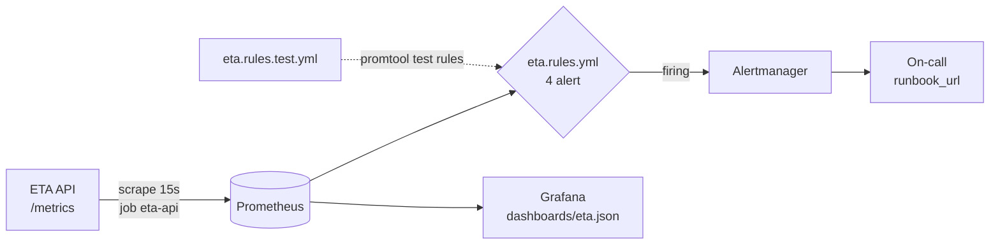

# M09: Prometheus và Grafana: dashboard service và model, alert rule có test

## Mục tiêu

API của M07 chạy được champion, canary, shadow, nhưng khi có chuyện bạn chỉ biết qua người dùng phàn nàn. Milestone này
cho service ETA đôi mắt:

- **Metric service theo RED** (rate, errors, duration) và **metric model** (phân phối giá trị dự đoán, version đang
  chạy, tỉ lệ fallback) xuất ở `/metrics`, label ít giá trị (không `request_id`).
- **Bốn alert theo triệu chứng**, mỗi alert có `for`, `severity`, `runbook_url`, và được chứng minh bằng
  `promtool test rules`, gồm ca khó nhất: **không có traffic** thì tỉ lệ lỗi là 0/0, không được bắn alert lỗi giả; còn
  khi chính metric biến mất thì phải có alert `absent`.
- **Dashboard as code** cho Grafana, mọi truy vấn chỉ dùng metric API thật sự xuất ra.

Đây là bài tích hợp sau [module 09](../../modules/09-monitoring-observability/README.md) (profile `monitoring` của stack,
cách dùng `promtool`, cardinality, dashboard provisioning).



## Việc cần làm

### 1. Metric trong `src/eta/serve.py`

Dùng `prometheus_client` (registry mặc định, đã có từ M07). Giữ `eta_fallback_total`, `eta_shadow_errors_total` của M07.

| Metric | Kiểu | Label | Ý nghĩa |
| --- | --- | --- | --- |
| `eta_requests_total` | Counter | `status` (mã HTTP dạng chuỗi), `variant` | Mỗi request `POST /predict`, **kể cả** 422 (validate lỗi), 503, 500 |
| `eta_request_duration_seconds` | Histogram | `variant` | Thời gian xử lý mỗi request `POST /predict` (mọi status); bucket phải có `0.3` |
| `eta_prediction_seconds` | Histogram | `variant` | Giá trị `eta_s` của mỗi dự đoán thành công (cả shadow, `variant="shadow"`) |
| `eta_model_info` | Gauge = 1 | `version`, `variant` (`champion`, `challenger`) | Model đang nạp; đặt lại khi khởi động, reload và tắt |

- `variant` của request là nhánh đã trả lời (`champion`, `canary`); request không tới được model (422, 503) dùng
  `variant="none"`.
- Request 422 do FastAPI trả trước khi vào endpoint, nên đếm bằng **middleware** (`@app.middleware("http")`) bao quanh
  `/predict`; endpoint ghi `request.state.variant` để middleware đọc. Exception chưa bắt được đếm `status="500"`.
- Label của mọi metric `eta_*` chỉ thuộc `{status, variant, version, le}`. Không bao giờ dùng `request_id`, zone hay giờ làm
  label: mỗi giá trị mới là một time series mới.
- Bucket gợi ý: độ trễ `0.005, 0.01, 0.025, 0.05, 0.1, 0.2, 0.3, 0.5, 1, 2.5`; dự đoán `60, 120, 300, 600, 900, 1200, 1800,
  2700, 3600, 5400, 7200`.

### 2. `monitoring/prometheus.yml`

Scrape job tên **`eta-api`** (target `api:8000` trong Compose), `rule_files: [rules/eta.rules.yml]`, alerting tới
`alertmanager:9093`. Phải qua `promtool check config` (đường dẫn rule tính từ thư mục `monitoring/`).

### 3. `monitoring/rules/eta.rules.yml`

Bốn alert, selector lọc `job="eta-api"`:

| Alert | Điều kiện | `for` | `severity` gợi ý |
| --- | --- | --- | --- |
| `EtaHighErrorRate` | Tỉ lệ `eta_requests_total` có `status` 5xx trên tổng, cửa sổ `rate` 5 phút, vượt 5% | **5m** | `critical` |
| `EtaHighLatencyP95` | `histogram_quantile(0.95, ...)` của `eta_request_duration_seconds` (cửa sổ 5 phút) trên 0.3 s | **10m** | `warning` |
| `EtaMetricsAbsent` | `absent(...)` của một metric API **luôn** xuất khi sống (gợi ý `eta_model_info{job="eta-api"}`) | tuỳ bạn | `critical` |
| `EtaPredictionShift` | Trung vị `eta_prediction_seconds` (bỏ `variant="shadow"`, cửa sổ 1 giờ) lệch hơn 30% so với `offset 7d` | tuỳ bạn | `warning` |

- Mỗi alert: `for` lớn hơn 0, `labels.severity` là `critical` hoặc `warning`, `annotations.summary` không rỗng,
  `annotations.runbook_url` bắt đầu bằng `https://` và chứa chữ `runbook` (trỏ tới mục của alert trong `docs/runbook.md`,
  viết ở M10).
- Không dùng `absent(eta_requests_total)`: counter có label chưa có series nào cho tới request đầu tiên, nên service vừa
  khởi động mà chưa có traffic sẽ bị báo "mất metric" giả.

### 4. `monitoring/rules/eta.rules.test.yml`

Test của bạn cho `promtool test rules` (chạy với thư mục làm việc `monitoring/rules`). Bắt buộc có:

- Một ca **không traffic**: mọi series `eta_requests_total` đứng yên ở 0 (dạng `0+0xN` hoặc `0xN`), có
  `alert_rule_test` cho `EtaHighErrorRate` với `exp_alerts` rỗng.
- Một ca `EtaMetricsAbsent` **bắn** (`exp_alerts` không rỗng).

Nên có thêm ca lỗi 10% bắn sau `for`, ca p95 cao và ca dịch chuyển dự đoán (`interval` 30m, hơn 7 ngày dữ liệu).

### 5. `monitoring/grafana/dashboards/eta.json`

Dashboard JSON (như module 09: biến `datasource`, `schemaVersion` từ 39), có panel cho: request theo status
(`eta_requests_total`), tỉ lệ lỗi, p50/p95 độ trễ theo variant (`eta_request_duration_seconds_bucket`), phân phối hoặc
trung vị dự đoán (`eta_prediction_seconds_bucket`), version đang chạy (`eta_model_info`), fallback/shadow lỗi. **Mọi tên
`eta_*` trong `expr` phải có thật** trong `/metrics` của API. Tuỳ chọn: provisioning datasource và dashboard trong
`monitoring/grafana/provisioning/` và profile `monitoring` trong `compose.yaml` của project (bản tham chiếu: Prometheus
`127.0.0.1:29190`, Grafana `127.0.0.1:23100`, đổi qua `ETA_PROMETHEUS_PORT`, `ETA_GRAFANA_PORT`).

### 6. Test chấm làm gì

- `test_m09_metrics_exposed`: `TestClient`, model joblib, `ETA_MODEL_VERSION=m09-v1`. Đọc `/metrics` trước và sau 4 request
  hợp lệ và 1 request `trip_distance=-1` (counter dùng chung trong tiến trình nên test so **độ chênh**):
  `eta_requests_total{status="200"}` +4 (cả 4 có `variant="champion"`), `{status="422"}` +1,
  `eta_request_duration_seconds_count` +5, có bucket `le="0.3"`, `eta_prediction_seconds_count` +4,
  `eta_model_info{version="m09-v1",variant="champion"} == 1`, còn `eta_fallback_total`, và không metric `eta_*` nào có
  label ngoài `{status, variant, version, le}`.
- `test_m09_rules_promtool`: `prometheus.yml` có job `eta-api`; `promtool check config` và `promtool test rules
  eta.rules.test.yml` thoát 0; đủ bốn alert với metadata ở mục 3, `for` của `EtaHighErrorRate` là 5m và của
  `EtaHighLatencyP95` là 10m.
- `test_m09_rules_no_traffic`: test tự chạy rule của bạn trên ba kịch bản (series có nhãn `job="eta-api",
  instance="api:8000"`; gồm `eta_requests_total` status 200 và 500, bucket độ trễ `le="0.3"` và `+Inf`, `eta_model_info`):
  **không traffic** (counter đứng yên, `eta_model_info` = 1) → ở phút 15 và 30 không alert lỗi, không alert p95, không
  absent; **lỗi 10%** → chưa bắn ở phút 2, bắn ở phút 15; **API mất hẳn** (mọi series stale sau phút 10) → absent chưa bắn ở
  phút 3, bắn ở phút 25, alert lỗi không bắn. Rồi kiểm tệp test của bạn có hai ca bắt buộc ở mục 4.
- `test_m09_dashboard_provisioned`: mọi `eta_*` trong `expr` có trong `/metrics`, dashboard dùng đủ bốn metric RED, dự đoán,
  version; rồi (cần Grafana của stack, `require_stack("grafana")`) đẩy dashboard qua API với `uid` ngẫu nhiên, đọc lại đúng
  danh sách panel, xoá trong `finally`.

```bash
uv run pytest tracks/mlops/capstone/project/tests -q -rs -k m09
```

## Kết quả nộp

- `capstone/project/src/eta/serve.py` (bản M09), `monitoring/prometheus.yml`, `monitoring/rules/eta.rules.yml`,
  `monitoring/rules/eta.rules.test.yml`, `monitoring/grafana/dashboards/eta.json` (và provisioning nếu làm).
- Mục "Monitoring" trong README project: ảnh chụp dashboard khi chạy k6 của M07, bảng bốn alert (điều kiện, `for`, vì
  sao chọn ngưỡng), và giải thích vì sao tỉ lệ lỗi 0/0 không bắn alert.

## Tiêu chí đạt

- [ ] `uv run pytest tracks/mlops/capstone/project/tests -q -rs -k m09` pass, không skip (Docker, Grafana của stack bật bằng
      `--profile monitoring`).
- [ ] Request 422 được đếm; không label cardinality cao.
- [ ] Không traffic thì không alert lỗi giả; API biến mất thì có alert `absent`.
- [ ] Mỗi alert có `for`, `severity`, `runbook_url`; tệp test promtool có ca không traffic.
- [ ] Dashboard chỉ dùng metric có thật, có RED, phân phối dự đoán, version.
- [ ] (Tự đánh giá) Bạn giải thích được vì sao `EtaPredictionShift` là tín hiệu proxy (chưa có nhãn) và nó bắn trong tình
      huống nào của dữ liệu 2020 ở M10.
