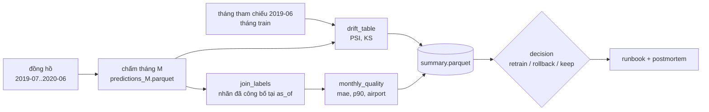

# M10: Phát lại 2019 tới 2020: phát hiện, quyết định, runbook và postmortem COVID

## Mục tiêu

Bạn vận hành service ETA suốt 12 tháng, từ 2019-07 tới 2020-06, bằng đồng hồ mô phỏng của M05: mỗi tháng chấm chuyến
bằng champion, đo drift của đầu vào và của dự đoán, và khi nhãn về (chậm một tháng) thì đo chất lượng thật. Giữa chừng là
mùa lễ cuối 2019 (drift mùa vụ) và tháng 3/2020 (NYC phong toả vì COVID). Nhiệm vụ:

- Viết `eta.drift` (PSI, KS) và `eta.quality` (join log dự đoán với nhãn, chất lượng theo tháng).
- Lệnh `eta.cli replay` ghi `reports/replay/summary.parquet` trên dữ liệu thật.
- Ra **quyết định có số liệu** cho 2020-03 và ít nhất một tháng khác: `retrain`, `rollback` hay `keep`. Không có đáp án
  định sẵn: quyết định phải đứng được bằng số bạn đo, và **drift không đồng nghĩa với train lại**.
- Viết runbook cho các alert của M09 và postmortem không đổ lỗi cho giai đoạn COVID.

Đây là bài tích hợp sau [module 10](../../modules/10-drift-incidents/README.md) (PSI/KS và giới hạn của chúng, nhãn về
muộn, khung phát hiện → xác minh → tác động → quyết định, runbook, postmortem).



## Việc cần làm

### 1. `src/eta/drift.py`

```python
psi(ref: pd.Series, cur: pd.Series, bins: int = 10) -> float
drift_table(ref: pd.DataFrame, cur: pd.DataFrame, columns: list[str]) -> pd.DataFrame   # cột feature, psi, ks_stat
```

PSI ở đây chia bin theo **quantile của `ref`** (khác cách của Evidently ở module 10; hai cách cho số khác nhau, bạn ghi rõ
mình dùng cách nào). Test so với số tính tay tới sai số `1e-6`, nên làm đúng từng bước:

1. Bỏ NaN ở mỗi mẫu; tỉ lệ tính trên số dòng còn lại.
2. `edges = np.unique(np.quantile(ref, np.linspace(0, 1, bins + 1)))` (nội suy mặc định của numpy); biên trùng nhau gộp
   lại. Biên trong là `edges[1:-1]`; hai bin ngoài cùng mở tới âm và dương vô cùng.
3. Bin của mỗi giá trị: `np.searchsorted(biên_trong, x, side="right")` (giá trị bằng biên rơi vào bin bên phải).
4. Tỉ lệ mỗi bin nhỏ hơn `1e-4` (kể cả bin rỗng) nâng lên `1e-4`, áp riêng cho `ref` và `cur`.
5. $$\mathrm{PSI} = \sum_i (c_i - r_i)\,\ln\frac{c_i}{r_i}$$; `psi(x, x) == 0`.

`ks_stat` là `scipy.stats.ks_2samp(ref, cur).statistic` (bỏ NaN). `drift_table` trả mỗi cột trong `columns` một dòng,
đúng thứ tự, đúng ba cột `feature`, `psi`, `ks_stat`.

### 2. `src/eta/quality.py`

```python
join_labels(predictions: pd.DataFrame, labels: pd.DataFrame) -> pd.DataFrame
monthly_quality(joined: pd.DataFrame) -> dict[str, float]   # khoá mae, p90_abs_err, mae_airport, n
```

- `join_labels`: inner join theo `request_id`; giữ các cột của log dự đoán (`PREDICTION_LOG_COLUMNS`) và thêm
  `duration_s`. Request chưa có nhãn và nhãn không khớp request nào đều bị loại.
- `monthly_quality`: sai số tuyệt đối `|eta_s - duration_s|`; `mae` là trung bình, `p90_abs_err` là `np.quantile(..., 0.9)`,
  `mae_airport` là MAE của chuyến có `PULocationID` hoặc `DOLocationID` thuộc sân bay (132, 138; NaN nếu không có), `n` là
  số dòng. Nên thêm `bias_s` (trung bình `eta_s - duration_s`): dấu của nó cho biết model đoán dài hay ngắn.

### 3. `eta.cli replay`

```bash
python -m eta.cli replay --config params.replay.yaml --start 2019-07 --end 2020-06 --out reports/replay [--reference 2019-06]
```

1. Gọi `replay_flow(start, end, config, out)` của M05 (train champion trên tháng `start - 1` nếu registry chưa có
   champion; ghi `predictions_<tháng>.parquet` và `replay.json`).
2. Chấm thêm tháng tham chiếu (`--reference`, mặc định `start - 1`, chính là tháng train) bằng `batch_score_flow`.
3. Ghi `out/summary.parquet`, mỗi tháng từ `start` tới `end` một dòng, đúng các cột:

| Cột | Cách tính |
| --- | --- |
| `month`, `model_version`, `n_scored` | Từ `predictions_<tháng>.parquet` |
| `psi_trip_distance`, `psi_pickup_hour`, `psi_eta_s` | `drift_table(tham chiếu, tháng)`; `pickup_hour` lấy từ `pickup_datetime` của log dự đoán |
| `ks_trip_distance` | `ks_stat` của `trip_distance` |
| `n_labeled`, `mae`, `p90_abs_err`, `mae_airport`, `bias_s` | `monthly_quality(join_labels(dự đoán, labels_for(tháng, as_of=end)))`; nhãn chưa công bố thì `n_labeled = 0` và các số còn lại NaN |
| `as_of` | `end` |

`mae` của summary phải bằng `mae` mà `replay_flow` ghi trong `replay.json` (cùng nhãn, cùng log dự đoán).

Dữ liệu: `data_dir` phải chứa `yellow_tripdata_<tháng>.parquet` của cả 2019 và 2020 (hai bộ `nyc-tlc`, `nyc-tlc-2020`):
tạo thư mục symlink, ví dụ `data/replay/`. Phát lại mất khoảng một phút với mẫu 50 000 chuyến mỗi tháng.

### 4. Quyết định: `reports/decisions/<YYYY-MM>.yaml`

Chạy phát lại với **đúng cấu hình test dùng** (để số của bạn khớp số test tự tính): `months: ["2019-06"]`,
`sample_rows: 50000`, `seed: 0`, `model_params: {max_iter: 100}`, registry trống. Đọc `summary.parquet` rồi viết:

```yaml
decision: keep            # retrain | rollback | keep
reasons:                  # ≥2 câu, mỗi câu ≥6 từ, có số
  - "..."
  - "..."
evidence:
  psi_trip_distance: 0.0  # psi_trip_distance của tháng này trong summary
  mae_before: 0.0         # mae của tháng trước
  mae_after: 0.0          # mae của tháng này
  as_of: "YYYY-MM"        # lúc bạn ra quyết định
```

- Bắt buộc `2020-03.yaml` và ít nhất một tháng khác trong 2019-07..2020-06 (gợi ý tháng mùa vụ 2019-12). Tên tệp là tháng
  được quyết định.
- Ba số trong `evidence` khớp `summary.parquet` trong sai số 1%. Thêm khoá khác tuỳ bạn (PSI giờ đón, bias, kết quả thử
  train lại).
- `as_of` là lúc bạn **biết** các số đó: nhãn của tháng phải đã công bố (`published(tháng, as_of)` của M05, tức
  `as_of >= tháng + 1`) và `as_of` không sau `2020-06`. Quyết định cho 2020-03 sớm nhất là `as_of: "2020-04"`.
- Hai luật nhất quán test kiểm: MAE **không xấu đi** (`mae_after <= mae_before`) thì `decision` phải là `keep` (drift một
  mình không phải lý do train lại); MAE xấu đi **hơn 50%** thì không được `keep`. Ở giữa hai mức đó, lý do của bạn quyết
  định, và được chấm bằng rubric trong `SOLUTION.md`.
- Nên chứng minh bằng thí nghiệm, không chỉ bằng ngưỡng: ví dụ train challenger trên phần đầu tháng, so với champion trên
  phần cuối tháng (dữ liệu bạn **đã có** tại `as_of`).

### 5. `docs/runbook.md` và `docs/postmortem-covid.md`

- Runbook: mỗi alert trong `monitoring/rules/eta.rules.yml` (M09) có một mục, tên alert xuất hiện trong runbook; có các
  heading (cấp nào cũng được, có thể đánh số) **Triệu chứng**, **Kiểm tra**, **Hành động**, **Leo thang**. Lệnh kiểm tra
  phải chạy được; nên có mục quyết định hằng tháng sau khi nhãn về.
- Postmortem không đổ lỗi cho giai đoạn COVID trong phát lại: heading **Tóm tắt**, **Dòng thời gian**, **Nguyên nhân**,
  **Tác động**, **Việc cần làm**; nhắc mốc `2020-03` và `2020-04`; số liệu lấy từ summary của bạn.
- Mỗi tệp ít nhất 300 từ và không còn chữ `TODO`.

### 6. Test chấm làm gì

- `test_m10_psi_matches_reference`: ba ca tính tay (`bins=2` có NaN; bin rỗng nâng `1e-4`; biên quantile trùng phải gộp),
  `psi(x, x) == 0`, dịch 50% thì PSI trên 0.1, `drift_table` đúng cột, thứ tự và khớp `ks_2samp`.
- `test_m10_join_labels_and_quality`: 5 dự đoán, 5 nhãn (một nhãn không có request) → 4 dòng; `mae`, `p90_abs_err`,
  `mae_airport`, `n` khớp số tính tay.
- `test_m10_replay_summary_real` (cần `nyc-tlc` và `nyc-tlc-2020`, đọc qua `mlopskit.real_month` có kiểm sha256): chạy
  `eta.cli replay` với cấu hình ở mục 4 trên thư mục symlink 2019-06..2020-06, MLflow SQLite tạm, Prefect test harness;
  summary đủ cột, 12 tháng, `as_of = 2020-06`; PSI `trip_distance` của 2020-04 lớn hơn của 2019-12; tháng 2020-06 `mae`
  NaN và `n_labeled = 0`; các tháng khác có `mae`, `n_labeled == n_scored`, `mae` khớp `replay.json`.
- `test_m10_decision_files_valid`: các luật ở mục 4, so với summary mà test vừa tính bằng code của bạn.
- `test_m10_docs_structure`: các luật ở mục 5.

```bash
uv run pytest tracks/mlops/capstone/project/tests -q -rs -k m10
```

## Kết quả nộp

- `capstone/project/src/eta/drift.py`, `quality.py`, lệnh `replay` trong `cli.py`, cấu hình phát lại (ví dụ
  `params.replay.yaml`).
- `reports/decisions/2020-03.yaml` và ít nhất một quyết định khác (`.gitignore` bỏ chặn `reports/decisions/`, vẫn chặn phần
  còn lại của `reports/`).
- `docs/runbook.md`, `docs/postmortem-covid.md`.
- Mục "Drift và sự cố" trong README project: bảng summary 12 tháng (PSI, MAE, bias), quyết định từng tháng bạn chọn và
  lý do một dòng.

## Tiêu chí đạt

- [ ] `uv run pytest tracks/mlops/capstone/project/tests -q -rs -k m10` pass, không skip (hai bộ dữ liệu đã tải).
- [ ] MAE của một tháng chỉ dùng nhãn đã công bố tại `as_of`; tháng cuối không có MAE.
- [ ] Quyết định 2020-03 và tháng còn lại có số khớp summary, lý do dựa trên chất lượng đo được, không chỉ trên drift.
- [ ] Runbook phủ mọi alert của M09; postmortem không đổ lỗi, có dòng thời gian và việc cần làm có người/khi nào.
- [ ] (Tự đánh giá, rubric trong `SOLUTION.md`) Bạn giải thích được vì sao PSI `trip_distance` gần như không đổi trong
      tháng 3/2020 mà MAE vẫn xấu đi, và tín hiệu nào lẽ ra báo sớm hơn.
