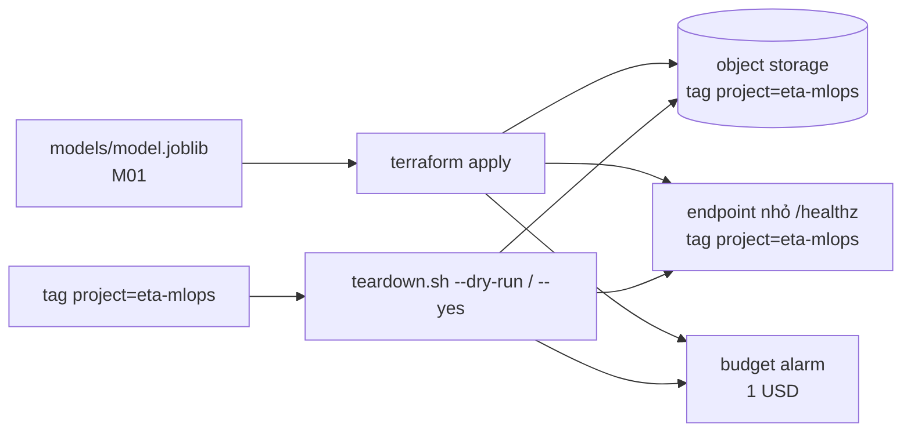

# M11: Tuỳ chọn: đưa một phần lên cloud free tier, có lệnh dọn

## Mục tiêu

**Milestone này tuỳ chọn.** Bỏ qua nó không mất điểm phần lõi: M12 và M13 không dùng gì từ đây, và khi chưa có thư mục
`cloud/` thì mọi test `test_m11_*` **skip** với lý do "M11 tuỳ chọn", không fail. Làm nó khi bạn có (hoặc muốn tạo) một
tài khoản cloud và muốn thấy service ETA chạy ngoài máy mình.

Sau [module 12](../../modules/12-ml-platform-governance/README.md) bạn đã biết chi phí và quản trị là một phần của nền
tảng ML. Bài này luyện đúng phần đó ở quy mô nhỏ nhất:

- Đưa **một phần** service lên free tier của **một** nhà cung cấp bạn chọn (AWS, GCP hay Azure), ví dụ artifact model lên
  object storage và một endpoint nhỏ báo model nào đang chạy. Không cần đưa cả API, MLflow hay Prefect lên.
- Mọi tài nguyên tạo bằng **IaC (Terraform hoặc OpenTofu)** và mang **tag dự án**, để tìm và xoá được kể cả khi mất state.
- Có **budget alarm** đặt trước khi tạo tài nguyên đầu tiên, và một **lệnh dọn** xem trước được (`--dry-run`).

Bài học chính không phải cloud: là thói quen "không tạo thứ gì mà mình không biết cách xoá và không biết nó tốn bao nhiêu".



## Việc cần làm

### 1. Không có tài khoản thì dừng ở đây

Mọi test **không** cần tài khoản, khoá hay mạng cloud: chúng đọc tệp `.tf` và chạy `teardown.sh` trên inventory giả. Bạn
có thể viết toàn bộ thư mục `cloud/`, cho test xanh, mà không bao giờ `terraform apply`. Chạy thật trên cloud là phần tự
đánh giá. Nếu tạo tài khoản mới: bật MFA cho root, tạo user/role riêng để làm bài, và đặt budget (mục 4) **trước**.

### 2. `cloud/*.tf`: IaC có tag dự án

Bạn chọn nhà cung cấp và dịch vụ. Gợi ý cho AWS: bucket S3 chứa model (chặn public, mã hoá), một Lambda 128 MB trả JSON
`model_version` và vị trí artifact (không cần nạp model), log group giữ log vài ngày, budget. GCP: Cloud Storage và Cloud
Run (scale về 0). Luật test kiểm:

- Có ít nhất một tệp `cloud/*.tf` và một block `resource`.
- Một block `locals` khai `tags = { project = "eta-mlops", ... }` (giá trị đúng từng ký tự; thêm `owner`, `milestone`
  tuỳ bạn).
- **Mọi** block `resource` có `tags = local.tags` hoặc `tags = merge(local.tags, {...})` (GCP dùng `labels =` cùng cách),
  **hoặc** block `provider` có `default_tags { tags = local.tags }` (AWS) hay `default_labels = local.tags` (Google).
  Ngoại lệ duy nhất là các loại tài nguyên con không nhận tag, bị xoá theo tài nguyên cha:
  `aws_s3_bucket_public_access_block`, `aws_s3_bucket_versioning`, `aws_s3_bucket_server_side_encryption_configuration`,
  `aws_s3_bucket_lifecycle_configuration`, `aws_s3_bucket_ownership_controls`, `aws_s3_bucket_policy`,
  `aws_iam_role_policy`, `aws_iam_role_policy_attachment`, `aws_lambda_function_url`, `aws_lambda_permission`,
  `google_project_service`, `google_storage_bucket_iam_member`, `google_cloud_run_v2_service_iam_member`,
  `google_cloud_run_service_iam_member`, `google_project_iam_member`, `google_billing_budget` (budget gắn với billing
  account, không nhận `labels`).
- Không có `access_key = "..."` hay `secret_key = "..."` trong `.tf`: khoá lấy từ profile CLI hoặc biến môi trường.
- `cloud/.gitignore` chặn `*.tfstate` và `.terraform` (state chứa ID, có khi chứa bí mật; không commit).

Không bị test kiểm nhưng hay vấp: Lambda function URL công khai (`authorization_type = "NONE"`) từ cuối 2025 cần cả hai
quyền `lambda:InvokeFunctionUrl` và `lambda:InvokeFunction` cho principal `"*"` (hai `aws_lambda_permission`); thiếu một
trong hai thì URL trả 403. Quyền `lambda:InvokeFunction` cho `"*"` phải kèm `invoked_via_function_url = true` (cần provider
`hashicorp/aws` từ 6.28): thiếu điều kiện này thì ai có tài khoản AWS cũng gọi thẳng API `Invoke` được, không cần URL.

### 3. `cloud/teardown.sh`: dọn theo tag, có `--dry-run`

`terraform destroy` là đường chính. `teardown.sh` là lưới an toàn khi mất state hay apply hỏng giữa chừng: nó tìm tài
nguyên theo **tag**, không theo tên.

```text
bash cloud/teardown.sh --dry-run [--inventory FILE]
bash cloud/teardown.sh --yes     [--inventory FILE]
```

- Không có `--inventory`: hỏi cloud (AWS: `aws resourcegroupstaggingapi get-resources --tag-filters Key=project,Values=eta-mlops`;
  IAM role không luôn hiện ở API này, nên đặt role dưới một `path` riêng và liệt kê thêm bằng `aws iam list-roles
  --path-prefix`). Không bị test kiểm nhưng hay vấp khi chạy thật: Tagging API theo **vùng**, nên truyền `--region` bằng
  vùng trong Terraform (cho người chạy đổi được, ví dụ cờ `--region` của script), không dựa vào vùng mặc định của CLI;
  budget AWS là toàn cục, liệt kê riêng như IAM role (`aws budgets describe-budgets --account-id ...` rồi
  `aws budgets list-tags-for-resource`); xoá Lambda và log group ở đúng vùng trong ARN của chúng; CLI tự gộp mọi trang của
  `get-resources`, đừng tự truyền `--pagination-token`; và output `--output json` của CLI là JSON **nhiều dòng**, đọc cả
  output bằng một trình phân tích JSON, đừng ghép tay thành JSON Lines.
- Có `--inventory FILE`: đọc danh sách từ tệp JSON thay vì hỏi cloud, định dạng:

  ```json
  {"resources": [{"id": "arn:aws:s3:::eta-mlops-models-7f3a", "type": "aws_s3_bucket",
                  "name": "eta-mlops-models-7f3a", "tags": {"project": "eta-mlops"}}]}
  ```

  `tags` có thể thiếu hoặc rỗng. `type` là tên loại tài nguyên Terraform; `name` là tên dùng trong lệnh xoá.
- Chọn tài nguyên khi `tags.project` bằng **đúng** `eta-mlops`: khoá `Project` viết hoa, giá trị `eta-mlops-staging`,
  hay tên bắt đầu bằng `eta-mlops-` mà không có tag đều **không** bị chọn.
- `--dry-run`: in ra stdout **đúng một dòng bắt đầu bằng `WOULD DELETE`** cho mỗi tài nguyên được chọn, dòng đó chứa `id`;
  không in dòng `WOULD DELETE` nào khác; **không gọi** `aws`, `gcloud` hay `az` (kể cả lệnh đọc, khi đã có
  `--inventory`); exit 0.
- `--yes`: gọi lệnh xoá của CLI cloud cho từng tài nguyên được chọn, lệnh có chứa `name` của nó; không lệnh nào nhắc tới
  tài nguyên không được chọn; exit 0 khi xong.
- `--yes` mà một lệnh xoá lỗi: **không dừng**, vẫn xoá tiếp mọi tài nguyên còn lại; cuối lượt in ra stderr một dòng chứa
  `FAILED` và `name` (hoặc `id`) của mỗi tài nguyên xoá lỗi, rồi exit khác 0. Dừng giữa chừng để lại phần đắt nhất còn
  chạy; `set -e` cho cả vòng xoá là cách hay gặp để vấp luật này.
- Không có `--dry-run` lẫn `--yes`: từ chối, exit khác 0, không gọi CLI nào.
- Gặp `type` chưa biết cách xoá khi chạy `--yes`: dừng **trước khi** xoá bất cứ thứ gì và báo loại đó (dry-run vẫn liệt
  kê nó, kèm cảnh báo ra stderr).

Nên xoá theo thứ tự phụ thuộc (endpoint trước role nó dùng) và xoá budget cuối cùng, để cảnh báo còn tới phút chót.

### 4. `cloud/budget.md`

Viết trước khi `apply`: ngưỡng tiền **bằng số kèm `USD`** (ví dụ trần 1 USD/tháng), alarm/cảnh báo gửi tới đâu (email,
SNS, Pub/Sub), mỗi tài nguyên tốn gì ngoài free tier, và quy trình dọn có lệnh `teardown.sh --dry-run`. Ít nhất 150 từ,
không còn `TODO`. Budget nên nằm trong IaC (AWS `aws_budgets_budget` nhận tag nên được dọn theo tag, xoá cuối cùng; GCP
`google_billing_budget` không nhận `labels`, nên ghi trong `budget.md` cách xoá nó bằng `terraform destroy` hay console).

### 5. Test chấm làm gì

- `test_m11_iac_resources_tagged`: các luật ở mục 2, đọc tệp `.tf` bằng bộ đọc HCL tối giản (bỏ comment, chuỗi, heredoc).
- `test_m11_teardown_dry_run_inventory`: chạy `bash cloud/teardown.sh --dry-run --inventory <tệp>` trong sandbox, `PATH`
  có `aws`, `gcloud`, `az` **giả** chỉ ghi lại lời gọi. Inventory có 5 tài nguyên mang tag đúng và 5 tài nguyên bẫy
  (không tag, tag rỗng, `Project` viết hoa, `eta-mlops-staging`, tag khác). Đúng 5 dòng `WOULD DELETE`, không lời gọi CLI.
- `test_m11_teardown_deletes_only_tagged`: cùng inventory, không cờ → exit khác 0 và không gọi CLI; `--yes` → mỗi tài
  nguyên được chọn có lệnh chứa `name` của nó, không lệnh nào chứa `name` của tài nguyên bẫy. Inventory dùng `type` của
  AWS (`aws_s3_bucket`, `aws_lambda_function`, `aws_cloudwatch_log_group`, `aws_iam_role`, `aws_budgets_budget`); chọn
  GCP hay Azure thì script của bạn vẫn phải xoá được năm loại này qua `aws` (CLI giả nên không cần cài).
- `test_m11_teardown_continues_after_a_failed_delete`: cùng inventory, `--yes` với `aws` giả trả lỗi cho mọi lệnh chứa
  `name` của tài nguyên được chọn đầu tiên (bucket `eta-mlops-models-7f3a`) → exit khác 0, mọi tài nguyên được chọn khác vẫn
  có lệnh xoá, stderr có dòng `FAILED` nêu tên bucket.
- `test_m11_budget_doc`: các luật ở mục 4.
- `test_m11_cloud_live`: **skip mặc định**. Đặt `ETA_CLOUD_LIVE=1` (CLI cloud đã đăng nhập) thì chạy `teardown.sh --dry-run`
  thật trên tài khoản của bạn (chỉ đọc) và đòi exit 0. Test này chạy ngoài sandbox vì cần mạng và thông tin đăng nhập
  cloud của bạn; nó chỉ chạy khi bạn đặt `ETA_CLOUD_LIVE=1`.

```bash
uv run pytest tracks/mlops/capstone/project/tests -q -rs -k m11
ETA_CLOUD_LIVE=1 uv run pytest tracks/mlops/capstone/project/tests -q -rs -k m11_cloud_live
```

## Kết quả nộp

- `capstone/project/cloud/*.tf`, `cloud/.gitignore`, `cloud/teardown.sh`, `cloud/budget.md`; mã của endpoint nếu có
  (ví dụ `cloud/lambda/health.py`); `terraform.tfvars.example` không chứa bí mật.
- Mục "Cloud" trong README project: nhà cung cấp, dịch vụ, chi phí ước tính mỗi tháng, lệnh `apply`/`destroy`/dọn.
- Nếu chạy thật: thời gian `apply` và `destroy`, URL endpoint đã gọi, và kết quả `teardown.sh --dry-run` in 0 dòng sau khi
  dọn.

## Tiêu chí đạt

- [ ] Bỏ qua M11: `-k m11` chỉ skip, không fail; phần lõi không đổi.
- [ ] Làm M11: `uv run pytest tracks/mlops/capstone/project/tests -q -rs -k m11` pass, chỉ `test_m11_cloud_live` skip.
- [ ] Mọi tài nguyên trong IaC mang tag `project=eta-mlops`; không có khoá trong repo, state không commit.
- [ ] `teardown.sh --dry-run` không gọi gì, chọn đúng theo tag; không có cờ thì từ chối.
- [ ] (Tự đánh giá) Chạy thật: budget tạo trước tài nguyên đầu tiên; sau khi dọn, `teardown.sh --dry-run` in 0 dòng và
      hoá đơn tháng đó 0 USD.
- [ ] (Tự đánh giá, rubric trong `SOLUTION.md`) Giải thích vì sao dọn theo tag an toàn hơn dọn theo tiền tố tên, và vì
      sao `--dry-run` không được gọi cả lệnh đọc khi đã có inventory.
