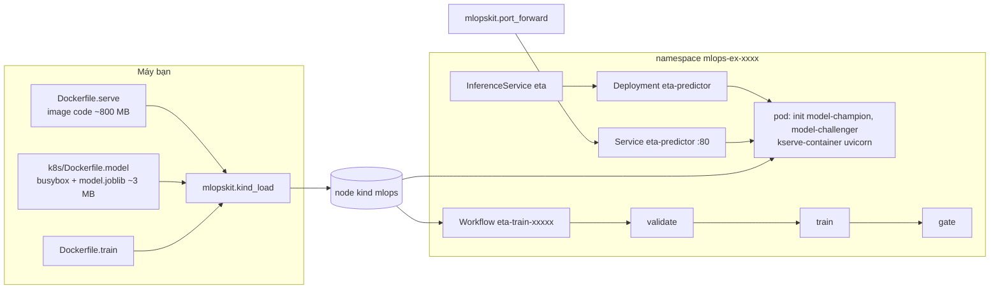

# M12: Chuyển ETA sang kind và KServe, pipeline training trên Argo Workflows

## Mục tiêu

Tới M10, service ETA chạy bằng Compose trên một máy: API là một container, training là một lệnh `act` hay Prefect. Sau
[module 13](../../modules/13-kubernetes-for-ml/README.md) bạn chuyển cả hai sang Kubernetes, trên cluster kind `mlops`
dùng chung của track:

- **Serving**: API ETA (image `Dockerfile.serve` của M02/M07, **không sửa code**) chạy thành một **InferenceService KServe**
  với predictor custom container, chế độ RawDeployment. Model đi vào pod bằng một **image model** nhỏ, tách khỏi image code.
- **Canary và rollback trên K8s**: đưa version mới ra 25% rồi 50% request, rồi rút về 0%, chỉ bằng cách đổi biến release và
  `kubectl apply`. Mỗi bước kiểm bằng request HTTP thật, không chỉ bằng trạng thái `Ready`.
- **Training**: Workflow Argo `validate → train → gate` dùng image `Dockerfile.train`, nhận tháng dữ liệu qua parameter,
  truyền dữ liệu và metric giữa các bước bằng artifact; model bị cổng từ chối thì Workflow **Failed ở đúng bước `gate`**.

Bài học chính: "pod Ready" chỉ nói tiến trình đã trả 200 ở `/readyz`. Nó không nói pod đang chạy **đúng model, đúng
version, đúng cấu hình**. Mọi test của milestone này gọi API thật qua `port_forward` và so `model_version` lẫn `eta_s`
với model mà test tự train.



## Việc cần làm

Chưa dựng cluster thì làm [module 13, mục 0](../../modules/13-kubernetes-for-ml/README.md): `bash setup/mlops/kind/up.sh`
(cluster `mlops`, context `kind-mlops`, KServe 0.21 RawDeployment, Argo Workflows 4.1). Thiếu cluster thì mọi test cần
cluster **skip** kèm lệnh dựng. Milestone này **không** cần stack Compose (MLflow, MinIO của `setup/mlops`): cluster không
gọi ra MLflow trên máy (mục 1).

### 1. Model vào pod bằng đường nào

| Cách | Vì sao không (hoặc vì sao có) trong bài này |
| --- | --- |
| Pod gọi MLflow của stack trên máy | Stack chỉ bind `127.0.0.1`; node kind ở network Docker riêng nên không tới được. Nối hai network là sửa hạ tầng chung, và làm serving phụ thuộc máy bạn đang bật Compose. |
| `storageUri: s3://...` (MinIO của Argo) | Cần image `kserve/storage-initializer` (kéo từ mạng, khá nặng) và Secret S3 trong mỗi namespace. Là đường chuẩn khi có object storage thật; ở đây thêm tải mà không dạy thêm điều gì. |
| Model nằm luôn trong image serve | Mỗi model mới là một image 800 MB phải build và nạp lại; code và model không tách version được. |
| **Image model riêng + init container (chọn)** | Image `busybox` + `model.joblib` chỉ vài MB, nạp vào kind trong vài giây. Init container chép model vào `emptyDir` mà container serve đọc. Đây là cùng ý tưởng với "modelcar" (`storageUri: oci://`) của KServe, nhưng KServe chỉ nhận **một** `storageUri`, còn canary của ETA cần **hai** model trong một pod. |

Ngoài đời, image model được CI build khi một version qua cổng promotion (M08), tag bằng số version trong registry.

### 2. Vì sao canary nằm trong app, không ở `canaryTrafficPercent`

`spec.predictor.canaryTrafficPercent` của KServe chỉ có tác dụng ở chế độ Serverless (Knative chia traffic theo
revision). Ở RawDeployment, KServe **nhận** trường này nhưng vẫn chỉ có một Deployment (đã thử trên cluster của track).
Thêm nữa, `kubectl port-forward svc/...` luôn chọn **một** pod, nên chia traffic giữa hai Deployment sau một Service không
đo được qua đường test dùng. Vì vậy canary dùng chính cơ chế của M07: pod chạy champion **và** challenger, `ETA_CANARY_WEIGHT`
quyết định tỉ lệ, `route(request_id, weight)` (sha256, M07 mục 3) chọn nhánh một cách xác định. Test gọi chính
`eta.serve.route` của bạn để tính trước nhánh của từng `X-Request-ID`, rồi so với câu trả lời của pod.

### 3. `k8s/eta.yaml`: một manifest, bảy biến release

`k8s/eta.yaml` là một tệp YAML nhiều document. Nó **là template**: test thay biến bằng `string.Template.substitute` của
Python (cùng cú pháp `${TÊN}` với `envsubst`), rồi `kubectl apply` vào một namespace tạm. Luật test kiểm:

| Biến | Ý nghĩa |
| --- | --- |
| `${ETA_SERVE_IMAGE}` | Tag image build từ `Dockerfile.serve` |
| `${ETA_CHAMPION_IMAGE}`, `${ETA_CHAMPION_VERSION}` | Image model champion (build từ `k8s/Dockerfile.model`) và version của nó |
| `${ETA_CHALLENGER_IMAGE}`, `${ETA_CHALLENGER_VERSION}` | Image model challenger và version |
| `${ETA_CANARY_WEIGHT}` | Tỉ lệ canary, chuỗi số thực trong [0, 1] |
| `${ETA_ADMIN_TOKEN}` | Token cho `POST /admin/reload` (M07 mục 6) |

- Khác module 13 (test thay nguyên văn `eta-serve:dev` vì bài chỉ có một image), manifest này dùng `${...}` vì phải render nhiều bản (champion, challenger, canary, image mỗi lần build) từ một tệp.
- Dùng **cả bảy** biến; biến nào khác dạng `${...}` hay `$TÊN` làm test fail. Ngoại lệ duy nhất là biến thứ tám
  `${ETA_PRIORITY_CLASS}` mà [M14](m14-k8s-load.md) thêm cho `priorityClassName` của predictor; test M12 thay nó bằng chuỗi rỗng
  (pod nhận độ ưu tiên mặc định). Đừng dùng ký tự `$` cho việc khác trong
  tệp: `string.Template` hiểu `$$` là một `$`, còn `envsubst` để nguyên `$$`, nên hai cách render sẽ ra hai manifest khác nhau.
- **Không có challenger** được biểu diễn bằng challenger trùng champion (cùng image, cùng version) và
  `ETA_CANARY_WEIGHT=0`: một manifest, một hình dạng pod cho mọi release.
- Không ghi `metadata.namespace` ở document nào.
- Có Secret chứa `ETA_ADMIN_TOKEN`; giá trị token **chỉ** được nằm trong Secret (không trong ConfigMap, không `value:`
  trong InferenceService). Container đọc nó bằng `secretRef` hay `secretKeyRef`.
- `InferenceService` tên **`eta`**, annotation `serving.kserve.io/deploymentMode: RawDeployment`. Cluster không có
  metrics-server, nên tắt autoscaler: annotation `serving.kserve.io/autoscalerClass: none` hoặc `minReplicas` bằng
  `maxReplicas` (không thì HPA báo `<unknown>` và `FailedGetResourceMetric` mãi). Từ M14, KEDA quản lý số replica và annotation đổi thành
  `external` (xem M14 mục 2); test M12 nhận cả hai.
- `spec.predictor.containers` có **đúng một** container, image `${ETA_SERVE_IMAGE}`, khai **đúng một** `containerPort: 8000`. KServe tạo
  Deployment `eta-predictor` và Service `eta-predictor` cổng 80 trỏ vào cổng đó; test `port_forward` vào `svc/eta-predictor:80`.
- `readinessProbe` là `httpGet` `/readyz`, `livenessProbe` là `httpGet` `/healthz`. Liveness **không** trỏ `/readyz`: pod
  chưa nạp xong model là chưa sẵn sàng, không phải đã chết, và kubelet sẽ giết nó lặp lại. Thêm `startupProbe` nếu model
  nạp chậm (bài sự cố của module 13).
- Container chính có `resources.requests` và `resources.limits`, đủ cả `cpu` và `memory`.
- `spec.predictor.automountServiceAccountToken: false`. API ETA không gọi API Kubernetes, và ServiceAccount `default` của
  namespace test được gắn quyền executor của Argo (`k8s_namespace`): token mount vào pod là quyền thừa nếu pod bị chiếm.
- Mọi container và init container có `imagePullPolicy: IfNotPresent` (hoặc `Never`): image chỉ nằm trong node, không có
  registry nào để kéo.
- Model của champion và challenger đi vào pod bằng init container chạy image `${ETA_CHAMPION_IMAGE}` /
  `${ETA_CHALLENGER_IMAGE}`; container serve đọc chúng qua `ETA_MODEL_PATH`, `ETA_CHALLENGER_PATH` (chế độ tệp của M07),
  version qua `ETA_MODEL_VERSION`, `ETA_CHALLENGER_VERSION`.
- **Đổi bất kỳ biến release nào cũng phải sinh pod mới.** Biến đặt trong ConfigMap mà container đọc bằng `envFrom` chỉ được
  đọc khi container khởi động: đổi ConfigMap rồi `apply`, pod cũ vẫn chạy với giá trị cũ, `kubectl rollout status` báo xong
  ngay. Đặt biến release thẳng trong `env` của container (thuộc pod template); muốn giữ chúng trong ConfigMap thì thêm vào
  pod template một annotation chứa **mọi** biến release không bí mật (vd. `eta/release:
  "${ETA_SERVE_IMAGE}|${ETA_CHAMPION_IMAGE}|${ETA_CHAMPION_VERSION}|${ETA_CHALLENGER_IMAGE}|${ETA_CHALLENGER_VERSION}|${ETA_CANARY_WEIGHT}"`)
  để giá trị đổi thì pod template đổi. **Không** đưa `${ETA_ADMIN_TOKEN}` vào annotation (metadata ai đọc pod cũng thấy):
  đổi token chỉ sửa Secret, pod vẫn giữ token cũ trong env tới khi khởi động lại, nên xoay token thì chạy thêm
  `kubectl rollout restart deployment/eta-predictor`. Test có một bước chỉ đổi `ETA_CANARY_WEIGHT` (0.25 → 0.5) để bắt lỗi này.

`k8s/Dockerfile.model`: test build nó với build context chỉ chứa **một** tệp `model.joblib` (quyền 0644). Image phải có
lệnh để init container chép model (vd. `busybox`), và nên chạy bằng user không phải root. `COPY --chmod=0444` cũng đặt quyền
cho **thư mục** cha nó tạo ra: thư mục không có quyền `x` thì init container báo `Permission denied` khi đọc tệp bên trong.

Triển khai tay (ngoài test):

```bash
docker build -t eta-serve:dev -f Dockerfile.serve .
mkdir -p /tmp/eta-v1 && cp models/model.joblib /tmp/eta-v1/ && docker build -t eta-model:v1 -f k8s/Dockerfile.model /tmp/eta-v1
uv run python -c "import mlopskit; [mlopskit.kind_load(t) for t in ('eta-serve:dev', 'eta-model:v1')]"
kubectl --context kind-mlops create namespace eta
export ETA_SERVE_IMAGE=eta-serve:dev ETA_CHAMPION_IMAGE=eta-model:v1 ETA_CHAMPION_VERSION=v1 \
       ETA_CHALLENGER_IMAGE=eta-model:v1 ETA_CHALLENGER_VERSION=v1 ETA_CANARY_WEIGHT=0 ETA_ADMIN_TOKEN=$(openssl rand -hex 16)
envsubst '$ETA_SERVE_IMAGE $ETA_CHAMPION_IMAGE $ETA_CHAMPION_VERSION $ETA_CHALLENGER_IMAGE $ETA_CHALLENGER_VERSION $ETA_CANARY_WEIGHT $ETA_ADMIN_TOKEN' \
  < k8s/eta.yaml | kubectl --context kind-mlops -n eta apply -f -
kubectl --context kind-mlops -n eta rollout status deployment/eta-predictor
kubectl --context kind-mlops -n eta port-forward svc/eta-predictor 28090:80
```

Truyền danh sách biến cho `envsubst` (như trên) để nó chỉ thay đúng bảy biến release, không đụng `$` nào khác. Tag kiểu `:dev`, `:v1` (không phải `:latest`) để `IfNotPresent` dùng image đã nạp. Dọn: `kubectl --context kind-mlops delete
namespace eta`.

### 4. Quy trình release: canary rồi rollback

Mỗi bước là một lần `apply` với bộ biến mới, chờ rollout xong, rồi kiểm bằng request:

| Bước | Champion | Challenger | `ETA_CANARY_WEIGHT` |
| --- | --- | --- | --- |
| Ổn định | v1 | v1 | 0 |
| Canary 25% | v1 | v2 | 0.25 |
| Canary 50% | v1 | v2 | 0.5 |
| Rollback | v1 | v1 | 0 |
| (Promote, không bị test) | v2 | v2 | 0 |

Rollback ở đây là **apply lại release cũ**, không phải `kubectl rollout undo deployment/eta-predictor`: Deployment do
controller KServe quản lý, nó sẽ ghi đè ngay về spec của InferenceService. Nguồn sự thật là manifest đã render, giữ trong
git (GitOps, Argo CD ở module 13). `POST /admin/reload` của M07 vẫn có, nhưng ở chế độ tệp nó chỉ nạp lại đúng các tệp đang
có trong pod; đổi model trên K8s là đổi pod.

Sau mỗi `apply`, test chờ `status.observedGeneration` của InferenceService bằng `metadata.generation`, `kubectl rollout
status deployment/eta-predictor` (tối đa 240 giây), InferenceService `Ready`, và `/readyz` báo đúng release (tối đa 90
giây): `model_version` là champion, và nếu `/readyz` có `challenger`, `canary_weight` (M07 khuyên có) thì hai trường đó
cũng phải khớp (release không có challenger riêng thì `challenger: null` cũng được).
Rồi 40 request `POST /predict` cùng một chuyến, mỗi request một `X-Request-ID` riêng: `variant` phải bằng
`route(id, weight)` của bạn, `model_version` phải là version của nhánh đó, và `eta_s` phải bằng ETA mà **chính `eta.serve`
của bạn** trả cho model đó khi chạy trên máy (`TestClient`, chế độ tệp, sai số tương đối 1e-4). Làm tròn hay kẹp ngưỡng
trong `/predict` là việc của bạn, hai phía cùng code nên vẫn khớp. Pod báo `v2` mà chạy model của `v1` thì fail.

Hai kiểm độc lập để `route()` hay `/predict` hỏng không qua được chỉ vì so với chính nó:

- ETA mà `eta.serve` của bạn trả trên máy phải cách `model.predict(make_features(chuyến))` (kẹp tối thiểu 60 s như M05/M07)
  không quá **1 giây**, và hai model test phải cho ETA khác nhau.
- Test dùng 40 `X-Request-ID` cố định (`m12-split-0` … `m12-split-39`). Weight 0: không request nào vào canary. Weight
  `w > 0`: số request canary phải trong `[max(1, ⌊0.4·w·40⌋), min(39, ⌊1.6·w·40⌋ + 2)]`, tức `[4, 18]` với 0.25 và
  `[8, 34]` với 0.5. `route()` luôn trả `"champion"` (hay luôn `"canary"`) thì fail.

### 5. `argo/train-workflow.yaml`: `validate → train → gate`

Một Workflow (không phải WorkflowTemplate), dùng image `${ETA_TRAIN_IMAGE}` (biến duy nhất của tệp này, thay như mục 3).
Test đọc tệp, đặt giá trị parameter, rồi `kubectl create` vào namespace tạm. Luật test kiểm:

- Đúng một document `kind: Workflow`, có `metadata.generateName`, không có `metadata.namespace`.
- `spec.arguments.parameters` có `month` (tháng `YYYY-MM`) và `champion-metrics` (JSON metric của champion, `{}` nghĩa là
  chưa có champion). Test ghi đè giá trị của cả hai; test dùng tháng `2019-03`, nên đừng ghi cứng `2019-01` ở đâu.
- **Dữ liệu**: test tạo trong namespace một ConfigMap tên **`eta-train-data`**, khoá `yellow_tripdata_<month>.parquet`
  (1 500 chuyến giả, khoảng 40 KB). Workflow mount nó (vd. `spec.volumes` + `volumeMounts` tại `/data`; image train của M02
  đã đặt `ETA_DATA_DIR=/data`). ConfigMap giới hạn 1 MiB: ngoài đời dữ liệu nằm ở PVC hay object storage, chỉ đổi khai báo
  volume.
- Ba bước Pod tên **`validate`**, **`train`**, **`gate`** (tên task trong `dag` hay tên step), chạy tuần tự: bước sau bắt đầu
  sau khi bước trước xong. Có `retryStrategy` cũng được (Argo đặt tên `train(0)`, `train(1)`; test lấy lần chạy cuối).
- `validate`: `eta.cli prepare` rồi `eta.cli validate` (M03) cho tháng `month`; exit khác 0 khi dữ liệu hỏng. Parameter là
  dữ liệu do người submit đưa vào: đừng ghép `{{workflow.parameters.month}}` vào chuỗi `sh -c` (một giá trị như
  `2019-01"; rm -rf /tmp; "` thành lệnh shell). Truyền nó qua `env` hay `args` dạng mảng, và kiểm `^\d{4}-(0[1-9]|1[0-2])$`
  trước khi dùng, **ở mọi bước** dùng nó (cả `train`, nơi tháng thành tên tệp `--input` và `ETA_MONTHS`): một template có
  thể được tái dùng ở Workflow khác không có bước `validate` đứng trước. Test cho
  một tháng có 10% chuyến thời lượng âm: Workflow phải **Failed** ở `validate` và **không** có bước `train` nào chạy.
- `train`: output artifact tên **`model`** và **`metrics`** (JSON của `--metrics-out`).
- `gate`: input artifact tên **`metrics`**, so với `champion-metrics` bằng `decide` và `Policy()` của M04; qua thì exit 0,
  bị từ chối thì exit **3** (`EXIT_REJECTED` của `eta.cli`). Cluster không có MLflow nên champion đi vào qua parameter; khi
  có registry trong cluster, bước này đổi thành `eta.cli promote` với cùng mã thoát.
- Test: `champion-metrics = "{}"` → Workflow **Succeeded**, cả ba bước Succeeded. Champion có `mae = 1.0`,
  `mae_airport = 1.0` (không model nào thắng nổi) → Workflow **Failed**, `validate` và `train` Succeeded, `gate` Failed với
  `exitCode` 3. Mỗi Workflow phải xong trong 360 giây; test chờ bằng `mlopskit.wait_for(..., fail_on=...)`, nên Workflow vào
  phase khác phase mong đợi là fail ngay kèm log.

Hay vấp:

- Image train chạy user 10001. Input artifact Argo tải về có thể chỉ root đọc được (`PermissionError` khi mở
  `/tmp/in/metrics.json`); đặt `mode: 0444` cho input artifact đó, hoặc để artifact ở dạng nén mặc định.
- `kubectl wait --for=jsonpath='{.status.phase}'=Succeeded` không dừng khi Workflow Failed, chờ tới hết hạn. Hỏi
  `status.phase` theo vòng lặp và dừng ở `Succeeded`, `Failed` hoặc `Error`.
- Container của các bước nên có `securityContext` như pod serve: `allowPrivilegeEscalation: false`,
  `capabilities.drop: [ALL]`, và `seccompProfile: RuntimeDefault` ở `spec.securityContext` của Workflow.
- Artifact (`sample`, `model`, `metrics`) nằm trong bucket MinIO dùng chung của Argo dưới khoá `<tên workflow>/...` và **không**
  tự mất khi xoá namespace. Không dùng `artifactGC: OnWorkflowDeletion` trong bài: nó gắn finalizer vào Workflow và chạy pod
  dọn trong chính namespace đang bị xoá, dễ làm namespace kẹt `Terminating`. MinIO của cluster lưu trong `emptyDir`, nên
  khởi động lại pod `argo-artifacts` (hoặc chạy lại `up.sh`) là xoá sạch; xem `setup/mlops/kind/README.md`.
- Dùng `retryPolicy: OnError` (lỗi hạ tầng: pod bị xoá, node mất), không retry khi bước thoát khác 0: retry `gate` bị từ
  chối chỉ ra cùng kết quả ba lần.

### 6. Test chấm làm gì

```bash
uv run pytest tracks/mlops/capstone/project/tests -q -rs -k m12
```

- `test_m12_manifests_contract` (không cần cluster): các luật tĩnh của mục 3 trên `k8s/eta.yaml` đã render.
- Các test còn lại kiểm tệp trước, rồi kiểm cluster và Docker (skip nếu thiếu), rồi mới train model và build image.
- `test_m12_isvc_serves_champion`: build `Dockerfile.serve` và một image model, `kind_load`, apply, chờ rollout; `/readyz`
  báo version, `/predict` trả `eta_s > 0` đúng của model đó và `model_version` đúng; `POST /admin/reload` không có
  `X-Admin-Token` → 403, có token đúng → 200 với `champion` là version đó.
- `test_m12_canary_rollout_and_rollback`: bốn release ở mục 4, mỗi bước 40 request kiểm `variant`, `model_version`, `eta_s` và tỉ lệ canary.
- `test_m12_workflow_trains`, `test_m12_gate_rejects_worse_model`, `test_m12_bad_month_stops_at_validate`: mục 5.

Mỗi test tạo namespace `mlops-ex-<uuid8>` riêng và xoá nó khi xong, kể cả khi fail; image build ra được xoá khỏi Docker trên
máy, còn bản đã nạp ở lại trong node (dọn theo [`setup/mlops/kind/README.md`](../../../../setup/mlops/kind/README.md)).
Cả milestone khoảng 2 phút trên laptop khi image đã có cache.

## Kết quả nộp

- `capstone/project/k8s/eta.yaml`, `k8s/Dockerfile.model`, `argo/train-workflow.yaml`.
- Mục "Kubernetes" trong README của project: lệnh triển khai tay (mục 3), bảng release đã chạy (mục 4) kèm thời gian rollout
  đo được, và lý do bạn chọn nguồn model (giữ đường image model hay đổi sang `storageUri`, vì sao).

## Tiêu chí đạt

- [ ] `uv run pytest tracks/mlops/capstone/project/tests -q -rs -k m12` pass, không skip (cluster `mlops` đã dựng).
- [ ] Kiểm service bằng request thật: version **và** giá trị dự đoán khớp model đã triển khai, không chỉ `Ready`.
- [ ] Đổi bất kỳ biến release nào cũng sinh pod mới; rollback bằng apply lại release cũ, không bằng `rollout undo`.
- [ ] Token admin chỉ nằm trong Secret; probe readiness/liveness đúng endpoint; có requests và limits.
- [ ] Workflow dừng đúng bước: dữ liệu hỏng ở `validate`, model kém hơn ở `gate` với mã 3.
- [ ] (Tự đánh giá) So bảng mục 1 với bối cảnh của bạn: khi nào chuyển sang `storageUri` và object storage.
- [ ] (Tự đánh giá) Kế hoạch đưa canary sang mức hạ tầng (Serverless/Knative hoặc Gateway API chia traffic) và cách đo khi đó.
