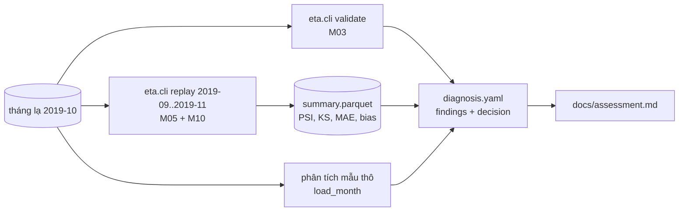

# M13: Đánh giá độc lập mức junior: tháng dữ liệu lạ, tự chẩn đoán và vận hành

## Mục tiêu

Đây là bài **đánh giá độc lập** khép lại mức junior. Không có hướng dẫn từng bước: bạn nhận một tháng dữ liệu "lạ" như
người trực nhận một tệp mới từ nguồn, và phải trả lời ba câu hỏi bằng số:

1. Tháng này có gì bất thường? (triệu chứng)
2. Vì sao? (nguyên nhân, chọn từ một tập nhãn cố định)
3. Làm gì với model và với tháng dữ liệu đó? (quyết định)

Tháng lạ là **2019-10**, sinh từ dữ liệu TLC thật bằng một script cố định, có cài sẵn một số lỗi (bài không nói bao nhiêu
và lỗi gì). Mọi lỗi đều lộ ra bằng các công cụ bạn đã dựng: `validate` của M03, đồng hồ và `replay` của M05, `drift` và
`quality` của M10. Không cần viết code mới; nếu cần, viết thêm phân tích nhỏ trong notebook hay script của bạn.

**Đừng mở `capstone/solutions/`** (nhất là `solutions/assessment/`) và đừng so tệp tháng lạ với tệp gốc của TLC từng dòng
một: cả hai đều cho đáp án mà không luyện được gì, và trong sự cố thật không có "tệp đúng" để so. Test chỉ kiểm được kết
quả (script sinh tháng lạ nằm trong `solutions/assessment/` theo thiết kế, `tests/etakit.py` chỉ gọi nó để dựng tệp cho test; bạn không cần và không nên đọc nó); phần lập luận chấm bằng rubric trong `SOLUTION.md` sau khi bạn nộp.

Bài này dùng mọi thứ từ M01 tới M10 và module 10 (khung phát hiện → xác minh → tác động → quyết định).



## Việc cần làm

### 1. Lấy dữ liệu

Cần bộ `nyc-tlc` đã tải. Từ gốc repo:

```bash
uv run python tracks/mlops/capstone/project/tests/etakit.py assessment
```

Lệnh ghi vào `capstone/project/data/assessment/` (đã bị `.gitignore` chặn): ba symlink tới tháng thật 2019-08, 2019-09,
2019-11 và tệp tháng lạ `yellow_tripdata_2019-10.parquet` (400 000 chuyến). Chạy lại lệnh cho ra đúng tệp đó.

### 2. Cấu hình và lệnh chạy

Tạo `capstone/project/params.assessment.yaml` đúng như sau, để số bạn đo khớp số test tự tính:

```yaml
data_dir: data/assessment
months: ["2019-08"]
sample_rows: 50000
seed: 0
model_params: {max_iter: 100}
mlflow_uri: sqlite:///data/assessment-mlflow.db
model_name: eta-assessment
```

Registry phải trống khi phát lại (xoá `data/assessment-mlflow.db` trước mỗi lần chạy lại): `replay` sẽ train champion
trên 2019-08 rồi chấm 2019-09, 2019-10, 2019-11; tại `as_of = 2019-11` nhãn của 2019-09 và 2019-10 đã công bố.

```bash
cd tracks/mlops/capstone/project
PYTHONPATH=src uv run --project ../../../.. python -m eta.cli prepare --config params.assessment.yaml --month 2019-10 --out data/assessment-interim/2019-10.parquet
PYTHONPATH=src uv run --project ../../../.. python -m eta.cli validate data/assessment-interim/2019-10.parquet --month 2019-10
PYTHONPATH=src uv run --project ../../../.. python -m eta.cli replay --config params.assessment.yaml --start 2019-09 --end 2019-11 --out reports/assessment/replay
```

Tháng 2019-09 là đối chứng "bình thường" cùng model. Phát lại mất khoảng 20 giây.

### 3. Tập nhãn `cause` cho phép

Mỗi finding chọn **một** nhãn trong bảng. Tháng lạ có thể dính một vài nhãn, không phải tất cả; có nhãn là bẫy cho người
kết luận vội. Mỗi nhãn đòi **ít nhất** các khoá evidence ở cột cuối.

| `cause` | Nghĩa | Evidence bắt buộc |
| --- | --- | --- |
| `unit_change` | Một cột số đổi đơn vị so với các tháng trước | `psi_trip_distance`, `median_trip_distance`, `median_trip_distance_before` |
| `timezone_shift` | Cột thời gian bị ghi theo múi giờ khác, mọi chuyến lệch cùng một số giờ | `psi_pickup_hour`, `peak_pickup_hour`, `peak_pickup_hour_before` |
| `clock_error` | Đồng hồ thiết bị sai: thời điểm đón và trả của một phần chuyến vô lý (trả trước đón) | `negative_duration_share` |
| `outside_month` | Tệp lẫn chuyến của tháng khác (ngày nằm hẳn ngoài tháng, không phải vài giờ ở mép tháng) | `outside_month_share` |
| `duplicate_rows` | Một lượng đáng kể chuyến bị ghi trùng | `duplicate_share` |
| `truncated_month` | Tệp thiếu ngày (bị cắt giữa tháng) | `days_with_pickups` |
| `missing_zone` | Mất dữ liệu của một zone | `zone`, `zone_share`, `zone_share_before` |
| `seasonal_drift` | Hành vi đi lại thật đổi theo mùa hay sự kiện; dữ liệu đúng | `mae`, `mae_before` |
| `concept_drift` | Quan hệ đầu vào → thời gian chuyến thật đổi; dữ liệu đúng | `mae`, `mae_before`, `bias_s` |

### 4. Khoá evidence và cách test tính lại

Mọi khoá trong bảng dưới mà bạn ghi trong `evidence` đều được test **tính lại** và so (số thực: sai số tương đối 1%; số
nguyên: bằng đúng). Khoá khác bạn tự đặt (ví dụ `median_ratio`, `shift_hours`) không bị kiểm, chấm bằng rubric.

| Khoá | Cách tính |
| --- | --- |
| `psi_trip_distance`, `ks_trip_distance`, `psi_pickup_hour`, `psi_eta_s`, `mae`, `bias_s`, `mae_airport`, `n_scored` | Cột cùng tên, dòng `2019-10` của `summary.parquet` (lệnh replay ở mục 2) |
| `mae_before`, `bias_s_before` | `mae`, `bias_s` của dòng `2019-09` |
| `negative_duration_share` | Trên mẫu thô `load_month(<tệp 2019-10>, 50000, 0)` (đúng thứ `prepare` ghi): tỉ lệ dòng `tpep_dropoff_datetime < tpep_pickup_datetime` |
| `outside_month_share` | Cùng mẫu: tỉ lệ dòng có pickup ngoài `[2019-10-01, 2019-11-01)` |
| `duplicate_share` | Cùng mẫu: `df.duplicated().mean()` trên 5 cột |
| `median_trip_distance` | Cùng mẫu: median `trip_distance` |
| `peak_pickup_hour` | Cùng mẫu: giờ (0–23) của pickup có nhiều dòng nhất; bằng nhau thì lấy giờ nhỏ hơn |
| `days_with_pickups` | Cùng mẫu: số ngày khác nhau có pickup nằm trong tháng |
| `zone`, `zone_share` | `zone` là số zone bạn nghi; `zone_share` là tỉ lệ dòng của mẫu có `PULocationID` hoặc `DOLocationID` bằng `zone` |
| Khoá trên kèm hậu tố `_before` | Như trên, nhưng trên mẫu `load_month(<tệp 2019-09>, 50000, 0)` với tháng 2019-09 |

### 5. `reports/assessment/diagnosis.yaml`

```text
month: "2019-10"
findings:                       # mỗi cause đúng một finding
  - symptom: "câu mô tả điều bạn thấy, có số"         # ≥6 từ
    evidence: {<khoá>: <số>, ...}                    # mapping khoá → số, đủ khoá bắt buộc của cause
    cause: <nhãn>                                      # một nhãn của bảng mục 3
    action: "việc cụ thể bạn làm hoặc yêu cầu, ai làm"  # ≥6 từ
decision: keep                  # retrain | rollback | keep: quyết định cho model
quarantine: true                # true: không dùng tháng này cho train và đánh giá cho tới khi nguồn sửa
reasons:                        # ≥2 câu, mỗi câu ≥6 từ, có số
  - "..."
  - "..."
```

`.gitignore` của project bỏ chặn đúng tệp này (phần còn lại của `reports/assessment/` vẫn bị chặn).

Luật test kiểm:

- `month` là `"2019-10"`; `findings` không rỗng; mỗi finding đủ bốn khoá; `cause` thuộc bảng mục 3, không lặp; đủ khoá
  evidence bắt buộc; `symptom`, `action` mỗi câu ≥6 từ.
- **Mỗi lỗi cài sẵn có một finding đúng `cause`**, và **không có `cause` nào ngoài các lỗi cài sẵn**: chẩn đoán thừa tốn công
  người trực như chẩn đoán thiếu. Thông báo lỗi chỉ cho biết số nhãn còn thiếu và số nhãn thừa, không cho biết là nhãn nào; số evidence lệch thì chỉ báo khoá, giá trị bạn ghi và sai số cho phép. Đừng dò đáp án
  bằng cách chạy test nhiều lần: bài tự đánh giá mất ý nghĩa, và rubric hỏi bạn chứng minh từng nhãn.
- Mọi khoá evidence của bảng mục 4 khớp số test tính lại (test tự dựng dữ liệu, tự phát lại bằng `eta.cli replay` của bạn
  với đúng cấu hình mục 2).
- `decision` thuộc `retrain | rollback | keep`; `reasons` ≥2 câu. `quarantine` là `true`/`false`.
- Luật nhất quán: có finding là lỗi dữ liệu (mọi nhãn trừ `seasonal_drift`, `concept_drift`) thì `quarantine: true` và
  `decision` khác `retrain` (train lại trên dữ liệu hỏng là đưa lỗi vào model). `rollback` chỉ hợp lệ khi `summary.parquet`
  có hơn một `model_version` (có version cũ để lùi về).

### 6. `docs/assessment.md`

Báo cáo cho trưởng nhóm, ít nhất 400 từ, không còn `TODO`, có các heading (cấp nào cũng được, có thể đánh số) **Tóm tắt**,
**Cách điều tra**, **Phát hiện**, **Quyết định**, **Phòng ngừa**; có các lệnh bạn đã chạy (ít nhất `eta.cli validate` và
`eta.cli replay`); nhắc tên từng `cause` trong `diagnosis.yaml` và giải thích. Nên có: bảng summary ba tháng, các nhãn bạn
**đã loại** và vì sao, cách bạn đo tác động của từng lỗi lên MAE, và check nào nên thêm vào validation để tháng sau bị
chặn tự động.

### 7. Test chấm làm gì

- `test_m13_diagnosis_valid`: cấu trúc YAML và luật nhất quán ở mục 5 (không cần dữ liệu).
- `test_m13_finds_injected_faults`: tập `cause` khớp đúng tập lỗi cài sẵn.
- `test_m13_evidence_matches_recomputed` (cần `nyc-tlc`, đọc qua `mlopskit.real_month` có kiểm sha256): dựng thư mục dữ
  liệu như mục 1 trong thư mục tạm, chạy `eta.cli replay` của bạn với cấu hình mục 2 (MLflow SQLite tạm, Prefect test
  harness), tính lại các khoá ở mục 4 bằng `eta.data.load_month` của bạn và so.
- `test_m13_assessment_doc`: các luật ở mục 6.

```bash
uv run pytest tracks/mlops/capstone/project/tests -q -rs -k m13
```

## Kết quả nộp

- `capstone/project/params.assessment.yaml`, `reports/assessment/diagnosis.yaml`, `docs/assessment.md`.
- Mục "Đánh giá M13" trong README project: một đoạn tóm tắt và đường dẫn tới hai tệp trên.
- (Nên có) Một target `make assessment` (hay script) chạy lại toàn bộ chẩn đoán từ đầu bằng một lệnh.

## Tiêu chí đạt

- [ ] `uv run pytest tracks/mlops/capstone/project/tests -q -rs -k m13` pass, không skip; bộ `nyc-tlc` đã tải.
- [ ] Không mở `solutions/`, không so với tệp gốc của TLC; mọi số trong YAML đến từ pipeline của bạn.
- [ ] Mỗi finding có triệu chứng đo được, nguyên nhân chứng minh được, và hành động có người làm.
- [ ] Quyết định cho model và cho tháng dữ liệu tách bạch, nhất quán với nguyên nhân.
- [ ] (Tự đánh giá, rubric trong `SOLUTION.md`) Bạn giải thích được vì sao validation của M03 chỉ bắt được một phần vấn đề,
      tác động của từng lỗi lên MAE và bias, và đề xuất check mới có ngưỡng bằng số.
