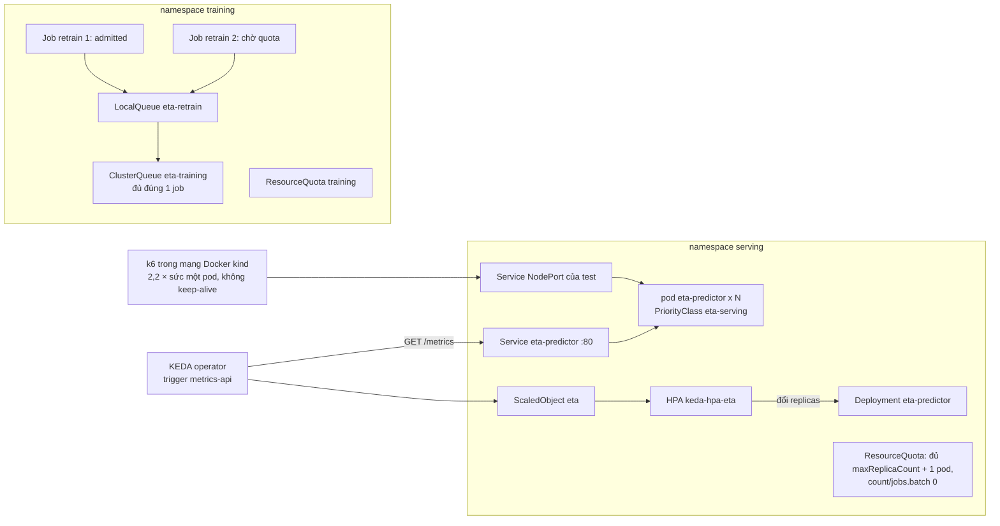

# M14: ETA chịu tải trên K8s: autoscale theo metric của API, retrain qua Kueue, quota tách serving và training

## Mục tiêu

Tới M12, API ETA chạy trên kind với **một** replica cố định, và Workflow train chạy lúc nào cũng được. Ngoài đời hai thứ
này tranh nhau cùng một cluster: giờ cao điểm tối thứ Sáu, traffic đặt xe tăng gấp mấy lần, đúng lúc job retrain hằng
đêm (M05, M10) bắt đầu. Sau [module 14](../../modules/14-kubernetes-ml-production/README.md) bạn làm ba việc:

- **Autoscale theo metric của chính API**: KEDA đọc một metric từ `/metrics` của API ETA (M09) và đổi số replica của
  Deployment `eta-predictor` mà KServe tạo. Dưới tải, số replica tăng và p95 quay về trong ngưỡng.
- **Retrain đi qua hàng đợi**: job retrain là `batch/v1` Job nộp vào `LocalQueue` của Kueue. ClusterQueue của training
  chỉ đủ chỗ cho **một** job retrain một lúc; job thứ hai chờ, không tạo pod, rồi tự chạy khi job đầu xong.
- **Hai namespace, hai quota, hai mức ưu tiên**: namespace serving có ResourceQuota vừa đủ cho số replica tối đa và
  không nhận Job; namespace training có quota riêng; pod serving mang PriorityClass cao hơn pod retrain, nên khi node
  hết chỗ, scheduler đẩy retrain ra chứ không đẩy API.

Bài học chính: autoscale không phải "bật HPA". Phải chọn metric phản ánh đúng việc pod đang quá tải, biết metric đó
được đọc từ đâu và mỗi bao lâu, và quota của namespace phải chứa nổi số replica tối đa (không thì HPA ra lệnh scale mà
ReplicaSet không tạo được pod). Mọi kết luận ở đây đo trên một node kind trên laptop: kiến thức này không thay kinh
nghiệm vận hành cluster thật nhiều node, nơi cold start, phân mảnh tài nguyên và autoscaler của node chiếm phần lớn
độ trễ.



## Việc cần làm

Cần cluster `mlops` **có add-on senior** (KEDA 2.21, Kueue 0.20):
`bash setup/mlops/kind/up.sh --senior` ([module 14, mục 0](../../modules/14-kubernetes-ml-production/README.md)). Thiếu
cluster hay thiếu add-on thì test cần cluster **skip** kèm lệnh dựng. Milestone này dùng lại ba image của M12
(`Dockerfile.serve`, `Dockerfile.train`, `k8s/Dockerfile.model`) và không cần stack Compose.

Bạn thêm bốn tệp vào `k8s/` và sửa hai chỗ đã có:

| Tệp | Biến (thay bằng `string.Template` như M12) | Nội dung |
| --- | --- | --- |
| `src/eta/serve.py` | | Thêm gauge số request đang xử lý vào `/metrics` (mục 1) |
| `k8s/eta.yaml` | 7 biến của M12 + `${ETA_PRIORITY_CLASS}` | `autoscalerClass: external`, `priorityClassName` (mục 2) |
| `k8s/cluster.yaml` | `${ETA_RUN}` | Chỉ tài nguyên cluster-scoped: hai PriorityClass, ResourceFlavor, ClusterQueue (mục 4) |
| `k8s/serving.yaml` | `${ETA_NAMESPACE}` | ResourceQuota (và LimitRange nếu muốn) của namespace serving, ScaledObject (mục 3) |
| `k8s/training.yaml` | `${ETA_RUN}` | ResourceQuota (và LimitRange nếu muốn) của namespace training, LocalQueue (mục 5) |
| `k8s/retrain-job.yaml` | `${ETA_RUN}`, `${ETA_TRAIN_IMAGE}`, `${ETA_MONTH}` | Một `batch/v1` Job retrain (mục 6) |

Mỗi tệp phải dùng **mọi** biến ghi ở cột giữa và **chỉ** các biến đó (biến lạ làm test fail, như M12). Không ghi
`metadata.namespace` ở tệp nào. `cluster.yaml` chỉ được chứa `PriorityClass`, `ResourceFlavor`, `ClusterQueue` (thêm
`Cohort`, `WorkloadPriorityClass` nếu muốn); `serving.yaml` chỉ `ResourceQuota`, `LimitRange`, `ScaledObject`;
`training.yaml` chỉ `ResourceQuota`, `LimitRange`, `LocalQueue`; `retrain-job.yaml` đúng một `Job`.

`${ETA_RUN}` là hậu tố của mọi tên cluster-scoped: cluster dùng chung, nên mỗi lần chạy test có một bộ PriorityClass và
ClusterQueue riêng (test tạo qua `mlopskit.cluster_scoped` và xoá khi xong). Tên cố định mà test tìm:
PriorityClass **`eta-serving-${ETA_RUN}`** và **`eta-training-${ETA_RUN}`**, ClusterQueue **`eta-training-${ETA_RUN}`**,
LocalQueue **`eta-retrain`**, ScaledObject **`eta`**.

### 1. Chọn metric để scale

| Metric | Đọc được trên cluster này? | Phản ánh quá tải của ETA? |
| --- | --- | --- |
| CPU của pod (HPA `Resource`, trigger `cpu` của KEDA) | Có: `--senior` cài metrics-server | Gián tiếp và trễ: metrics-server lấy mẫu mỗi 15 giây, tính theo `requests.cpu`; pod bị giới hạn ở `limits.cpu` thì CPU đứng yên ở trần trong khi hàng đợi vẫn dài thêm |
| Request/giây (`rate(eta_requests_total[1m])`) | Cần Prometheus trong cluster tính `rate()`; trigger `metrics-api` chỉ đọc giá trị tức thời | Có, nhưng phải biết trước sức chịu của một pod và số đó đổi mỗi khi model đổi |
| p95 latency (histogram M09) | Cũng cần Prometheus | Là triệu chứng người dùng thấy, nhưng trễ: lúc p95 vượt là đã quá tải rồi |
| Số request đang xử lý (in-flight) | Có, nếu API xuất nó như một gauge trong `/metrics` | Theo định luật Little, in-flight = req/s × latency: nhỏ khi pod còn sức, tăng vọt khi hàng đợi dài ra |

Ghép các cột này với luật dưới đây để chọn. Luật test áp cho metric của trigger:

- Trigger là `metrics-api` đọc `/metrics` của API (`format: prometheus`); `valueLocation` là tên một metric **có thật**
  trong `/metrics` của pod và có dòng **`# TYPE <tên> gauge`**. Counter chỉ tăng (HPA sẽ không bao giờ hạ), histogram
  `_count`/`_sum` cũng vậy.
- Metric phải **hạ khi hết tải**: 10 giây sau khi k6 dừng, test đọc metric đó trên từng pod predictor và đòi giá trị
  không lớn hơn `targetValue` của trigger.
- Nếu bạn thêm metric mới vào `eta.serve`, giữ luật label của M09 (cardinality thấp, không `request_id`).

KEDA gọi URL của trigger qua Service `eta-predictor`, nên mỗi lần đọc chỉ thấy **một pod ngẫu nhiên**. Đọc kỹ ý nghĩa
hai `metricType` trước khi chọn: với `Value`, HPA coi số đọc được là giá trị của cả target và tính
`replicas mới = ceil(replicas × giá trị / targetValue)`; với `AverageValue`, HPA chia số đọc được cho số replica (coi nó
là tổng của mọi pod). Hỏi: số mà KEDA đọc được ở đây là của một pod hay của cả Deployment? Lấy mẫu một pod thì nhiễu, và
pod mới vừa Ready chưa nhận tải có thể báo 0: nghĩ xem `behavior` của HPA cần gì để không tụt ngay. Ngoài đời, Prometheus
trong cluster cộng metric của mọi pod rồi trigger `prometheus` của KEDA đọc tổng đó; ở đây không có Prometheus trong
cluster.

Không scale về 0: API online nhận request liên tục, và cold start của pod ETA (init container chép model, nạp model,
warmup, readiness) mất 10–25 giây trên laptop. Scale-to-zero hợp với batch inference như bài KEDA của module 14.

### 2. `k8s/eta.yaml`: nhường số replica cho KEDA

- Annotation **`serving.kserve.io/autoscalerClass: external`**. Với `none` (M12), KServe 0.21 ghi đè `spec.replicas` của
  Deployment về `minReplicas` mỗi lần reconcile: HPA của KEDA scale lên 3, vài giây sau KServe kéo về 1 (đã thử: chạy
  `kubectl scale deployment/eta-predictor --replicas=2` với `none` thì về 1 ngay; với `external` thì giữ). `external`
  bảo KServe để yên số replica. Trần số replica giờ là `maxReplicaCount` của ScaledObject, nên bản tham chiếu bỏ `maxReplicas`
  và giữ `minReplicas: 1` cho lần tạo đầu.
- `spec.predictor.priorityClassName: "${ETA_PRIORITY_CLASS}"`. Test M14 thay bằng `eta-serving-<run id>`, test M12 thay
  bằng chuỗi rỗng (pod nhận độ ưu tiên mặc định), nên M12 vẫn pass.
- Mọi luật của M12 vẫn giữ. Test M12 nhận cả `none` lẫn `external`.
- `resources` của container chính quyết định sức chịu của một pod, và test đặt tải theo sức đó (mục 7). Probe cũng phải
  chịu được tải: xem "Hay vấp" ở cuối mục 7.

### 3. `k8s/serving.yaml`: quota và ScaledObject

ScaledObject tên **`eta`**, luật test kiểm:

- `scaleTargetRef.name: eta-predictor` (Deployment do KServe tạo).
- `minReplicaCount` 1 hoặc 2; `maxReplicaCount` từ 3 tới 6.
- Đúng **một** trigger, `type: metrics-api`, `metadata.format: prometheus`, `metadata.url` là
  `http://eta-predictor.${ETA_NAMESPACE}.svc.cluster.local/metrics` (cổng 80 của Service; host `eta-predictor.${ETA_NAMESPACE}`
  hay `...svc` cũng được). KEDA operator chạy ở namespace `keda`, nên tên Service phải có namespace.
- `metadata.valueLocation`: xem luật metric ở mục 1.
- `metricType`, `targetValue` và `advanced.horizontalPodAutoscalerConfig.behavior` là lựa chọn của bạn, test đo bằng tải
  thật (mục 7). Gợi ý: đo sức một pod trước (test in ra số này), rồi suy `targetValue` từ định luật Little cho mức tải
  bạn muốn mỗi pod gánh. `targetValue` quá cao thì HPA thấy "vừa đủ" khi các pod đã gần bão hoà và dừng ở ít replica.
  `pollingInterval`, `cooldownPeriod` chỉ có tác dụng khi `minReplicaCount: 0`; KEDA 2.21 cảnh báo nếu bạn đặt.

ResourceQuota của namespace serving:

- Có `hard` cho `requests.cpu`, `requests.memory`, `limits.cpu`, `limits.memory`, `pods`, mỗi khoá đủ cho
  **`maxReplicaCount + 1`** pod predictor (thêm một pod cho rolling update khi đổi release, `maxSurge` 25% làm tròn lên).
  Test tính request/limit hiệu lực của pod như scheduler: lớn hơn giữa tổng container chính và init container lớn nhất.
  Quota thiếu thì HPA đặt `replicas: 4` nhưng ReplicaSet báo `exceeded quota` và pod thứ 4 không bao giờ có; test fail
  nếu trong namespace serving có event `exceeded quota`.
- **`count/jobs.batch: "0"`**: namespace serving không chạy Job. Một Job retrain lỡ tạo thẳng vào đây (không qua hàng
  đợi) bị API server từ chối ngay, thay vì âm thầm ăn CPU của API.

### 4. `k8s/cluster.yaml`: mức ưu tiên và ClusterQueue

- PriorityClass `eta-serving-${ETA_RUN}` và `eta-training-${ETA_RUN}`: `value` số nguyên, thứ tự
  **`1 000 000 > serving > training > 0`**; không `globalDefault: true` (cluster dùng chung). 1 000 000 là PriorityClass
  `mlops-system` mà `up.sh` gán cho controller add-on (KServe, KEDA, Kueue, cert-manager, Argo; xem
  [`setup/mlops/kind/README.md`](../../../../setup/mlops/kind/README.md)). Rủi ro chéo tenant: cluster có một node và
  nhiều người dùng chung; class serving `PreemptLowerPriority` cho phép scheduler đẩy **mọi** pod thấp hơn ra khi node
  hết chỗ, kể cả pod của bài khác và controller không có class. Vì vậy giữ serving ngay trên training (vài nghìn), dưới
  hẳn class của controller; test cluster skip kèm lệnh `bash setup/mlops/kind/up.sh --senior` nếu controller add-on chưa
  có `mlops-system`. `eta-training` có **`preemptionPolicy: Never`**: retrain chờ chỗ trống, không đẩy pod nào ra.
  Serving giữ `PreemptLowerPriority` mặc định.
- Một ResourceFlavor và ClusterQueue `eta-training-${ETA_RUN}` có `nominalQuota` cho `cpu` và `memory`. Quota này đủ
  cho **đúng một** Job retrain chạy cùng lúc: request của một Job vừa quota, hai Job thì vượt ở ít nhất một tài nguyên.
  Bản tham chiếu: Job xin 1 CPU, 768Mi; ClusterQueue 1500m, 1536Mi. `queueingStrategy: StrictFIFO` giữ thứ tự nộp.
- Mọi tên trong tệp chứa `${ETA_RUN}` (cả ResourceFlavor).

### 5. `k8s/training.yaml`: quota và LocalQueue

- LocalQueue **`eta-retrain`**, `spec.clusterQueue: eta-training-${ETA_RUN}`.
- ResourceQuota với `requests.cpu`, `requests.memory` **không nhỏ hơn** `nominalQuota` của ClusterQueue. Kueue admit
  theo quota của ClusterQueue, còn pod vẫn phải qua ResourceQuota của namespace: quota namespace nhỏ hơn thì Workload
  được admit nhưng Job báo `FailedCreate ... exceeded quota` và không có pod. Kueue của cluster này không quản lý Job
  thiếu nhãn hàng đợi (`manageJobsWithoutQueueName: false`), nên ResourceQuota cũng là giới hạn cho Job nộp thẳng.

### 6. `k8s/retrain-job.yaml`: Job retrain

- `apiVersion: batch/v1`, `kind: Job` (webhook Kueue của cluster chỉ quản lý loại này), nhãn
  **`kueue.x-k8s.io/queue-name: eta-retrain`**. Test đổi `metadata.name` để nộp nhiều bản.
- Pod: `priorityClassName: eta-training-${ETA_RUN}`, `restartPolicy: Never`, `automountServiceAccountToken: false`,
  image `${ETA_TRAIN_IMAGE}` với `imagePullPolicy: IfNotPresent`, `resources.requests` có `cpu` và `memory` (quyết định
  Kueue xếp hàng thế nào).
- **Bảo mật pod** (test kiểm cả pod retrain lẫn pod predictor của `eta.yaml`, mọi container và init container):
  `runAsNonRoot: true` và `seccompProfile.type: RuntimeDefault` (ở pod hay container), `allowPrivilegeEscalation: false`,
  `capabilities.drop: [ALL]`, như module 13/14.
- Dữ liệu: test tạo trong namespace training ConfigMap **`eta-train-data`** khoá `yellow_tripdata_${ETA_MONTH}.parquet`
  (1 500 chuyến giả, như M12). Mount ở `/data` (image train đặt `ETA_DATA_DIR=/data`) và chạy
  `eta.cli train --config /app/params.yaml` cho tháng `${ETA_MONTH}` qua biến `ETA_MONTHS` (env, không ghép vào chuỗi
  shell). Lệnh in metric JSON ra stdout như M01; test đọc log Job và đòi có `"mae"`, tức Job thật sự train.
- Nên đặt `backoffLimit` nhỏ và `activeDeadlineSeconds` (test không kiểm): job retrain hỏng không được giữ quota mãi.

Triển khai tay (ngoài test), sau các lệnh build và `kind_load` của M12:

```bash
RUN=dev1 SERVING=eta TRAINING=eta-training
ETA_RUN=$RUN envsubst '$ETA_RUN' < k8s/cluster.yaml | kubectl --context kind-mlops apply -f -
kubectl --context kind-mlops create namespace $TRAINING
ETA_NAMESPACE=$SERVING envsubst '$ETA_NAMESPACE' < k8s/serving.yaml | kubectl --context kind-mlops -n $SERVING apply -f -
export ETA_PRIORITY_CLASS=eta-serving-$RUN   # cùng bảy biến release của M12
envsubst '$ETA_SERVE_IMAGE $ETA_CHAMPION_IMAGE $ETA_CHAMPION_VERSION $ETA_CHALLENGER_IMAGE $ETA_CHALLENGER_VERSION $ETA_CANARY_WEIGHT $ETA_ADMIN_TOKEN $ETA_PRIORITY_CLASS' \
  < k8s/eta.yaml | kubectl --context kind-mlops -n $SERVING apply -f -
ETA_RUN=$RUN envsubst '$ETA_RUN' < k8s/training.yaml | kubectl --context kind-mlops -n $TRAINING apply -f -
ETA_RUN=$RUN ETA_TRAIN_IMAGE=eta-train:dev ETA_MONTH=2019-03 envsubst '$ETA_RUN $ETA_TRAIN_IMAGE $ETA_MONTH' \
  < k8s/retrain-job.yaml | kubectl --context kind-mlops -n $TRAINING create -f -
kubectl --context kind-mlops -n $SERVING get scaledobject,hpa,deploy
kubectl --context kind-mlops -n $TRAINING get workloads.kueue.x-k8s.io,jobs
```

Dọn: xoá hai namespace, rồi `ETA_RUN=$RUN envsubst '$ETA_RUN' < k8s/cluster.yaml | kubectl --context kind-mlops delete -f -`
(PriorityClass, ClusterQueue là cluster-scoped, không mất theo namespace).

### 7. Test chấm làm gì

```bash
uv run pytest tracks/mlops/capstone/project/tests -q -rs -k m14
```

- `test_m14_manifests_contract` (không cần cluster): các luật tĩnh của mục 2–6 trên các tệp đã render.
- `test_m14_scales_under_load`: test bỏ qua (skip kèm lệnh `up.sh --senior`) nếu Deployment controller add-on chưa có
  PriorityClass từ 1 000 000 trở lên (`mlops-system`). Tạo bộ cluster-scoped, hai namespace (serving, training), một Service NodePort của test
  (selector `serving.kserve.io/inferenceservice: eta`, cổng 8000), quota serving, release M12 với một model. Mọi k6 chạy
  trong mạng Docker `kind`, gọi NodePort với `K6_NO_CONNECTION_REUSE=true` (mỗi request một kết nối, kube-proxy chia đều
  cho mọi pod; giữ keep-alive thì k6 dính vào pod đầu tiên).
  1. **Đo sức một pod** (chưa có ScaledObject, 1 replica): bậc thang 50, 75, 100, 125, 150, 175, 200, 250, 300 req/s,
     mỗi bậc 5 giây; k6 dừng ngay ở bậc đầu tiên trượt (không đẩy tiếp tải vào pod đã bão hoà). Sức một pod **C** là
     bậc cao nhất, liên tục từ bậc đầu, có p95 ≤ 300 ms và lỗi dưới 1%. Test in C và từng bậc: dùng số này cho bảng
     README và để chọn `targetValue`. C là bậc cuối còn đạt, nên sức thật có thể cao hơn tới một bậc (khoảng 15–25%).
  2. **Tải chấm** = `ceil(2,2 × C)` kẹp trong [150, 400] req/s: đủ để một pod quá tải hẳn và hai pod chạy gần bão hoà
     (mỗi pod khoảng 1,1 × C, tức 0,9–1 lần sức thật), nên hàng đợi dài ra và metric hợp lý phải đưa HPA lên từ 3
     replica.
  3. Training (quota, LocalQueue, ConfigMap dữ liệu, một Job retrain chạy song song với tải), rồi ScaledObject (chờ
     `Ready`); kiểm luật metric ở mục 1 (`valueLocation` có trong `/metrics` và là gauge).
  4. Tải chấm trong 60 giây (pha `warm`) rồi thêm 20 giây (pha `steady`); test hỏi số replica mỗi 2 giây. 10 giây sau khi
     k6 dừng, đọc metric của trigger trên từng pod predictor.

  Đạt khi:
  - trước tải Deployment có tối đa 2 replica; dưới tải số replica tăng và đạt **ít nhất 3** (và ít nhất 3 pod Ready).
    Nếu `2,2 × C` vượt 400 (máy quá nhanh, test không tạo đủ tải để hai pod gần bão hoà) thì chỉ đòi **ít nhất 2**;
  - metric của trigger trên mọi pod về không quá `targetValue` sau khi hết tải;
  - pha `steady`: **p95 ≤ 300 ms** (cùng ngưỡng alert latency của M09), lỗi dưới 1%;
  - không có event `exceeded quota` trong namespace serving;
  - pod predictor có `priority` bằng `value` của `eta-serving-<run>`, pod retrain (test chờ nó có pod) bằng `value` của
    `eta-training-<run>`.

  p95 một mình không chứng minh autoscale: sức một pod đổi theo độ bận của máy, nên test đặt tải theo C đo ngay trong lần
  chạy và đòi cả số replica. Số đo của bản tham chiếu ở `solutions/SOLUTION.md`.
- `test_m14_retrain_queued_and_isolated`: hai namespace và bộ cluster-scoped riêng. Một Job retrain bỏ nhãn hàng đợi,
  tạo vào namespace serving, phải bị từ chối (`forbidden`). Hai Job retrain nộp cùng lúc vào `eta-retrain`: đúng một
  được admit, Job kia không có pod; Job kia chỉ được admit sau khi Job đầu xong (`lastTransitionTime` của condition
  `Admitted` không sớm hơn `completionTime` của Job đầu); cả hai `succeeded` trong 300 giây và log có `"mae"`; Workload
  của chúng có `spec.priority` bằng `value` của `eta-training-<run>`.

Cả milestone khoảng 4 phút trên laptop khi image đã có cache (build và `kind_load` ba image lần đầu thêm khoảng một
phút). Image build ra được xoá khỏi Docker trên máy, bản đã nạp ở lại trong node như M12.

Hay vấp:

- Pod bão hoà trả `/readyz` chậm hơn `timeoutSeconds` của readinessProbe (mặc định 1 giây), bị rút khỏi Service; KEDA
  đọc metric qua chính Service đó nên không còn số nào, HPA không scale, pod càng quá tải. Bản thử với
  `limits.cpu: 500m` rơi đúng vòng này (1 replica suốt 80 giây, p95 4–6 giây). Readiness nghĩa là "phục vụ được", không
  phải "đang bận": nới `timeoutSeconds`, `failureThreshold` cho `/readyz`, để autoscale lo phần tải. Gốc của vòng này
  trong FastAPI: endpoint `def` (đồng bộ) chạy trong thread pool chung với `/predict`, nên khi hàng trăm `/predict` đang
  chờ, `/readyz` và `/metrics` cũng xếp sau chúng; KEDA hết thời gian chờ (3 giây) và không đọc được metric đúng lúc cần
  nhất. Endpoint nhẹ như `/healthz`, `/readyz`, `/metrics` viết `async def` thì chạy trên event loop, trả ngay cả khi
  thread pool đầy.
- HPA của KEDA báo `<unknown>` lúc đầu: KEDA chưa đọc được URL. Xem `kubectl describe scaledobject eta` (event
  `KEDAScalerFailed`), thường là sai tên Service, thiếu namespace trong host, hay sai cổng (Service KServe nghe 80, không
  phải 8000).
- Scale lên rồi tụt ngay: scale down không có `stabilizationWindowSeconds`, trong khi mẫu metric của một pod mới vừa
  Ready thường là 0.
- ClusterQueue đủ quota, Workload `Admitted`, mà Job không có pod: xem `kubectl describe job`; thường là ResourceQuota
  của namespace training nhỏ hơn ClusterQueue, hoặc LimitRange đặt `max` nhỏ hơn request của Job.
- Job chờ mãi với `couldn't assign flavors ... insufficient quota`: request của một Job đã lớn hơn `nominalQuota`.

## Kết quả nộp

- `src/eta/serve.py` (nếu metric bạn chọn cần thêm vào API); `k8s/eta.yaml` (cập nhật), `k8s/cluster.yaml`, `k8s/serving.yaml`,
  `k8s/training.yaml`, `k8s/retrain-job.yaml`.
- Mục "Chịu tải trên K8s" trong README của project: metric bạn chọn và vì sao, `targetValue` và cách bạn tìm ra nó (sức
  chịu một pod đo được), bảng replica theo thời gian và p95 của hai pha từ lần chạy test của bạn, và quota hai namespace
  kèm phép tính.

## Tiêu chí đạt

- [ ] `uv run pytest tracks/mlops/capstone/project/tests -q -rs -k m14` pass, không skip (cluster có add-on senior).
- [ ] Dưới tải 2,2 × sức một pod, Deployment lên từ 3 replica, metric hạ khi hết tải, p95 pha steady ≤ 300 ms; quota
  serving không chặn pod nào.
- [ ] Job retrain đi qua Kueue: job thứ hai chờ quota, không có pod, tự chạy khi job đầu xong; namespace serving từ chối Job.
- [ ] Pod serving có PriorityClass cao hơn pod retrain; retrain không đẩy ai ra (`preemptionPolicy: Never`).
- [ ] (Tự đánh giá) Khi cluster có Prometheus: viết lại trigger thành `prometheus` với tổng metric của mọi pod,
  chọn lại `metricType`, so độ trễ scale với cách lấy mẫu một pod.
- [ ] (Tự đánh giá) Ước lượng cold start của một pod ETA trên cluster thật (kéo image 800 MB, nạp model từ object
  storage) và minReplicaCount bạn chọn cho giờ cao điểm, có số.
