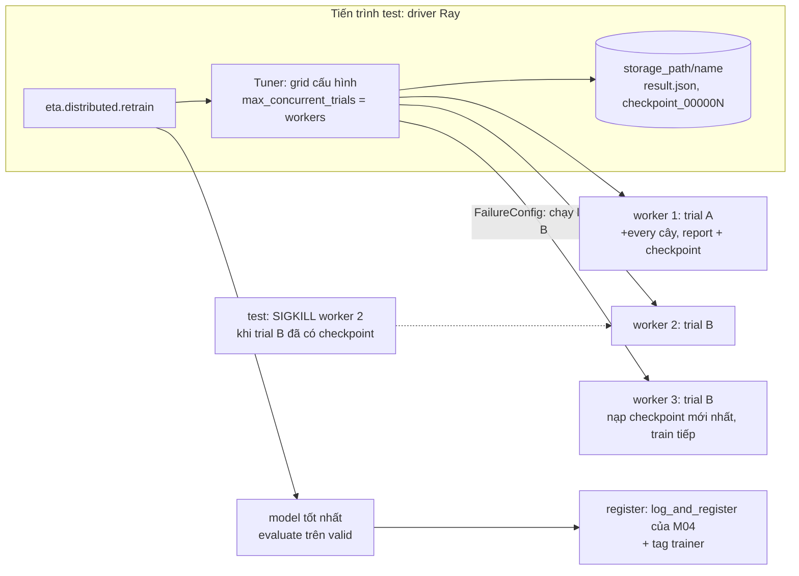

# M15: Retrain ETA bằng Ray nhiều worker, checkpoint định kỳ, chịu worker bị kill

## Mục tiêu

Job retrain của M14 chạy `eta.cli train` trong một tiến trình. Khi team muốn thử nhiều cấu hình mỗi đêm (learning rate,
số lá) trên cùng dữ liệu, một tiến trình chạy lần lượt từng cấu hình là lãng phí máy nhiều nhân; và nếu node bị thu hồi
giữa chừng (spot, preemption của M14), job chạy lại từ đầu. Sau
[module 15](../../modules/15-distributed-training/README.md) bạn viết `eta.distributed`:

- **Nhiều worker**: Ray Tune chạy các cấu hình của ETA song song, mỗi trial trên một worker Ray (1 CPU), dữ liệu đi qua
  object store một lần.
- **Checkpoint định kỳ**: mỗi trial thêm cây theo từng đợt `every` cây (`warm_start` của `HistGradientBoostingRegressor`)
  và lưu checkpoint định kỳ (sau mỗi đợt, hoặc vài đợt một lần).
- **Chịu worker bị kill**: `FailureConfig(max_failures > 0)`. Test SIGKILL thật tiến trình worker đang chạy một trial;
  Tune khởi động trial đó trên worker mới, và trial **tiếp từ checkpoint mới nhất**, không train lại từ cây đầu tiên.
- **Vẫn qua cổng của M04**: model tốt nhất không tệ hơn model train một tiến trình quá mức cho phép, và được đăng ký
  vào MLflow bằng `log_and_register` của M04 (tag `git_commit`, `data_version`).

Mọi thứ chạy trên Ray cục bộ của laptop (một node, 2 CPU cho Ray). Ray cluster nhiều node, autoscaler của Ray và KubeRay
chỉ ở mức khái niệm trong module 15; kiến thức ở đây không thay kinh nghiệm vận hành job phân tán thật, nơi mạng, lưu
trữ checkpoint dùng chung và node chết hàng loạt mới là phần khó.



## Việc cần làm

Không cần cluster hay stack Compose: Ray chạy trong tiến trình test qua `mlopskit.ray_local` (chỉ nghe 127.0.0.1, dọn mọi
tiến trình Ray khi xong), MLflow là SQLite trong thư mục tạm. `ray[train,tune]` đã có trong môi trường của repo.

### 1. Vì sao Ray Tune song song theo cấu hình, không chia dữ liệu

| Cách | Vì sao không (hoặc vì sao có) cho ETA |
| --- | --- |
| Ray Train `DataParallelTrainer` + model của M01 | GBDT dựng cây **tuần tự**: cây sau học phần dư của cây trước. Không có gradient để allreduce như mạng nơ-ron; mỗi worker train một `HistGradientBoostingRegressor` trên một mảnh dữ liệu là ra N model khác nhau, không phải một model. |
| LightGBM/XGBoost distributed (Ray Train `LightGBMTrainer`) | Đúng là data-parallel GBDT: mỗi worker giữ một phần dữ liệu, allreduce histogram mỗi lần chia nút. Đáng khi dữ liệu không vừa RAM một máy. Mẫu ETA vài trăm nghìn dòng vừa RAM một worker; đổi sang booster LightGBM còn kéo theo đổi model, đổi `eta.serve` và cổng M04. |
| **Ray Tune, mỗi cấu hình một trial (chọn)** | Cùng dữ liệu, cùng model M01, khác siêu tham số. Các trial độc lập, song song gần tuyến tính theo số worker; Tune đã có sẵn checkpoint theo trial và `FailureConfig` để chạy lại trial chết. |

Ghi lý do này (bằng lời của bạn, kèm số đo) vào README của project.

### 2. `src/eta/distributed.py`

```python
@dataclass
class Retrained:
    model: object        # Pipeline của trial tốt nhất, đủ `rounds` cây, dự đoán trên make_features như M01
    metrics: dict        # eta.train.evaluate(model, *build_features(valid)): mae, p90_abs_err, mae_airport
    params: dict         # tham số model của trial tốt nhất, gồm max_iter = rounds
    trials: int          # số trial đã chạy

retrain(train: pd.DataFrame, valid: pd.DataFrame, storage_path: str, *, name: str = "eta-retrain",
        workers: int = 2, rounds: int = 200, every: int = 20, max_failures: int = 2) -> Retrained

register(result: Retrained, config: Config, data_version: str) -> str
```

`train`, `valid` là chuyến đã làm sạch có cột `duration_s` (như `synthetic_trips` của M04). Luật test kiểm:

- `tune.Tuner` với `RunConfig(name=name, storage_path=storage_path, failure_config=FailureConfig(max_failures=max_failures))`.
  Test đọc kết quả từng trial ở `storage_path/name/<trial>/result.json` mà Tune tự ghi (đừng tắt logger mặc định của Tune).
- **Ít nhất `workers` trial chạy cùng lúc** trên các worker khác nhau: mỗi trial xin 1 CPU (`tune.with_resources`),
  `max_concurrent_trials=workers`, và có ít nhất `workers` cấu hình. Test so khoảng thời gian report của các trial
  (trường `pid`, `timestamp` Tune tự thêm): phải có hai trial khác `pid` chạy chồng lên nhau.
- Mỗi trial thêm cây theo từng đợt **đúng `every` cây** và sau mỗi đợt gọi `tune.report({...metric..., "trees": <số cây
  hiện có>}, checkpoint=...)`. Trường **`trees`** là số nguyên, lần report cuối của mọi trial có `trees == rounds`.
  Checkpoint (`tune.Checkpoint.from_directory(...)`) gắn vào report **định kỳ**: mỗi đợt hay vài đợt một lần đều được;
  điều test tính là **checkpoint mới nhất** trước khi worker bị kill (mục 4).
- Trial bắt đầu bằng `tune.get_checkpoint()`: có checkpoint thì nạp model và train tiếp từ đó.
- `retrain` trả model của trial tốt nhất theo `mae` trên `valid` (lần report cuối), `metrics` là metric của **chính model
  trả về** đo bằng `eta.train.evaluate`, `params` gồm `max_iter == rounds`. Trial nào vẫn lỗi sau `max_failures` lần thì
  `retrain` raise.
- `register` gọi `eta.registry.log_and_register(result.model, result.metrics, config, data_version)` của M04 với
  `config.model_params = result.params` (để run log `model.learning_rate`, `model.max_iter`...), rồi có thể thêm tag
  riêng (bản tham chiếu: `trainer=ray-tune`, `trials`). Trả version.

Worker Ray là tiến trình riêng, phải import được `eta`. Test đặt `PYTHONPATH=<project>/src` trước khi khởi Ray; ngoài
đời package nằm sẵn trong image (`PYTHONPATH=/app/src` của `Dockerfile.train`) hay được cài vào môi trường của cluster.
Đừng dùng `runtime_env={"working_dir": ...}`: `ray_local` tắt đường đó vì nó bắt worker chạy lại `uv run` và treo.

Chạy tay trên một tháng thật (từ `capstone/project`, sau khi đã có dữ liệu M01):

```bash
RAY_ENABLE_UV_RUN_RUNTIME_ENV=0 RAY_ENABLE_WINDOWS_OR_OSX_CLUSTER=0 PYTHONPATH=src uv run --project ../../../.. python - <<'PY'
import tempfile
from pathlib import Path

import ray

from eta.data import load_month, month_path
from eta.distributed import retrain
from eta.features import clean
from eta.train import time_split

trips = clean(load_month(month_path(Path("../../../../data/raw/nyc-tlc"), "2019-01"), 200_000, 0), "2019-01")
train, valid = time_split(trips)
ray.init(num_cpus=2, include_dashboard=False, _node_ip_address="127.0.0.1", _temp_dir="/tmp/eta-ray")
with tempfile.TemporaryDirectory() as storage:
    result = retrain(train, valid, storage)
    print(result.params, result.metrics)
PY
```

`--project ../../../..` dùng môi trường của repo (có Ray), không phải `pyproject.toml` nhỏ của project. Bản tham chiếu
chạy lệnh này trong khoảng 45 giây, `mae` 147 giây trên 20% cuối tháng 2019-01. Kill thử một worker trong lúc chạy, chỉ trong phiên Ray của bạn (máy có thể đang chạy Ray khác, của test hay của
người khác): worker là tiến trình con của raylet mang `--temp-dir` bạn đặt, nên

```bash
pgrep -P "$(pgrep -f 'raylet.*/tmp/eta-ray' | head -1)" -af 'ray::ImplicitFunc'   # rồi kill -9 <pid> một dòng
```

Đừng `pkill -f 'ray::'`: lệnh đó giết cả worker của mọi phiên Ray trên máy.

### 3. Checkpoint và `warm_start`

`HistGradientBoostingRegressor(warm_start=True, early_stopping=False)`: mỗi lần `fit` với `max_iter` lớn hơn, model giữ
các cây cũ và chỉ thêm cây mới. Với Pipeline của M01, `pipeline.set_params(model__max_iter=k)` rồi `pipeline.fit(X, y)`
(encoder fit lại trên cùng dữ liệu, ra cùng mã hoá). Checkpoint là thư mục tạm chứa `model.joblib`; `tune.report` chép
nó vào `storage_path` trước khi trả về, nên xoá thư mục tạm sau đó là an toàn. `early_stopping=False` vì early stopping
tách một phần train làm validation riêng và có thể dừng trước `rounds`, làm số cây giữa các lần chạy lại không còn
khớp.

`CheckpointConfig(num_to_keep=2)` đủ: Tune chỉ cần checkpoint mới nhất để chạy lại trial. Giữ mọi checkpoint của 4
trial × 10 đợt là 40 bản model trên đĩa.

### 4. Test chấm làm gì

```bash
uv run pytest tracks/mlops/capstone/project/tests -q -rs -k m15
```

Test chạy `retrain` **một lần** cho cả milestone: dữ liệu giả 40 000 chuyến tháng 2019-03 (80% đầu theo thời gian là
`train`, 20% sau là `valid`), `ray_local(num_cpus=2)`, `workers=2, rounds=200, every=20, max_failures=2`, giới hạn cứng
240 giây (`signal.alarm`). Một luồng theo dõi `storage_path/name`: trial đầu tiên đã report ít nhất 3 lần, chưa xong,
và đã có thư mục `checkpoint_*` thì bị **SIGKILL** (qua pidfd, chỉ khi tiến trình đó vẫn là worker `ray::` của user này và raylet cha của nó mang thư mục tạm của đúng
lần `ray_local` này).

- `test_m15_trials_run_in_parallel`: ít nhất 2 trial; hai trial khác `pid` chạy chồng thời gian; lần report cuối của mọi
  trial có `trees == 200`; sau `ray.shutdown()` (trước khi `ray_local` diệt tiến trình còn sót), mọi worker từng chạy trial
  đã tự thoát trong tối đa 15 giây.
- `test_m15_killed_worker_resumes_from_checkpoint`: có worker bị kill; trial đó chạy tiếp trên `pid` khác và kết thúc ở
  200 cây; lần report đầu sau khi chạy lại có `trees` = số cây của checkpoint mới nhất trước khi kill + 20, và số lần
  report sau khi chạy lại = (200 − số cây đã lưu) / 20. Train lại từ đầu thì lần report đầu sau khi chạy lại là 20 cây
  và test fail.
- `test_m15_model_passes_baseline`: `metrics` khớp `evaluate` của test trên model trả về (sai số tương đối 1e-6); so với
  model train một tiến trình bằng `eta.train.train(X, y, {"max_iter": 200, "random_state": 0})` trên cùng `train`, đo
  trên cùng `valid`: `mae` không tệ hơn quá **3%** và `mae_airport` không tệ hơn quá **5%** (cổng M04 với
  `max_mae_regression=0.03`, mặc định `max_airport_regression=0.05`); `mae` thấp hơn 0,8 lần baseline trung vị theo cặp
  zone (notebook M01) tính trên cùng dữ liệu; `params["max_iter"] == 200`.
- `test_m15_registered_with_lineage`: `register` vào MLflow SQLite tạm; model version có tag `data_version` đúng chuỗi
  truyền vào và `git_commit` không rỗng; run log metric `mae` của model và mọi `model.<khoá>` của `params`; model nạp
  lại từ `models:/<tên>/<version>` dự đoán như model trả về.

Bản tham chiếu: 4 cấu hình (`learning_rate` 0,05/0,1 × `max_leaf_nodes` 31/63), mỗi trial 6–8 giây, cả lần chạy kể cả
kill và chạy lại khoảng 25–30 giây; cả milestone dưới 1 phút. `mae` của Ray khoảng 33,8 giây so với 34,5 của model một
tiến trình (dữ liệu giả có nhiễu chuẩn 40 giây).

Hay vấp:

- Trial `ActorDiedError` ngay từ đầu, log `ModuleNotFoundError: No module named 'eta'`: worker không thấy package (mục 2).
- Trial chạy lại mà `trees` bắt đầu lại từ 20: hàm trial không đọc `tune.get_checkpoint()`, hoặc đọc mà dựng model mới
  thay vì nạp model đã lưu.
- Hai trial không bao giờ chồng nhau: thiếu `max_concurrent_trials`, hoặc mỗi trial xin 2 CPU trong khi Ray chỉ có 2.
- `retrain` treo tới hết 240 giây: trial xin nhiều CPU hơn Ray có (Tune chờ tài nguyên mãi, không báo lỗi).
- `HistGradientBoostingRegressor` dùng OpenMP: Ray đặt `OMP_NUM_THREADS` bằng số CPU của trial (1), nên hai trial không
  tranh nhau. Chạy ngoài Ray mà không đặt biến này thì mỗi `fit` chiếm mọi nhân.

## Kết quả nộp

- `src/eta/distributed.py`.
- Mục "Retrain phân tán" trong README của project: lý do chọn Ray Tune theo cấu hình (mục 1), thời gian chạy với
  `workers=1` và `workers=2` trên máy bạn, log một lần kill worker và chạy lại (số cây trước và sau), và version MLflow
  đã đăng ký với tag lineage.

## Tiêu chí đạt

- [ ] `uv run pytest tracks/mlops/capstone/project/tests -q -rs -k m15` pass.
- [ ] Ít nhất hai worker chạy song song; checkpoint định kỳ; `FailureConfig(max_failures > 0)`.
- [ ] Worker bị SIGKILL giữa chừng: trial tiếp từ checkpoint mới nhất, không train lại từ đầu, không còn tiến trình mồ côi.
- [ ] Model tốt nhất qua cổng so với model một tiến trình và được đăng ký với tag `git_commit`, `data_version`.
- [ ] (Tự đánh giá) Ước lượng khi nào ETA cần data-parallel GBDT thật (bao nhiêu dòng, bao nhiêu RAM một worker) và
  checkpoint khi đó nằm ở đâu (đĩa local của worker không còn dùng được khi node chết).
