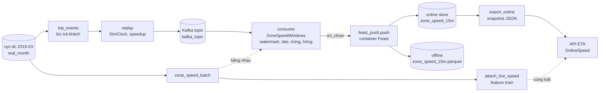

# M16: Feature real-time từ stream Kafka phát lại, đo freshness

## Mục tiêu

Feature tốc độ của M06 là trung vị theo `(zone, giờ)` của **tháng trước**: nó không thấy được một vụ tắc đường xảy ra 20 phút
trước. M16 thêm feature real-time đầu tiên của ETA: **`speed_15m_mph`, tốc độ trung bình của các chuyến đón ở một zone và vừa
kết thúc trong cửa sổ 15 phút gần nhất**, tính từ stream, đẩy vào online store của Feast, và API ETA đọc nó lúc dự đoán.

Bạn dựng lại cả đường đi của một feature streaming trên dữ liệu thật, ở quy mô một máy:

1. **Phát lại**: chuyến TLC thật (tháng 3/2019) thành sự kiện "chuyến đã kết thúc", gửi vào topic Kafka theo **đồng hồ mô phỏng
   tăng tốc** (1 phút dữ liệu thành 1 giây thật khi `speedup=60`).
2. **Cửa sổ theo event time**: consumer gộp theo **lúc trả khách** (tốc độ của chuyến chỉ biết khi chuyến kết thúc), có watermark;
   sự kiện đến quá trễ bị loại và **đếm**, bản trùng và message hỏng bị bỏ qua và đếm, không làm chết consumer.
3. **Online store**: cửa sổ vừa đóng đi vào Feast qua push source; online luôn giữ cửa sổ mới nhất mỗi zone.
4. **Serving**: API ETA đọc giá trị online, dùng **cùng luật** với lúc dựng feature train, thiếu hay cũ thì dùng mặc định an toàn.
5. **Freshness**: đo từ event time tới lúc giá trị đọc được, trên cùng một trục thời gian mô phỏng.

Bài tích hợp sau [module 16](../../modules/16-streaming-realtime-ml/README.md). Sự cố của M18 (consumer chết vì một message hỏng,
feature quá TTL, model điền 0) là chuyện xảy ra với đúng feature này; mấy luật dưới đây là để nó không xảy ra với bạn. Kiến thức
trong bài là nền, không thay được kinh nghiệm vận hành một pipeline streaming thật nhiều partition, nhiều consumer.



## Việc cần làm

Cần: bộ `nyc-tlc` (`uv run python data/download_dataset.py nyc-tlc`), Kafka của stack
(`docker compose -f setup/mlops/compose.yaml --profile streaming up -d --wait`), Docker cho image Feast `mlops-feast:0.67.0`
(build lần đầu). Thiếu thứ nào thì test cần nó **skip** kèm lệnh bật. Code mới nằm trong `src/eta/streaming/`, khung có sẵn
trong `capstone/project/src/eta/streaming/` (tên hàm và chữ ký, thân còn `NotImplementedError`). **Dùng lại code module 16 của
bạn**: luật cửa sổ của bài Basic 01 và Intermediate 01, push và freshness của Intermediate 02; ở đây đổi feature (tốc độ thay cho giá
cước), event time (lúc trả khách) và thêm phần API.

### 1. Quy ước thời gian

- Thời điểm trong TLC là giờ New York **không múi giờ**. Bài coi chuỗi `YYYY-MM-DDTHH:MM:SS` như UTC để đổi sang giây epoch
  (`datetime.fromisoformat(s).replace(tzinfo=timezone.utc).timestamp()`): mọi phép trừ giữa hai thời điểm vẫn đúng, cửa sổ vẫn
  rơi vào :00, :15, :30, :45 giờ địa phương. Lát dữ liệu của test (2019-03-05) không chạm đổi giờ mùa hè.
- Hằng số trong `eta/streaming/events.py`: `WINDOW_S = 900`, `LATENESS_S = 120`. Trong `eta/streaming/online.py`:
  `TTL_S = 1800`. Feature tên `speed_15m_mph`. Mặc định khi không có feature là **`DEFAULT_SPEED_MPH` của M06** (một mặc định
  cho cả nền tảng, không bao giờ 0).

### 2. Phát lại: `eta/streaming/events.py`

**`trip_events(trips) -> list[dict]`**: `trips` là chuyến sạch (có `tpep_dropoff_datetime`, `PULocationID`, `trip_distance`,
`duration_s`). Mỗi dòng thành một dict **đúng năm khoá**:

| Khoá | Giá trị |
| --- | --- |
| `trip_id` | `str` của index dòng trong `trips` |
| `PULocationID` | `int` |
| `dropoff_at` | `"YYYY-MM-DDTHH:MM:SS"`, lúc trả khách: đây là **event time** |
| `trip_distance`, `duration_s` | `float` |

Danh sách sắp tăng theo lúc trả khách, **ổn định** (hai chuyến trùng giờ giữ thứ tự trong `trips`).

**`SimClock(sim_start, wall_start, speedup)`** (dataclass, giây epoch): `sim(wall) = sim_start + (wall - wall_start) * speedup`,
`wall(sim)` là hàm ngược.

**`replay(bootstrap, topic, events, clock) -> int`**: gửi từng sự kiện **theo thứ tự của list** bằng `KafkaProducer`
(`kafka-python-ng`), key là `PULocationID`, value là JSON của dict. Sự kiện thứ `i` gửi khi wall time (`time.time()`) đã tới
`clock.wall(m_i)`, với `m_i` là event time lớn nhất trong `events[0..i]` (list có thể lệch thứ tự: đồng hồ không chạy lùi).
Không gửi sớm; `flush` rồi đóng producer; trả số sự kiện đã gửi. Test kiểm bằng timestamp Kafka (CreateTime) của từng message:
không message nào sớm hơn `clock.wall(m_i)` quá 0,05 giây, và tổng thời gian không quá `span / speedup + 10` giây.

### 3. Cửa sổ: `eta/streaming/windows.py`

**`ZoneSpeedWindows(window_s=WINDOW_S, lateness_s=LATENESS_S)`**, có thuộc tính đếm `late`, `duplicates`, `invalid`, và:

- `add(event) -> list[dict]`: `event` là giá trị đã giải mã JSON (có thể là bất cứ thứ gì, kể cả `None`). Xét **theo thứ tự**:
  1. Không hợp lệ thì `invalid += 1`, bỏ: không phải dict, thiếu khoá nào trong năm khoá, `trip_id` không phải chuỗi,
     `PULocationID` không phải số nguyên, `dropoff_at` không đọc được, `trip_distance` hay `duration_s` không phải số hữu hạn,
     `trip_distance` ngoài `[0, 100]` hoặc `duration_s` ngoài `(0, 10 800]` (cùng giới hạn với `clean` của M01; nhờ vậy tốc độ luôn
     hữu hạn). Message hỏng **không bao giờ** làm consumer dừng.
  2. `trip_id` đã gặp thì `duplicates += 1`, bỏ.
  3. Cửa sổ tumbling `[start, start + window_s)` với `start = ts - ts % window_s` (`ts` là event time, giây epoch). Nếu đã có
     watermark và `start + window_s <= watermark` thì `late += 1`, bỏ.
  4. Còn lại: cộng vào cửa sổ `(PULocationID, start)`; `watermark = max(watermark, ts - lateness_s)`; **đóng ngay** mọi cửa sổ
     có `window_end <= watermark` và trả chúng (sắp theo `(window_end, PULocationID)`).
- `flush() -> list[dict]`: đóng mọi cửa sổ còn mở, cùng thứ tự.

Mỗi dòng cửa sổ có **đúng năm khoá**: `PULocationID`, `window_start`, `window_end` (giây epoch, `int`), `trips`, và
`speed_15m_mph = tổng trip_distance / (tổng duration_s / 3600)` của các chuyến được nhận (tỉ số của tổng, không phải trung bình
tốc độ từng chuyến: chuyến dài nặng hơn, và cộng dồn được).

**`consume(bootstrap, topic, *, on_close=None, idle_ms=3000) -> dict`**: đọc topic **từ đầu** (group mới mỗi lần, tắt auto commit),
giải mã từng message (value không phải bytes, ví dụ tombstone `None`, bytes không phải JSON, hay JSON lồng sâu tới mức parser ném
`RecursionError` thì đưa vào `add` như giá trị hỏng `None`), dừng khi `idle_ms` không có message mới **kể từ
message cuối** (trước message đầu tiên thì chờ lâu hơn, ví dụ 30 giây, vì consumer còn join group), rồi `flush`. Mỗi lần có cửa sổ
vừa đóng (kể cả lúc `flush`) gọi `on_close(rows)` với **list không rỗng** các dòng đó; nối mọi lần gọi lại phải bằng `windows`.
Trả `{"windows", "late", "duplicates", "invalid", "consumed"}` (`consumed` đếm mọi message đã đọc, kể cả hỏng và trùng).

**`zone_speed_batch(trips, window_s=WINDOW_S) -> DataFrame`**: cùng feature tính bằng pandas trên chuyến (cửa sổ theo lúc trả
khách), cột đúng thứ tự `PULocationID, window_start, window_end, trips, speed_15m_mph`, sắp theo `(window_end, PULocationID)`.
Trên đúng các chuyến mà stream đã nhận, hai đường phải ra cùng số (sai số tương đối `1e-9`): đó là cách bạn biết stream không lệch
với batch dùng để train.

### 4. Feast: `feature_repo/streaming.py` và `eta/streaming/feast_push.py`

`feature_repo/streaming.py` (cùng repo với `features.py` của M06, import `pu_zone` từ `features`):

- `FileSource` tên tuỳ ý, đường dẫn `data/zone_speed_15m.parquet`, `timestamp_field="event_timestamp"`.
- `PushSource` tên **`zone_speed_push`**, `batch_source` là FileSource trên.
- `FeatureView` tên **`zone_speed_15m`**, `entities=[pu_zone]`, schema `speed_15m_mph` (`Float64`) và `trips` (`Int64`),
  `source` là push source, `ttl=timedelta(minutes=30)`, `online=True`.
- View push **không materialize**: nguồn batch của nó là tệp do chính `push` ghi. Từ đây `feast materialize` của M06 phải chỉ rõ view
  (`feast materialize -v zone_hour_speed ...`); test M06 đã làm vậy. Chạy `materialize` không có `-v` sẽ lỗi khi
  `data/zone_speed_15m.parquet` chưa có.
- Chạy push thật (ngoài test) thì **tạo trước `feature_repo/data/zone_speed_15m.parquet` rỗng** đúng bốn cột (`PULocationID` int64,
  `speed_15m_mph` float64, `trips` int64, `event_timestamp` datetime UTC), như test làm: push offline ghi nối vào tệp này.

`eta/streaming/feast_push.py` chạy **trong container Feast**, nơi không có package `eta`: đầu tệp chỉ import pandas và thư viện
chuẩn, `feast` import bên trong hàm. Hằng `PUSH_SOURCE = "zone_speed_push"`, `REFS = ["zone_speed_15m:speed_15m_mph",
"zone_speed_15m:trips"]`.

- `to_push_frame(windows) -> DataFrame`: cột đúng thứ tự `PULocationID` (int64), `speed_15m_mph` (float64), `trips` (int64),
  `event_timestamp` (datetime UTC) **= `window_end`**: giá trị của cửa sổ là về các chuyến đã kết thúc trước `window_end`. Sắp tăng
  theo `event_timestamp`.
- `push(store, frame) -> int`: ghi **mọi** dòng vào offline qua push source; online chỉ ghi dòng có `event_timestamp` lớn nhất của mỗi
  zone, và chỉ khi nó **không cũ hơn** giá trị online đang có (đọc `speed_15m_mph__ts` từ
  `get_online_features(...).to_dict(include_event_timestamps=True)`; online store SQLite của Feast ghi đè theo thứ tự ghi, không so
  thời điểm). Trả số dòng đã ghi online.
- `export_online(store, zones, path) -> int`: đọc online cho `zones`, ghi `path` dạng
  `{"feature_view": "zone_speed_15m", "rows": [{"PULocationID", "speed_15m_mph", "trips", "window_end"}, ...]}` chỉ với zone có giá
  trị (`window_end` là `speed_15m_mph__ts`), **ghi tệp tạm cùng thư mục rồi `os.replace`** để API không bao giờ đọc nửa tệp. Trả số dòng.

**Vì sao API đọc snapshot chứ không gọi Feast.** Như M06, image serving không có Feast (xung đột pandas). Snapshot do chính job push
ghi ngay sau mỗi lần push, nên freshness đo tới lúc **API** thấy giá trị, không chỉ tới lúc ghi vào store. Ngoài đời bạn sẽ gọi
feature server của Feast hoặc đọc Redis trực tiếp; luật đọc (mục 5) giữ nguyên.

### 5. Feature cho train và cho API: `eta/streaming/online.py`, `features.py`, `serve.py`

Một cửa sổ **sẵn sàng** cho request lúc `t` (giờ đón) khi `window_end + LATENESS_S <= t` (stream chỉ đóng được cửa sổ sau khi
watermark qua nó) và **còn dùng được** khi `t - window_end <= TTL_S` (hai bất đẳng thức đều tính cả dấu bằng).

- `attach_live_speed(trips, windows) -> DataFrame` (feature train, point-in-time): thêm cột `speed_15m_mph` vào bản sao của `trips`
  (cần `tpep_pickup_datetime`, `PULocationID`): giá trị của cửa sổ **mới nhất** cùng zone thoả cả hai điều kiện, không có thì
  `DEFAULT_SPEED_MPH`. Giữ số dòng, thứ tự, index; không sửa `trips`. `windows` có cột như `zone_speed_batch`.
- `features.py`: `speed_15m_mph` là feature **tuỳ chọn** như `avg_speed_mph` của M06: có cột thì `make_features` / `build_features`
  thêm nó sau `avg_speed_mph` (nếu có), ở cuối; không có thì feature như cũ.
- `OnlineSpeed(path)`: đọc snapshot (đọc lại khi tệp đổi), tra theo zone và giờ đón.
- `serve.py`: biến `ETA_ONLINE_FEATURES` là đường dẫn snapshot. Model có `speed_15m_mph` trong `feature_names_in_` mà chưa đặt
  biến này thì API **không sẵn sàng** (`/readyz` 503), như M06 với `ETA_SPEED_TABLE`. Khi model cần, `/predict` gắn feature từ
  snapshot theo đúng luật trên và trả thêm hai trường (chỉ khi model dùng feature này; model
  không dùng thì response giữ đúng hợp đồng M07, không có trường thừa): `speed_15m_mph` (giá trị đã dùng) và `speed_15m_status`: `fresh` (dùng giá trị
  online), `stale` (zone có giá trị nhưng không sẵn sàng hoặc quá TTL), `missing` (zone không có giá trị). `stale` và `missing` dùng
  `DEFAULT_SPEED_MPH`. Snapshot chỉ giữ cửa sổ mới nhất mỗi zone, nên API và `attach_live_speed` cho cùng giá trị khi cửa sổ mới nhất là
  cửa sổ point-in-time chọn (luôn đúng khi chạy thật: request đến sau khi cửa sổ đã đóng).

### 6. Freshness: `eta/streaming/freshness.py`

`freshness(records) -> dict`: mỗi record có `event_time` và `visible_at` (giây, cùng trục mô phỏng). Trả `n`, `p50`, `p95`, `max`
của `visible_at - event_time` (percentile kiểu mặc định của `numpy.percentile`); list rỗng thì `n = 0`, ba số kia `None`.

Freshness đo theo **event time**: một chuyến kết thúc lúc 08:01 nằm trong cửa sổ 08:00–08:15, chỉ thấy được sau 08:17 (lateness),
cộng thời gian xử lý. Đo từ lúc consumer nhận message sẽ cho số đẹp hơn thực tế gần 15 phút.

**Ngưỡng**: với `speedup = 60`, p95 **không quá 2 160 giây mô phỏng** = 2 × (900 cửa sổ + 120 lateness + 60 cho xử lý, tức 1 giây
thật), và p50 không dưới `LATENESS_S`. Bản tham chiếu đo được p50 592 s, p95 994 s, max 1 076 s (dư hơn 2 lần).

### 7. Test chấm làm gì

```bash
uv run pytest tracks/mlops/capstone/project/tests -q -rs -k m16
```

- `test_m16_window_rules` (không cần Kafka): 14 sự kiện viết tay qua `ZoneSpeedWindows(900, 120)`, gồm bản trùng, năm giá trị hỏng
  (chuỗi, dict thiếu khoá, `duration_s = 0`, `trip_distance = 1e300`, `None`), một sự kiện trễ và một sự kiện rơi **đúng** vào `window_end == watermark`. Kiểm từng cửa
  sổ đóng ở đúng sự kiện nào, giá trị, và ba bộ đếm.
- `test_m16_replay_stream_matches_batch` (Kafka, dữ liệu thật 08:00–09:00 ngày 2019-03-05, 25% chuyến): `trip_events` trên `trips`
  đã xáo; luồng bị xáo trong phạm vi 20 vị trí, 15 sự kiện của 10 phút đầu dời xuống cuối (thành trễ), 25 bản trùng; năm message hỏng
  gửi trước (không phải JSON, thiếu khoá, `duration_s` âm, JSON lồng 100 000 tầng, tombstone `value=None`). `replay` với `speedup = 1800` vào topic tạm của `mlopskit.kafka_topic()`, rồi `consume`. So với luật tính lại trên đúng
  thứ tự đã gửi: các bộ đếm, mọi cửa sổ, thứ tự xuất, các lần gọi `on_close`; `zone_speed_batch` trên các chuyến được nhận bằng stream.
- `test_m16_attach_point_in_time`: tám chuyến quanh ranh giới sẵn sàng (`+120 s`), TTL (`1800 s`, `1801 s`), zone lạ.
- `test_m16_feast_online_matches_batch` (Docker): chép `feature_repo/` sang thư mục tạm, thay `feature_store.yaml` bằng online store
  **SQLite** (`data/online.db`), offline `file`, project ngẫu nhiên; tạo sẵn `data/zone_speed_15m.parquet` rỗng; chép
  `src/eta/streaming/feast_push.py` vào gốc repo tạm; `feast apply` trong container **`network="none"`**. Cửa sổ thật của 25 zone,
  2 giờ, đi vào `push` theo 3 lô xáo trộn rồi một lô gửi lại 10 cửa sổ cũ: online của mỗi zone là cửa sổ mới nhất (sai số `1e-9`),
  số dòng ghi online là số zone của từng lô rồi `0`, zone lạ trả `None`, snapshot của `export_online` đúng bằng online.
- `test_m16_api_reads_online_feature`: train model nhỏ bằng `train.train` trên chuyến có `attach_live_speed`, chạy API bằng
  `TestClient` với `ETA_ONLINE_FEATURES` là snapshot trên. 12 zone lúc `window_end + 180 s`, một ca quá TTL, một zone lạ, một ca chưa sẵn
  sàng (`window_end + 60 s`, kỳ vọng `stale` và `DEFAULT_SPEED_MPH`): `eta_s` và
  `speed_15m_mph` phải bằng model chạy trên feature của `attach_live_speed`; trạng thái `fresh`/`stale`/`missing`; chưa đặt biến thì
  `/readyz` 503; model không dùng feature thì response chỉ có ba khoá của M07.
- `test_m16_live_freshness` (Kafka + Docker, khoảng 1 phút): 10 zone, 08:00–08:45, 30% chuyến, 5 sự kiện dời thành trễ. Container Feast
  (test viết) đọc `on_close` của bạn qua một tệp outbox, gọi `push` và `export_online` của bạn, ghi lúc snapshot có giá trị. `replay`
  với `speedup = 60`, `consume` chạy song song. Kiểm: số sự kiện trễ bị loại, ít nhất 95% sự kiện được nhận có giá trị online,
  `freshness` khớp percentile tính lại, ngưỡng ở mục 6.

Máy đang tải nặng thì freshness tăng (xử lý 1 giây thật thành 60 giây mô phỏng); ngưỡng đã dư 2 lần cho việc đó.

## Kết quả nộp

- `src/eta/streaming/` (`events.py`, `windows.py`, `online.py`, `freshness.py`, `feast_push.py`), `feature_repo/streaming.py`,
  phần thêm vào `features.py` và `serve.py`.
- Mục "Feature real-time" trong README: định nghĩa feature, event time và vì sao là lúc trả khách, watermark, TTL, mặc định, số
  freshness p50/p95 đo trên máy bạn (chạy `test_m16_live_freshness` với `-s` và in `freshness`, hoặc script riêng).

## Tiêu chí đạt

- [ ] `uv run pytest tracks/mlops/capstone/project/tests -q -rs -k m16` pass, không skip.
- [ ] Feature của stream bằng tính batch trên cùng cửa sổ; online luôn là cửa sổ mới nhất; API dùng cùng luật với feature train.
- [ ] Sự kiện trễ, trùng, hỏng được đếm; không message nào làm consumer dừng.
- [ ] (Tự đánh giá) Giải thích được p50 freshness gần nửa cửa sổ cộng lateness, và đổi `WINDOW_S`/`LATENESS_S` thì đánh đổi giữa
      freshness, số sự kiện trễ bị loại và độ nhiễu của feature thế nào.
- [ ] (Tự đánh giá) Nói được điều gì đổi khi topic có nhiều partition (watermark theo partition, lấy nhỏ nhất; partition rảnh giữ
      watermark đứng yên) và khi consumer chết giữa chừng (commit offset sau khi push, push idempotent theo `event_timestamp`).
- [ ] (Tự đánh giá) Chỉ ra trong code của bạn chỗ nào chặn được chuỗi sự cố của M18 (message hỏng, feature quá TTL, mặc định 0) và
      alert nào bạn sẽ đặt trên freshness.
