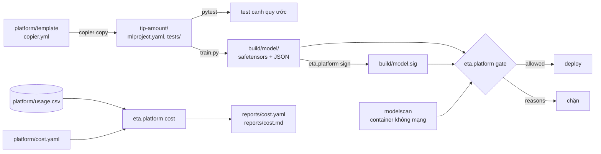

# M17: Onboard model thứ hai qua template nền tảng, ký và quét model, báo cáo chi phí

## Mục tiêu

Tới M16, mọi thứ trong capstone phục vụ **một** model. Đội `pricing` muốn đưa model thứ hai lên cùng nền tảng: **dự đoán tiền
tip** (`tip_amount`) của chuyến taxi. Nếu họ chép tay thư mục ETA rồi sửa, sau ba model bạn có ba cách đặt tên, ba kiểu lưu model,
không ai biết model nào tốn bao nhiêu. Milestone này biến capstone thành một **nền tảng nhỏ**:

1. **Golden path**: template Copier sinh dự án model đã có tag bắt buộc (owner, team, cost center), quy ước tên registry, lưu model
   bằng **safetensors** (không pickle), và test canh quy ước nằm ngay trong dự án sinh ra. Model tip onboard trong **tối đa 5 lệnh**.
2. **Cổng deploy**: một model chỉ được deploy khi đủ bốn điều: chỉ gồm định dạng không chứa code (xét **theo nội dung tệp**),
   modelscan không thấy gì, **chữ ký còn khớp** (ký bằng khoá EC của pipeline, `model-signing`), và tag bắt buộc hợp lệ.
3. **Chi phí theo model**: từ log sử dụng của cụm dùng chung, báo cáo đội nào, model nào tốn bao nhiêu, gồm cả phần không ai muốn
   nhận (năng lực nhàn rỗi, workload không gắn nhãn).

Bài tích hợp sau [module 17](../../modules/17-ml-platform-security/README.md). **Dùng lại code module 17 của bạn**: template của bài
Basic 01, sniff định dạng của Intermediate 01, ký và cổng của Intermediate 02, chi phí của Basic 03; ở đây gộp lại thành một nền tảng. Kiến thức trong bài là nền; dựng và vận hành một nền
tảng ML cho nhiều đội thật (quản lý khoá, quy trình ngoại lệ, chargeback thật) cần kinh nghiệm mà một bài tập không thay được.



## An toàn khi làm bài

Test dùng pickle "độc hại" đã **vô hại hoá** (`etakit.marker_pickle`, `etakit.stealth_pickle`): nạp vào chỉ ghi chữ `pwned` vào một
tệp đánh dấu trong thư mục tạm của test, không gọi lệnh hệ thống, không dùng mạng. Test **không bao giờ** nạp tệp model. Code của
bạn cũng không được nạp (`pickle.load`, `joblib.load`, `torch.load`...) để kiểm tra: sau mọi lần gọi cổng, test kiểm tệp đánh dấu
không xuất hiện. Quét model chỉ qua `mlopskit.modelscan_run` (container `--network none`, mount chỉ đọc). Khoá ký do test sinh tại
chỗ (`etakit.ec_keypair`, khoá riêng quyền 0600), không Sigstore, không mạng.

## Việc cần làm

Cần Docker (image `mlops-modelscan:0.8.8`, build lần đầu), bubblewrap (`bwrap`, test chạy Copier và lệnh onboarding trong sandbox),
bộ `nyc-tlc`. Thư viện `copier`, `model-signing`, `safetensors` đã có trong môi trường mặc định.

### 1. Template nền tảng: `platform/template/`

Template Copier (đúng **một** tệp `copier.yml` hoặc `copier.yaml`, nội dung dự án trong thư mục con). Template **không được** dùng
tính năng Copier coi là không an toàn (`_tasks`, `_migrations`, `_jinja_extensions`): test chạy `copier copy` không có `--trust`.
Câu hỏi và luật:

| Câu hỏi | Luật |
| --- | --- |
| `project_name` | bắt buộc, không rỗng |
| `project_slug` | mặc định từ `project_name` (bỏ khoảng trắng hai đầu, chữ thường, khoảng trắng thành `-`); khớp `^[a-z][a-z0-9]*(-[a-z0-9]+)*$` |
| `team` | một trong `eta`, `pricing`, `fraud`, `search`, `ads` |
| `owner` | **không có default**, là email |
| `cost_center` | **không có default**, dạng `CC-` và 4 chữ số |

Trả lời sai hay thiếu thì `copier copy` dừng với lỗi và **không sinh** `mlproject.yaml`. Dự án sinh ra có:

- `mlproject.yaml`: `name` (= slug), `registry_name` (= `<team>-<slug>`), `model_format: safetensors`, `target: tip_amount`, `tags`
  gồm đúng ba khoá `owner`, `team`, `cost_center`.
- `.copier-answers.yml` (có `_src_path` và các câu trả lời) để `copier update` kéo thay đổi của template về.
- `train.py`: `python train.py --data <tệp tháng TLC> --out <thư mục>` đọc chuyến, làm sạch, chia theo thời gian (80% đầu train, 20%
  cuối test), train, ghi `<out>/model/` và `<out>/metrics.json` (`mae`, `baseline_mae` là MAE của dự đoán bằng trung vị tập train,
  `n_train`, `n_test`).
- `<out>/model/` chỉ gồm tệp **safetensors và JSON** (xét theo nội dung), trong đó có `metadata.json` chép `registry_name` và `tags`
  từ `mlproject.yaml`. Tag nằm **trong** thư mục được ký, nên sửa tag sau khi ký làm chữ ký hỏng.
- `tests/`: `python -m pytest -q` trong dự án pass **ít nhất 2 test**, và **fail** khi `mlproject.yaml` mất một trong ba tag.
- Tệp Python trong template đặt đuôi `.py.jinja` (để pytest của repo không thu thập test của template).

Template này **cố ý chuyên cho bài tip** (bảng chuyến TLC, `target: tip_amount` cố định, không có câu hỏi `target`): golden path
thật sẽ có nhiều loại bài toán, ở đây gọn lại để tập trung vào luật nền tảng. Model nào, feature nào là việc của bạn. Gợi ý: tiền mặt trong TLC luôn ghi tip 0, nên `payment_type` là feature mạnh nhất; một
`Ridge` vài feature lưu `coef`/`intercept` bằng safetensors là đủ, và nạp lại không cần pickle. Model gradient boosting (LightGBM có
định dạng văn bản riêng, ONNX) cũng được nếu bạn giữ được luật "chỉ safetensors và JSON" hoặc tự mở rộng allowlist có lý do.

### 2. Lệnh nền tảng: `src/eta/platform/`

- `eta.platform.signing`: `sign(model_dir, private_key, signature)` ký **cả thư mục** bằng khoá riêng EC
  (`signing.Config().use_elliptic_key_signer(...)`); `signature` nằm trong `model_dir` thì `raise ValueError` và không ghi gì.
  `verify(model_dir, public_key, signature) -> bool` fail closed: mọi lỗi (thiếu tệp, tệp hỏng, khoá khác, sửa, thêm, xoá tệp) là
  `False`, không ném lỗi.
- `eta.platform.gate`: `deploy_gate(model_dir, signature, public_key, scan) -> {"allowed": bool, "reasons": [...]}`, `reasons`
  **sắp xếp tăng dần**, `allowed` đúng khi rỗng. `scan(model_dir)` gọi **đúng một lần** trên chính `model_dir` (test truyền
  `mlopskit.modelscan_run`). Mã lý do:

| Mã | Khi nào |
| --- | --- |
| `empty` | thư mục không có tệp nào |
| `format:<tệp>` | tệp (đường dẫn tương đối, posix) không phải safetensors hay JSON **theo nội dung**; symlink cũng là `format` |
| `signature` | `verify` trả `False` |
| `scan` | kết quả quét không sạch: `returncode` không phải 0 hay 3, `stdout` không phải JSON object, có `issues`, có `errors`, hoặc `scan` ném exception (không có Docker, quá giờ): cổng không bao giờ ném lỗi |
| `tag:<khoá>` | trong `metadata.json` của `model_dir`, `tags.<khoá>` thiếu hoặc sai luật của template (owner email, team trong danh sách, cost center `CC-dddd`), so **khớp cả chuỗi** (`"CC-2041\n"` là sai); không có `metadata.json` hợp lệ thì cả ba |

  Cách nhận định dạng theo nội dung như module 17 bài Intermediate 01: safetensors khi 8 byte đầu là độ dài header JSON hợp lệ, JSON
  khi cả tệp parse được. Cổng không bao giờ nạp tệp model.
- `python -m eta.platform sign <model_dir> --key <private.pem> --out <sig>` và
  `python -m eta.platform gate <model_dir> --signature <sig> --public-key <pub>` (in quyết định JSON, mã thoát 0 khi được deploy,
  khác 0 khi bị chặn; tự chạy modelscan bằng image `mlops-modelscan:0.8.8` đã build sẵn (không kéo từ mạng), `--network none`,
  chỉ mount thư mục model, chỉ đọc).
- Cổng chỉ có nghĩa khi bước deploy dùng **đúng các byte đã kiểm**: chép model vào nơi deploy rồi chạy cổng trên bản chép (hoặc deploy
  từ chính thư mục vừa qua cổng, không ai ghi được), đừng kiểm một chỗ rồi deploy từ chỗ khác.
- Phạm vi: cổng này áp cho model onboard qua template. Model ETA hiện vẫn nạp bằng `joblib`/MLflow (pickle) như M04–M12, cổng nền tảng
  **chưa phủ** ETA; chuyển ETA sang định dạng không pickle là việc tiếp theo, không thuộc milestone này.

### 3. Onboarding trong tối đa 5 lệnh: `docs/onboarding.md`

Tệp có mục `## Onboarding` và trong đó một khối ` ```bash `. Luật của khối:

- Tối đa **5** lệnh, **mỗi dòng một lệnh**; không nối lệnh bằng `&&`, `||`, `;`, `|`, không xuống dòng bằng `\`. Dòng trống và
  dòng bắt đầu bằng `#` không tính.
- Chạy được từ một thư mục trống với các biến: `PLATFORM` (thư mục template), `TRIPS` (tệp `yellow_tripdata_2019-03.parquet`),
  `SIGNING_KEY`, `PUBLIC_KEY`, `PYTHONPATH` trỏ `src` của project, `python` là Python của môi trường repo.
- Kết quả: dự án `tip-amount/` (registry `pricing-tip-amount`, owner `lan.nguyen@example.com`, team `pricing`, cost center
  `CC-2041`), model `tip-amount/build/model/`, chữ ký `tip-amount/build/model.sig`, `tip-amount/build/metrics.json`.
- Lệnh **cuối** là cổng deploy (`python -m eta.platform gate ...`).

Test chạy mọi lệnh **trừ lệnh cuối** trong sandbox bwrap (không có Docker), theo thứ tự, mỗi lệnh `bash -euo pipefail -c`, giới hạn
300 giây mỗi lệnh. Rồi test gọi `deploy_gate` của bạn với `mlopskit.modelscan_run` trên kết quả, và chạy **lệnh cuối ngoài sandbox**
(cần Docker cho modelscan) với cùng biến: phải thoát 0; sửa một byte của model rồi chạy lại: phải thoát khác 0. Ngưỡng chất lượng: `n_test >= 10 000` và `mae <= 0.8 * baseline_mae` (bản tham chiếu: 0.72 so với 1.68 USD).

### 4. Báo cáo chi phí: `eta.platform.cost` và `reports/`

Đầu vào có sẵn: `platform/usage.csv` (log 30 ngày tháng 11/2019 của cụm dùng chung, mỗi dòng một workload một ngày: `date`,
`namespace`, `model`, `workload`, `cpu_hours`, `gpu_hours`, `mem_gb_hours` là tài nguyên **đã xin**) và `platform/cost.yaml` (`period`,
`currency`, `prices`, `capacity` của cả kỳ, `namespaces` ánh xạ namespace sang đội, `cost_centers` của đội). Số trong log là số dựng
sẵn theo cấu hình của capstone (ETA serve 2 replica, retrain hằng đêm, model tip từ ngày 11, notebook không gắn nhãn, một namespace
thử nghiệm chưa đăng ký đội).

- `load_usage(path) -> list[dict]`: ba cột tài nguyên là `float`; `namespace` và `model` bỏ khoảng trắng hai đầu; `model` rỗng thành
  `None`.
- `cost_report(rows, config) -> dict`:
  - chi phí một dòng = `cpu_hours × cpu_hour + gpu_hours × gpu_hour + mem_gb_hours × mem_gb_hour`;
  - dòng có namespace trong `namespaces` thuộc đội đó và model của nó (`None` thành `unlabelled`); dòng namespace lạ cộng vào
    `unallocated` (không thuộc model nào);
  - `idle` = tổng theo **từng loại** tài nguyên `max(0, capacity - tổng đã xin) × giá` (dùng vượt một loại không bù cho loại khác);
  - `idle` chia cho các dòng model theo tỉ lệ chi phí trực tiếp (`unallocated` không nhận phần idle);
  - trả `{"period", "currency", "models": [{"team", "model", "cost_center", "direct", "idle_share", "total"}, ...], "unallocated",
    "idle", "capacity_cost", "total"}`, mỗi số làm tròn 2 chữ số, `total` = tổng trực tiếp + `idle` + `unallocated` (bằng
    `capacity_cost` khi không loại nào dùng vượt).
- `python -m eta.platform cost platform/usage.csv platform/cost.yaml --out reports` ghi `reports/cost.yaml` (dict trên) và
  `reports/cost.md` (bảng Markdown, mỗi model một dòng có tên model và tổng 2 chữ số, cộng các dòng `unallocated`, idle, tổng). Nộp
  cả hai tệp (`.gitignore` đã mở cho chúng).

### 5. Test chấm làm gì

```bash
uv run pytest tracks/mlops/capstone/project/tests -q -rs -k m17
```

- `test_m17_template_contract`: template không cần `--trust`; render với câu trả lời đúng (sandbox); `mlproject.yaml`, tệp câu trả lời;
  test của dự án sinh ra pass (ít nhất 2) và fail khi bỏ từng tag.
- `test_m17_template_rejects_bad_answers`: owner không phải email, cost center sai dạng, đội lạ, slug có `_`, thiếu owner, thiếu cost
  center: cả sáu không sinh dự án. Test chỉ báo số ca bị nhận sai.
- `test_m17_onboarding_in_five_commands`: mục 3; kiểm thêm định dạng từng tệp model theo nội dung, tag trong `metadata.json`, verify
  chữ ký bằng thư viện `model-signing`, và cổng cho qua.
- `test_m17_gate_blocks_unsigned_tampered_or_malicious`: một thư mục model mẫu (safetensors + JSON) qua cổng với modelscan thật trong
  11 ca: sạch; chưa ký; sửa một byte sau khi ký; ký bằng khoá khác; bỏ tag sau khi ký; ký khi thiếu tag; owner sai dạng; cost center có
  xuống dòng ở cuối; ký kèm pickle
  có payload; ký kèm pickle modelscan không bắt được, đuôi `.bin`; thêm pickle sau khi ký. Mỗi ca so đúng cả danh sách `reasons` và việc
  `scan` được gọi đúng một lần; test chỉ báo tên ca sai. Cuối test: tệp đánh dấu không tồn tại, `scan` ném exception thì quyết định là `["scan"]`, và
  `sign` từ chối chữ ký đặt trong thư mục model.
- `test_m17_cost_report_recomputes`: tính lại bằng pandas từ `platform/usage.csv` và so với `reports/cost.yaml` của bạn (sai số 0,011
  mỗi số), kiểm `reports/cost.md`, rồi gọi `cost_report` trên log có thêm namespace lạ, model chỉ có khoảng trắng, namespace có khoảng
  trắng, và một ngày dùng GPU vượt năng lực.

## Kết quả nộp

- `platform/template/`, `src/eta/platform/`, `docs/onboarding.md`, `reports/cost.yaml`, `reports/cost.md`.
- Mục "Nền tảng" trong README: bảng MAE của model tip, lý do chọn định dạng lưu model, quyết định của cổng trên model vừa onboard, và
  ba con số chi phí bạn sẽ mang tới buổi họp ngân sách.

## Tiêu chí đạt

- [ ] `uv run pytest tracks/mlops/capstone/project/tests -q -rs -k m17` pass, không skip.
- [ ] Model tip đi từ template tới cổng deploy trong tối đa 5 lệnh, không sửa tay tệp nào.
- [ ] Cổng chặn model chưa ký, bị sửa sau khi ký, có pickle (kể cả pickle mà modelscan bỏ sót), thiếu tag; không bao giờ nạp model.
- [ ] Báo cáo chi phí tính lại khớp, có dòng `unallocated` và phần idle.
- [ ] (Tự đánh giá) Giải thích vì sao cần cả chữ ký lẫn quét (hai câu hỏi khác nhau), vì sao allowlist theo nội dung đứng trước
      modelscan, và ai giữ khoá riêng, khoá công khai tới cổng thế nào, khi lộ khoá thì làm gì.
- [ ] (Tự đánh giá) Đọc báo cáo chi phí: phần idle lớn hơn cả chi phí trực tiếp; đề xuất hai việc giảm nó (vd. GPU node tự tắt,
      request đúng cỡ) và ước tính tiết kiệm bằng số của báo cáo.
