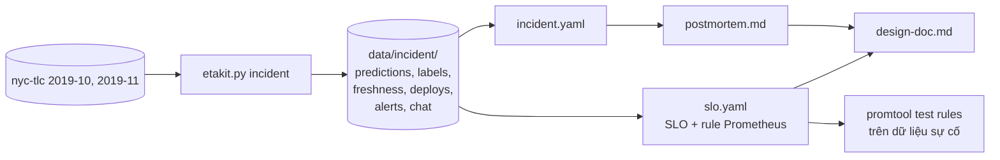

# M18: Đánh giá độc lập mức senior: nền tảng ETA nhiều market, SLO, dẫn xử lý sự cố, postmortem

## Mục tiêu

Đây là bài **đánh giá độc lập** khép lại tầng senior. Không có hướng dẫn từng bước. Bạn đóng vai kỹ sư senior của nền tảng ETA
vừa đi qua một sự cố, và nộp bốn thứ mà một senior thật phải viết sau sự cố như vậy:

1. **Hồ sơ sự cố** (`reports/senior/incident.yaml`): ai, cái gì, khi nào, mất bao nhiêu, vì sao, quyết định nào chấm dứt tác động.
   Mọi con số tính được từ bằng chứng thô.
2. **SLO và alert** (`reports/senior/slo.yaml`): SLI, mục tiêu, error budget theo market, alert burn rate chạy được bằng `promtool`.
3. **Postmortem không đổ lỗi** (`docs/senior/postmortem.md`).
4. **Design doc** (`docs/senior/design-doc.md`) cho nền tảng ETA nhiều market, để sự cố kiểu này không lan và bị bắt sớm hơn.

Nền tảng phục vụ ba **market**: `manhattan`, `queens`, `brooklyn` (borough của zone đón khách; TLC chỉ có New York nên bài coi
mỗi borough là một market riêng, như một thành phố trong nền tảng nhiều thành phố). Mỗi market một deployment ETA, một partition
của feature view online `zone_speed_15m` (tốc độ theo zone 15 phút gần nhất, như M16). Ngày sự cố là **2019-11-14**: mỗi chuyến
thật của ngày đó là một request ETA lúc đón khách, nhãn là thời gian chuyến thật, về lúc trả khách.

Bài dùng module 18 (SLO cho ML, burn rate, incident command, postmortem, design doc) và mọi thứ của capstone. Kiến thức trong bài
không thay được kinh nghiệm dẫn sự cố thật; nó cho bạn khung để làm việc đó và để trả lời phỏng vấn senior.

**Đừng mở `capstone/solutions/`** (nhất là `solutions/assessment/senior_incident.py`, script sinh sự cố): nó chứa đáp án. Test chỉ
kiểm được phần đo được; phần lập luận chấm bằng rubric trong `SOLUTION.md` sau khi bạn nộp. `tests/etakit.py` gọi script đó để dựng
dữ liệu; bạn không cần đọc nó.



## Việc cần làm

### 1. Lấy bằng chứng

Cần bộ `nyc-tlc` đã tải (gồm `taxi_zone_lookup.csv`). Từ gốc repo:

```bash
uv run python tracks/mlops/capstone/project/tests/etakit.py incident
```

Lệnh ghi vào `capstone/project/data/incident/` (đã bị `.gitignore` chặn), khoảng 5 giây, chạy lại cho ra đúng các tệp đó:

| Tệp | Nội dung |
| --- | --- |
| `predictions.parquet` | Log dự đoán: `request_id`, `ts` (lúc đón khách), `market`, `model_version`, `PULocationID`, `DOLocationID`, `trip_distance`, `eta_s` |
| `labels.parquet` | Nhãn: `request_id`, `label_ts` (lúc nhãn về, tức lúc trả khách), `duration_s` |
| `freshness.csv` | Mỗi phút, mỗi market: `minute` (`HH:MM`), `market`, `feature_view`, `age_s` (tuổi của feature online, giây) |
| `deploys.log` | Mọi thay đổi trong ngày, mỗi dòng có `deploy_id`, `service`, `change` |
| `alerts.log` | Thông báo `firing`/`resolved` của Alertmanager hôm đó |
| `chat.log` | Kênh sự cố, mỗi người là một handle `@tên` |

Mọi thời điểm là giờ New York, cùng múi với chat. Có thông tin không liên quan trong mọi tệp. Phân tích bằng notebook hay script
riêng của bạn (không bắt buộc nộp, nhưng nên có để tự chấm phần "cách điều tra" của rubric).

### 2. Định nghĩa đã thống nhất với đội sản phẩm

- **Dự đoán tốt**: `|eta_s - duration_s| <= 0.3 * duration_s + 300` (giây). Ngược lại là **tệ**.
- **SLO chất lượng**: 90% dự đoán tốt, theo market, cửa sổ 30 ngày. **SLO freshness**: 99% số phút mà `age_s` không quá 900, theo
  market, cửa sổ 30 ngày.
- **Khung**: khung 5 phút theo `ts` của request (`ts` làm tròn xuống 5 phút, ví dụ `15:50` gồm 15:50:00–15:54:59). Chỉ xét khung có
  ít nhất 20 request của market đó.

### 3. `reports/senior/slo.yaml`

```text
service: eta
window_days: 30
slos:                                # ít nhất 4, name không trùng, phải có availability, latency, quality, freshness
  - name: quality
    kind: events                     # events (đếm theo request) | time (đếm theo phút)
    sli: "câu định nghĩa SLI ≥6 từ"
    measured_at: "đo ở đâu"
    target: 0.9                      # số thực trong (0, 1)
    budget_events: {manhattan: <số>, queens: <số>, brooklyn: <số>}
  - name: freshness
    kind: time
    sli: "..."
    measured_at: "..."
    target: 0.99
    budget_minutes: <số>
  - ...                              # availability, latency: bạn chọn target, giải thích trong design doc
prometheus:
  groups: [...]                      # rule group Prometheus, đúng như trong một tệp rule
```

Luật test kiểm:

- `window_days: 30`; mỗi SLO có `kind`, `sli` (≥6 từ), `measured_at` không rỗng, `target` là số thực trong (0, 1). Mỗi SLO
  `kind: time` có `budget_minutes = (1 - target) × 30 × 1440` (sai số 1%).
- `quality` là `events`, target `0.9`; `freshness` là `time`, target `0.99` (định nghĩa mục 2).
- `quality.budget_events` có đúng ba market, mỗi giá trị bằng `(1 - 0.9) × 30 × số request của market trong predictions.parquet`
  (sai số 1%): số dự đoán tệ được phép trong 30 ngày nếu ngày này là ngày điển hình.
- `prometheus.groups` qua `promtool check rules` (test ghi riêng phần này thành tệp rule). Promtool đánh giá rule mỗi phút
  (`evaluation_interval: 1m`), qua `mlopskit.promtool` (cần Docker, không cần stack).

Metric đầu vào (đã có ở serving và job join nhãn):

- `eta_quality_checks_total{job="eta", market, outcome}`: counter, tăng khi nhãn về và được chấm; `outcome` là `good` hoặc `bad`
  theo định nghĩa mục 2.
- `eta_requests_total{job="eta", market}`: counter request `/predict`.
- `eta_feature_last_success_timestamp_seconds{job="feature-pipeline", market, feature_view="zone_speed_15m"}`: gauge, Unix time
  (giây) của lần materialize thành công gần nhất của partition market đó.

Bốn alert bắt buộc, mỗi alert **theo từng market** (kết quả giữ nhãn `market`, biểu thức có chữ `market`):

| Alert | Điều kiện | `for` | `severity` |
| --- | --- | --- | --- |
| `ETAMarketQualityFastBurn` | burn rate chất lượng trên **5** ở cả cửa sổ `1h` và `5m` | tối đa 10m | `critical` |
| `ETAMarketQualitySlowBurn` | burn rate chất lượng trên **2** ở cả cửa sổ `6h` và `30m` | tối đa 30m | `warning` |
| `ETAMarketFeatureStale` | burn rate freshness trên **14.4** ở cả cửa sổ `1h` và `5m` | tối đa 5m | `critical` |
| `ETAMarketLabelsMissing` | market có request trong 2 giờ qua nhưng không có lần chấm nào trong 2 giờ, **kể cả khi series chất lượng của market đó biến mất** | tối đa 30m | `warning` |

Mỗi alert có `annotations.summary` không rỗng và `annotations.runbook_url` bắt đầu bằng `https://`; ba alert burn rate có biểu thức
chứa `and`. Với SLO 90%, burn rate tối đa có thể là 10 (100% tệ): đó là lý do ngưỡng nhanh là 5, không phải 14.4 như SLO khả dụng.

Các ca `promtool test rules` mà test chạy (series ghi mỗi phút):

- Queens 60% tệ kéo dài, manhattan 5%, brooklyn 8%: `FastBurn` chỉ bắn cho queens ở giờ 2, `SlowBurn` chỉ bắn cho queens ở giờ 8,
  `LabelsMissing` không bắn.
- Queens 30% tệ: ở giờ 8 `FastBurn` không bắn, `SlowBurn` bắn cho queens. Queens 8%: không alert nào bắn ở giờ 8.
- Queens 5% trong 6 giờ rồi 40% trong 45 phút: ở phút 405 cả `SlowBurn` lẫn `FastBurn` không bắn.
- Queens 70% tệ trong 3 giờ rồi về 2%: `FastBurn` bắn cho queens ở phút 175 và **đã tắt** ở phút 190.
- Series chất lượng của queens biến mất sau giờ 3, request vẫn đến: `LabelsMissing` chưa bắn ở giờ 4, bắn cho queens (và chỉ queens)
  ở giờ 6; `FastBurn` không bắn.
- Freshness: queens ngừng cập nhật từ phút 60 tới phút 100, brooklyn từ phút 60 tới phút 78: `FeatureStale` không bắn ở phút 70 và 79, bắn
  cho queens (không cho brooklyn) ở phút 97, tắt ở phút 120.
- **Phát lại sự cố**: test dựng series từ dữ liệu sự cố (lần chấm tính ở phút nhãn về, request ở phút `ts`, gauge freshness
  bằng `phút × 60 - age_s`, phút 00:00 là thời điểm 0) rồi kiểm: `FeatureStale` bắn cho đúng các market bị ảnh hưởng 10 phút sau
  `started_at`; `FastBurn` bắn cho đúng các market đó 30 phút sau `mitigated_at`; lúc 06:00, 10:22, 11:00 và 20:00 không alert nào
  bắn cho market nào. Khi sai, test chỉ báo số kiểm tra sai.

### 4. `reports/senior/incident.yaml`

```text
date: "2019-11-14"
affected_markets: [<market>, ...]
severity: SEV1                       # SEV1 | SEV2 | SEV3
started_at: "HH:MM"                  # trong ngoặc kép: YAML 1.1 đọc 15:50 không ngoặc thành số 950
detected_at: "HH:MM"
mitigated_at: "HH:MM"
time_to_detect_min: <số nguyên>
time_to_mitigate_min: <số nguyên>
trigger: <deploy_id>
decision: rollback                   # rollback | restart | scale-out | wait | disable-feature | failover
causes: [<nhãn>, ...]
impact:
  affected_requests: <số nguyên>
  bad_predictions: <số nguyên>
  quality_budget_consumed_pct: <số>
  stale_minutes: <số nguyên>
  freshness_budget_consumed_pct: <số>
roles: {incident_commander: <handle>, comms: <handle>, ops: <handle>}
reasons:                             # ≥2 câu, mỗi câu ≥6 từ, có số
  - "..."
```

`.gitignore` của project bỏ chặn `reports/senior/`. Định nghĩa từng trường (test tính lại mọi trường đo được từ các tệp ở mục 1):

| Trường | Định nghĩa |
| --- | --- |
| `affected_markets` | Market có ít nhất một khung với tỉ lệ dự đoán tệ **lớn hơn 60%** |
| `started_at` | Khung sớm nhất như vậy (của các market bị ảnh hưởng) |
| `mitigated_at` | Khung đầu tiên sau `started_at` mà từ đó tới hết ngày mọi khung của các market bị ảnh hưởng có tỉ lệ tệ **không quá 40%** |
| `detected_at` | Thời điểm sớm nhất đội nhận được tín hiệu về triệu chứng của market bị ảnh hưởng từ bên ngoài người đang làm thay đổi: dòng `firing` trong `alerts.log` hoặc tin nhắn báo triệu chứng trong `chat.log` |
| `time_to_detect_min`, `time_to_mitigate_min` | Số phút từ `started_at` tới `detected_at`, tới `mitigated_at` |
| `trigger` | `deploy_id` của thay đổi đã đưa thành phần hỏng vào đường phục vụ của market bị ảnh hưởng (không nhất thiết là thay đổi gần nhất) |
| `decision` | Hành động đã chấm dứt tác động lên người dùng (không phải hành động sửa tận gốc) |
| `roles` | Handle (có hay không có `@`) của người giữ `incident_commander`, `comms`, `ops` (người thực hiện hành động ở `decision`) theo `chat.log`; ba người khác nhau |
| `impact.affected_requests` | Số request của các market bị ảnh hưởng có khung trong `[started_at, mitigated_at)`, chính xác |
| `impact.bad_predictions` | Số dự đoán tệ trong các request đó, chính xác |
| `impact.quality_budget_consumed_pct` | `bad_predictions / (0.1 × 30 × số request cả ngày của các market bị ảnh hưởng) × 100` (sai số 0.05) |
| `impact.stale_minutes` | Số dòng `freshness.csv` của các market bị ảnh hưởng có `age_s > 900`, chính xác |
| `impact.freshness_budget_consumed_pct` | `stale_minutes / (0.01 × 30 × 1440 × số market bị ảnh hưởng) × 100` (sai số 0.05) |
| `severity` | `SEV1` nếu các market bị ảnh hưởng có ít nhất 6 khung tỉ lệ tệ lớn hơn 60% (30 phút người dùng nhận ETA hỏng); không thì `SEV2` nếu `quality_budget_consumed_pct` hoặc `freshness_budget_consumed_pct` từ 5 trở lên; còn lại `SEV3` |

Nhãn `causes` cho phép. Sự cố có thể dính vài nhãn, không phải tất cả; có nhãn là bẫy cho người kết luận theo thời điểm:

| Nhãn | Nghĩa |
| --- | --- |
| `stale_feature` | Feature online cũ hoặc ngừng cập nhật trong lúc model đọc nó |
| `unsafe_default` | Khi feature thiếu, code dùng giá trị mặc định làm dự đoán sai hẳn |
| `skipped_canary` | Thay đổi lên toàn bộ traffic mà không qua canary hay shadow |
| `missing_freshness_alert` | Không có SLO hay alert freshness nên feature cũ mà không ai biết |
| `config_change` | Một thay đổi cấu hình (timeout, log level, replicas) gây ra triệu chứng |
| `model_regression` | Model mới kém hơn model cũ ngay cả khi feature đúng |
| `traffic_spike` | Lưu lượng tăng bất thường làm service quá tải |
| `label_delay` | Pipeline nhãn hỏng, nhãn về trễ hơn bình thường |
| `upstream_data_change` | Dữ liệu chuyến từ nguồn đổi định dạng hay đơn vị |

Luật test kiểm: cấu trúc trên (`date`, kiểu dữ liệu, thời điểm `"HH:MM"`, hai khoảng thời gian khớp ba thời điểm, nhãn thuộc
bảng và không lặp, ba vai trò khác người, `reasons`); mọi trường của bảng định nghĩa khớp số test tính lại; tập `causes` đúng bằng
tập nguyên nhân và yếu tố góp phần của sự cố, không thiếu, không thừa. Thông báo lỗi chỉ cho biết trường nào sai, số nhãn thiếu và
số nhãn thừa, số market lệch; không cho biết giá trị đúng. Đừng dò đáp án bằng cách chạy test nhiều lần: rubric hỏi bạn chứng minh
từng nhãn bằng bằng chứng.

### 5. `docs/senior/postmortem.md`

Postmortem không đổ lỗi gửi cả công ty, ít nhất 600 từ, không còn `TODO`. Có các heading (cấp nào cũng được, có thể đánh số)
**Tóm tắt**, **Tác động**, **Dòng thời gian**, **Nguyên nhân**, **Điều làm tốt**, **Hành động** (heading bắt đầu bằng các chữ đó,
ví dụ "Điều làm tốt và điều may mắn" được). Luật test kiểm:

- Không nhắc người trong kênh chat bằng handle (`@tên` hay `tên`, không phân biệt hoa thường; tài khoản bot và đội support không tính):
  dùng vai trò. Không có các cụm `lỗi của`, `cẩu thả`, `bất cẩn`, `đáng lẽ`, `cẩn thận hơn`, `chú ý hơn`.
- Phần **Tác động** có ba số nguyên `affected_requests`, `bad_predictions`, `stale_minutes` của `incident.yaml` (viết `1 242`,
  `1.242`, `1,242` đều được).
- Phần **Dòng thời gian** có bảng cột `Thời điểm`, `Sự kiện`; ít nhất 10 mốc `HH:MM` có mô tả, tăng dần; có đủ ba mốc
  `started_at`, `detected_at`, `mitigated_at` của `incident.yaml`.
- Phần **Nguyên nhân** nhắc tên từng nhãn trong `causes` (nên có thêm các nhãn đã loại và vì sao).
- Phần **Điều làm tốt** có ít nhất 2 gạch đầu dòng.
- Phần **Hành động** có bảng cột `Hành động`, `Loại`, `Chủ sở hữu`, `Hạn`, `Cách kiểm`; ít nhất 5 dòng, không ô trống; `Loại` chỉ là
  `ngăn chặn`, `phát hiện`, `giảm thiệt hại` và có đủ cả ba; `Hạn` dạng `YYYY-MM-DD`.

### 6. `docs/senior/design-doc.md`

Design doc cho nền tảng ETA nhiều market (thêm market, thêm thành phố), viết cho design review: ít nhất 1 200 từ, không còn `TODO`,
có đủ các phần `## 1.` tới `## 11.` theo thứ tự dưới (tên phần sau số do bạn đặt). Khác bài design doc của module 18: ở đây số liệu
lấy từ dữ liệu thật của sự cố, và trọng tâm là cô lập lỗi giữa market, onboard market mới, SLO theo market.

| Phần | Yêu cầu kiểm tự động |
| --- | --- |
| 1. Bối cảnh và yêu cầu | Bảng cột `Yêu cầu`, `Con số`, ít nhất 6 dòng có chữ số ở cột `Con số`; cụm `ngoài phạm vi` và ít nhất 2 gạch đầu dòng |
| 2. Market và lưu lượng | Bảng cột `Market`, `Request/ngày`, `Đỉnh request/phút`, ít nhất 4 dòng; mỗi market của dữ liệu một dòng, cột `Market` ghi đúng tên (`manhattan`...), số request cả ngày và số request lớn nhất trong một phút (theo `ts` làm tròn xuống phút) khớp `predictions.parquet` chính xác; thêm ít nhất một dòng ước tính cho market hay thành phố mới |
| 3. SLO | Có `reports/senior/slo.yaml` và nhắc `name` của mọi SLO trong tệp đó |
| 4. Kiến trúc | Khối ` ```mermaid ` ít nhất 10 cạnh (`-->`, `-.->`, `==>`), có thành phần theo market (chữ `market` trong sơ đồ); ít nhất 300 ký tự giải thích ngoài sơ đồ và bảng |
| 5. Cô lập theo market | Ít nhất 3 gạch đầu dòng |
| 6. Onboard market mới | Ít nhất 5 bước đánh số (`1.`, `2.`...) |
| 7. Phương án và đánh đổi | Bảng cột `Phương án`, `Chi phí`, `Độ trễ`, `Chất lượng`, `Chọn`; ít nhất 3 dòng; đúng một dòng `Chọn` là `có` |
| 8. Dung lượng và chi phí | Ít nhất 4 gạch đầu dòng có chữ số |
| 9. Chế độ hỏng | Bảng cột `Hỏng`, `Phát hiện`, `Giảm thiểu`, `Phạm vi`, ít nhất 6 dòng không ô trống; có chữ `fallback`; dẫn tới `postmortem.md` |
| 10. Rollout và rollback | Ít nhất 4 gạch đầu dòng; có `canary`, `rollback`, `freshness` |
| 11. Câu hỏi mở | Ít nhất 5 gạch đầu dòng kết thúc bằng `?` |

Test chỉ kiểm khung và số đo; nội dung chấm bằng rubric. Tốt nhất là nhờ người khác review bằng chính các câu hỏi ở phần 11.

### 7. Test chấm làm gì

- `test_m18_incident_valid`, `test_m18_incident_causes`, `test_m18_slo_valid`, `test_m18_postmortem`, `test_m18_design_doc`: cấu trúc
  và luật ở mục 3–6, không cần dữ liệu (postmortem đọc `incident.yaml`, design doc đọc `slo.yaml`).
- `test_m18_incident_matches_data`, `test_m18_slo_budget_matches_data`, `test_m18_design_doc_traffic` (cần `nyc-tlc`, đọc qua
  `mlopskit.real_month` có kiểm sha256): dựng dữ liệu sự cố trong thư mục tạm như mục 1 và tính lại.
- `test_m18_rules_metadata`, `test_m18_rules_burn_per_market`, `test_m18_rules_on_incident` (cần Docker): `promtool check rules`
  và các ca ở mục 3.

```bash
uv run pytest tracks/mlops/capstone/project/tests -q -rs -k m18
```

Cả bộ chạy khoảng 30 giây (dựng dữ liệu 5 giây, ba lần chạy promtool).

## Kết quả nộp

- `capstone/project/reports/senior/slo.yaml`, `reports/senior/incident.yaml`, `docs/senior/postmortem.md`,
  `docs/senior/design-doc.md`.
- Mục "Đánh giá M18" trong README project: một đoạn tóm tắt sự cố và quyết định, đường dẫn tới bốn tệp.
- (Nên có) Notebook hay script tính mọi số trong `incident.yaml` từ `data/incident/` bằng một lệnh.

## Tiêu chí đạt

- [ ] `uv run pytest tracks/mlops/capstone/project/tests -q -rs -k m18` pass, không skip; bộ `nyc-tlc` đã tải, Docker chạy.
- [ ] Không mở `solutions/`; mọi số trong YAML đến từ phân tích của bạn trên `data/incident/`.
- [ ] Bạn tách được ba mốc khác nhau của sự cố (thay đổi, hỏng ngầm, người dùng bị ảnh hưởng) và giải thích khoảng cách giữa chúng.
- [ ] Bạn giải thích được vì sao severity không suy ra từ phần trăm budget đã tiêu, và vì sao alert chất lượng luôn đến muộn.
- [ ] (Tự đánh giá, rubric trong `SOLUTION.md`) Alert của bạn, chạy trên dữ liệu sự cố, bắn sớm hơn người dùng phát hiện bao nhiêu
      phút; design doc có cơ chế cụ thể cho từng nhãn trong `causes`.
