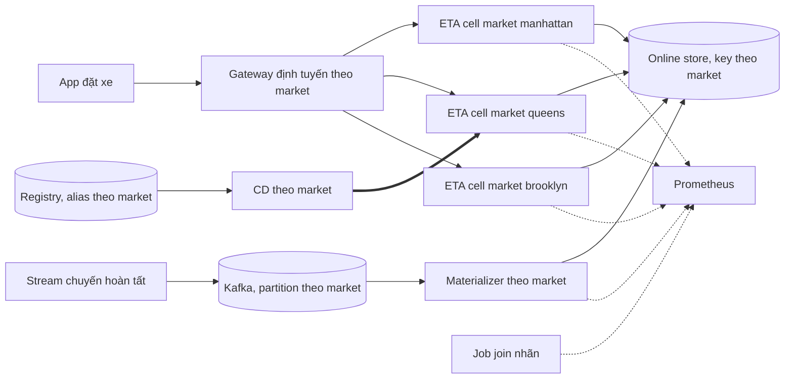

# Design doc: nền tảng ETA nhiều market

Tác giả: đội nền tảng ML. Trạng thái: chờ design review. Phạm vi: đưa dịch vụ ETA từ một deployment cho cả thành phố thành nền
tảng phục vụ nhiều market (borough hôm nay, thành phố khác trong năm tới), mỗi market cô lập lỗi và có SLO riêng.

## 1. Bối cảnh và yêu cầu

Hôm nay ETA chạy ba market: manhattan, queens, brooklyn. Sự cố 2019-11-14 ([postmortem](postmortem.md)) cho thấy một thay đổi ở một
market có thể hỏng cả market đó trong 70 phút mà không alert nào bắn kịp. Đội sản phẩm muốn thêm hai thành phố trong 12 tháng.

| Yêu cầu | Con số |
| --- | --- |
| Lưu lượng hiện tại (ngày thường, cả ba market) | 255 082 request/ngày, đỉnh khoảng 365 request/phút |
| Lưu lượng thiết kế | 10 lần hiện tại: khoảng 61 request/giây ở đỉnh |
| Độ trễ `/predict` gồm gọi feature store | p99 dưới 150 ms ở ingress |
| Chất lượng theo market | 90% dự đoán có sai số không quá 30% thời gian thật + 300 giây, cửa sổ 30 ngày |
| Freshness của feature online | 99% số phút feature cũ không quá 900 giây, theo market |
| Thời gian onboard một market mới | dưới 10 ngày làm việc, không sửa code serving |
| Phạm vi lỗi | sự cố ở một market không làm tỉ lệ tệ của market khác tăng quá 1 điểm phần trăm |

Ngoài phạm vi của doc này:

- Định giá chuyến và ghép tài xế: chỉ dùng ETA làm đầu vào, không thiết kế ở đây.
- Model học online hay retrain theo giờ: giữ retrain hằng tuần, có cổng promotion của M04.
- Dữ liệu cá nhân của khách và lưu trữ theo luật từng quốc gia: một doc riêng khi có market ngoài Mỹ.

## 2. Market và lưu lượng

Số đo từ log dự đoán của ngày 2019-11-14 (một ngày thường), đỉnh là số request lớn nhất trong một phút.

| Market | Request/ngày | Đỉnh request/phút | Ghi chú |
| --- | --- | --- | --- |
| manhattan | 236990 | 321 | 93% lưu lượng; model tốt nhất (3.1% dự đoán tệ) |
| queens | 15631 | 35 | Chuyến sân bay dài, nhãn về sau trung vị 37 phút |
| brooklyn | 2461 | 9 | Dữ liệu ít, 9.5% dự đoán tệ, sát ngưỡng SLO |
| thành phố mới (ước tính) | 60000 | 90 | Giả định một thành phố cỡ trung, chưa có dữ liệu lịch sử |

Ba market chênh nhau hai bậc độ lớn. Một thiết kế tối ưu cho manhattan (một deployment lớn, model chung) sẽ làm market nhỏ bị
"chìm" trong trung bình: sự cố của queens chỉ là 0.5% request của cả ngày.

## 3. SLO

SLO đầy đủ, budget theo market và alert burn rate có test nằm ở `reports/senior/slo.yaml`. Tóm tắt:

| SLI | Đo ở đâu | SLO | Cửa sổ |
| --- | --- | --- | --- |
| availability | ingress của market | 99.5% request 2xx | 30 ngày |
| latency | histogram ở ingress | 99% dưới 150 ms | 30 ngày |
| quality | job join nhãn, theo lúc nhãn về | 90% dự đoán tốt | 30 ngày |
| freshness | gauge last success của từng partition | 99% số phút | 30 ngày |

Mọi SLO tính **theo market**. SLO quality là tín hiệu trễ (bằng thời gian chuyến, 12–37 phút trung vị), nên freshness là SLO dẫn
trước: feature cũ báo trước khi dự đoán hỏng. Budget chất lượng tính bằng số dự đoán tệ được phép (queens: 46 893 trong 30 ngày).

## 4. Kiến trúc

Mỗi market là một **cell**: deployment ETA, alias model trong registry (`champion-queens`), partition Kafka, consumer
materialize và dashboard riêng. Gateway chỉ định tuyến theo market của zone đón, không có logic ML. Hai market dùng chung code
serving và image, khác nhau ở config và model. Online store dùng chung nhưng key có tiền tố market, và mỗi consumer chỉ ghi
partition của mình, nên một consumer chết chỉ làm cũ feature của một market. Đây là đánh đổi cố ý: tách hẳn online store theo market
tốn thêm chi phí vận hành mà không giảm thêm phạm vi lỗi của sự cố kiểu 2019-11-14.

## 5. Cô lập theo market

- Rollout model và config theo từng market, không bao giờ cùng lúc nhiều market; CD từ chối thay đổi chạm hai cell.
- Fallback trong mỗi cell: khi feature online thiếu hoặc cũ quá TTL, model dùng tỉ số tốc độ 1 (hành vi của model không dùng feature
  realtime) và tăng `feature_missing_total`.
- Quota tài nguyên theo cell; manhattan autoscale không lấy CPU của market nhỏ.
- Alert và error budget theo market: market nhỏ không bị trung bình của manhattan che.

## 6. Onboard market mới

1. Thêm market vào bảng zone → market của gateway và chạy backfill feature 4 tuần từ dữ liệu lịch sử.
2. Tạo cell từ template (deployment, alias registry, partition Kafka, consumer, dashboard, rule SLO) bằng một lệnh.
3. Train model trên 8 tuần dữ liệu của market; cổng promotion so với baseline trung vị theo cặp zone.
4. Shadow 7 ngày: chấm mọi request nhưng không trả cho app, đo SLO quality và freshness trên nhãn thật.
5. Canary 10% trong 1 giờ có cổng freshness và quality, rồi 50%, rồi 100%.
6. Sau 30 ngày, review SLO: nếu budget của market luôn thừa hoặc luôn thiếu thì chỉnh mục tiêu cùng đội sản phẩm.

## 7. Phương án và đánh đổi

| Phương án | Chi phí | Độ trễ | Chất lượng | Chọn |
| --- | --- | --- | --- | --- |
| Một deployment và một model chung cho mọi market | Thấp nhất | Như nhau | Market nhỏ bị model chung kéo xuống; lỗi lan cả nền tảng | không |
| Cell theo market, code và image chung, model riêng | Trung bình: thêm 1 deployment và 1 consumer mỗi market | Như nhau | Model hợp từng market; lỗi ở một cell | có |
| Tách hẳn mỗi market một cluster và online store | Cao: gấp 3–4 lần hạ tầng | Như nhau | Như phương án cell | không |

## 8. Dung lượng và chi phí

- Đỉnh thiết kế 61 request/giây; giả định một pod 1 vCPU chịu khoảng 200 request/giây với model GBM (phải đo lại bằng k6 như M07), nên 2 pod mỗi cell lớn
  là đủ, giữ tối thiểu 2 pod cho mọi cell để chịu một pod chết.
- Feature online: 263 zone × 1 giá trị mỗi phút mỗi market, dưới 1 MB trong Redis.
- Kafka: khoảng 255 000 sự kiện chuyến mỗi ngày, mỗi sự kiện dưới 200 byte, tức dưới 60 MB/ngày, giữ 7 ngày.
- Thêm một market tốn 1 deployment 2 pod, 1 consumer, 1 partition: ước tính 60 USD/tháng trên cloud, cộng 2 ngày công vận hành.

## 9. Chế độ hỏng

| Hỏng | Phát hiện | Giảm thiểu | Phạm vi |
| --- | --- | --- | --- |
| Consumer của một partition dừng | `ETAMarketFeatureStale` (burn freshness 14.4 lần) | Fallback tỉ số 1; rollback model về bản không đọc feature; DLQ | Một market |
| Feature thiếu vì hết TTL | `feature_missing_total` tăng | Fallback trong model, không dùng 0 | Một market |
| Model mới tệ ở một market | `ETAMarketQualityFastBurn` và cổng canary | Rollback alias của market | Một market |
| Nhãn ngừng về cho một market | `ETAMarketLabelsMissing` | Giữ model, đánh dấu SLO quality "mù", điều tra job join | Một market |
| Gateway định tuyến sai market | Tỉ lệ request theo market lệch so với tuần trước | Rollback config gateway | Nhiều market |
| Online store chết | Lỗi đọc feature ở mọi cell, latency tăng | Fallback tỉ số 1 ở mọi cell, ETA vẫn trả | Mọi market |

Sự cố mẫu cho hàng đầu tiên là [postmortem.md](postmortem.md).

## 10. Rollout và rollback

- Thay đổi model đi qua shadow rồi canary 10% ít nhất 1 giờ ở đúng một market; không có ngoại lệ "cửa sổ hotfix".
- Cổng canary kiểm freshness của mọi feature model mới đọc, tỉ lệ `feature_missing_total` và SLO quality trên nhãn đã về.
- Rollback là đổi alias `champion-<market>` về version trước, dưới 2 phút, có trong runbook và được diễn tập mỗi quý.
- Rollout nền tảng (gateway, online store) đi từ market nhỏ nhất (brooklyn) lên lớn nhất, nghỉ 1 ngày giữa các bước.

## 11. Câu hỏi mở

- Market nhỏ như brooklyn có đủ nhãn để SLO quality 90% có ý nghĩa thống kê trong 30 ngày không?
- Nên tách online store theo market khi có thành phố thứ năm, hay khi một market vượt 50% lưu lượng?
- Ai sở hữu SLO freshness: đội feature pipeline hay đội model đọc feature đó?
- Fallback tỉ số 1 làm ETA kém hơn khoảng bao nhiêu so với feature tươi, và có cần SLO riêng cho thời gian chạy fallback?
- Có nên cho support một kênh báo sự cố theo market vào thẳng on-call, khi alert chất lượng luôn trễ bằng thời gian chuyến?
