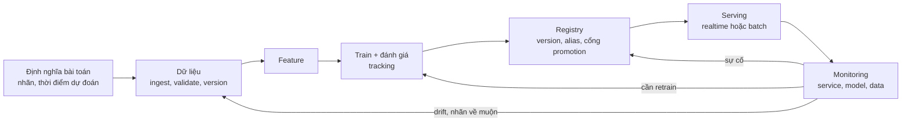
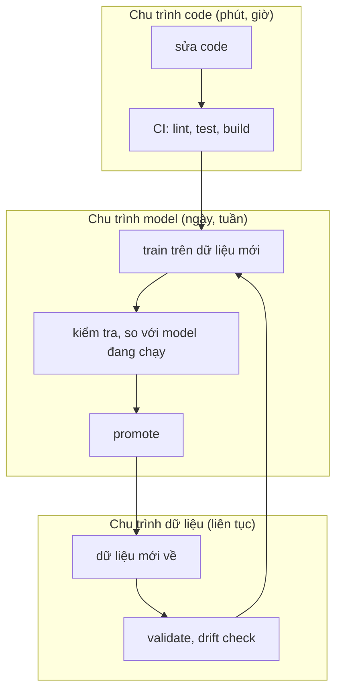
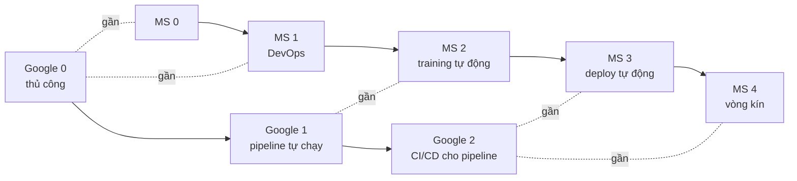
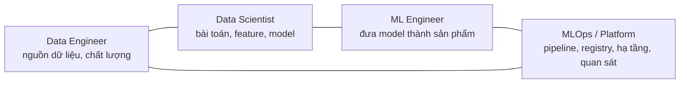

# Giới thiệu MLOps

Một model chạy tốt trong notebook mới là 10% công việc. 90% còn lại là làm cho nó chạy **mỗi ngày**, trên dữ liệu **mới**,
được **người khác** gọi, và khi nó sai thì có người biết, biết vì sao, và gỡ được trong vài phút. **MLOps** là tập thực hành
(và công cụ) để làm việc đó đáng tin cậy và lặp lại được, thay vì phụ thuộc vào một người nhớ các bước.

Module 00 là bản đồ, không có hạ tầng để dựng. Bạn sẽ:

- Vẽ lại vòng đời ML trong production và chỉ ra mỗi mũi tên hay hỏng ở đâu.
- Xếp hạng một hệ thống theo thang maturity của Google và Microsoft (và hiểu vì sao hai thang không trùng nhau).
- Phân biệt vai trò MLOps, ML engineer, Data Scientist, Data Engineer, và biết ranh giới nào hay có sự cố.
- Đọc được "hidden technical debt in ML" thành danh sách việc kiểm tra được bằng máy.
- Có bản đồ công cụ của cả track: mỗi module giải vấn đề gì, vì sao công cụ đó.

Bài toán xuyên suốt của track là capstone **dịch vụ ETA cho taxi NYC** (xem [tổng quan track](../../README.md)): model chỉ
là gradient boosting, trọng tâm là vận hành. Ví dụ trong module này dùng các hệ thống giả định kiểu đó (báo giá giao hàng,
xếp hạng đề xuất, chấm điểm gian lận).

## 1. Vì sao ML production khác phần mềm thường

Phần mềm thường: code đúng thì hành vi đúng, và hành vi **không đổi** nếu code không đổi. ML: hành vi do **code + dữ liệu +
cấu hình + môi trường** quyết định, và dữ liệu ngoài thế giới đổi mà không ai commit gì. Hậu quả:

| Khác biệt | Phần mềm thường | Hệ thống ML |
| --- | --- | --- |
| Thứ quyết định hành vi | Code | Code, dữ liệu train, hyperparameter, seed, phiên bản thư viện |
| Hỏng như thế nào | Lỗi, exception, 5xx | Vẫn trả 200, chỉ là **sai dần** (silent failure) |
| Khi nào cũ | Khi yêu cầu đổi | Khi thế giới đổi: mùa vụ, khuyến mãi, COVID |
| Kiểm thử | Đúng/sai xác định | Ngưỡng thống kê, slice, hành vi (xem module 01) |
| Phát hành | Build artifact | Artifact + dữ liệu + cổng chất lượng (module 04) |
| Rollback | Deploy bản trước | Cần giữ model và dữ liệu cũ có phiên bản (module 03, 04) |

Câu đáng nhớ nhất: **ML hỏng mà không báo**. Một API trả ETA sai 40% vẫn có health check xanh. Đó là lý do monitoring
cho model (module 09, 10) khác monitoring service.

## 2. Vòng đời ML trong production



Đọc sơ đồ theo mũi tên, mỗi chỗ có một kiểu hỏng quen thuộc:

| Mũi tên | Hỏng thế nào | Module |
| --- | --- | --- |
| Bài toán → dữ liệu | Rò rỉ nhãn: dùng thông tin chưa có lúc dự đoán | 01, 06 |
| Dữ liệu → feature | Schema đổi âm thầm, dữ liệu bẩn lọt vào | 03 |
| Feature → train | Hai DS train trên hai bản CSV; không tái lập | 01, 03, 05 |
| Train → registry | Model tốt hơn trên tổng nhưng tệ ở slice quan trọng | 04 |
| Registry → serving | Deploy nhầm model chưa duyệt; feature tính khác lúc train | 06, 07 |
| Serving → monitoring | Chỉ có health check; không log dự đoán nên không nối được nhãn | 09 |
| Monitoring → quay lại | Drift vô hại bị báo là sự cố; sự cố thật bị coi là drift | 10 |

Hai điều khác phim ảnh: (1) vòng lặp từ monitoring quay lại dữ liệu **là** lý do MLOps tồn tại; (2) có hai đường cho model đi
ra ngoài: **realtime** (API, độ trễ tính bằng ms) và **batch** (chấm cả bảng theo lịch). Chọn sai đường thường là quyết định
đắt nhất của dự án (module 07).

### Ba chu trình có nhịp khác nhau



CI/CD cho **code** chạy mỗi pull request; **continuous training** (CT) chạy khi có dữ liệu mới, theo lịch, hoặc khi cảnh
báo drift; **continuous delivery của model** chỉ chạy khi model qua cổng. Gộp ba thứ vào một pipeline là lỗi thiết kế phổ biến
(module 08 nói về ranh giới).

## 3. MLOps maturity: Google và Microsoft

Cả hai thang đo **mức độ tự động hoá và độ tin cậy của việc đưa model ra và giữ nó chạy**. Chúng không thi đua với nhau:
Google chia thô theo pipeline, Microsoft chia mịn ở phần deploy và vận hành.

### Thang của Google (3 mức)

| Mức | Tên | Đặc điểm |
| --- | --- | --- |
| 0 | Quy trình thủ công | Notebook, train tay, giao model cho đội khác copy vào. Ít khi retrain. Không có monitoring chất lượng |
| 1 | Tự động hoá pipeline ML | Pipeline train tự chạy (CT), có kiểm tra dữ liệu và model, tracking/registry, trigger theo lịch hoặc dữ liệu mới. Deploy **pipeline** vẫn thủ công |
| 2 | Tự động hoá CI/CD pipeline | Chính pipeline được kiểm thử, build, deploy tự động; thử nghiệm nhanh, nhiều pipeline cùng chạy |

### Thang của Microsoft (5 mức)

| Mức | Tên | Đặc điểm |
| --- | --- | --- |
| 0 | Chưa có MLOps | Mọi thứ thủ công, không tracking |
| 1 | DevOps nhưng chưa MLOps | Code có CI/CD, nhưng model vẫn train và phát hành tay |
| 2 | Training tự động | Có pipeline training, tracking, registry |
| 3 | Deploy model tự động | Deploy qua cổng kiểm tra, có A/B hoặc canary |
| 4 | Vận hành tự động hoàn toàn | Monitoring kích hoạt retrain, vòng kín |



### Cách dùng đúng, và lỗi hay gặp

- **Mức cao nhất không phải mục tiêu.** Một model dự đoán nhu cầu hằng tuần với một người duy trì không cần mức 2. Câu hỏi
  đúng: *việc nào còn do con người làm tay đang gây sự cố hoặc tốn thời gian nhất?* Bài Basic 01 tập đúng việc này.
- **Đừng xếp hạng theo công cụ.** "Có Airflow" không có nghĩa mức 1: nếu không có kiểm tra dữ liệu và model, pipeline chỉ
  đem một lỗi chạy lúc 2 giờ sáng. "Có Kubernetes" không nói gì về maturity.
- **Có CI cho code API không làm cho ML đạt mức 1 theo Google.** Đó là mức 1 của Microsoft (DevOps nhưng chưa MLOps).
- **Maturity là thang cho từng hệ thống**, không phải cho công ty. Một công ty có thể có một model mức 2 và mười model mức 0.

## 4. Vai trò: ai làm gì



| Việc | Data Scientist | ML Engineer | MLOps / Platform | Data Engineer |
| --- | --- | --- | --- | --- |
| Định nghĩa bài toán, nhãn, metric | **Chính** | Góp ý | | Góp ý về dữ liệu có sẵn |
| Feature và model | **Chính** | Tối ưu, productionise | | Cung cấp dữ liệu nguồn |
| Code train sạch, có test | Viết | **Chính** (chuẩn, review) | Cung cấp template | |
| Pipeline training, CI/CD | | Dùng và đóng góp | **Chính** | Pipeline dữ liệu |
| Registry, cổng promotion | Đề xuất ngưỡng | Tham gia | **Chính** (quy trình) | |
| Serving, scaling, độ trễ | | **Chính** | Hạ tầng | |
| Monitoring model | Chọn chỉ số, đọc kết quả | Triển khai | **Chính** (hệ thống) | Chất lượng upstream |
| On-call | Hỗ trợ khi model xấu | Chính cho service | Chính cho nền tảng | Chính cho pipeline dữ liệu |

Ranh giới là nơi sự cố rơi xuống khe: DE đổi schema mà DS không biết (cần data contract, module 03); DS train một model không
ai biết cách dựng lại; promotion không có chủ. Bài Advanced 02 bắt bạn phân vai cụ thể và bảo vệ phân vai đó.

**Theo quy mô đội**, các vai trò gộp lại: startup nhỏ thường có một người làm cả ML engineer và MLOps; công ty vừa tách thêm
platform; công ty lớn có đội nền tảng ML riêng (module 17). Đừng học tên chức danh, học **việc cần có người chịu trách
nhiệm**. Tên chức danh khác nhau giữa các công ty; câu hỏi "ai bị gọi lúc 3 giờ sáng khi ETA sai?" thì giống nhau.

## 5. Hidden technical debt in ML

Bài báo của Sculley và cộng sự (Google, NeurIPS 2015) có một hình nổi tiếng: code ML (model) là **một hộp nhỏ** giữa các hộp lớn
hơn nhiều: thu thập dữ liệu, kiểm tra, feature extraction, quản lý tài nguyên, cấu hình, serving, monitoring. Nợ ở đây là
nợ **hệ thống**, không nằm trong thuật toán.

| Loại nợ | Triệu chứng | Cách chặn |
| --- | --- | --- |
| Entanglement (CACE: changing anything changes everything) | Đổi phân phối một feature làm model khác đi ở nơi không ngờ | Test hành vi, kiểm tra slice, theo dõi tầm quan trọng feature |
| Undeclared consumers | Dịch vụ khác đọc đầu ra model qua tệp, không ai biết | Đăng ký consumer, API có version, quyền truy cập |
| Unstable data dependency | Feature đến từ model/bảng của đội khác, đổi mà không báo | Data contract, snapshot có version (module 03) |
| Underutilized data dependency | Feature thêm vào cho đẹp, tăng chút điểm, tốn bảo trì | Loại feature bằng leave-one-out, xoá thật |
| Feedback loops | Model ảnh hưởng dữ liệu nó học tiếp | Giữ nhóm đối chứng, log quyết định (module 16) |
| Glue code, pipeline jungle | 95% là code dán các thư viện, nhiều bước lẻ | Pipeline khai báo, một hợp đồng I/O rõ ràng |
| Dead experimental codepaths | Cờ thí nghiệm cũ không ai dám xoá | Xoá định kỳ, test phủ |
| Configuration debt | Cấu hình rải rác, hard-code đường dẫn | Config tách code (module 01) |
| Thế giới ngoài đổi | Ngưỡng cố định, phân phối nhãn đổi | Monitoring, ngưỡng đặt lại có chủ (module 10) |

**ML Test Score** (Breck và cộng sự, Google 2017) biến chuyện này thành checklist có điểm: test cho dữ liệu, cho model, cho hạ
tầng, cho monitoring. Không cần thuộc 28 mục; cần có thói quen hỏi *"điều này có kiểm được bằng máy không?"*. Bài Intermediate
01 cài một máy quét nhỏ cho bảy dấu hiệu cụ thể, ví dụ:

```python
import re

def unpinned(requirements_txt: str) -> list[str]:
    lines = (l.strip() for l in requirements_txt.splitlines())
    return [l for l in lines if l and not l.startswith(("#", "-")) and "==" not in l]

print(unpinned("pandas\nnumpy==1.26.4\n# note\n-r base.txt\nscikit-learn>=1.4\n"))
```

Luật đơn giản thế này đã bắt được lỗi "scikit-learn nâng bản làm model không load được" trước khi vào production.

## 6. Bản đồ công cụ của track

Roadmap có hàng chục công cụ; track này **đi sâu ở một công cụ chính cho mỗi vấn đề** và so sánh phần còn lại để bạn biết
vì sao chọn. Nguyên tắc: *công cụ là câu trả lời cho một vấn đề cụ thể, và có chi phí vận hành*.

| Vấn đề | Công cụ chính trong track | So sánh |
| --- | --- | --- |
| Code ML sạch, tái lập | uv, pyproject, pytest, Makefile (01) | Poetry, conda |
| Đóng gói, chạy giống nhau mọi nơi | Docker, Compose, trivy (02) | Podman, Buildah |
| Phiên bản dữ liệu, chất lượng | DVC, MinIO, Pandera (03) | lakeFS, Delta, Great Expectations |
| Tracking, registry, cổng promotion | MLflow (Postgres, MinIO) (04) | W&B, Neptune, Comet |
| Pipeline training, orchestration | Prefect (05) | Airflow, Kubeflow, ZenML, Metaflow |
| Feature store, skew | Feast (06) | Tecton, Hopsworks |
| Serving, canary, rollback | FastAPI, load test (07) | BentoML, Triton, Ray Serve, TorchServe |
| CI/CD | GitHub Actions chạy bằng act (08) | GitLab CI, Jenkins, CML |
| Monitoring | Prometheus, Grafana, Alertmanager (09) | Datadog, Cloud Monitoring |
| Drift, sự cố | Evidently, PSI/KS tự tính (10) | NannyML, WhyLabs, Arize |
| Deep learning serving | ONNX Runtime, SegFormer (11) | Triton, TensorRT |
| Platform, governance, cloud | model card, audit, SageMaker/Vertex/Azure ML so sánh (12) | Databricks |
| Kubernetes cho ML | kind, KServe, Argo Workflows (13) | Seldon, Kubeflow |
| Autoscale, hàng đợi GPU, serving dưới tải | HPA, KEDA, Kueue, KServe, k6 (14) | Triton, Volcano, YuniKorn |
| Distributed training | torchrun (DDP, FSDP2 trên gloo), Ray Train/Tune (15) | DeepSpeed, Horovod |
| Streaming, feature real-time | Kafka, Feast push, River (16) | Flink, Spark Structured Streaming, Bytewax, Tecton |
| Nền tảng nhiều đội, bảo mật model | Copier, safetensors, modelscan, model-signing, CycloneDX, phân bổ chi phí kiểu OpenCost (17) | Backstage, Sigstore, Kyverno, OpenCost, Kubecost |
| SLO, sự cố, system design | SLO burn rate có test bằng promtool, incident command, postmortem, design doc (18) | PagerDuty |

```mermaid
flowchart LR
    subgraph Core["Lõi junior (00-13)"]
        A[01 code] --> B[02 container] --> C[03 data] --> D[04 registry]
        D --> E[05 pipeline] --> F[06 feature] --> G[07 serving]
        G --> H[08 CI/CD] --> I[09 monitoring] --> J[10 drift]
        J --> K[11 DL] --> L[12 governance] --> N[13 Kubernetes]
    end
    subgraph Senior["Tầng senior (14-18)"]
        O[14 K8s prod] --> P[15 distributed] --> Q[16 streaming] --> R[17 platform] --> S[18 design]
    end
    N --> O
```



### Chọn công cụ thế nào

1. **Bắt đầu từ vấn đề đang đau, đo được.** "Hai người train ra MAE khác nhau" dẫn tới seed, version dữ liệu, ghim môi
   trường; không dẫn tới Kubeflow.
2. **Dùng thứ đã có người vận hành** (ví dụ Airflow của đội DE) trước khi thêm công cụ mới.
3. **Tính chi phí vận hành**, không chỉ giá: ai nâng cấp, ai trực, mất bao lâu để người mới dùng được.
4. **Chừa đường nâng cấp.** MLflow file store hôm nay → Postgres + MinIO khi có người thứ hai; Compose hôm nay → Kubernetes khi
   cần scale, không phải trước đó.
5. **Mua hay tự xây** là quyết định kinh doanh; module 12 và 17 so sánh managed service với open source.

Bài Basic 02 là tám tình huống chọn công cụ kiểu này.

## 7. Ôn: phần bạn đã học ở track khác

Track này **không dạy lại** những gì bạn đã có. Bảng dưới trỏ về nơi đã học và nói module MLOps nào mở rộng nó.

| Bạn đã học | Ở đâu | Module MLOps dùng lại ở |
| --- | --- | --- |
| MLflow Tracking, đóng gói model, signature, registry, alias | [DS 14, mục 2-3](../../../data-science/modules/14-mlops-for-ds/README.md) | 04 (server thật, lineage, cổng promotion) |
| FastAPI cho model, batch hay online | [DS 14, mục 4](../../../data-science/modules/14-mlops-for-ds/README.md) | 07 (production, shadow, canary, rollback) |
| Drift: PSI, KS | [DS 14, mục 5](../../../data-science/modules/14-mlops-for-ds/README.md) | 10 (đa biến, nhãn về muộn, quyết định) |
| ONNX | [DS 14, mục 6](../../../data-science/modules/14-mlops-for-ds/README.md) | 11 (benchmark, GPU, INT8) |
| Eval online/offline, observability bằng trace, load test và SLO | [AE 20, mục 1, 3, 6](../../../ai-engineer/modules/20-evaluation-production/README.md) | 07, 09, 18 |
| Idempotency, backfill, Airflow, retry, data contract | [DE 05, mục 2, 4, 7](../../../data-engineer/modules/05-batch-pipelines/README.md) | 03, 05 |
| Docker cho job dữ liệu, CI/CD pipeline, IaC, monitoring, rollback | [DE 08, mục 2, 4, 5, 6, 8](../../../data-engineer/modules/08-devops-for-data/README.md) | 02, 08, 09, 12 |

Một nguyên tắc ôn: nếu bạn nhớ khái niệm nhưng chưa tự làm, mở mục tương ứng và chạy bài của nó trước khi sang module MLOps
tương ứng. Module MLOps giả định bạn đã biết "MLflow run là gì", chỉ dạy **vì sao một server dùng chung cần Postgres và
MinIO** và **ai được promote**.

## 8. Tài liệu tham khảo

- D. Sculley et al., [Hidden Technical Debt in Machine Learning Systems](https://papers.nips.cc/paper_files/paper/2015/hash/86df7dcfd896fcaf2674f757a2463eba-Abstract.html), NeurIPS 2015.
- E. Breck et al., [The ML Test Score: A Rubric for ML Production Readiness and Technical Debt Reduction](https://research.google/pubs/the-ml-test-score-a-rubric-for-ml-production-readiness-and-technical-debt-reduction/), IEEE Big Data 2017.
- Google Cloud, [MLOps: Continuous delivery and automation pipelines in machine learning](https://cloud.google.com/architecture/mlops-continuous-delivery-and-automation-pipelines-in-machine-learning).
- Microsoft, [MLOps maturity model](https://learn.microsoft.com/en-us/azure/architecture/ai-ml/guide/mlops-maturity-model) (Azure Architecture Center).
- Chip Huyen, *Designing Machine Learning Systems*, O'Reilly 2022.
- Google, [Rules of Machine Learning](https://developers.google.com/machine-learning/guides/rules-of-ml).
- [roadmap.sh/mlops](https://roadmap.sh/mlops): roadmap nguồn của track.
