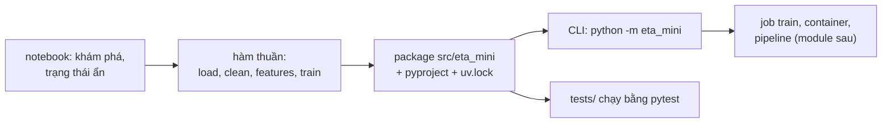
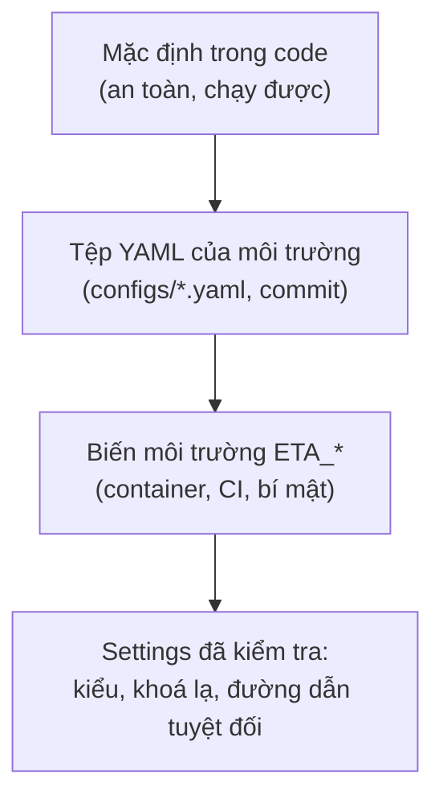
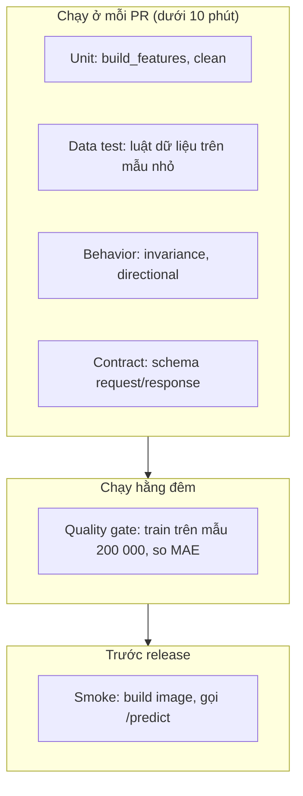

# Nền tảng kỹ thuật cho ML code

Hầu hết sự cố ML production không đến từ thuật toán. Chúng đến từ chuyện rất thường: model chỉ train được trên laptop của một người vì đường dẫn `/home/an/Downloads`,
hai lần train ra hai MAE khác nhau mà không ai biết vì sao, bản sửa "nhỏ" làm hỏng một feature mà không test nào kêu, một tệp 300 MB lọt vào Git và ở đó mãi mãi.
Module này dạy phần kỷ luật kỹ thuật phần mềm mà mọi module sau (container, DVC, registry, pipeline, CI/CD) đều giả định bạn đã có.

Chủ đề xuyên suốt là một bài toán nhỏ: **ETA mini**, dự đoán thời lượng chuyến Yellow Taxi NYC (phút) từ khoảng cách, giờ đón, thứ trong tuần và hai zone. Model nhẹ (một `HistGradientBoostingRegressor`);
phần đáng học là mọi thứ quanh nó. Đây cũng là cái nền của capstone "Dịch vụ ETA cho taxi NYC".

Sau module này bạn sẽ:

- Chuyển một notebook thành package `src/` có `pyproject.toml`, lockfile `uv`, hàm `train()` gọi được và CLI chạy ở thư mục bất kỳ.
- Tách cấu hình khỏi code (mặc định, YAML, biến môi trường) và ghi log JSON có cấu trúc, che bí mật.
- Viết bốn loại test cho code ML: unit, data, test có seed, test hành vi model (invariance, directional).
- Chẩn đoán một pipeline train không tái lập và liệt kê đủ các nguồn ngẫu nhiên và thứ tự không xác định.
- Dùng Makefile, Bash đủ dùng và Git flow đúng cho repo ML (không commit data/model, pre-commit, branch ngắn).
- Biết Go dùng ở đâu quanh hệ ML và vì sao chỉ cần đọc hiểu ở mức này.

## 0. Cài đặt

Module chạy hoàn toàn trong môi trường Python của repo (`uv run`). Các công cụ dưới đây là phần còn thiếu; bài tập tự skip với thông báo rõ khi thiếu `bwrap`.

| Công cụ | Phiên bản đã kiểm | Tối thiểu | Dùng ở |
| --- | --- | --- | --- |
| GNU Make | 4.4.1 | 4.0 | Basic 03 |
| Git | 2.47.3 | 2.30 | Basic 03, toàn module |
| bubblewrap (`bwrap`) | 0.12.0 | 0.4 | Basic 01 và 03 (sandbox chạy CLI, `make`, `git`) |
| uv | 0.11.33 | 0.5 | Mọi bài |
| ruff | 0.17.1 | 0.17 | Mục 1, 5; Basic 03 (chỉ đọc cấu hình) |
| pre-commit | 4.7.0 | 4.0 | Mục 6; Basic 03 (chỉ đọc cấu hình) |

`make`, `git` và `bwrap` có sẵn trong repo của distro (`sudo apt install make git bubblewrap`; `apt` xác minh chữ ký của gói, không tải script lạ về chạy bằng quyền root).
`ruff` và `pre-commit` chạy qua `uv tool`, cài vào `~/.local/bin`; `uv` kiểm hash của từng tệp tải về theo chỉ mục PyPI:

```bash
uv tool install ruff==0.17.1
uv tool install pre-commit==4.7.0
make --version | head -1 && git --version && bwrap --version && ruff --version && pre-commit --version
```

Cả hai phiên bản được phát hành trước ngày viết module hơn hai tuần (ghim phiên bản "đã cũ vài tuần" là thói quen chống lỗi bản mới còn nóng). Gỡ: `uv tool uninstall ruff pre-commit`.
Muốn thử mà không cài: `uv tool run --from ruff==0.17.1 ruff --version`.

## 1. Từ notebook sang package

Notebook tốt để khám phá, tệ để vận hành: trạng thái ẩn (chạy cell không theo thứ tự), không import được, không test được, diff Git toàn JSON, và gần như chắc chắn có đường dẫn cứng.
Quy tắc làm việc thực tế: **khám phá trong notebook, tất cả những gì sẽ chạy lần thứ hai thì chuyển vào package**.



### `src/` layout

```text
eta-mini/
├── pyproject.toml
├── uv.lock
├── Makefile
├── src/eta_mini/{__init__,data,features,model,cli,__main__}.py
├── tests/
├── configs/default.yaml
└── notebooks/            # chỉ để khám phá, không import từ đây
```

Lý do chọn `src/` thay vì để `eta_mini/` cạnh `tests/`: với layout phẳng, `pytest` chạy ở gốc repo import được package **dù chưa cài**, nên bạn không bao giờ phát hiện `pyproject.toml` thiếu dependency hay thiếu module. Với `src/`, import chỉ chạy khi package đã được cài (hoặc `PYTHONPATH=src`), nên test thấy đúng thứ người dùng thấy.

```toml
[project]
name = "eta-mini"
version = "0.1.0"
requires-python = ">=3.11"
dependencies = ["pandas>=2.2", "scikit-learn>=1.5", "pyarrow>=15", "joblib>=1.4"]

[project.scripts]
eta-train = "eta_mini.cli:main"

[build-system]
requires = ["setuptools>=68"]
build-backend = "setuptools.build_meta"

[tool.setuptools.packages.find]
where = ["src"]
```

### `uv` và lockfile

| Việc | Lệnh | Ghi chú |
| --- | --- | --- |
| Tạo môi trường và cài đúng theo lock | `uv sync --frozen` | Lỗi nếu `uv.lock` lệch `pyproject.toml`: đúng ý cho CI |
| Thêm dependency | `uv add pandas` | Sửa `pyproject.toml` và `uv.lock` cùng lúc |
| Chạy lệnh trong môi trường | `uv run pytest -q` | Không cần `activate` |
| Khoá phiên bản Python | `.python-version` + `requires-python` | `uv` tự tải Python đúng bản |

`pyproject.toml` nói "tôi chấp nhận pandas từ 2.2"; `uv.lock` nói "đúng 2.2.3, hash này". Ứng dụng (service, job train) **commit lockfile**; thư viện dùng chung thì cho phép khoảng rộng hơn.
Đây là chỗ nhiều dự án ML trượt: `requirements.txt` không ghim, sáu tháng sau `pip install` ra pandas 3 và model train ra số khác.

### Hàm thuần, không biến toàn cục

Dấu hiệu code notebook chưa sẵn sàng: đọc dữ liệu ở top-level, biến `df` bị sửa qua nhiều cell, hàm đọc biến toàn cục. Chuyển thành hàm `df -> df` thì test được bằng 3 000 dòng tổng hợp thay vì 7 triệu dòng thật.
Trên dữ liệu thật của NYC TLC (mẫu 200 000 chuyến của 2019-01, `seed=0`), luật làm sạch của ETA mini (`0 < thời lượng <= 180 phút`, `0 < quãng đường <= 100 dặm`) loại **khoảng 1,0% dòng**, và MAE trên tập test là khoảng **2,8 phút** so với **6,9 phút** của cách đoán trung vị.
Hai con số này là thứ test hồi quy nên giữ lại: refactor đúng nghĩa là chúng không đổi.

## 2. Cấu hình tách khỏi code và logging có cấu trúc

### Ba lớp cấu hình



Ưu tiên tăng dần: mặc định < YAML < env. Nguyên tắc 12-factor: thứ gì **đổi giữa các môi trường** (đường dẫn dữ liệu, URI tracking, mật khẩu) thuộc về config; thứ gì **định nghĩa hành vi** (danh sách feature, luật làm sạch) thuộc về code và được review.
Bí mật không bao giờ vào YAML trong Git: lấy từ env hoặc secret manager ([module 17-ml-platform-security](../17-ml-platform-security/README.md)).

Ba quyết định thiết kế đáng nhớ (Basic 02 bắt bạn làm cả ba):

1. **Khoá lạ là lỗi.** `sed: 3` thay vì `seed: 3` bị bỏ qua âm thầm là cách nhanh nhất để tưởng mình đã đổi tham số.
2. **Đường dẫn tương đối trong YAML tính từ thư mục chứa YAML**, không từ cwd, nếu không `make train` ở gốc repo và job Airflow chạy ở thư mục khác trỏ tới hai nơi khác nhau.
3. **Kiểm tra ngay lúc nạp**, không phải lúc dùng: pipeline chạy 40 phút rồi chết vì `max_iter="abc"` là lỗi đắt.

### Logging JSON

`print` ổn trong notebook, không ổn trong job chạy 3 giờ mà người trực đọc log lúc 2 giờ sáng. Log có cấu trúc (một dòng một JSON) cho phép lọc theo `run_id`, đếm `level=ERROR`, vẽ MAE theo thời gian mà không cần regex.

```python
logger.info("train done", extra={"run_id": "2026-11-03-a1", "mae": 2.8, "n_train": 158446})
```

```json
{"ts": "2026-11-03T08:41:07.120+00:00", "level": "INFO", "logger": "eta", "msg": "train done", "run_id": "2026-11-03-a1", "mae": 2.8, "n_train": 158446}
```

Mỗi dòng cần: thời gian UTC, mức, tên logger, thông điệp, định danh chạy (`run_id`), và các số liệu có nghĩa. **Không log bí mật** và không log dữ liệu cá nhân của khách (toạ độ chính xác, số điện thoại).
Lưới an toàn che trường theo tên (`password`, `token`, `secret`, `key`) bắt lỗi vô tình, nhưng không bắt được bí mật nằm trong chuỗi `msg`: kỷ luật vẫn là không đưa vào.

## 3. Test cho code ML

Test ML không thay test phần mềm; nó thêm ba lớp mà phần mềm thường không có: dữ liệu, tính ngẫu nhiên và hành vi của model đã học.



| Lớp | Kiểm cái gì | Dữ liệu | Thời gian |
| --- | --- | --- | --- |
| Unit | Hàm thuần: `build_features`, `clean`, parse config | Vài dòng viết tay | mili giây |
| Data | Luật dữ liệu: không có thời lượng âm, zone trong 1-265, ngày trong tháng; số dòng bị loại | Mẫu nhỏ có đủ các loại lỗi thật | giây |
| Có seed | Train hai lần cùng seed ra cùng số; split không phụ thuộc thứ tự tệp | Dữ liệu tổng hợp nhỏ | giây |
| Hành vi model | Bất biến và hướng kỳ vọng của dự đoán | Model nhỏ train trên dữ liệu tổng hợp | giây |
| Chất lượng | MAE không tệ hơn ngưỡng/model đang chạy | Mẫu dữ liệu thật | phút, ngoài PR |

### Dữ liệu thật bẩn, và test phải biết điều đó

Tệp NYC TLC 2019-01 có chuyến có thời lượng âm hoặc 0, `trip_distance` bằng 0 hay hàng trăm dặm, và cả chuyến năm 2008 hay 2018 trong tệp của tháng 1/2019. Data test nên dựng một mẫu nhỏ chứa **đúng các loại lỗi đó** và kiểm số dòng bị loại,
vì lúc luật làm sạch bị sửa lệch một dấu `<=`, chỉ phép đếm mới lộ ra:

```python
def test_clean_removes_only_known_dirty_rows():
    cleaned = clean(make_trips(3000))        # 30 dòng bẩn đã biết
    assert len(cleaned) == 3000 - 30
    assert cleaned["duration_min"].between(0, 180, inclusive="right").all()
```

### Test hành vi model

Một model có MAE tốt vẫn có thể làm điều vô lý. Hai họ test (theo CheckList của Ribeiro và cộng sự):

- **Invariance (bất biến)**: thay đổi không nên đổi dự đoán thì không đổi. Ví dụ đảo thứ tự cột của JSON; đổi `PULocationID` giữa hai zone cùng khu và cùng đặc điểm.
- **Directional expectation (hướng kỳ vọng)**: thay đổi nên đẩy dự đoán theo một hướng thì đẩy theo hướng đó. Ví dụ tăng `trip_distance` thì ETA không giảm **trên trung bình**.

Vì sao "trên trung bình": model cây có vùng phẳng và dao động nhỏ, đòi mọi điểm đơn điệu sẽ làm test đỏ ngẫu nhiên. Đo hai số, trung bình thay đổi và tỉ lệ ngược chiều, với ngưỡng cho từng số.
Muốn ép cứng thì ràng buộc ở lúc train (`monotonic_cst` của `HistGradientBoostingRegressor`), và test là lưới kiểm rằng ràng buộc vẫn còn (Intermediate 01).

### Lỗi hay gặp khi test ML

- Test độ chính xác bằng `assert accuracy == 0.8731`: đỏ khi đổi phiên bản thư viện. Dùng ngưỡng với biên, không dùng bằng nhau.
- Test cần dữ liệu thật 7 triệu dòng chạy ở mọi PR: CI 25 phút, người ta tắt nó. Dữ liệu thật dùng ở lớp chất lượng hằng đêm.
- Retry test flaky ba lần: che lỗi thật. Một lần retry, cách ly có hạn, có người chịu trách nhiệm.

## 4. Tái lập: seed và các nguồn không xác định

"Tái lập" nghĩa là cùng code, cùng dữ liệu, cùng cấu hình thì cùng kết quả. Không có nó thì không so sánh được hai thí nghiệm: trên mẫu 200 000 chuyến của 2019-01, cùng code nhưng seed 0, 1, 2 cho MAE 2,797, 2,760 và 2,801.
Chênh lệch 0,04 phút là **nhiễu của cách chia dữ liệu**. Nếu bạn không kiểm soát seed, cải tiến nhỏ hơn mức đó là không thể phân biệt với may rủi.

### Danh sách nguồn không xác định

| Nguồn | Triệu chứng | Cách xử lý |
| --- | --- | --- |
| `random`, `np.random`, `torch` có bộ sinh riêng; gieo hạt cái này không gieo cái kia | `np.random.seed(0)` mà vẫn khác | Dùng bộ sinh cục bộ: `np.random.default_rng(seed)`, `random_state=seed` |
| `os.listdir`, `glob`, `set`, `dict` từ nguồn ngoài | Khác nhau giữa hai máy hoặc hai lần chạy | `sorted(...)` ngay khi liệt kê |
| Chia dữ liệu theo vị trí dòng | Tập test đổi khi thứ tự dòng đổi | Chia theo khoá ổn định (hash của id) hoặc sắp xếp trước |
| Đa luồng, song song, GPU không xác định | Sai khác ở chữ số thập phân cuối | Ghim số luồng; chấp nhận dung sai; ghi nhận rõ |
| Phiên bản thư viện, dữ liệu đổi ngầm | Khác khi chạy lại sau vài tháng | Lockfile, DVC (module 03) |

### Seed có mặt chưa chứng minh được tái lập

Thấy chữ `seed` trong code làm người đọc yên tâm, nhưng nó chỉ bao phủ những nguồn thực sự đọc seed đó. Khi hai lần chạy ra hai kết quả khác nhau, ba cách chẩn đoán theo thứ tự rẻ nhất:

1. **Chạy hai lần trong cùng một tiến trình rồi so**, sau khi cố ý đổi trạng thái ngẫu nhiên toàn cục giữa hai lần. Nếu khác, nguồn ngẫu nhiên không nằm dưới `seed` bạn truyền.
2. **Giả lập môi trường khác** (đổi thứ tự liệt kê tệp, đổi số luồng) để lộ phụ thuộc môi trường.
3. **Bisect theo từng bước**: so hash của dữ liệu sau `load`, sau `split`, sau `fit`. Bước đầu tiên hai lần chạy cho hash khác nhau là thủ phạm.

Hợp đồng đúng của hàm thư viện: **không đổi trạng thái ngẫu nhiên toàn cục của chương trình gọi nó**. Dùng bộ sinh cục bộ và truyền seed xuống, đừng gọi `np.random.seed` trong thư viện.

## 5. Makefile, Bash đủ dùng và Go giới thiệu

### Makefile: một lệnh cho cả đội và CI

Makefile ở đây không để build C. Nó là **danh sách lệnh có tên**: người mới gõ `make` thấy mọi việc làm được, CI gọi đúng những lệnh đó, nên "chạy trên máy tôi" và "chạy trên CI" là một.

```make
.DEFAULT_GOAL := help
PYTHON ?= uv run python
SEED ?= 0

.PHONY: help setup test lint train clean

help: ## Liệt kê các lệnh
	@grep -E '^[a-z_-]+:.*## ' $(MAKEFILE_LIST) | awk -F':.*## ' '{printf "%-8s %s\n", $$1, $$2}'

test: ## Chạy test
	uv run pytest -q

train: ## Train ETA mini
	mkdir -p models
	$(PYTHON) -m eta_mini --data $(DATA) --out models/model.joblib --seed $(SEED)
```

Chi tiết hay sai: dòng lệnh bắt đầu bằng **tab**, không phải dấu cách; `.PHONY` cho target không phải tên tệp; `?=` cho phép ghi đè từ dòng lệnh (`make train SEED=7`); trong recipe, ký tự `$` của shell/awk viết `$$`.
Dùng `make -n target` để xem lệnh sẽ chạy mà không chạy: cách duyệt Makefile của người khác an toàn nhất.

### Bash đủ dùng

Bạn không cần viết script Bash dài (script dài nên là Python). Cần đọc và viết được phần keo:

```bash
set -euo pipefail                              # dừng khi lỗi, biến chưa gán, lỗi trong pipe
DATA="${DATA:-data/yellow_tripdata_2019-01.parquet}"   # mặc định nếu chưa đặt
[ -f "$DATA" ] || { echo "thiếu $DATA" >&2; exit 1; }
uv run python -m eta_mini --data "$DATA" --out models/model.joblib
jq -r '.mae' <<<"$(tail -n1 run.log)"          # đọc một trường từ dòng log JSON
```

Ba bẫy kinh điển: biến không bọc dấu nháy (`$DATA` có dấu cách vỡ lệnh), thiếu `set -e` (lệnh lỗi mà script vẫn "thành công"), và pipe nuốt mã lỗi (cần `pipefail`). Dùng `shellcheck` để bắt chúng ([DevOps module 02](../../../devops/modules/02-scripting/README.md)).

### Go: chỉ giới thiệu

Go xuất hiện quanh hệ ML ở những chỗ cần một binary tĩnh, khởi động nhanh, nhiều kết nối đồng thời: service gateway trước model, sidecar, CLI nội bộ, và gần như toàn bộ hạ tầng cloud-native (Docker, Kubernetes, Prometheus, Terraform) viết bằng Go.
Với MLOps engineer, mức cần có là: **đọc được** code Go của các công cụ, biết một service Go gọi model bằng ONNX hoặc HTTP (xem DS 14 mục 6), và biết khi nào chọn Go thay vì Python (cần tải cao, binary nhỏ, không cần hệ sinh thái ML). Viết model hay pipeline train bằng Go là hiếm. Module này không có bài tập Go.

## 6. Git flow cho dự án ML

### Cái gì vào Git, cái gì không

| Vào Git | Không vào Git | Quản lý bằng |
| --- | --- | --- |
| Code, test, `pyproject.toml`, `uv.lock` | Dữ liệu (`data/`) | DVC + remote (module 03) |
| Config YAML của môi trường | Bí mật, `.env` | Secret manager, biến môi trường (module 17-ml-platform-security) |
| `dvc.yaml`, `dvc.lock` (con trỏ tới dữ liệu) | Model (`*.joblib`, `*.pkl`) | Model registry (module 04) |
| Notebook đã xoá output (`nbstripout`) | Cache, `.venv`, `mlruns/` | `.gitignore` |

Lý do cứng: Git lưu **mỗi phiên bản** của tệp nhị phân đầy đủ trong `.git` vĩnh viễn. Một parquet 300 MB commit ba lần là gần 1 GB mà `git rm` không lấy lại được; muốn xoá phải viết lại lịch sử, phá mọi clone và nhánh của đồng đội.
Phòng bệnh rẻ hơn chữa: `.gitignore` đúng cộng pre-commit chặn tệp lớn.

### pre-commit

```yaml
repos:
  - repo: https://github.com/pre-commit/pre-commit-hooks
    rev: v6.0.0
    hooks:
      - id: check-added-large-files
        args: ["--maxkb=500"]
      - id: check-yaml
  - repo: https://github.com/astral-sh/ruff-pre-commit
    rev: v0.17.1
    hooks:
      - id: ruff
      - id: ruff-format
```

`pre-commit install` gắn hook vào `git commit`. Hook chạy trên máy từng người, nên **không thay CI**: ai cũng có thể `--no-verify`. CI chạy lại cùng cấu hình (`pre-commit run --all-files`) mới là chốt chặn thật. Ghim `rev` bằng tag; `rev: main` làm kết quả đổi theo ngày.

### Quy trình nhánh

Với đội 2-6 người, **trunk-based hoặc nhánh ngắn** hợp ML hơn Git Flow nhiều nhánh dài: nhánh `feature/*` sống dưới vài ngày, PR nhỏ, merge vào `main` khi CI xanh. Thí nghiệm dài ngày không để trong nhánh dài mà ghi bằng tracking (module 04) với tham số và commit hash; nhánh chỉ chứa code đã đáng merge.
Quy tắc nên đặt: PR phải chạy `make lint test`; commit message nói **vì sao** thay vì chỉ `update`; model đưa vào production luôn truy được về một commit và một phiên bản dữ liệu.

## 7. Ôn nhanh và checklist

### Đã học ở track khác

| Chủ đề | Đã học ở | Module này thêm gì |
| --- | --- | --- |
| Vòng đời model, đóng gói pipeline, MLflow cơ bản, checklist notebook sang production | [DS 14: MLOps cho Data Scientist](../../../data-science/modules/14-mlops-for-ds/README.md) | Cách làm kỹ thuật cho việc đó: layout, config, test, tái lập |
| Đánh giá và quan sát hệ AI, bộ test chất lượng | [AE 20: Evaluation và production](../../../ai-engineer/modules/20-evaluation-production/README.md) | Test hành vi cho model dự đoán số, ngân sách test trong CI |
| CI, Git, container cho pipeline dữ liệu | [DE 08: DevOps cho dữ liệu](../../../data-engineer/modules/08-devops-for-data/README.md) | Điều chỉnh cho code ML: tái lập, không commit data/model |

### Checklist: repo ML sẵn sàng cho module sau

- `uv sync --frozen && make test` chạy sạch trên máy mới, không cần sửa đường dẫn.
- `python -m <package> --help` chạy được từ thư mục bất kỳ.
- Không có đường dẫn cứng, không có bí mật, không có tệp lớn trong Git.
- Cùng seed cùng kết quả; test chứng minh điều đó, kể cả khi đổi thứ tự tệp.
- Test hành vi chặn được model hỏng cố ý.
- Log JSON có `run_id`; một dòng cho mỗi sự kiện đáng nói.
- Model đang chạy truy được về commit và phiên bản dữ liệu (nối với module 03-04).

## 8. Tài liệu tham khảo

- [Python Packaging User Guide: src layout vs flat layout](https://packaging.python.org/en/latest/discussions/src-layout-vs-flat-layout/)
- [uv documentation: projects, lockfile, tools](https://docs.astral.sh/uv/)
- [The Twelve-Factor App: Config](https://12factor.net/config)
- [Beyond Accuracy: Behavioral Testing of NLP Models with CheckList (Ribeiro et al., 2020)](https://arxiv.org/abs/2005.04118)
- [Hidden Technical Debt in Machine Learning Systems (Sculley et al., 2015)](https://papers.nips.cc/paper/2015/hash/86df7dcfd896fcaf2674f757a2463eba-Abstract.html)
- [The ML Test Score: A Rubric for ML Production Readiness (Breck et al., 2017)](https://research.google/pubs/the-ml-test-score-a-rubric-for-ml-production-readiness-and-technical-debt-reduction/)
- [scikit-learn: Controlling randomness](https://scikit-learn.org/stable/common_pitfalls.html#controlling-randomness)
- [GNU Make manual](https://www.gnu.org/software/make/manual/make.html)
- [pre-commit documentation](https://pre-commit.com/)
- [ruff documentation](https://docs.astral.sh/ruff/)
- [Go: A Tour of Go](https://go.dev/tour/)
