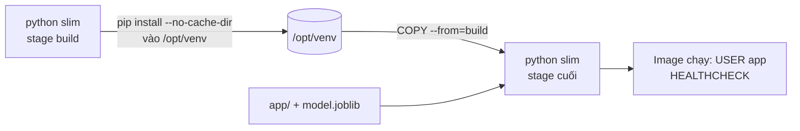
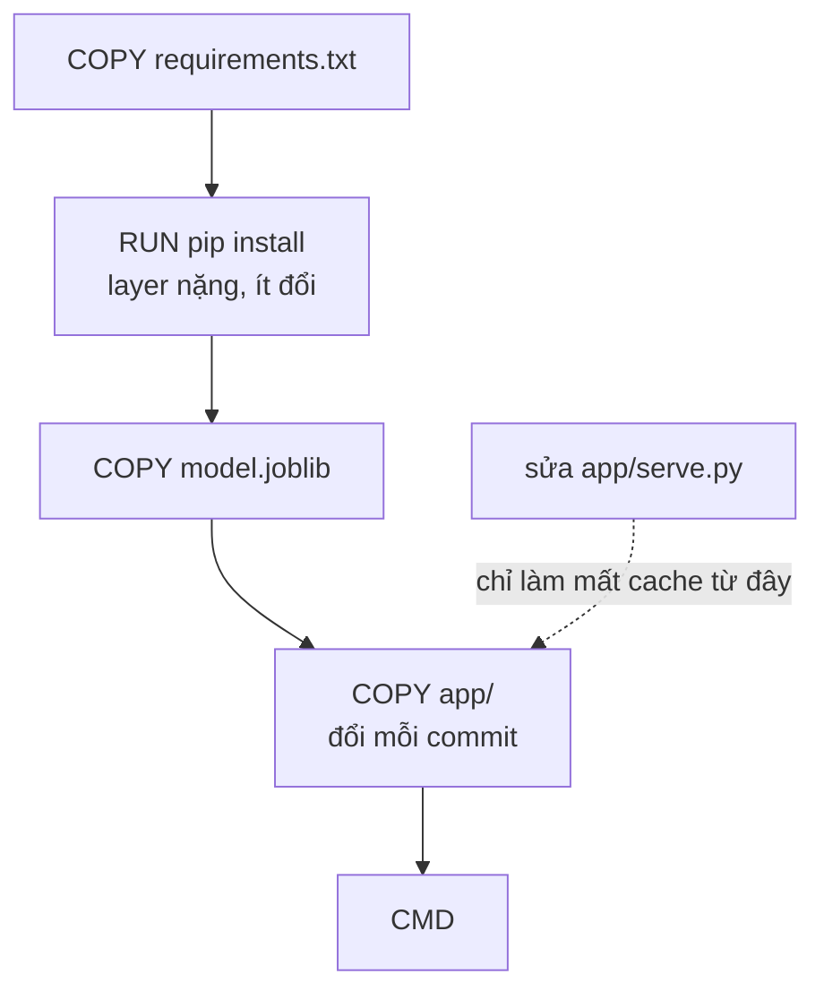
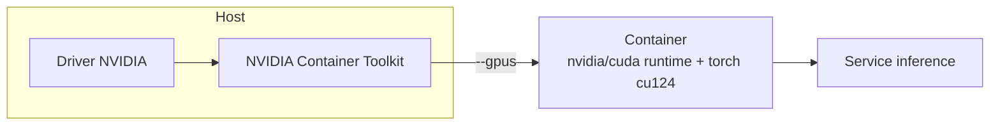
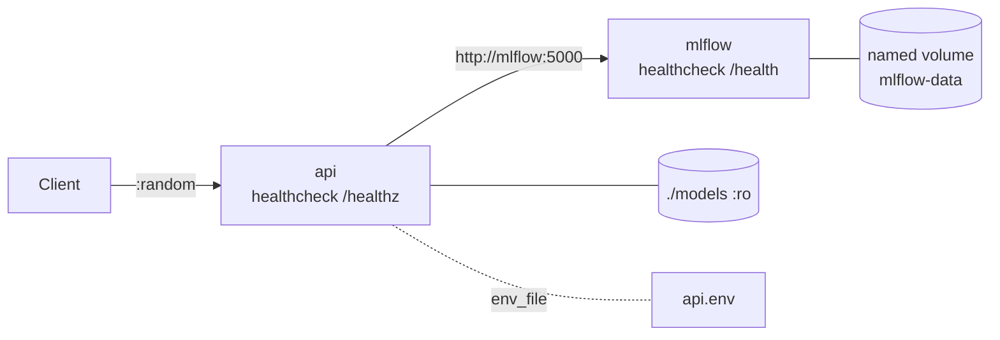

# Container cho ML

Một model chạy được trên máy bạn mới chỉ là một nửa việc. Nửa còn lại là làm cho nó chạy **giống hệt** ở CI, staging và production: cùng phiên bản Python, cùng scikit-learn (file `joblib` load bằng bản khác có thể lỗi hoặc cho số khác), cùng thư viện hệ thống. Container là cách rẻ nhất để chốt môi trường đó, và cũng là nơi phần lớn sự cố "tuần trước còn chạy" bắt đầu: image phình 5 GB vì kéo cả CUDA, build 10 phút vì mỗi lần sửa code lại cài lại torch, container root cùng bí mật dán trong compose.

Module này dạy Docker ở mức người vận hành ML: viết Dockerfile nhỏ, tái lập, chạy bằng user thường; quyết định model nằm trong hay ngoài image; dựng stack nhiều dịch vụ bằng Compose có healthcheck đúng; quét image bằng trivy; và đọc hiểu đường GPU (NVIDIA Container Toolkit) trong khi bài tập vẫn chạy trên CPU. Docker cơ bản (image, container, volume, network) đã học ở [DE 08](../../../data-engineer/modules/08-devops-for-data/README.md) và [DevOps](../../../devops/README.md); module này dùng lại, không dạy lại.

Sau module này bạn sẽ:

- Viết Dockerfile multi-stage cho service sklearn, ghim phiên bản, không root, có `HEALTHCHECK`, nhỏ hơn ngưỡng đặt trước.
- Sắp xếp layer để sửa code không cài lại dependency nặng, và dùng `.dockerignore` đúng chỗ.
- Chọn giữa đóng model vào image và giao model ngoài image, nói rõ đánh đổi.
- Dựng Compose nhiều dịch vụ với `healthcheck`, `depends_on: condition: service_healthy`, volume, `env_file`, `profiles`.
- Chẩn đoán container thoát hay restart liên tục từ trạng thái, mã thoát và log.
- Dùng trivy để quét Dockerfile và image, và viết chính sách chặn có lý do.

## 0. Cài đặt

Bài tập dựng image và compose project thật, nên cần Docker Engine và Compose v2. Trivy chỉ cần cho Intermediate 03 (thiếu thì bài đó skip phần quét).

| Công cụ | Phiên bản đã kiểm | Tối thiểu | Dùng ở |
| --- | --- | --- | --- |
| Docker Engine | 29.9 | 24.0 | Mọi bài có `tests/` dựng image |
| Docker Compose | v5.6 (plugin `docker compose`) | v2.20 | Intermediate 01, 02 |
| Image `python` | `python:3.12.11-slim` | đúng tag này | Base cho mọi bài |
| trivy | 0.75.0 | 0.60 | Intermediate 03 |

Kiểm tra Docker và Compose, tải base image:

```bash
docker --version && docker compose version && docker pull python:3.12.11-slim
```

`docker compose version` phải in `v2.x` trở lên; lệnh `docker-compose` (có dấu gạch) là bản v1 cũ, không dùng.

### Cài trivy

Tải bản phát hành từ GitHub, kiểm checksum **trước** khi giải nén và cài, vào `~/.local/bin` (không cần `sudo`):

```bash
cd "$(mktemp -d)" &&
curl -fsSLO https://github.com/aquasecurity/trivy/releases/download/v0.75.0/trivy_0.75.0_Linux-64bit.tar.gz &&
curl -fsSLO https://github.com/aquasecurity/trivy/releases/download/v0.75.0/trivy_0.75.0_checksums.txt &&
sha256sum --check --ignore-missing trivy_0.75.0_checksums.txt &&
mkdir -p ~/.local/bin && tar -xzf trivy_0.75.0_Linux-64bit.tar.gz trivy && install -m 0755 trivy ~/.local/bin/trivy &&
trivy --version
```

Checksum SHA-256 của `trivy_0.75.0_Linux-64bit.tar.gz` lúc viết module: `c6e65abddb348e25f10549df887045629cf28cc72453cd1c63acb717316b3f3f` (so với `trivy_0.75.0_checksums.txt` trên trang release). Khối lệnh nối bằng `&&` nên checksum sai thì dừng, không cài. Lệnh cuối in `Version: 0.75.0`. Chỉ có bản Linux 64-bit ở đây; trên máy khác chọn tệp tương ứng ở trang release.

Gỡ: `rm ~/.local/bin/trivy && rm -rf ~/.cache/trivy`.

## 1. Image cho ML: nhỏ, tái lập, không root

Image ML nặng vì dependency: numpy, scipy, scikit-learn trên `python:3.12.11-slim` cho khoảng 550 MB (nền slim khoảng 180 MB). Thêm torch CPU là hàng trăm MB nữa, bản CUDA là vài GB. Vì vậy mỗi quyết định về base và layer đều tính ra tiền và thời gian.

| Base | Cỡ nền | Khi nào dùng | Bẫy |
| --- | --- | --- | --- |
| `python:3.12.11` (đầy đủ) | lớn nhất | Cần biên dịch nhiều thứ | Kéo gcc, header mà service không dùng |
| `python:3.12.11-slim` | nhỏ | Mặc định cho service ML trên CPU | Không có `curl`, `gcc` |
| `python:3.12-alpine` | nhỏ nhất | Chỉ khi mọi dependency có wheel musl | numpy/scipy/sklearn không có wheel manylinux dùng được trên musl, pip biên dịch từ source: chậm, dễ lỗi |
| `nvidia/cuda:*-runtime` | vài GB | Inference GPU | Dùng `devel` thì phình thêm GB |

### Multi-stage và virtualenv



Stage cuối chỉ nhận `/opt/venv`; không mang pip, cache wheel hay công cụ build. Với wheel thuần Python (như ở đây) lợi ích là sạch và an toàn; khi dependency phải biên dịch, lợi ích còn rõ hơn vì gcc ở lại stage đầu.

### Quy tắc ngón tay cái

- **Ghim tag phiên bản đầy đủ** (`3.12.11-slim`), không `latest`, không `3.12-slim` (tag trôi theo bản vá). Muốn chắc nhất ghim thêm digest `@sha256:...`.
- **Ghim dependency** trong `requirements.txt` (hoặc `uv.lock`). File `joblib` phụ thuộc phiên bản scikit-learn đã train nó.
- **`pip install --no-cache-dir`**: cache wheel nằm lại trong layer là rác vĩnh viễn.
- **`USER` không phải root**: tiến trình bị khai thác không có quyền root trong container.
- **`HEALTHCHECK`**: image slim không có `curl`; dùng `python -c "import urllib.request; ..."`.
- **`CMD` dạng exec** (`["python", "-m", "app.serve"]`) để PID 1 là chương trình của bạn và nhận SIGTERM; dạng shell chạy qua `sh -c` nuốt tín hiệu.

### `uv` trong Docker

`uv` cài nhanh hơn pip nhiều lần. Mẫu thường dùng: chép binary `uv` từ image `ghcr.io/astral-sh/uv` rồi `uv sync --frozen --no-dev --no-install-project` ở stage build, chép `.venv` sang stage cuối. `--frozen` buộc dùng đúng `uv.lock` (tái lập), và cache mount (`RUN --mount=type=cache,target=/root/.cache/uv`) giữ cache giữa các lần build mà không đưa vào layer.

## 2. Cache layer và build context

Docker cache mỗi lệnh theo nội dung đầu vào của nó. Một lệnh mất cache thì **mọi lệnh phía sau** mất theo.



Thứ tự đúng: ít đổi nhất trước (dependency), hay đổi nhất sau (code). `COPY . .` trước `pip install` là lỗi kinh điển: sửa một dòng code, cài lại torch.

`.dockerignore` làm hai việc: giữ context nhỏ (build nhanh hơn, không gửi 5 GB dữ liệu cho daemon) và giữ rác khỏi image: `.git`, `.venv`, `__pycache__`, `data/`, `notebooks/`, `.env`. Điều thứ hai là bảo mật: một bí mật đã vào layer vẫn còn đó dù lệnh `RUN rm` ở layer sau; layer là bất biến.

## 3. Model trong hay ngoài image

| Tiêu chí | Model trong image | Model ngoài (volume, object storage, registry) |
| --- | --- | --- |
| Rollback | Chạy tag cũ: một thao tác | Đổi file hoặc alias; phải nhớ version |
| Tái lập, kiểm toán | Digest image = code + model | Cần ghi version model ở nơi khác |
| Rollout model mới | Build và đẩy image (layer dependency dùng lại) | Chép hoặc tải file, image không đổi |
| Điểm hỏng lúc khởi động | Gần như không | Thiếu file, sai quyền, mạng, registry chết |
| Phù hợp | Model nhỏ (dưới vài trăm MB), nhịp retrain thấp tới vừa | Model lớn (GB), retrain thường xuyên, nhiều model dùng chung runtime |

Không có đáp án đúng chung; có đáp án đúng cho **kích thước model, nhịp retrain và yêu cầu kiểm toán** của bạn. Dù chọn gì, service nên in ra đường dẫn và version model nó nạp, và fail to ngay khi khởi động nếu thiếu model (thay vì chờ request đầu tiên).

## 4. CUDA, GPU và đường CPU

Container không chứa driver GPU. Driver NVIDIA cài trên host; **NVIDIA Container Toolkit** đưa thiết bị và thư viện driver vào container lúc chạy (`docker run --gpus all ...`, hoặc trong Compose `deploy.resources.reservations.devices` với `driver: nvidia`, `capabilities: [gpu]`).



- **`runtime` vs `devel`**: inference dùng `-runtime` (hoặc `-cudnn-runtime`); `devel` kèm compiler và header, nặng thêm vài GB.
- **Phiên bản phải khớp**: bản CUDA mà wheel torch build ra phải tương thích với driver trên host (driver mới chạy được CUDA cũ, không ngược lại).
- **Đường CPU**: cùng Dockerfile, build-arg chọn base (`slim` hay `nvidia/cuda`) và index torch (`.../whl/cpu` hay `.../whl/cu124`). Dev, CI và bài tập chạy CPU; chỉ production bật GPU. Torch CPU khoảng vài trăm MB, bản CUDA kéo thêm vài GB thư viện nvidia.
- Kiểm host: `docker run --rm --gpus all nvidia/cuda:12.4.1-base-ubuntu22.04 nvidia-smi`. Không in bảng GPU nghĩa là toolkit hay driver chưa nối đúng.

Trong track này GPU đi qua `setup/gpu` khi bài thật sự cần; module này chỉ cần bạn đọc hiểu và review được cấu hình GPU.

## 5. Compose nhiều dịch vụ

Compose mô tả cả stack trong một tệp: dịch vụ, mạng, volume, cấu hình.



Các mảnh quan trọng:

- **`healthcheck`**: lệnh chạy *bên trong* container; trạng thái `healthy` là cái mà `depends_on` và `up --wait` dựa vào. Lệnh phải dùng công cụ có trong image.
- **`depends_on` với `condition: service_healthy`**: không có `condition` thì chỉ đảm bảo thứ tự *khởi động*, không đảm bảo dịch vụ phía trước đã sẵn sàng nhận kết nối.
- **Volume**: named volume cho dữ liệu của dịch vụ (sống sót qua `down`, không dính quyền host); bind mount (`./models:/models:ro`) cho tệp bạn sở hữu. Bind mount kiểu viết tắt tự tạo thư mục host nếu thiếu: một lỗi gõ đường dẫn thành thư mục rỗng thay vì thông báo lỗi.
- **`env_file` và biến môi trường**: cấu hình ngoài định nghĩa dịch vụ; bí mật không dán vào tệp compose đưa vào git. Trong network của Compose, dịch vụ gọi nhau bằng *tên dịch vụ*, không phải `localhost`.
- **`profiles`**: dịch vụ tuỳ chọn (UI, smoke test, GPU) chỉ lên khi gọi `--profile`.
- **Cổng**: khai báo cổng container (`"8000"`) để Docker chọn cổng host trống; cổng cố định gây xung đột giữa các dự án.
- **`restart`**: `unless-stopped` hay `on-failure:N`. `always` biến lỗi cấu hình thành vòng lặp vô hạn.

Chẩn đoán container thoát hay restart liên tục, theo thứ tự: `docker compose ps -a` (trạng thái, mã thoát), `docker compose logs <dịch vụ>` (dòng cuối trước khi thoát), `docker inspect` phần `State` và `Health` (OOM, mã thoát, log healthcheck), rồi dựng lại một lệnh tương đương bằng `docker run` để tách vấn đề khỏi Compose.

## 6. Quét image bằng trivy

Trivy quét ba thứ: **lỗ hổng** của gói OS và Python trong image (`trivy image`), **misconfiguration** của Dockerfile/Compose/Kubernetes (`trivy config`), và **bí mật** lọt vào tệp. Dữ liệu lỗ hổng cần tải database lần đầu; `trivy config` dùng bộ check đi kèm nên chạy được offline.

```bash
trivy config --format json --quiet .
trivy image --severity HIGH,CRITICAL --ignore-unfixed myimage:tag
```

Chính sách quan trọng hơn công cụ:

- Chặn mức nào (thường `CRITICAL,HIGH` có bản vá), mức thấp hơn chỉ báo cáo.
- Lỗ hổng chưa có bản vá: chặn deploy cũng không sửa được, nhưng phải ghi nhận và theo dõi. Đây là quyết định của con người, không phải mặc định kỹ thuật.
- Ngoại lệ (allowlist, `.trivyignore`) cần lý do, người duyệt, ngày hết hạn.
- Quét ở PR (`config`), sau build (`image`) và định kỳ trên cái đang chạy: lỗ hổng được công bố sau khi image đã ra.
- Image nhỏ hơn ít gói hơn nên ít finding hơn: slim thường tốt hơn bản đầy đủ cả về kích thước lẫn báo cáo.

## 7. Tổng kết: checklist trước khi gọi image là "sẵn sàng production"

| Câu hỏi | Dấu hiệu tốt |
| --- | --- |
| Tái lập? | Tag base và dependency ghim; ghi git commit và version model vào label |
| Nhỏ và build nhanh? | `COPY requirements.txt` trước `pip install`, multi-stage, `.dockerignore` |
| An toàn? | `USER` thường, không bí mật trong layer, trivy qua cổng |
| Vận hành được? | `HEALTHCHECK` dùng công cụ có trong image, `CMD` dạng exec, log ra stdout |
| Giao model rõ ràng? | Quyết định trong/ngoài image có ghi lý do; service in version model khi khởi động |
| Chạy trên CPU và GPU? | Một Dockerfile, build-arg chọn base và index torch |

Capstone: milestone m02 đóng gói dịch vụ ETA thành image và Compose theo các quy tắc trên.

## 8. Tài liệu tham khảo

- [Dockerfile best practices (Docker docs)](https://docs.docker.com/build/building/best-practices/)
- [Multi-stage builds](https://docs.docker.com/build/building/multi-stage/)
- [Compose file reference: services, healthcheck, depends_on](https://docs.docker.com/reference/compose-file/services/)
- [Compose profiles](https://docs.docker.com/compose/how-tos/profiles/)
- [Using uv in Docker](https://docs.astral.sh/uv/guides/integration/docker/)
- [NVIDIA Container Toolkit](https://docs.nvidia.com/datacenter/cloud-native/container-toolkit/latest/index.html)
- [Compose GPU support](https://docs.docker.com/compose/how-tos/gpu-support/)
- [Trivy documentation](https://trivy.dev/latest/)
- [Dockerfile security best practices (Docker Scout, Trivy checks)](https://docs.docker.com/build/building/best-practices/#security)
