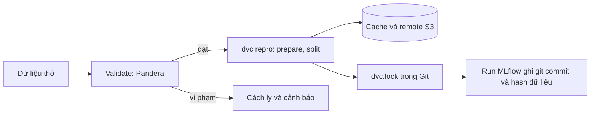
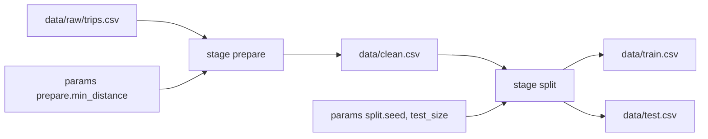
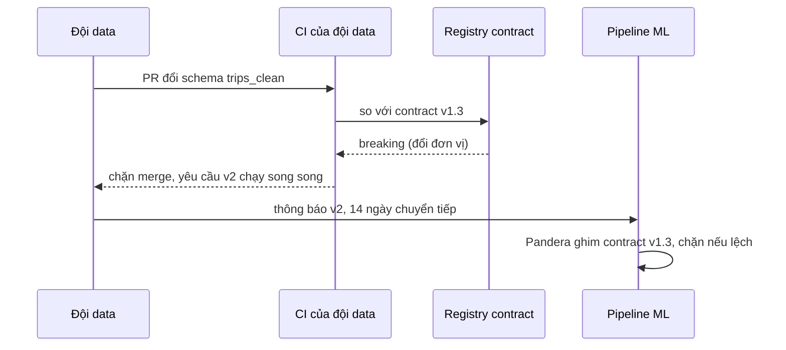

# Data versioning và chất lượng dữ liệu

Code có Git, nhưng model sinh ra từ code **cộng** dữ liệu. Module này dạy cách để mỗi commit trỏ tới đúng một phiên bản dữ liệu (DVC,
`dvc.lock`), cách chặn dữ liệu bẩn ở cửa vào (Pandera, so sánh Great Expectations), cách thoả thuận giữa đội data và đội ML (data contract), và khi nào DVC
không đủ (lakeFS, Delta Lake). Dữ liệu xuyên suốt là NYC Yellow Taxi 2019, bẩn thật: chuyến năm 2008, thời lượng âm, distance 0, zone Unknown.

## 0. Cài đặt

DVC đã nằm trong `pyproject.toml` của repo, cài qua `uv`, không cần `sudo` hay script tải ngoài.

| Công cụ | Phiên bản đã kiểm | Mức tối thiểu cho bài tập |
| --- | --- | --- |
| `dvc` (cùng `dvc-s3`) | 3.67.1 (`dvc-s3` 3.3.0) | 3.50 |
| `pandera` | 0.35.0 | 0.21 |
| `git` | 2.x | 2.30 |
| `bwrap` (bubblewrap, để chạy script của bạn trong sandbox) | 0.8 trở lên | có sẵn trong `setup/DEVOPS-TOOLS.md` |

`uv sync` kiểm hash từng gói theo `uv.lock` trước khi cài, đó là bước kiểm checksum:

```bash
uv sync --frozen
uv run dvc --version          # 3.67.1
uv run python -c "import pandera; print(pandera.__version__)"
```

Gỡ: xoá khỏi `pyproject.toml` rồi `uv sync`. Dữ liệu cache của DVC nằm trong `.dvc/cache` của từng repo và `~/.cache/dvc`, xoá thủ công.
Bài remote cần stack MinIO của `setup/mlops` (`docker compose -f setup/mlops/compose.yaml up -d --wait`), bucket `dvc` đã được tạo sẵn.

## 1. Vì sao phải version dữ liệu

Hai lần train cùng code ra hai model khác nhau thường là do dữ liệu đổi. Git không chứa nổi dữ liệu 2 GB, và Git LFS chỉ lưu tệp, không biết
"phiên bản dữ liệu nào đi với commit nào" ở mức pipeline. Cần ba thứ:

- **Phiên bản hoá**: mỗi trạng thái dữ liệu có định danh (hash nội dung), gắn vào commit.
- **Tái lập**: từ commit, dựng lại đúng dữ liệu và chạy lại đúng các bước sinh ra nó.
- **Kiểm chất lượng**: dữ liệu mới vào phải qua hàng rào trước khi trở thành "phiên bản".



Trade-off: version hoá có giá (dung lượng remote, thêm lệnh `dvc push`/`pull` vào quy trình). Dữ liệu nhỏ, đổi không thường xuyên thì một snapshot theo tháng
có tên rõ ràng đôi khi là đủ; từ khi nhiều người huấn luyện lại hằng tuần, tên tệp `v3_final` là nguồn tai nạn.

## 2. DVC: track data, cache, remote MinIO

`dvc add` băm tệp (md5), chép vào cache, và ghi một con trỏ nhỏ vào Git:

```bash
git init && dvc init
dvc add data/trips.parquet        # sinh data/trips.parquet.dvc và data/.gitignore
git add data/trips.parquet.dvc data/.gitignore && git commit -m "track trips"
```

```yaml
outs:
- md5: 3b1b4f2f0d7a5c8e9a1f
  size: 183452019
  path: trips.parquet
```

Cache nằm ở `.dvc/cache/files/md5/<2 ký tự>/<phần còn lại>`; chuyển giữa các phiên bản bằng `git checkout <rev> -- tệp.dvc` rồi `dvc checkout`: không cần mạng nếu
bản đó còn trong cache. Muốn chia sẻ thì cần **remote**:

```bash
dvc remote add -d storage s3://dvc/team-a
dvc remote modify storage endpointurl http://127.0.0.1:29000   # MinIO, không phải AWS
dvc push            # đẩy đối tượng chưa có lên remote
dvc pull            # máy mới: đọc con trỏ trong Git, tải về cache
```

Khoá truy cập đi qua biến môi trường (`AWS_ACCESS_KEY_ID`, `AWS_SECRET_ACCESS_KEY`) hoặc `dvc remote modify --local`, **không** vào `.dvc/config` vì tệp này được commit.
Lỗi nhóm hay gặp: commit con trỏ nhưng quên `dvc push`, đồng đội `dvc pull` gặp "missing cache".

## 3. Pipeline `dvc.yaml`, `dvc repro` và `dvc.lock`

`dvc.yaml` khai báo stage; DVC suy ra đồ thị từ chuyện đầu ra của stage này là đầu vào của stage kia:

```yaml
stages:
  prepare:
    cmd: python prepare.py
    deps:
      - prepare.py
      - data/raw/trips.csv
    params:
      - prepare.min_distance
    outs:
      - data/clean.csv
  split:
    cmd: python split.py
    deps:
      - split.py
      - data/clean.csv
    params:
      - split.seed
      - split.test_size
    outs:
      - data/train.csv
      - data/test.csv
```



`dvc repro` băm `cmd`, `deps`, `params` của từng stage rồi so với `dvc.lock`; khớp thì in `Stage 'x' didn't change, skipping`, khác thì chạy lại stage đó và mọi stage phụ thuộc.
`params:` theo từng khoá (`split.seed`) nên đổi `test_size` không làm `prepare` chạy lại.

**`dvc.lock` là hợp đồng tái lập**: nó ghi md5 của mọi dep và out ở lần chạy cuối. Commit nó cùng code, rồi ai checkout cũng dựng lại cùng dữ liệu. Công cụ chẩn đoán:
`dvc status` (stage nào lệch), `dvc dag` (đồ thị), `dvc repro --dry`, `dvc diff <rev>` (dữ liệu đổi gì giữa hai commit), `dvc params diff`.

## 4. Data validation: Pandera chính, Great Expectations so sánh

Validation là hàng rào ở cửa vào pipeline: chặn dữ liệu sai *trước khi* nó thành một phiên bản. Với NYC TLC, bốn lỗi thật bắt được bằng luật đơn giản:

```python
import pandas as pd
import pandera.pandas as pa

def trip_schema(month: str) -> pa.DataFrameSchema:
    start = pd.Timestamp(month + "-01")
    end = start + pd.offsets.MonthBegin(1)
    return pa.DataFrameSchema(
        {
            "tpep_pickup_datetime": pa.Column("datetime64[ns]", pa.Check(lambda s: (s >= start) & (s < end)), coerce=True),
            "tpep_dropoff_datetime": pa.Column("datetime64[ns]", coerce=True),
            "trip_distance": pa.Column(float, pa.Check.gt(0), coerce=True),
            "PULocationID": pa.Column(int, pa.Check.in_range(1, 265), coerce=True),
        },
        checks=pa.Check(lambda df: df["tpep_dropoff_datetime"] > df["tpep_pickup_datetime"]),
    )

schema.validate(df, lazy=True)   # gom mọi lỗi, SchemaErrors.failure_cases có chỉ số dòng
```

| | Pandera | Great Expectations |
| --- | --- | --- |
| Cách dùng | schema như code Python cạnh hàm biến đổi | bộ expectation + checkpoint, cấu hình riêng |
| Mạnh ở | DataFrame (pandas, Polars), luật nhiều cột bằng lambda, kiểm trong unit test | SQL và Spark, Data Docs (báo cáo HTML), người không code đọc được |
| Chi phí | thấp, một thư viện | nặng hơn: context, store, validation result |
| Chọn khi | luật nằm trong pipeline Python | cần báo cáo chất lượng cho nhiều đội hoặc kiểm trực tiếp trên warehouse |

Khi vi phạm có ba lựa chọn, tuỳ mức nghiêm trọng: **chặn cả lô** (lỗi hợp đồng: sai đơn vị, mất cột), **cách ly dòng lỗi** (quarantine, giữ để điều tra), hoặc **chỉ cảnh báo**. Đo tỉ lệ vi phạm
theo thời gian: tỉ lệ đổi đột ngột là tín hiệu sớm nhất của một nguồn dữ liệu đang hỏng.

## 5. Data contract giữa đội data và đội ML

Validation trả lời "dữ liệu này có đúng không"; **data contract** trả lời "ai hứa gì với ai". Một contract gồm: schema (kiểu, đơn vị, nullable, miền giá trị), ngữ nghĩa và SLA
(độ trễ, tỉ lệ lỗi chấp nhận), quy tắc thay đổi (breaking và non-breaking, versioning, báo trước), người sở hữu và kênh leo thang.



Điểm thực thi **phải ở cả hai phía**: nhà cung cấp kiểm trước khi phát hành (để không phá người khác), người dùng kiểm ở cửa vào (vì không tin hoàn toàn ai).
Đổi đơn vị mà không đổi tên hay kiểu cột là loại thay đổi nguy hiểm nhất: schema vẫn "đúng", model sai âm thầm.

## 6. Lineage cơ bản và khi DVC không đủ

Lineage cơ bản của một model: `model ← run MLflow ← git commit ← dvc.lock ← md5 dữ liệu`. Khi huấn luyện, ghi tự động vào run (không để con người nhớ điền):

```python
import subprocess, hashlib, mlflow

commit = subprocess.check_output(["git", "rev-parse", "HEAD"], text=True).strip()
lock_sha = hashlib.sha256(open("dvc.lock", "rb").read()).hexdigest()[:12]
with mlflow.start_run():
    mlflow.set_tags({"git_commit": commit, "dvc_lock_sha": lock_sha})
```

Giới hạn của DVC: nó quản lý tệp của **một repo**, không điều phối nhiều writer. So sánh:

| | DVC | lakeFS | Delta Lake |
| --- | --- | --- | --- |
| Đơn vị version | tệp/thư mục theo commit Git | cả lake (branch, commit trên object storage) | từng bảng (transaction log) |
| Giao dịch nhiều writer | không | commit nguyên tử, merge | ACID trên từng bảng |
| Time travel | theo commit Git | theo commit/branch lakeFS | `VERSION AS OF`, `TIMESTAMP AS OF` |
| Vận hành | gần như không (remote S3) | server + KV store | Spark hoặc delta-rs |
| Hợp với | đội ML 3-100 GB, tái lập thí nghiệm | data lake lớn nhiều đội | bảng ghi liên tục, điều tra theo thời điểm |

Quy tắc chọn: bắt đầu từ vấn đề (nhiều writer? truy vấn theo thời điểm? chỉ tái lập một lần train?), không từ công cụ. Mọi cách đều phải có **retention**: xoá object khỏi remote hay `VACUUM` quá sớm
thì con trỏ còn đó nhưng dữ liệu không dựng lại được.

## 7. Tài liệu tham khảo

- DVC docs: https://dvc.org/doc (đặc biệt Get Started, `dvc.yaml`, `dvc remote`)
- DVC, về `dvc.lock` và pipeline: https://dvc.org/doc/user-guide/project-structure/dvcyaml-files
- Pandera: https://pandera.readthedocs.io
- Great Expectations: https://docs.greatexpectations.io
- lakeFS: https://docs.lakefs.io
- Delta Lake: https://docs.delta.io
- Sculley et al., "Hidden Technical Debt in Machine Learning Systems" (NeurIPS 2015)
- NYC TLC trip record data: https://www.nyc.gov/site/tlc/about/tlc-trip-record-data.page
