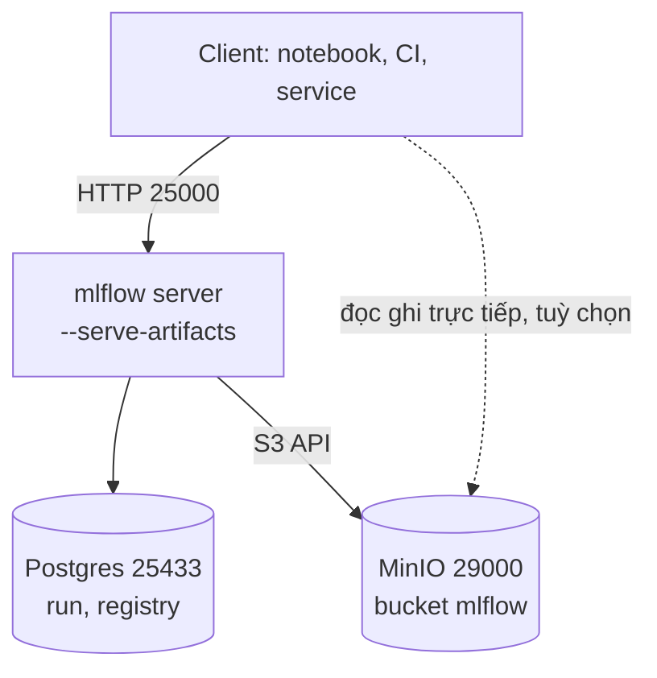
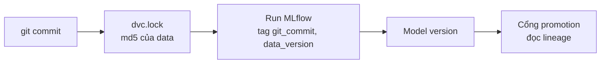
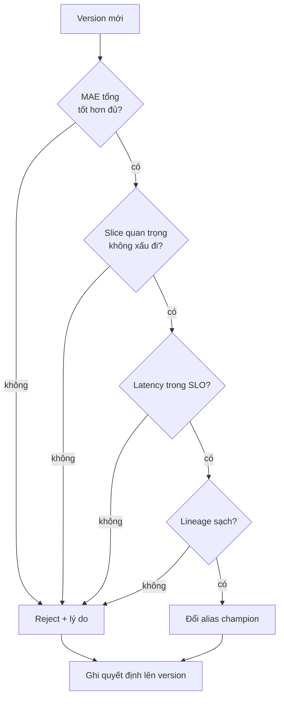

# Experiment tracking và model registry

Sau một tháng làm việc, ai cũng hỏi được câu "model đang chạy là cái nào, train từ code nào, dữ liệu nào, ai cho phép nó
lên production?". Nếu câu trả lời nằm trong đầu một người hoặc một thư mục `mlruns` trên laptop, bạn chưa có MLOps, bạn có
một thói quen. Module này dựng phần nối giữa "train xong" và "đang phục vụ": tracking có lineage, registry có alias, cổng
promotion ghi lại quyết định, và model card cho người đọc sau này.

Ví dụ xuyên suốt là service ETA taxi NYC của capstone (đo MAE theo giây, chia slice sân bay, đêm, chuyến ngắn, chuyến dài).
Bài tập Basic chạy hoàn toàn trên MLflow cục bộ (SQLite); bài Intermediate cần stack `setup/mlops`:

```bash
nice -n 15 docker compose -f setup/mlops/compose.yaml up -d --build --wait
```

Sau module này bạn sẽ:

- Dựng và dùng MLflow server thật (Postgres + MinIO) và biết những chỗ nó làm bạn bất ngờ.
- Gắn lineage `git commit` + `data_version` (từ `dvc.lock`) vào mọi run, và truy ngược từ dữ liệu tới run.
- Quản lý phiên bản model bằng alias `champion`/`challenger`, rollback bằng một lệnh, nạp đúng version.
- Viết cổng promotion: tiêu chí so với model đang chạy, slice, latency, lineage, và quyết định có thể truy lại.
- Viết model card sinh tự động, và chọn giữa MLflow, W&B, Neptune, Comet có lý do.

## 1. Ôn nhanh: tracking và registry với MLflow

Phần này chỉ ôn. Chi tiết về `MlflowClient`, signature, `log_model` và FastAPI ở module DS 14
(`tracks/data-science/modules/14-mlops-for-ds`, mục 2 và 3); đọc lại nếu bạn chưa nhớ.

| Khái niệm | Là gì | Nằm ở đâu |
| --- | --- | --- |
| Experiment, run | Nhóm các lần train; một lần train | Backend store |
| Param, metric, tag | Cấu hình, số đo (có step), nhãn tự do | Backend store |
| Artifact | Tệp: model, biểu đồ, bảng | Artifact store |
| Registered model, version | Tên model nhiều phiên bản bất biến | Backend store |
| Alias | Con trỏ có tên (`champion`) tới một version | Backend store |

```mermaid
flowchart LR
    T[Job train] -->|param metric tag| B[(Backend store<br/>Postgres)]
    T -->|model, biểu đồ| A[(Artifact store<br/>MinIO / S3)]
    B --> R[Registry<br/>version + alias]
    R -->|models:/tên@champion| S[Service]
    A --> S
```

Ba thói quen cần giữ (đã học ở DS 14, và quan trọng hơn khi nhiều người dùng chung): dùng `MlflowClient(uri)` với `run_id`
tường minh thay cho fluent API toàn cục; chọn run bằng truy vấn thay vì bằng mắt; ghi dữ liệu vào run cùng với model.

MLflow 3 có thêm khái niệm **logged model**: `log_model` trả về `model_id` riêng, và khi đăng ký phải truyền cả `model_uri` lẫn
`model_id`. Nguồn `runs:/<run>/model` kiểu MLflow 2 không còn trỏ đúng chỗ cho model log theo cách này.

## 2. MLflow server thật: Postgres, MinIO và những chỗ khó chịu

### Vì sao không dùng file store khi nhiều người

| Vấn đề | File store (`./mlruns`) | Server + database |
| --- | --- | --- |
| Ghi đồng thời | Nhiều tiến trình ghi lên cùng thư mục dễ hỏng | Database xử lý giao dịch |
| Truy vấn | Quét tệp, chậm khi vài nghìn run | Chỉ mục SQL |
| Model Registry | Không hỗ trợ đầy đủ | Cần backend database |
| Trạng thái | MLflow 3 đưa vào chế độ bảo trì, mặc định báo lỗi | Hướng đi chính thức |
| Chia sẻ | Phải chia sẻ ổ đĩa | Một URL, mọi người dùng chung |

Khi học một mình, SQLite (như `mlopskit.mlflow_local`) là đủ và không cần Docker. Khi làm việc nhóm, cần server.

### Stack của khoá học



`--serve-artifacts` cho server làm proxy: client đẩy và tải artifact qua HTTP tới MLflow, không cần khoá S3 ở máy client.
Đổi lại mọi byte artifact chạy qua server, là nút cổ chai khi model lớn.

Cấu hình client (xem `setup/mlops/README.md`):

```bash
export MLFLOW_TRACKING_URI=http://127.0.0.1:25000
export MLFLOW_ENABLE_PROXY_MULTIPART_DOWNLOAD=false
```

Biến thứ hai là bài học thực tế về "chạy trên server, treo ở client". Client MLflow 3 tự thử tải artifact trực tiếp từ
object storage bằng URL presigned; URL đó trỏ tới `minio:9000`, tên chỉ container nhìn thấy, nên `load_model` treo cho tới khi
hết lần thử lại. Tắt tải multipart bắt client quay về đường proxy. Cách xử lý đúng lâu dài là cấu hình URL công khai cho
object storage hoặc để client và server cùng một mạng; trong môi trường học, tắt biến này là cách nhanh nhất.

### Việc cần làm khi lên thật

- Backend Postgres có backup; artifact store có versioning. Hai nửa phải khôi phục về cùng thời điểm, nếu không registry trỏ
  vào artifact không còn.
- Xác thực nằm ở proxy phía trước (SSO) hoặc basic auth của MLflow; đừng mở cổng ra Internet.
- Dọn dẹp: experiment thử nghiệm xoá sau thời hạn; artifact của version đã từng lên production giữ theo yêu cầu kiểm toán.

## 3. Lineage: run, git commit và dữ liệu

Một run đáng tin khi từ nó dựng lại được ba thứ: **code** (git commit), **dữ liệu** (phiên bản), **môi trường** (lockfile,
image). Module 03 cho bạn `dvc.lock`, nơi `dvc repro` ghi hash của từng output; commit `dvc.lock` vào git nghĩa là
`git_commit` đã chốt luôn phiên bản dữ liệu. Tuy vậy vẫn nên ghi `data_version` thẳng vào run để truy vấn mà không phải
checkout.

```python
state = git_state(repo)                       # {"commit": "<40 hex>", "dirty": False}
version = data_version_from_lock("dvc.lock", "prepare")
client.create_run(experiment_id, tags={
    "git_commit": state["commit"],
    "git_dirty": str(state["dirty"]).lower(),
    "data_version": version,
})
```



Quyết định cần có:

- **Cây thư mục bẩn** (`git_dirty`) phải ghi lại. Commit hash của cây bẩn là lời nói dối; cổng promotion nên từ chối.
- **Tag hay param.** Param là cấu hình mà người ta muốn so sánh; tag là metadata để lọc và truy vết. Lineage là tag.
- **Truy ngược.** "Dữ liệu `c0ffee01` có lỗi, những model nào đã học từ nó?" là truy vấn `tags.data_version = '...'`;
  nếu không ghi, câu hỏi này không trả lời được, và đây là lúc lineage trả công.
- **Tự động bằng `mlflow.autolog`?** Fluent API tự ghi `mlflow.source.git.commit` khi chạy trong repo. Hữu ích, nhưng không
  ghi trạng thái bẩn và không biết gì về DVC. Tường minh vẫn tốt hơn.

## 4. Registry: version, alias và rollback

Version là bất biến: `taxi-eta` v7 mãi mãi là cùng artifact và cùng run. Cái thay đổi được là **alias**, con trỏ có tên tới một
version.

```python
client.create_registered_model("taxi-eta")
mv = client.create_model_version("taxi-eta", info.model_uri, run_id, model_id=info.model_id)
client.set_registered_model_alias("taxi-eta", "challenger", mv.version)
client.set_registered_model_alias("taxi-eta", "champion", mv.version)
model = mlflow.pyfunc.load_model("models:/taxi-eta@champion")
```

| Cách chỉ tới model | Ý nghĩa | Khi dùng |
| --- | --- | --- |
| `models:/taxi-eta@champion` | Model đang được duyệt cho production | Service, batch job |
| `models:/taxi-eta@challenger` | Ứng viên đang kiểm | Shadow, canary (module 07) |
| `models:/taxi-eta/7` | Đúng version 7 | Điều tra, tái lập, ghim sau khi đã phân giải alias |

Stages (`Staging`, `Production`) của MLflow đã bị deprecated, thay bằng alias và tag; alias linh hoạt hơn (đặt tên tự do)
và không giả định một vòng đời cố định. Tag thể hiện trạng thái (`approved_by`, `promotion.decision`); alias thể hiện "cái
nào đang phục vụ".

### Alias và rollback

Rollback là dời alias về version trước, một thao tác, tức thì, không train lại và không xoá version lỗi (để điều tra). Muốn
rollback không phụ thuộc trí nhớ, ghi đường lui lên version mới lúc promote (tag `previous_champion`). Service nên phân giải
alias một lần ra số version rồi nạp đúng số đó, và dùng số đó trong log và response: nếu alias bị đổi giữa hai bước, thông tin
báo cáo vẫn khớp model thật.

Service đang chạy không tự biết alias vừa đổi. Có hai cách: restart (đơn giản, có gián đoạn), hoặc poll alias định kỳ rồi nạp
lại (không gián đoạn, cần xử lý lỗi: refresh thất bại phải giữ model cũ, không được mất model). Cả hai bài trung cấp luyện hành
vi này; module 07 đưa nó vào FastAPI.

## 5. Cổng promotion

"Model mới có MAE thấp hơn" không đủ để thay model đang chạy. Cổng promotion là một hàm viết trước, có test, trả về quyết
định kèm lý do.

| Cổng | Câu hỏi | Lỗi hay gặp |
| --- | --- | --- |
| MAE tổng | Có tốt hơn đủ nhiều (vd. 1%) so với champion, trên cùng tập đánh giá? | So với số cũ lưu từ tháng trước, trên dữ liệu khác |
| Slice | Có chỗ quan trọng nào xấu đi (sân bay, ban đêm, chuyến dài)? | Trung bình tốt che slice xấu; slice nhỏ nhiễu chặn oan |
| Latency | p95 có nằm trong SLO và không quá k lần champion? | Đo trên máy train khác máy serving |
| Lineage | Tái lập được không (cây sạch, có data_version)? | Promote bản thử từ laptop |
| Tính nhất quán | Đủ số đo, không NaN, đủ slice? | Báo cáo thiếu slice nên "không có gì để so" |



Điểm thiết kế quan trọng:

- **Tính toán thuần, tác dụng phụ riêng.** `decide_promotion(challenger, champion, policy)` không đụng tới registry; lớp bọc đọc
  số đo từ run, gọi hàm, ghi tag, dời alias. Nhờ vậy test được ca biên không cần server.
- **Ngưỡng là chính sách, không phải hằng số trong code.** Đưa vào `policy` có phiên bản; thay đổi ngưỡng là một quyết định
  cần review.
- **Báo mọi cổng trượt**, không dừng ở cổng đầu tiên.
- **Ghi cả quyết định từ chối.** Tag `promotion.decision`, `promotion.reasons` trên version giúp trả lời kiểm toán và giúp
  người train biết sửa gì.
- **Biết chỗ yếu của cổng.** Cổng cho qua khi tập đánh giá quá nhỏ để slice bị bỏ qua; thử lại nhiều lần tới khi qua là
  p-hacking; quá nhiều slice thì chặn oan. Cổng là hàng rào, không phải bằng chứng.
- **Con người vẫn có chỗ.** Thay đổi lớn (loại model, feature set, nguồn dữ liệu) cần reviewer; ngoại lệ có hạn và có người
  ký. Đây là nội dung bài Advanced.

Trong capstone, cổng này sẽ chạy trong CI (module 08) và đổi alias là sự kiện kích hoạt deploy.

## 6. Model card

Model card là tài liệu ngắn đi cùng một version: dùng để làm gì và không dùng để làm gì, train trên dữ liệu nào, hiệu năng
(kể cả slice tệ nhất), hạn chế đã biết, và lineage. Ý tưởng từ "Model Cards for Model Reporting" (Mitchell et al., 2019).

Bốn nguyên tắc để nó không trở thành tài liệu chết:

- Sinh từ dữ liệu của run, không viết tay; `run_id` và `git_commit` luôn đúng với version.
- Kiểm bằng linter trong CI (đủ phần, không `TODO`, có bảng, có hạn chế).
- Slice tệ nhất đứng đầu bảng.
- Không có model card nào không có phần hạn chế: nếu không nghĩ ra, chưa ai nghĩ về nó.

Đính card vào version dưới dạng artifact của run hoặc tag trỏ tới nó để người mở version trong UI thấy ngay.

## 7. Công cụ khác: W&B, Neptune, Comet và khi nào chọn gì

| Tiêu chí | MLflow (tự host) | Weights & Biases | Neptune | Comet |
| --- | --- | --- | --- | --- |
| Mô hình | Mã nguồn mở, tự vận hành | SaaS (có self-host trả phí) | SaaS | SaaS (có on-prem trả phí) |
| Điểm mạnh | Registry tích hợp, miễn phí, kiểm soát dữ liệu | So sánh run, sweep, báo cáo, cộng tác | Quản lý metadata quy mô lớn, giao diện nhanh | Theo dõi thí nghiệm, so sánh, kiểm toán |
| Điểm yếu | Phải vận hành; UI cơ bản hơn; phân quyền mịn cần proxy | Chi phí theo số người; dữ liệu ra ngoài | Chi phí; registry không phải trọng tâm | Chi phí; hệ sinh thái nhỏ hơn |
| Hợp khi | Dữ liệu không rời mạng, cần registry, ngân sách nhỏ | Nhóm nghiên cứu DL, nhiều thí nghiệm | Nhiều run và metric rất lớn | Cần SaaS có on-prem |

Quy tắc chọn đơn giản: bắt đầu từ ràng buộc (dữ liệu được rời mạng không, ai vận hành, ngân sách), rồi mới tới tính năng.
Các dịch vụ đám mây (SageMaker, Vertex AI, Azure ML, Databricks) tích hợp tracking và registry sẵn nếu bạn đã ở đó; chi phí
của chúng là phụ thuộc nhà cung cấp. Dù chọn gì, giữ ba thứ ở dạng chuẩn để có đường thoát: tag lineage, đặt tên metric, và
định dạng model (MLflow model, ONNX).

Ở phỏng vấn, "vì sao chọn công cụ này" thường được trả lời tốt nhất bằng hai ràng buộc cụ thể và một điều bạn chấp nhận mất.

## 8. Tài liệu tham khảo

- MLflow, Model Registry: https://mlflow.org/docs/latest/ml/model-registry/
- MLflow, Tracking server và backend/artifact store: https://mlflow.org/docs/latest/ml/tracking/server/
- MLflow, logged models (MLflow 3): https://mlflow.org/docs/latest/ml/mlflow-3/
- Mitchell et al., Model Cards for Model Reporting (2019): https://arxiv.org/abs/1810.03993
- Google, MLOps: Continuous delivery and automation pipelines in ML: https://cloud.google.com/architecture/mlops-continuous-delivery-and-automation-pipelines-in-machine-learning
- Weights & Biases: https://docs.wandb.ai/ ; Neptune: https://docs.neptune.ai/ ; Comet: https://www.comet.com/docs/
- DVC, `dvc.lock`: https://dvc.org/doc/user-guide/project-structure/dvcyaml-files#dvclock-file
- Module DS 14 (ôn tracking, registry): `tracks/data-science/modules/14-mlops-for-ds`
