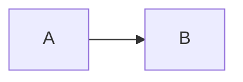

# Thiết kế

## 1. Bối cảnh và giả định

Ngắn.

## 2. Kiến trúc

## 3. Quy ước đặt tên và metadata

| Đối tượng | Quy ước | Lý do |
| --- | --- | --- |
| a | b | c |

## 4. Vai trò và quyền

| Vai trò | Được làm | Không được làm | Cơ chế thực thi |
| --- | --- | --- | --- |
| Data Scientist | Đổi alias champion trên production | Không có | Không có |

## 5. Vận hành

- một

## 6. Rủi ro và việc còn mở

- một
