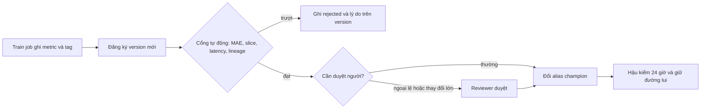

# Chính sách promotion cho dịch vụ ETA taxi NYC

## 1. Phạm vi và nguyên tắc

Chính sách áp cho mọi lần đổi alias `champion` của model `taxi-eta`. Ba nguyên tắc: quyết định dựa trên số đo do job train
ghi vào registry (không do người promote nhập tay); mọi quyết định, kể cả từ chối, được ghi lại cùng lý do trên version; và
promote luôn đảo ngược được bằng một lệnh. Chính sách đo "tốt hơn" trên bốn trục cùng lúc vì ETA phục vụ khách hàng ở
những tình huống rất khác nhau, nên một con số tổng không đại diện cho trải nghiệm.

## 2. Quy trình

## 3. Slice bảo vệ

| Slice | Vì sao quan trọng | Dung sai |
| --- | --- | --- |
| airport | Chuyến đi sân bay có giá trị cao, khách đặt trước giờ bay, ETA sai gây lỡ chuyến bay và khiếu nại | 5% |
| night | Ít xe, khách an toàn phụ thuộc vào ETA đúng; dữ liệu mỏng nên model dễ xấu đi âm thầm | 5% |
| short | Phần lớn lượng chuyến, quyết định doanh thu và trải nghiệm hằng ngày | 3% (chặt hơn vì mẫu rất lớn, nhiễu thấp) |
| long_haul | Chuyến dài, MAE tuyệt đối lớn nhất, nhạy với loss và đuôi phân phối | 5%, bỏ qua khi n dưới 200 |

## 4. Ngoại lệ và người duyệt

- Cổng tự động đủ cho thay đổi nhỏ (cùng kiến trúc, train lại). Thay đổi loại model, feature set hoặc nguồn dữ liệu cần thêm
  một reviewer thứ hai ngoài người train, ghi tên trên version.
- Ngoại lệ (ví dụ bỏ qua một slice trượt vì lý do kinh doanh) chỉ do tech lead ký, ghi bằng tag `promotion.exception` kèm
  ticket và hạn hết hiệu lực; hết hạn thì cổng chạy lại bình thường.
- Không ai được promote từ cây git bẩn hoặc không có `data_version`, kể cả có ngoại lệ: không tái lập thì không điều tra
  được khi hỏng.
- Slice quá nhỏ bị bỏ qua vì nhiễu; slice hiếm nhưng quan trọng phải được gộp thành slice đủ lớn ở bước đánh giá, không để
  nó trượt khỏi mắt cổng.

## 5. Rollback và hậu kiểm

- Rollback là đổi alias về `previous_champion` trên version hiện tại, một lệnh, không cần train lại; chạy được bởi người
  trực, không cần duyệt.
- Hậu kiểm 24 giờ sau promote: so phân phối dự đoán và MAE trên nhãn đã về (nhãn về muộn, xem module 10) với champion cũ;
  lệch quá ngưỡng thì rollback tự động và mở sự cố.
- Mỗi tháng rà các quyết định bị từ chối và các ngoại lệ: tỉ lệ từ chối cao ở một slice là dấu hiệu ngưỡng sai hoặc dữ liệu
  train thiếu slice đó.
