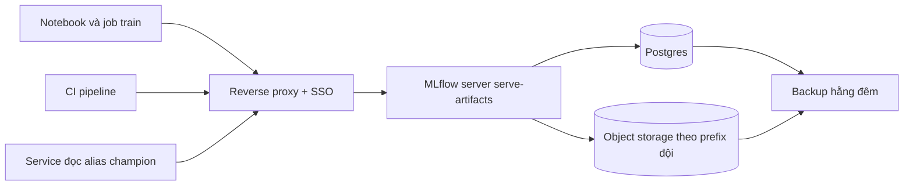

# Thiết kế registry dùng chung cho 4 đội ML

## 1. Bối cảnh và giả định

Bốn đội ML dùng chung một MLflow server duy nhất, backend Postgres, artifact trên object storage S3-compatible, đặt sau một
reverse proxy có xác thực. Mục tiêu theo thứ tự: truy vết được ai duyệt model nào dựa trên số liệu nào (kiểm toán), không
đội nào ghi đè hay đọc nhầm tài nguyên của đội khác, không mất dữ liệu khi một máy hỏng, và đủ đơn giản để 2 người vận hành.
Giả định: khoảng 30 người dùng đồng thời dưới 20, vài nghìn run mỗi tuần, artifact vài trăm GB mỗi năm; MLflow OSS không có
phân quyền theo model đủ mịn, nên phần phân quyền dựa vào proxy và quy ước, không dựa vào tính năng của MLflow. Giả định này
cần kiểm lại nếu số đội tăng gấp đôi.

## 2. Kiến trúc

## 3. Quy ước đặt tên và metadata

| Đối tượng | Quy ước | Lý do |
| --- | --- | --- |
| Registered model | `<đội>.<tên>`, ví dụ `eta.trip-duration` | Tránh va chạm tên; đội thấy ngay chủ sở hữu |
| Experiment | `/<đội>/<dự án>/<mục đích>` | Lọc theo đội, dọn theo dự án |
| Alias | Chỉ `champion` và `challenger`; không đặt alias tự do | Service nạp theo một alias cố định; alias lạ làm hỏng quy ước |
| Tag bắt buộc trên run | `git_commit`, `git_dirty`, `data_version`, `owner` | Lineage cho kiểm toán và cổng promotion |
| Tag trên version | `promotion.decision`, `promotion.reasons`, `previous_champion`, `approved_by` | Trả lời "ai duyệt dựa trên số liệu nào" |
| Artifact | Prefix `s3://mlflow/<đội>/` | Cô lập đội giá cước ở tầng object storage |

## 4. Vai trò và quyền

| Vai trò | Được làm | Không được làm | Cơ chế thực thi |
| --- | --- | --- | --- |
| Data Scientist | Tạo experiment, ghi run, đăng ký version, đặt alias challenger trong đội mình | Đổi alias champion, xoá version | Proxy lọc theo đội và phương thức; alias champion chỉ cho tài khoản dịch vụ |
| ML Engineer | Mọi quyền của DS, chạy cổng promotion, đề xuất ngoại lệ | Tự duyệt ngoại lệ, đọc artifact đội khác | Proxy và IAM theo prefix |
| CI promotion bot | Đổi alias champion sau khi cổng đạt, ghi tag quyết định | Đổi alias khi cổng trượt | Tài khoản dịch vụ riêng, token ngắn hạn, log kiểm toán |
| Tech lead đội | Ký ngoại lệ có hạn, xoá version của đội mình | Sửa lịch sử tag quyết định | Nhóm SSO, hành động ghi lại trong audit log của proxy |
| Quản trị nền tảng | Backup, nâng cấp, cấp quyền | Duyệt model của đội khác | Nhóm riêng có MFA, thay đổi qua pull request |

## 5. Vận hành

- Backup Postgres hằng đêm bằng `pg_dump` cộng WAL archive; object storage bật versioning và nhân bản sang bucket thứ hai.
  Diễn tập khôi phục mỗi quý, đo RTO thực tế (mục tiêu 4 giờ, RPO 24 giờ).
- Retention: run của experiment thử nghiệm xoá sau 90 ngày; artifact của version đã từng giữ alias champion giữ tối thiểu
  2 năm vì kiểm toán. Dọn bằng job hằng tuần chạy `gc` có chế độ dry-run trước.
- Nâng cấp MLflow: chạy thử bản sao dữ liệu trước (migration schema chỉ đi một chiều), có cửa sổ bảo trì thông báo trước.
- Giám sát: health của server, dung lượng đĩa Postgres, số lỗi 5xx của proxy, và độ trễ tải artifact; cảnh báo khi đĩa trên
  75%.
- Di chuyển từ file store của từng đội: công cụ xuất/nhập run, đội giá cước đi trước vì đã mất dữ liệu một lần.

## 6. Rủi ro và việc còn mở

- Một server là điểm sự cố chung: nếu server chết, service đã nạp model vẫn chạy nhưng không promote hay refresh được. Cần
  service cache model và chịu được registry mất vài giờ.
- MLflow OSS không cô lập đọc theo model; cô lập dựa vào proxy và prefix, có thể sai cấu hình. Rà quyền hằng quý.
- Chuyển sang dịch vụ quản lý hoặc SaaS khi: cần RBAC theo model và SSO tích hợp sẵn, số đội vượt khoảng 10, hoặc thời gian
  vận hành vượt 20% công của người vận hành; chi phí so sánh trên bảng tính thay vì cảm tính.
- Chưa quyết: nhãn model card sinh tự động hay viết tay cho model sản xuất rủi ro cao.
