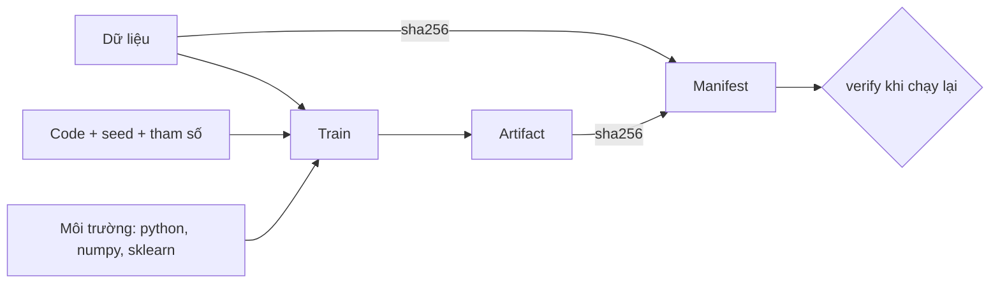
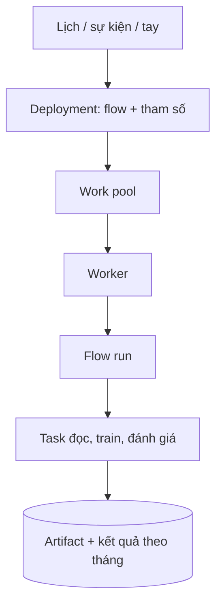
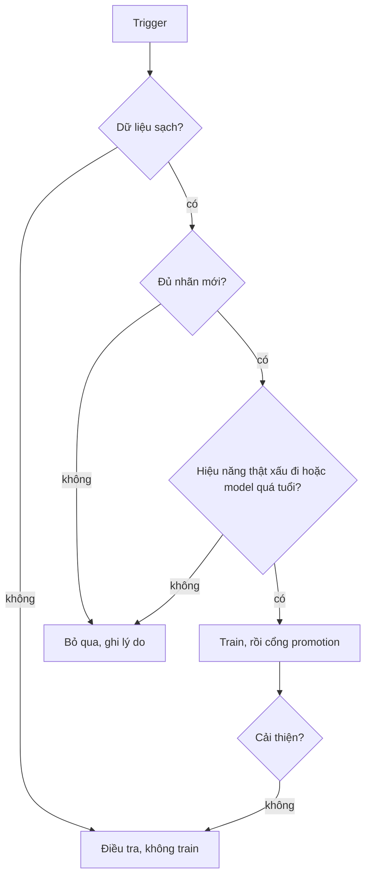

# Training pipeline và orchestration

Một model train bằng notebook chạy được một lần. Một pipeline train là thứ chạy lại được vào thứ Hai tuần sau, tháng sau, trên máy
của người khác, và cho đúng kết quả mà bạn giải thích được. Module này đi từ "tái lập được" (seed, dữ liệu, môi trường, artifact có
hash) tới "tự chạy đúng lúc" (Prefect 3: flow, task, retry, cache, schedule, backfill) rồi tới câu hỏi khó nhất của vận hành:
**khi nào** nên train lại, và vì sao không bao giờ nên train lại một cách mù quáng.

Ví dụ xuyên suốt vẫn là service ETA taxi NYC của capstone. Bài tập chạy hoàn toàn trên máy bạn: Prefect dùng một server tạm do
`prefect_test_harness()` dựng và dọn (không cần server thật), MLflow dùng SQLite, dữ liệu là các bảng tổng hợp nhỏ do test sinh
(dữ liệu thật dành cho capstone). Lần chạy đầu của mỗi bài Prefect mất khoảng 20 giây để khởi động server tạm.

Sau module này bạn sẽ:

- Ghim ba chân của tái lập (code, dữ liệu, ngẫu nhiên và môi trường) và chứng minh bằng hash của artifact.
- Viết flow Prefect có retry đúng loại lỗi, cache đúng khoá, tham số hoá theo tháng, và backfill an toàn.
- Dựng trigger "dữ liệu mới" chỉ chạy khi nội dung đổi, và phân biệt trigger với quyết định retrain.
- Chọn giữa Prefect, Airflow, Kubeflow Pipelines, ZenML, Metaflow bằng ràng buộc, không bằng sở thích.

## 0. Cài đặt

Prefect đã nằm trong môi trường mặc định của repo qua `uv`; không cần cài gì thêm.

| Công cụ | Phiên bản đã kiểm | Cách có |
| --- | --- | --- |
| Prefect | 3.9.0 | `uv sync` (đã ghim trong `pyproject.toml`, phát hành trước ngày thêm hơn 2 tuần) |
| MLflow, scikit-learn | như module 04 | `uv sync` |

Xác nhận:

```bash
uv run python -c "import prefect; print(prefect.__version__)"
uv run pytest tracks/mlops/modules/05-training-pipelines/exercises/basic/02-flow-retry -q
```

Gỡ: Prefect chỉ nằm trong `.venv` của repo, xoá `.venv` là hết. Test dùng `prefect_test_harness()` nên không để lại server hay dữ
liệu trong `~/.prefect` (thư mục lưu kết quả của test được đổi sang thư mục tạm). Nếu bạn tự chạy `prefect server start` ngoài
bài tập, dừng nó bằng Ctrl-C.

## 1. Pipeline tái lập được

"Chạy lại cho cùng kết quả" có ba chân, thiếu một là hỏng:

| Chân | Ghim bằng | Bằng chứng |
| --- | --- | --- |
| Code | git commit, cây sạch (module 04) | tag `git_commit`, `git_dirty=false` |
| Dữ liệu | hash nội dung (DVC `dvc.lock`, module 03) | `data_sha256` |
| Ngẫu nhiên và môi trường | seed tường minh, lockfile hoặc digest image, phiên bản Python/numpy/sklearn | `seed`, phiên bản trong manifest |

Chân thứ tư là **bằng chứng**: hash của artifact. Không có nó, "tái lập được" là lời hứa; có nó, tái lập là phép so sánh hai
chuỗi. Bài Basic 01 xây đúng bộ này: `data_fingerprint`, `train` với seed, `save_artifact` trả hash, `build_manifest`, `verify`.



Quyết định thực tế:

- **Seed qua tham số, không qua trạng thái toàn cục.** `np.random.seed` bị mọi thư viện chia sẻ; chỉ cần ai đó gọi nó giữa chừng là
  kết quả đổi. Truyền `random_state` cho từng đối tượng.
- **Song song có thể làm mất tất định.** Cộng số thực theo thứ tự khác nhau cho kết quả khác nhau ở bit cuối; GPU còn nhiều nguồn
  không tất định hơn. Khi cần giống từng bit, giảm song song trước và đo lại hash; khi chỉ cần "đủ gần", ghi dung sai thay vì
  hash.
- **Hash theo nội dung, không theo mtime hay đường dẫn.** `touch` và `cp` làm mtime và đường dẫn nói dối.
- **Hash khác không phải lúc nào cũng là lỗi.** Khác phiên bản numpy có thể cho hash khác mà dự đoán như nhau. Manifest cho bạn biết
  **vì sao** khác thay vì đoán.
- **Tái lập hoàn toàn đắt.** Quyết định thực dụng: tái lập từng bit cho model quyết định tiền/an toàn và cho bước kiểm tra; với
  model còn lại, tái lập "trong dung sai" cộng lineage đủ truy vết là đủ.

## 2. Prefect 3: flow, task, retry, cache, parameter

Prefect 3 biến hàm Python thường thành bước có quan sát được. `@flow` là đơn vị chạy và lập lịch; `@task` là bước bên trong có
retry, cache, trạng thái riêng. Không cần DSL hay file YAML để mô tả đồ thị; đồ thị chính là code gọi nhau.

```python
@task(retries=2, retry_delay_seconds=[5, 30], retry_condition_fn=is_transient)
def read_data(loader): ...

@task(cache_key_fn=data_cache_key)
def fit(data_path, n_estimators, seed): ...

@flow
def training_flow(month: str, min_r2: float = 0.5): ...
```

| Tính năng | Dùng để | Điều dễ sai |
| --- | --- | --- |
| `retries`, `retry_delay_seconds` | Vượt lỗi tạm thời (mạng, API) | `retries=2` là tổng 3 lần gọi; retry cho lỗi vĩnh viễn che lỗi thật |
| `retry_condition_fn` | Chỉ thử lại đúng loại lỗi | Dùng danh sách cho phép, không phải danh sách cấm |
| `cache_policy`, `cache_key_fn` | Không chạy lại bước đã có kết quả cho cùng đầu vào | Khoá chỉ băm tên (đường dẫn) thay vì nội dung dữ liệu |
| `cache_expiration` | Giới hạn tuổi cache | Cache vô hạn che việc code đã đổi |
| Parameter của flow | Một flow cho nhiều tháng, nhiều model | Tham số không phải JSON thuần thì UI/deployment không gọi được |
| `persist_result` | Giữ kết quả để cache và chạy tiếp | Kết quả lớn làm đầy kho lưu |

**Retry đặt ở đâu.** Ở bước có lỗi tạm thời (đọc dữ liệu), không ở bước train (lỗi mã hay dữ liệu sẽ lỗi lại y hệt) và không ở cả
flow (lặp lại việc đã xong). Bước được thử lại phải **idempotent**: gọi hai lần cho cùng kết quả như một lần. Thêm jitter và
backoff tăng dần ở production để nhiều flow không dội lại cùng lúc.

**Cache theo input.** Chính sách `INPUTS` băm giá trị đối số. Với dữ liệu, đối số là đường dẫn: cùng đường dẫn, nội dung khác thì
khoá giống nhau và cache trả kết quả của dữ liệu cũ. Khoá đúng gồm mọi thứ làm đầu ra đổi: hash nội dung dữ liệu, tham số, seed, và
(nếu code hay đổi) phiên bản code. Cache là tối ưu, không phải cơ chế tái lập: nó làm bạn **không chạy lại**, nên một pipeline
không tái lập vẫn trông ổn cho tới khi cache hết hạn.

**Test mà không cần server.** `prefect_test_harness()` dựng một server tạm trong tiến trình test và dọn khi xong; đây là cách test
của khoá học chạy được mà không để lại tiến trình. Hãy test hành vi (đếm lần gọi, đếm file) thay vì đọc log.

## 3. Schedule, deployment và backfill

Một flow là code; một **deployment** là "flow này, với tham số này, chạy ở đâu, khi nào". Ba cách chạy theo lịch trong Prefect 3:

| Cách | Ví dụ | Hợp khi |
| --- | --- | --- |
| `flow.serve(name=..., cron="0 3 * * 1")` | Tiến trình tự lắng nghe và chạy | Một máy, nhóm nhỏ, học và thử nghiệm |
| `flow.deploy(...)` với work pool | Worker (Docker, Kubernetes) nhận run | Nhiều môi trường, cần cô lập, GPU |
| Automation / trigger sự kiện | Chạy khi có sự kiện (dữ liệu mới, webhook) | CT theo dữ liệu hoặc cảnh báo |



### Backfill

Backfill là chạy lại pipeline cho quá khứ: sau khi sửa lỗi, thêm feature, hoặc dữ liệu về muộn. Nó nguy hiểm vì ghi vào đúng nơi
kết quả đúng đang nằm. Quy tắc:

- **Tham số hoá theo tháng logic.** Tệp đọc và khoá ghi suy ra từ `month`, không từ đồng hồ máy. Pipeline đọc "dữ liệu tháng này" bằng
  `today()` thì không backfill được.
- **Mỗi tháng một khoá ghi riêng** (`model-2026-01.joblib`) và mặc định không ghi đè; muốn tính lại phải nói rõ.
- **Idempotent:** chạy lại cùng lệnh cho cùng kết quả.
- **Một tháng lỗi không kéo cả đợt**, nhưng phải thấy được (báo cáo `done`/`skipped`/`failed`).
- **Đối soát sau backfill.** So số liệu mới với cũ theo tháng: tháng nào đổi quá ngưỡng thì dừng và xem, đừng thay thầm lặng. Kiểm
  bất biến rẻ nhất: kết quả một tháng không phụ thuộc thứ tự và không phụ thuộc các tháng khác trong đợt.
- **Ghi dấu dữ liệu nguồn** (`data_sha256`) vào kết quả để biết tháng nào cần tính lại khi nguồn bị sửa.

## 4. Continuous training: trigger và vì sao không retrain mù

CT là hệ thống quyết định khi nào train lại. Ba loại trigger:

| Trigger | Điểm mạnh | Điểm yếu |
| --- | --- | --- |
| Lịch (tuần, tháng) | Dễ đoán, dễ vận hành, bắt "tụt hậu âm thầm" | Train khi không cần, bỏ lỡ sự cố giữa kỳ |
| Dữ liệu mới (hash đổi, đủ dòng, đủ nhãn) | Phản ứng với dữ liệu thật | Hash đổi vì sửa nhỏ; nhãn về muộn |
| Cảnh báo (drift, MAE) | Phản ứng với vấn đề thật | Báo động giả; không nói nguyên nhân |

Điều cốt lõi: **trigger là lý do để xem xét, không phải lệnh train.** Mỗi trigger đi qua cùng một cổng.



**Vì sao không retrain mù:**

- Retrain tốn tính toán và thời gian người duyệt, và mỗi model mới là một rủi ro đưa vào production.
- Nếu dữ liệu đang hỏng (đổi nguồn, đổi đơn vị, null tăng đột ngột), retrain dạy model học đúng cái hỏng đó.
- Drift của đầu vào không đồng nghĩa dự đoán sai (mùa vụ, lễ): kiểm hiệu năng trên nhãn thật trước.
- Nhãn về muộn: train trên phần có nhãn là train trên mẫu thiên lệch.
- Vòng lặp "alert, retrain, alert": nếu retrain trước không giải quyết, retrain tiếp không giải quyết; thất bại của lần trước là thông tin.

Guardrail thực tế: cooldown sau mỗi retrain, ngưỡng nhãn tối thiểu, trần số lần retrain mỗi tuần, kiểm chất lượng dữ liệu trước
mọi trigger, cổng promotion (module 04) cho model mới, và giám sát chính pipeline CT (không chạy trong 2 chu kỳ thì báo).
Quyết định bỏ qua cũng được ghi lại, để sau này trả lời được "vì sao model không đổi trong ba tháng". Phần quyết định drift thật
sự (retrain, rollback hay giữ nguyên) mở rộng ở module 10.

## 5. Ôn nhanh: Airflow

Phần này chỉ ôn. Chi tiết DAG, operator, scheduler, sensor và backfill của Airflow ở DE `05-batch-pipelines`
(`tracks/data-engineer/modules/05-batch-pipelines`); đọc lại nếu bạn chưa nhớ.

| Khía cạnh | Airflow | Prefect 3 |
| --- | --- | --- |
| Đơn vị | DAG khai báo, lịch cố định | Hàm Python có tham số, dynamic |
| Chạy thử cục bộ | Cần scheduler và metadata DB | Chạy hàm trực tiếp, `prefect_test_harness` |
| Backfill | Mô hình `data_interval` có sẵn | Tự quản tham số `month`, linh hoạt hơn nhưng kỷ luật hơn |
| Hệ sinh thái | Rất lớn (operator, provider) | Nhỏ hơn, tích hợp qua Python |
| Khi chọn | Đã có Airflow và đội vận hành; ELT theo lịch | Nhóm nhỏ, ML, tham số động, ít hạ tầng |

Không có cái nào "tốt hơn" tuyệt đối. Nếu công ty đã vận hành Airflow cho ELT, chạy pipeline ML ở đó cũng là lựa chọn hợp lý; lý do để
thêm Prefect là ràng buộc cụ thể (tham số động, chạy local, nhóm DS không muốn viết DAG).

## 6. Kubeflow Pipelines, ZenML, Metaflow và chọn gì

| Công cụ | Mô hình | Hợp khi | Điều chấp nhận mất |
| --- | --- | --- | --- |
| Prefect 3 | Hàm Python, server + worker | Nhóm nhỏ, tham số động, chạy local và VM | Hệ sinh thái operator nhỏ |
| Airflow | DAG theo lịch | Đã có, ELT | Tham số động và chạy thử cục bộ kém |
| Kubeflow Pipelines | Component container trên Kubernetes | Đã có K8s, nhiều job GPU | Phải có và vận hành cụm; vòng lặp phát triển chậm |
| ZenML | Lớp trừu tượng "stack" bao orchestrator, artifact store | Muốn đổi backend không viết lại | Thêm một lớp khái niệm |
| Metaflow | Decorator trên flow, mạnh với AWS | Đã ở AWS, nhóm DS thích decorator | Kém hợp on-prem |

Quy tắc chọn: bắt đầu từ ràng buộc (ai vận hành lúc 3 giờ sáng, chạy ở đâu, đơn vị công việc là gì), rồi mới tới tính năng. Điều
kiện đổi công cụ phải đo được ("khi có 3 job cần GPU", "khi số pipeline vượt 30"), không phải "khi lớn hơn". Ở phỏng vấn, câu
trả lời tốt nhất cho "vì sao công cụ này" gồm hai ràng buộc cụ thể và một điều bạn chấp nhận mất.

## 7. Tài liệu tham khảo

- Prefect 3, Flows và Tasks: https://docs.prefect.io/v3/concepts/flows ; https://docs.prefect.io/v3/concepts/tasks
- Prefect 3, Caching: https://docs.prefect.io/v3/concepts/caching
- Prefect 3, Retries: https://docs.prefect.io/v3/concepts/tasks#retries
- Prefect 3, Deployments và schedules: https://docs.prefect.io/v3/concepts/deployments ; https://docs.prefect.io/v3/concepts/schedules
- Prefect, Testing flows: https://docs.prefect.io/v3/how-to-guides/workflows/test-workflows
- Google, MLOps: Continuous delivery and automation pipelines in ML: https://cloud.google.com/architecture/mlops-continuous-delivery-and-automation-pipelines-in-machine-learning
- Sculley et al., Hidden Technical Debt in Machine Learning Systems (2015): https://papers.nips.cc/paper/2015/hash/86df7dcfd896fcaf2674f757a2463eba-Abstract.html
- Kubeflow Pipelines: https://www.kubeflow.org/docs/components/pipelines/ ; ZenML: https://docs.zenml.io/ ; Metaflow: https://docs.metaflow.org/
- Module DE 05-batch-pipelines (ôn Airflow): `tracks/data-engineer/modules/05-batch-pipelines`
- Module 03 (dữ liệu có phiên bản) và 04 (tracking, registry, cổng promotion): `tracks/mlops/modules/03-data-versioning-quality`, `tracks/mlops/modules/04-tracking-registry`
