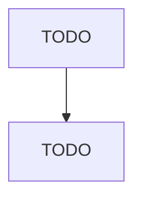

# Chính sách continuous training cho ETA

## 1. Nguyên tắc

TODO

## 2. Luồng quyết định

## 3. Các loại trigger

| Trigger | Chạy train khi | Bỏ qua khi |
| --- | --- | --- |
| TODO | TODO | TODO |

## 4. Guardrail

- TODO

## 5. Quan sát và hậu kiểm

- TODO
