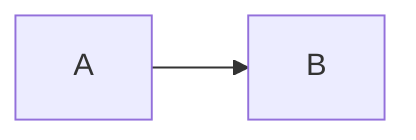

# Chọn orchestrator

## 1. Bối cảnh và ràng buộc

Ngắn.

## 2. Kiến trúc

## 3. So sánh công cụ

| Công cụ | Hợp khi | Chi phí vận hành | Quyết định |
| --- | --- | --- | --- |
| Prefect | tốt | thấp | chọn |
| Airflow | tốt | cao | chọn |

## 4. Quy ước vận hành

- dùng retry

## 5. Rủi ro và điều kiện đổi công cụ

- khi lớn hơn
