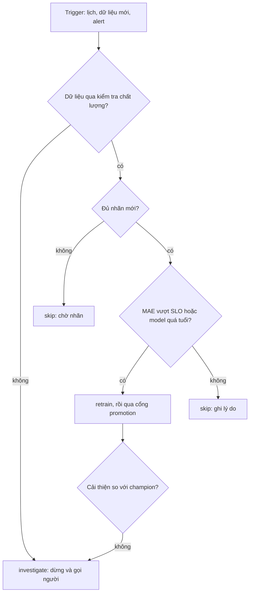

# Chính sách continuous training cho ETA

## 1. Nguyên tắc

Retrain là hành động tốn tiền và có rủi ro (model mới có thể tệ hơn, pipeline hỏng, dữ liệu lỗi bị học vào). Một trigger chỉ
là lý do để xem xét, không phải lệnh. Mỗi trigger đi qua cùng một luồng: kiểm chất lượng dữ liệu, kiểm tác động lên hiệu năng
thật (MAE trên nhãn đã về), rồi mới quyết định retrain, skip hoặc investigate. Mọi quyết định, kể cả skip, được ghi lại kèm lý
do để sau này truy được vì sao model không đổi.

## 2. Luồng quyết định

## 3. Các loại trigger

| Trigger | Chạy train khi | Bỏ qua khi |
| --- | --- | --- |
| Lịch (tuần/tháng) | Model quá tuổi tối đa, hoặc có đủ dữ liệu có nhãn và MAE đã tệ đi | Dữ liệu mới quá ít, MAE sát baseline |
| Dữ liệu mới (hash đổi) | Đủ tỉ lệ dòng mới đã có nhãn và hiệu năng giảm | Nhãn chưa về đủ, hoặc hash đổi vì sửa nhỏ |
| Alert drift (PSI) | MAE trên nhãn thật cũng xấu đi | PSI cao nhưng MAE không đổi (mùa vụ) |
| Alert hiệu năng (MAE) | Dữ liệu sạch, ngoài cooldown, nhãn đủ | Null rate/schema đổi (investigate), hoặc đang trong cooldown |

## 4. Guardrail

- Cooldown 24 giờ sau mỗi lần retrain; alert lặp trong cooldown chuyển thành investigate vì retrain lần trước không giải quyết được.
- Cần tối thiểu 20% dòng mới có nhãn; nhãn về muộn thì tính theo độ trễ nhãn, không đo trên dữ liệu chưa có nhãn.
- Kiểm chất lượng (null rate, schema, đơn vị) chạy trước mọi trigger; không train trên dữ liệu chưa qua kiểm tra.
- Mỗi lần retrain qua cổng promotion của module 04; model mới không tự lên production.
- Ngân sách: tối đa số lần retrain mỗi tuần, vượt thì cần người duyệt.

## 5. Quan sát và hậu kiểm

- Ghi mỗi quyết định trigger (kể cả skip) với số liệu và lý do; xem lại hằng tháng tỉ lệ retrain hữu ích.
- Đo chi phí và thời gian mỗi lần retrain, so với mức cải thiện MAE mang lại.
- Alert khi pipeline CT không chạy trong 2 chu kỳ lịch (chính CT cũng cần giám sát).
