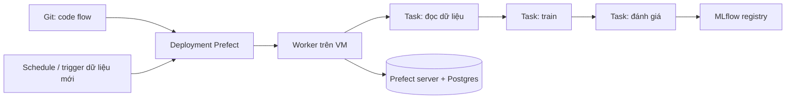

# Chọn orchestrator cho pipeline training

## 1. Bối cảnh và ràng buộc

Nhóm có 4 Data Scientist và 2 Data Engineer, chạy train hằng tuần cho 6 model và batch scoring hằng ngày trên một máy ảo
dùng Docker Compose; Kubernetes dự kiến sau khoảng 12 tháng. Nhóm DE đã vận hành Airflow cho ELT. Yêu cầu: retry cho bước
đọc dữ liệu, tham số hoá theo tháng, backfill có kiểm soát, chạy thử trên laptop không cần cụm, và không thêm người trực.
Đội DS viết Python thuần và không muốn học một DSL riêng. Ngân sách hạ tầng nhỏ, không có nền tảng đám mây quản lý.

## 2. Kiến trúc

## 3. So sánh công cụ

| Công cụ | Hợp khi | Chi phí vận hành | Quyết định |
| --- | --- | --- | --- |
| Prefect 3 | Python thuần, tham số hoá, chạy local và trên VM, nhóm nhỏ | Thấp: một server và worker | chọn |
| Airflow | Đã có cho ELT, DAG lịch cố định, nhiều operator | Trung bình, đã có người vận hành; DAG hướng lịch, tham số động kém linh hoạt hơn | theo dõi: dùng chung nếu DE muốn gom lịch |
| Kubeflow Pipelines | Đã có Kubernetes, cần GPU, component container hoá | Cao: cần cụm và người vận hành | loại: chưa có K8s |
| ZenML | Muốn lớp trừu tượng stack (artifact store, orchestrator) bao ngoài | Thấp tới trung bình, thêm một lớp khái niệm | theo dõi |
| Metaflow | Nhóm DS thích decorator, chạy AWS Batch | Thấp nếu ở AWS, kém hợp khi on-prem | loại: không ở AWS |

## 4. Quy ước vận hành

- Mọi flow nhận tham số `month` và đọc dữ liệu theo tháng đó, không bao giờ theo ngày chạy; nhờ vậy backfill an toàn.
- Mỗi bước ghi kết quả theo khoá logic (tháng, hash dữ liệu) và idempotent: chạy lại cho cùng đầu vào cho cùng đầu ra.
- Retry chỉ cho lỗi tạm thời (mạng, timeout) với số lần và độ trễ cố định; lỗi dữ liệu thì dừng.
- Backfill chạy tuần tự hoặc song song có giới hạn, có chế độ không ghi đè mặc định và báo cáo tháng nào đã chạy, tháng nào lỗi.
- Flow nằm trong Git, deployment sinh từ CI; không sửa flow trực tiếp trên server.

## 5. Rủi ro và điều kiện đổi công cụ

- Prefect server là điểm sự cố mới: có backup Postgres, và flow train vẫn chạy được local để đỡ lúc server hỏng.
- Chuyển sang Kubeflow khi có ít nhất 3 job cần GPU hoặc khi đã có cụm Kubernetes sản xuất với đội vận hành riêng.
- Gom về Airflow nếu số pipeline ML vượt 30 và DE nhận vận hành chung, để chỉ còn một lịch chạy.
- Nếu hơn 50% thời gian của DS dành cho sửa hạ tầng orchestrator trong hai quý liên tiếp, xem lại lựa chọn.
