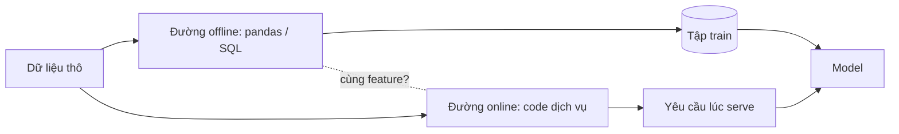
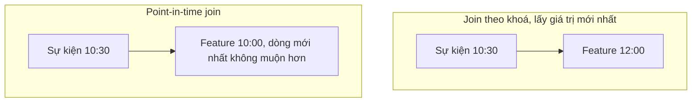
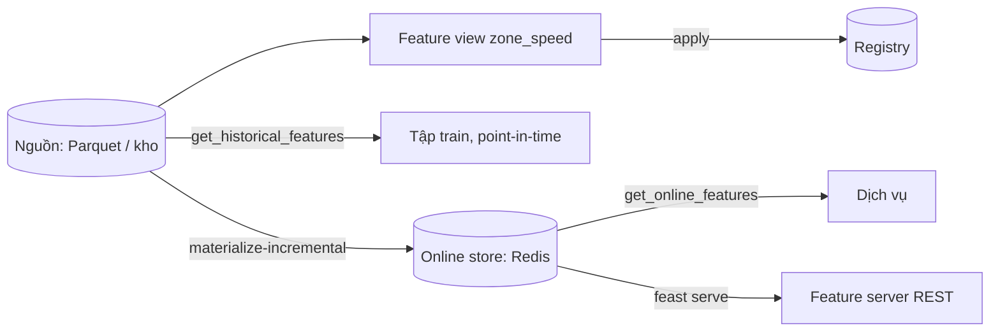

# Feature store và training-serving skew

Một model giá cước chạy tốt trên tập kiểm thử, lên production thì tệ, và không có gì "hỏng": không exception, không alert, chỉ có
số sai. Loại lỗi này là lý do feature store tồn tại, nhưng nhiều đội mua công cụ trước khi hiểu mình đang chữa bệnh gì. Module
này đi từ bệnh (training-serving skew, rò rỉ thời gian) tới thuốc (point-in-time join, một nguồn tính feature, Feast với online
store Redis) và dạy cả khi nào **không** nên dùng thuốc.

Ví dụ xuyên suốt là dữ liệu chuyến taxi NYC tháng 3/2019: tốc độ trung bình theo zone và giờ, giá cước dự đoán. Bài Basic chạy hoàn toàn bằng
pandas; hai trong ba bài Intermediate cần Redis của stack (profile `feast`):

```bash
nice -n 15 docker compose -f setup/mlops/compose.yaml --profile feast up -d --wait
```

Sau module này bạn sẽ:

- Kể tên và nhận ra các nguồn skew, đo skew bằng báo cáo thay vì đoán.
- Viết point-in-time join bằng `pd.merge_asof` và giải thích vì sao join "giá trị mới nhất" làm offline đẹp giả.
- Dựng feature repo Feast: entity, feature view, `apply`, `materialize-incremental`, đọc online qua Redis và qua feature server.
- Giữ parity giữa batch và online bằng một hàm tính chung và test ca biên.
- Quyết định có nên dùng feature store, và nếu có thì Feast, Tecton hay Hopsworks.

## 0. Cài đặt

Feast là công cụ mới của track, và nó có một ràng buộc đặc biệt: `feast[redis]` kéo `pandas` xuống 2.3.3, trong khi môi trường
mặc định của repo cần `pandas` mới hơn cho các track khác. Vì vậy Feast **không** vào môi trường mặc định; nó chạy trong một
container nhỏ. Code pandas của bạn (tính feature) vẫn chạy ở host; chỉ phần đăng ký, materialize và lấy feature chạy trong container.

| Thành phần | Phiên bản đã kiểm | Nguồn |
| --- | --- | --- |
| Feast (`feast[redis]`) | 0.67.0 | PyPI, ghim trong `setup/mlops/feast/Dockerfile` |
| Python trong image | 3.12.11 (`python:3.12.11-slim`) | Docker Hub |
| Redis (online store) | 7.4.5 | Docker Hub, service `redis` trong `setup/mlops/compose.yaml` |

```bash
uv run python -c "import mlopskit; print(mlopskit.feast_image())"
docker image inspect mlops-feast:0.67.0 --format '{{.Id}} {{.Size}}'
nice -n 15 docker compose -f setup/mlops/compose.yaml --profile feast up -d --wait
```

Lệnh đầu build image (một lần, vài phút) nếu chưa có và in tên image; lệnh hai in digest của image đã build để bạn đối chiếu
giữa các máy (phiên bản Feast được ghim, chưa ghim hash từng gói). Kiểm Feast chạy:

```bash
uv run python - <<'PY'
import tempfile, pathlib, mlopskit
repo = pathlib.Path(tempfile.mkdtemp())
print(mlopskit.feast_run(repo, "version").stdout)
PY
```

Kết quả có dạng `Feast SDK Version: "0.67.0"`. Cách gọi trong mã của bạn:

- `mlopskit.feast_run(repo, "apply", network="mlops_default")` chạy `feast apply` với `repo` mount ở `/repo`, user không root, `--rm`.
- `mlopskit.feast_python(repo, script, network="mlops_default")` chạy `python -c script`; script in JSON ra stdout, bạn đọc lại ở host.
- Đặt `network="mlops_default"` khi lệnh cần Redis: trong container, Redis là `redis:6379` (host dùng cổng `127.0.0.1:26390`).

Gỡ: `docker compose -f setup/mlops/compose.yaml --profile feast down` (Redis) và `docker image rm mlops-feast:0.67.0`.

## 1. Training-serving skew: nguồn và cách nhận ra

Training-serving skew là hiện tượng **cùng thực thể, cùng thời điểm, nhưng feature lúc train khác feature lúc serve**. Nó khác
drift: drift là thế giới đổi theo thời gian (module 10), skew có ngay ngày đầu, và sửa nó không cần train lại, cần sửa đường tính.



Các nguồn skew hay gặp:

| Nguồn | Ví dụ | Dấu hiệu |
| --- | --- | --- |
| Code tiền xử lý ở hai nơi | Notebook viết bằng pandas, dịch vụ viết lại bằng ngôn ngữ khác; hai bản làm tròn, xử lý null, thứ tự category khác nhau | Lệch nhỏ khắp nơi hoặc lệch lớn ở một cột |
| Dữ liệu khác thời điểm | Feature lúc train tính bằng cả ngày hôm đó, lúc serve chỉ có dữ liệu tới thời điểm hỏi; hoặc join "giá trị mới nhất" cho mẫu quá khứ | Offline đẹp bất thường, production tệ |
| Default khác nhau | Train điền thiếu bằng trung vị, serve điền 0; cột thiếu ở serve nhiều hơn ở train | `null_mismatch` trong báo cáo skew |
| Nguồn dữ liệu khác nhau | Train đọc từ kho đã làm sạch, serve đọc từ dịch vụ thô | Số dòng và phân phối khác ở cùng thực thể |
| Phiên bản logic khác nhau | Train dùng định nghĩa feature v2, dịch vụ vẫn v1 | Lệch xuất hiện sau một lần deploy |

Skew nguy hiểm vì **im lặng**. HTTP 200, độ trễ bình thường, không exception. Chỉ chất lượng dự đoán sai, mà chất lượng chỉ đo được khi nhãn
về, vài ngày tới vài tuần sau. Cách phát hiện sớm: so feature của cùng thực thể giữa hai đường (bài `03-skew-report`), ghi log
feature online để so định kỳ, và có test parity trong CI (mục 4).

Phân biệt trước khi hành động: model tệ ngay ngày đầu với dữ liệu nhìn giống train thì nghi skew trước; tệ dần theo tuần thì nghi
drift. Phản xạ "train lại" không chữa được skew, vì model mới học đúng trên đường offline sai lệch như cũ.

## 2. Point-in-time correctness

Khi dựng tập train, mỗi mẫu (sự kiện tại thời điểm `t`) chỉ được dùng giá trị feature mà hệ thống **đã biết tại `t`**. Nối theo khoá
với bảng "giá trị mới nhất" đưa thông tin tương lai vào mẫu quá khứ: offline đẹp giả, production tệ, và không có lỗi nào để báo.



- `feature_ts` phải là lúc giá trị **khả dụng**, không phải lúc nó mô tả. Trung bình giờ 10:00–11:00 chỉ tính xong lúc 11:00.
- `pd.merge_asof(direction="backward", by=key)` làm đúng phép này; bài `01-point-in-time-join` bắt bạn viết nó và kiểm bằng phép tìm vét cạn.
- **TTL/tolerance:** giá trị cũ quá ngưỡng coi như thiếu. Offline và online phải dùng cùng ngưỡng, nếu không train thấy giá trị mà serve không thấy.
- Bằng nhau thì vẫn lấy: feature có `feature_ts` đúng bằng thời điểm sự kiện được dùng. Test duy nhất đáng có: với mọi dòng của tập train, `feature_timestamp <= event_ts`. Một dòng vi phạm là rò rỉ.

Cái giá: tập train theo point-in-time cần lịch sử feature (mỗi giá trị cùng thời điểm hiệu lực), nên lưu bảng feature dạng chuỗi
thời gian chứ không ghi đè.

## 3. Feast: entity, feature view và hai kho

Feast tách **định nghĩa** feature (Git, `apply`) khỏi **lưu trữ**: offline store cho train, online store cho serve, registry giữ metadata.



| Khái niệm | Là gì | Trong bài tập |
| --- | --- | --- |
| `Entity` | Thực thể và khoá nối (`join_keys`) | `zone` khoá `zone_id` |
| `FeatureView` | Nhóm feature từ một nguồn, có `schema`, `ttl` | `zone_speed` |
| `FileSource` | Nguồn dữ liệu, có `timestamp_field` | `data/zone_stats.parquet` |
| `FeatureService` | Nhóm feature view mà một model dùng | `zone_service` |
| `apply` | Đăng ký định nghĩa vào registry, tạo bảng online | `feast apply` |
| `materialize-incremental` | Chép giá trị mới nhất kể từ lần chạy trước từ offline sang online | Chạy theo lịch |

Điều cần nhớ:

- **Online chỉ có dữ liệu sau materialize.** Không materialize thì online rỗng, và nếu job trễ thì online cũ. Cần lịch và cảnh báo trễ.
- **`ttl` ảnh hưởng cả hai phía:** offline bỏ giá trị cũ hơn ttl; materialize lần đầu lấy từ `now - ttl`. Đặt ttl theo chu kỳ cập nhật.
- **Thực thể không có dữ liệu trả `None`**, không lỗi. Dịch vụ phải có default tường minh và đếm tỉ lệ dùng default.
- **Feature server** (`feast serve`) phơi `POST /get-online-features`: dịch vụ không phải nhúng SDK. Kết quả theo cột (`metadata.feature_names`
  và `results[i].values/statuses`), cột khoá thực thể cũng có mặt; đọc theo tên, và xử lý `null` kể cả khi `status` là `PRESENT`.
- **Redis dùng chung** cần tên project riêng và `teardown` khi xong, nếu không các test hoặc đội đè lên nhau.
- Feast 0.67 chạy trong container (mục 0) vì kéo `pandas` cũ; định nghĩa trong repo chỉ khai báo, việc tính feature vẫn bằng pandas ở host.

## 4. Parity batch và online: một hàm cho hai đường

Thuốc rẻ nhất cho skew do code hai nơi là **không có hai nơi**: một hàm tính feature, train gọi trên cả bảng, serve gọi trên một dòng.

```python
def compute_features(df): ...
def train_matrix(df):  return compute_features(df)
def serve_one(request): return compute_features(pd.DataFrame([request])).iloc[0].to_dict()
```

- **Hàm vector hoá là nguồn sự thật**, đường online chỉ chuyển đổi hợp đồng API sang cột đầu vào của hàm đó. Đừng viết lại cho "nhanh".
- **Khai báo default một chỗ** (hằng có tên) và thêm cột cho biết giá trị là thật hay điền hộ (`zone_known`).
- **Bảng ca biên là test:** giờ 23 sang 0, phút 21:59 và 22:00, thứ Sáu 23:59 và thứ Bảy 00:00, thiếu zone, số âm, bảng rỗng. Các lỗi này ở biên
  lệch rất ít mẫu nên số tổng hợp không bao giờ lộ ra.
- **Test parity bằng dữ liệu thật:** phát lại N chuyến qua cả hai đường, so từng cột; đây là phiên bản nhỏ của kiểm tra mà bạn cũng
  chạy mỗi đêm trên production (lấy mẫu thực thể, so online với offline cùng thời điểm).
- **Ghi hợp đồng đầu vào đầy đủ và kiểm nó ở cả hai phía** (người gọi và dịch vụ).

Feature store giải bài toán này ở quy mô nhiều model: định nghĩa ở một nơi, hai kho đọc cùng một nguồn. Nhưng nếu bạn có một model một
đội, một hàm chung cộng test parity thường là đủ.

## 5. Khi nào không cần feature store

Feature store thêm một điểm sự cố mới (online store), một thứ phải vận hành, và một lớp trừu tượng để học. Trả giá đó chỉ đáng khi có
vấn đề mà nó giải. Hãy hỏi:

| Câu hỏi | Nếu "không" |
| --- | --- |
| Có ai tra feature theo thực thể trong vài chục mili giây không? | Không cần online store; bảng trong kho là đủ |
| Có nhiều model hoặc nhiều đội dùng chung feature không? | Một thư viện hoặc một bảng dùng chung là đủ |
| Có feature phụ thuộc thời gian cần point-in-time trên quy mô lớn không? | `merge_asof` hoặc SQL có `ASOF JOIN` là đủ |
| Đội có người vận hành nó không? | Đừng tự host; cân nhắc dịch vụ quản lý hoặc chưa làm |

Các ca thường **chưa** cần: model chạy theo lô, feature tính bằng SQL từ kho; feature đến từ chính thân yêu cầu; một model một đội;
feature tổng hợp theo tháng chia sẻ qua dbt. Skew do viết lại ở hai nơi chữa bằng hàm dùng chung và test parity, không bằng mua công cụ.
Bài `02-do-we-need-a-store` (Advanced) luyện đúng quyết định này.

## 6. Feast, Tecton, Hopsworks và các lựa chọn khác

| Tiêu chí | Feast | Tecton | Hopsworks | Tự xây (bảng + hàm chung) |
| --- | --- | --- | --- | --- |
| Mô hình | Mã nguồn mở, tự host | Dịch vụ quản lý | Mã nguồn mở và quản lý | Mã của đội |
| Streaming feature | Hạn chế, tự ghép | Mạnh, SLA | Có (Spark/Flink) | Tự viết |
| Vận hành | Bạn lo online store và lịch materialize | Họ lo | Tuỳ gói | Bạn lo |
| Hợp khi | Nhiều model dùng chung feature, batch theo giờ, đội biết vận hành | Streaming, SLA, kiểm toán, ngân sách | Muốn tích hợp trọn nền tảng ML trên hạ tầng riêng | Một model, một đội |
| Điều bạn đổi | Tự lo mọi thứ khác ngoài định nghĩa | Chi phí và phụ thuộc nhà cung cấp | Độ nặng của nền tảng | Không có tái sử dụng |

Quy tắc chọn: bắt đầu từ ràng buộc (độ tươi, độ trễ, số model, đội vận hành), rồi mới tính năng. Giữ đường thoát: định nghĩa
feature là mã trong Git, nguồn là bảng chuẩn (Parquet), nên chuyển công cụ là chuyển lớp phục vụ chứ không viết lại logic.
Các nền tảng đám mây (SageMaker, Vertex AI, Databricks) có feature store tích hợp nếu bạn đã ở đó; đổi lại là phụ thuộc nhà cung cấp.

## 7. Tài liệu tham khảo

- Feast, tài liệu: https://docs.feast.dev/
- Feast, feature server (`feast serve`): https://docs.feast.dev/reference/feature-servers/python-feature-server
- Feast, point-in-time joins: https://docs.feast.dev/getting-started/concepts/point-in-time-joins
- pandas, `merge_asof`: https://pandas.pydata.org/docs/reference/api/pandas.merge_asof.html
- Sculley et al., Hidden Technical Debt in Machine Learning Systems (2015): https://papers.nips.cc/paper/2015/hash/86df7dcfd896fcaf2674f757a2463eba-Abstract.html
- Google, Rules of Machine Learning (Rule 37, đo skew): https://developers.google.com/machine-learning/guides/rules-of-ml
- Tecton: https://docs.tecton.ai/ ; Hopsworks: https://docs.hopsworks.ai/
- Module DS 14 (ôn pipeline và serving cơ bản): `tracks/data-science/modules/14-mlops-for-ds`
