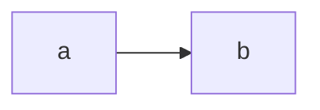

# Thiết kế yếu

## 1. Bối cảnh và giả định

Chúng tôi dùng feature store vì mọi công ty lớn đều dùng.

## 2. Kiến trúc

## 3. Danh mục feature

| Feature | Nguồn và cách tính | Cần online? |
| --- | --- | --- |
| speed | trung bình | có |

## 4. Chống training-serving skew

- Cẩn thận khi code.

## 5. Vận hành

- Chạy hàng ngày.

## 6. Rủi ro và việc còn mở

- Chưa có.
