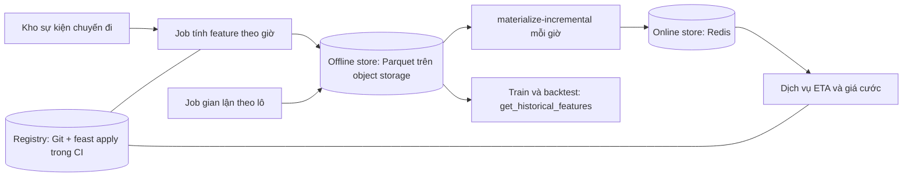

# Thiết kế nền tảng feature cho 3 model taxi

## 1. Bối cảnh và giả định

Công ty taxi có ba model: ETA (phục vụ trong ứng dụng, độ trễ dưới 100 ms, mỗi yêu cầu cần tốc độ trung bình theo zone), giá
cước động (cần số chuyến đang chờ theo zone, tươi trong 5 phút) và phát hiện gian lận (chạy theo lô mỗi đêm, cần lịch sử 30
ngày của tài xế). Ba nhóm đang tự viết lại cùng một đoạn tính tốc độ theo zone, ba lần cho ra ba con số khác nhau, và ETA đã
từng lệch giữa train với serve hai tuần mà không ai biết. Đội nền tảng chỉ có 2 người, hạ tầng là một cụm Postgres, một
object storage, một Redis, chưa có đám mây quản lý. Giả định: lưu lượng 50 yêu cầu mỗi giây ở giờ cao điểm, dữ liệu sự kiện
đổ về kho theo lô mỗi giờ, chưa có luồng streaming.

## 2. Kiến trúc

Một nguồn tính feature duy nhất (job theo giờ) ghi vào offline store; online store chỉ nhận qua materialize, không có đường
ghi riêng. Registry nằm trong Git, thay đổi qua pull request và CI chạy `feast apply`.

## 3. Danh mục feature

| Feature | Nguồn và cách tính | Cần online? |
| --- | --- | --- |
| zone_avg_speed_1h | Trung bình tốc độ chuyến đã kết thúc trong giờ trước, theo zone đón | có |
| zone_trip_count_1h | Số chuyến bắt đầu trong giờ trước theo zone | có |
| zone_pending_requests_5m | Số yêu cầu chưa ghép xe trong 5 phút, theo zone | có |
| driver_trips_30d | Số chuyến của tài xế trong 30 ngày | không |
| driver_cancel_rate_30d | Tỷ lệ huỷ chuyến của tài xế trong 30 ngày | không |
| zone_surge_history_7d | Hệ số giá cước trung bình theo giờ trong tuần qua | không |

## 4. Chống training-serving skew

- Một định nghĩa duy nhất cho mỗi feature: job theo giờ là mã duy nhất tính feature; train, serve và job gian lận đều đọc
  kết quả của nó, không ai tính lại ở nơi khác.
- Point-in-time correctness: mọi tập train lấy qua `get_historical_features` với thời điểm sự kiện; có test chặn feature
  có timestamp lớn hơn thời điểm sự kiện.
- Parity batch và online: mỗi đêm lấy mẫu 1000 thực thể, so giá trị online với offline cùng thời điểm; lệch quá ngưỡng thì
  chặn đưa model mới lên.
- Default thiếu dữ liệu được khai báo một chỗ (cùng tệp định nghĩa feature), cả train và serve dùng chung; ghi lại tỷ lệ
  thực thể rơi vào default như một metric.
- Mọi thay đổi định nghĩa feature tăng phiên bản (`zone_avg_speed_1h_v2`), không sửa tại chỗ.

## 5. Vận hành

- Materialize: `materialize-incremental` mỗi giờ sau khi job tính xong; cảnh báo nếu lần chạy trễ quá 20 phút hoặc thất bại.
- TTL: đặt bằng 3 lần chu kỳ cập nhật (3 giờ cho feature theo giờ); feature quá TTL trả về rỗng thay vì số cũ, dịch vụ rơi về default.
- Backfill: khi đổi định nghĩa hoặc thêm feature, tính lại lịch sử vào offline store trước, rồi mới materialize; tập train cũ ghi phiên bản feature.
- Redis: bật persistence và đặt `maxmemory` với chính sách không xoá khoá; dung lượng tính theo số zone nhân số feature, nhỏ so với bộ nhớ.
- Registry đổi qua pull request; môi trường staging có Redis riêng để thử `apply` trước production.

## 6. Rủi ro và việc còn mở

- Redis chết thì ETA mất feature: dịch vụ dùng default và bật cờ "chất lượng thấp"; việc còn mở là thử diễn tập sự cố.
- Feature 5 phút (`zone_pending_requests_5m`) vượt khả năng job theo giờ; cần streaming (Flink hoặc Kafka) hoặc tính ở dịch vụ; chưa quyết định.
- Nếu đội tăng lên nhiều model hơn hay cần streaming, đánh giá chuyển sang Tecton hoặc Hopsworks; ngưỡng: quá 15 feature view online hoặc đội nền tảng mất hơn 30% thời gian vào vận hành.
