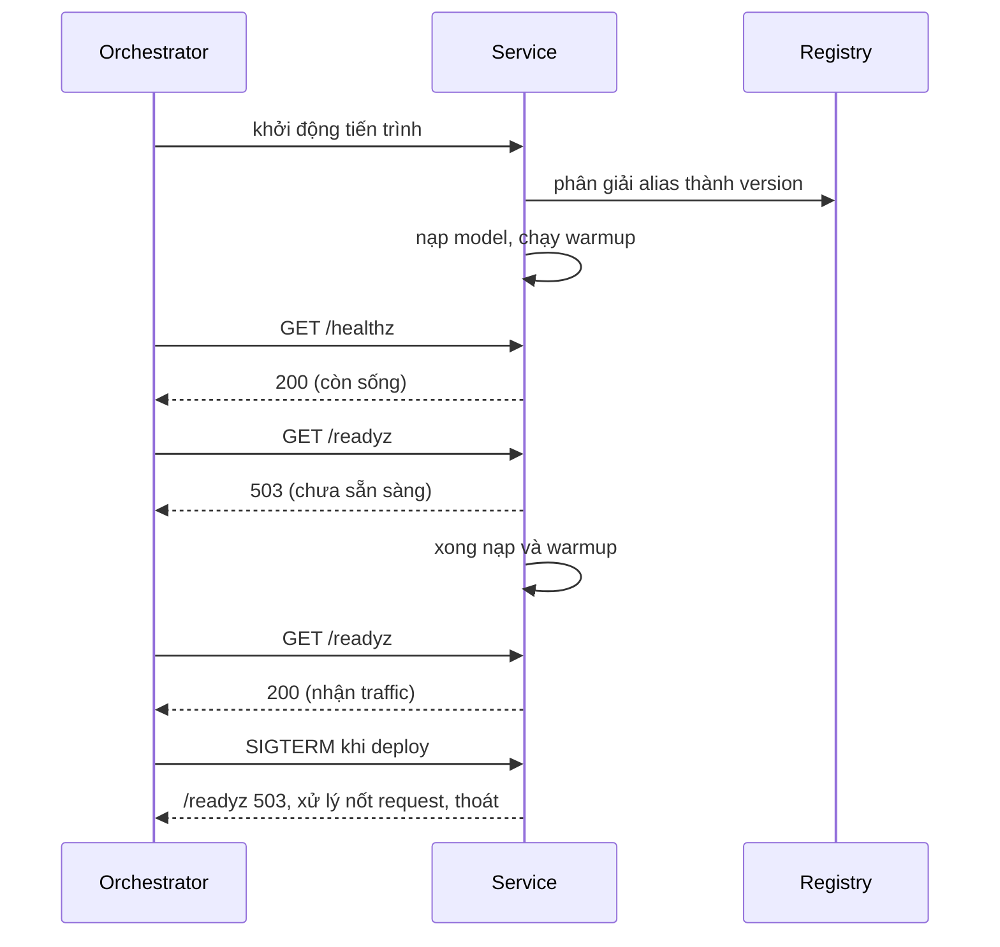
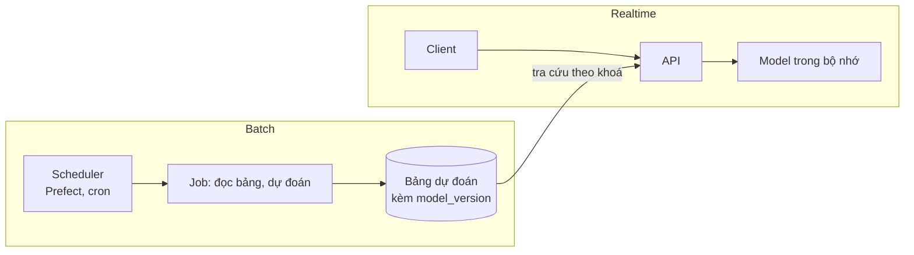
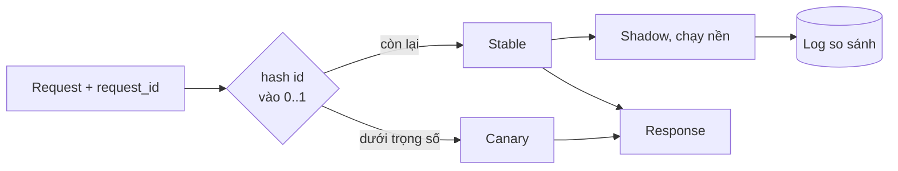
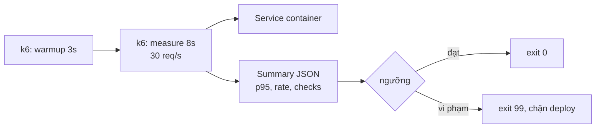

# Model serving: từ "chạy được" tới "triển khai được mà không sợ"

Một model trả lời đúng trên notebook mới đi được 10% đường. Phần còn lại là những câu hỏi mà notebook không đặt ra: service
này khi nào mới nhận traffic, nó nạp model nào, điều gì xảy ra nếu model mới tệ, rollback mất bao lâu, và chịu được tải bao
nhiêu. Module này dựng bộ khung cho cả bốn câu hỏi, ở tầng **ứng dụng** (FastAPI, MLflow alias, k6), trước khi bạn lên
Kubernetes ở module 13 và 14.

Ví dụ xuyên suốt vẫn là service ETA taxi NYC. Bài tập chạy trên CPU laptop, không cần stack `setup/mlops` (MLflow dùng
SQLite cục bộ). Chỉ bài k6 cần Docker (build một image sklearn nhỏ và chạy k6 trong container); bài sự cố chạy in-process.

Sau module này bạn sẽ:

- Viết service có `/healthz` khác `/readyz`, warmup, timeout, kiểm tra đầu vào, `model_version` trong response.
- Rollback bằng đổi alias rồi `POST /admin/reload`, không rebuild, không restart.
- Định tuyến canary và A/B bằng hash ổn định; chạy shadow mà không đổi response.
- Viết cổng tải bằng k6 với ngưỡng p95 và đọc kết quả có warmup.
- So sánh BentoML, Triton, Ray Serve, TorchServe với "FastAPI tự viết" bằng tiêu chí, không bằng cảm tính.

## 0. Cài đặt

k6 chạy trong container, không cài vào máy. Chỉ cần Docker.

| Công cụ | Phiên bản đã kiểm | Nguồn | Gỡ |
| --- | --- | --- | --- |
| k6 | 1.8.1 (image `grafana/k6:1.8.1`) | Docker Hub, tag cố định; test gọi qua `mlopskit.k6_run` | `docker rmi grafana/k6:1.8.1` |
| python (base image bài k6) | 3.12.11-slim | Docker Hub | `docker rmi python:3.12.11-slim` |

```bash
docker pull grafana/k6:1.8.1
docker image inspect grafana/k6:1.8.1 --format '{{.Id}}'
docker run --rm grafana/k6:1.8.1 version
```

Lệnh thứ hai in digest của image; bản đã kiểm có `sha256:23f2279054c3e01535455c4d92914a625df12aeb631ea0e3ea7a43f96bcbc843`.
Lệnh thứ ba phải in `k6 v1.8.1`. Digest khác nghĩa là tag đã bị đẩy lại: dừng và hỏi trước khi chạy tiếp.

## 1. Ôn nhanh: FastAPI phục vụ model

Phần này chỉ ôn. Cách viết endpoint, `pydantic` và đóng gói model đã học ở module DS 14
([`tracks/data-science/modules/14-mlops-for-ds`](../../../data-science/modules/14-mlops-for-ds/README.md)); đọc lại nếu
chưa nhớ. Module này giả định bạn viết được `POST /predict` nhận JSON và trả JSON. Từ đây đi tiếp vào những thứ DS 14 không
nói: service sống thế nào giữa các lần deploy.

## 2. Production checklist cho service model

Bảy việc phân biệt "demo" với "service". Mỗi dòng có một câu hỏi để tự kiểm.

| Việc | Cách làm | Câu hỏi tự kiểm |
| --- | --- | --- |
| Nạp model theo **alias** | `models:/<tên>@champion` phân giải ra số version lúc khởi động, ghi vào log | Restart lúc 3 giờ sáng nạp model nào? |
| `/healthz` khác `/readyz` | liveness: tiến trình còn sống; readiness: nhận được traffic | Nạp model xong chưa mà đã nhận request? |
| Warmup | vài dự đoán mẫu qua đúng đường mã của request thật trước khi báo ready | Request đầu tiên của người dùng có chậm hơn request thứ 100 không? |
| Timeout | giới hạn thời gian mỗi dự đoán, trả 504 thay vì treo | Một request chậm có giữ cả hàng đợi không? |
| Kiểm tra đầu vào | số cột, kiểu, NaN/Inf, miền giá trị, số dòng tối đa; sai thì 422 | Input rác sinh ra dự đoán rác hay lỗi rõ ràng? |
| `model_version` trong response và log | số nguyên version, không phải tên alias | Người điều tra thấy ngay model nào trả lời? |
| Tắt êm (graceful shutdown) | nhận SIGTERM, `/readyz` về 503, chờ request đang chạy, rồi thoát | Deploy có làm rơi request đang dở không? |



Quyết định cần cân nhắc:

- **`/healthz` không nên phụ thuộc vào dịch vụ ngoài.** Nếu liveness gọi registry mà registry chậm, orchestrator giết cả
  đàn service đang khoẻ. Liveness trả lời câu hỏi "tiến trình có kẹt không", không hơn.
- **Readiness là hợp đồng với load balancer.** Nó phải 503 cho tới khi service thật sự trả lời được ở tốc độ bình
  thường, và 503 ngay khi bắt đầu tắt. Một `readyz` luôn 200 là một `healthz` đặt tên khác.
- **Nạp trong nền hay trong khởi động?** Nạp đồng bộ trong lúc khởi động đơn giản nhưng orchestrator có thể giết
  tiến trình vì quá `startupProbe`. Nạp nền cho `healthz` 200 ngay và `readyz` 503 cho tới khi xong; đổi lại phải xử lý
  trạng thái "chưa có model" trong mọi endpoint.
- **Timeout phải bé hơn timeout của phía gọi.** Client chờ 2 giây mà service chờ 5 giây thì service làm việc cho
  người đã bỏ đi.
- **Validate trước khi tới model.** Lỗi 422 rẻ và có nghĩa; model nhận NaN thường im lặng trả NaN hoặc một con số hợp lý
  nhưng sai.
- **Version là số, alias là con trỏ.** Log `champion` không nói gì sau một tuần; log `version=7` thì truy được.

## 3. Batch inference theo lịch và khác realtime ở đâu

Không phải model nào cũng cần API. Nếu mỗi sáng bạn dự đoán nhu cầu cho 50 000 khu vực và ghi vào bảng, một job theo
lịch rẻ hơn, đơn giản hơn và dễ kiểm hơn nhiều.

| Tiêu chí | Realtime (API) | Batch theo lịch |
| --- | --- | --- |
| Độ trễ | mili giây tới trăm mili giây, có SLO p95 | phút tới giờ, SLO là "xong trước 6 giờ sáng" |
| Đầu vào | một đối tượng, feature phải có ngay | cả bảng, đọc từ kho |
| Chi phí | máy chạy 24/7, dư công suất cho đỉnh | chạy ngắn, trả theo giờ chạy |
| Lỗi | request lỗi là người dùng thấy | job lỗi thì chạy lại, người dùng chưa thấy gì |
| Rollout | canary, shadow theo request | chạy song song hai bản trên cùng bảng, so sánh trước khi chuyển |
| Hay vấp | skew giữa feature train và feature online | dữ liệu chưa về kịp, chạy hai lần sinh kết quả khác nhau |



Cách dùng lai rất phổ biến: batch tính trước cho phần lớn khoá, API chỉ tra bảng và tính tại chỗ cho các khoá mới. Đừng
chọn realtime chỉ vì "nghe hiện đại"; hỏi trước: ai cần câu trả lời, trong bao lâu, và chuyện gì xảy ra nếu muộn một giờ?
Batch có cùng nguyên tắc với realtime: ghi `model_version` vào từng dòng đầu ra, và chạy lại phải cho cùng kết quả (cố
định phiên bản model, dữ liệu và hạt giống).

## 4. Triển khai an toàn: shadow, canary, A/B và rollback

Bốn cách tung model mới, từ ít rủi ro nhất đến nhiều nhất, đều làm được ở tầng ứng dụng.

| Cách | Người dùng thấy | Cho biết gì | Rủi ro |
| --- | --- | --- | --- |
| **Shadow** | Luôn model cũ | Model mới có chạy được trên traffic thật không, dự đoán lệch bao nhiêu | Gần như không; tốn thêm tài nguyên |
| **Canary** | Một phần nhỏ nhận model mới | Số đo vận hành thật (lỗi, độ trễ, phân phối dự đoán) | Phần nhỏ đó nhận dự đoán xấu |
| **A/B** | Mỗi nhóm một biến thể, lâu | Tác động kinh doanh, có ý nghĩa thống kê | Cần cỡ mẫu và thời gian |
| **Rollback** | Quay về bản cũ | không áp dụng | Chỉ nhanh nếu đã chuẩn bị trước |



**Định tuyến bằng hash ổn định.** Ném đồng xu mỗi request làm cùng một người thấy hai model luân phiên, và không tái lập
được. Thay vào đó băm `request_id` (hoặc `user_id`) bằng một hàm băm cố định như SHA-256, đổi 8 byte đầu thành số trong
[0, 1) và so với trọng số. Ba tính chất cần có: cùng id luôn cùng nhánh, tỉ lệ thật xấp xỉ trọng số, và tăng trọng số chỉ
thêm id vào canary chứ không đảo ai về stable. Hàm `hash()` của Python không dùng được vì nó đổi theo từng tiến trình.
Muốn nhiều thí nghiệm độc lập thì thêm một **salt** theo tên thí nghiệm; không có salt, ai nằm trong 10% canary hôm nay
cũng nằm trong 10% đầu của mọi thí nghiệm khác.

**Chọn khoá băm.** `request_id` cho canary vận hành (mỗi request độc lập); `user_id` khi trải nghiệm phải nhất quán qua nhiều
lần gọi (A/B). Băm theo request mà phục vụ một phiên có trạng thái sẽ làm người dùng thấy giá nhảy qua nhảy lại.

**Shadow phải vô hình.** Quy tắc: response là của model chính, nguyên vẹn; lỗi và độ chậm của shadow không chạm
tới request; shadow chạy trên bản sao của đầu vào; kết quả shadow chỉ vào log (kèm request id, hai version, độ lệch lớn nhất). Lỗi
ghi log shadow cũng không được làm hỏng request.

**Rollback nhanh.** Cơ chế đã có từ module 04: alias là con trỏ. Rollback = đổi alias `champion` về version cũ trong
registry, rồi gọi `POST /admin/reload` để service nạp lại. Không rebuild image, không restart, không đụng tới Git. Ba điều
kiện để thao tác này an toàn:

1. Service ghim version đã nạp (không tra alias mỗi request) và trả `model_version`, nên bạn biết mình đang ở đâu.
2. Reload nạp model mới **trước**, rồi đổi con trỏ trong một bước; lỗi giữa chừng thì giữ nguyên model cũ.
3. Endpoint quản trị có xác thực và nằm sau mạng nội bộ; nếu không, ai đó đổi được model production bằng một lệnh `curl`.

Đổi lại, alias + reload nghĩa là có trạng thái nằm ngoài image: kiểm toán phải đọc lịch sử registry chứ không chỉ đọc
manifest deploy. Nếu bạn cần "mọi thứ trong Git" thì ghim số version trong manifest và rollback bằng commit (chậm hơn một
chút, audit đẹp hơn).

## 5. Load test với k6

Load test trả lời một câu hỏi: tại tải mục tiêu, service có giữ được SLO không? Không phải "bao nhiêu request/giây thì
sập".

| Chỉ số | Đọc thế nào |
| --- | --- |
| `http_req_duration` p95, p99 | Độ trễ mà 95% hoặc 99% request nằm dưới. Trung bình che mất đuôi, đừng nhìn nó |
| `http_reqs` (count, rate) | Thông lượng thật đạt được; thấp hơn tải đặt ra nghĩa là k6 không bơm nổi hoặc service nghẽn |
| `http_req_failed` | Tỉ lệ lỗi; p95 đẹp mà 30% lỗi là vô nghĩa |
| `checks` | Kiểm nội dung response, không chỉ mã trạng thái |
| `dropped_iterations` | k6 không kịp phát request theo lịch (VU thiếu hoặc service quá chậm) |

Quyết định khi viết kịch bản:

- **Open model (arrival rate) hay closed model (VU cố định).** Closed model: mỗi VU chờ response rồi gửi tiếp, nên service
  chậm thì tải tự giảm và che mất vấn đề ("coordinated omission"). Open model (`constant-arrival-rate`) giữ nhịp
  đến cố định; đây là mô hình đúng cho dịch vụ có người dùng độc lập.
- **Tách warmup khỏi đo.** Chạy một scenario ngắn trước, và đặt ngưỡng **chỉ trên scenario đo** bằng tag
  (`http_req_duration{scenario:measure}`). Nếu không, đuôi lúc khởi động làm hỏng p95 hoặc, tệ hơn, bạn học cách tăng ngưỡng để
  xanh.
- **Ngưỡng đặt từ SLO, không từ lần đo đầu.** Ngưỡng ra từ con số bạn cam kết với người dùng; k6 thoát mã 99 khi vi phạm nên
  gắn được vào CI.
- **Tải sinh ra từ máy khác máy chạy service** khi có thể; cùng một máy thì k6 và service tranh CPU và con số lệch.
  Bài tập chạy k6 với `--network host` trên cùng máy, nên coi số đo là tương đối, không tuyệt đối.
- **Dữ liệu request phải giống thật**: một body cố định trúng cache và đẹp hơn thực tế.



## 6. Chọn công cụ serving

FastAPI tự viết là điểm xuất phát tốt: bạn kiểm soát mọi thứ và hiểu mọi thứ. Công cụ chuyên dụng đáng giá khi bạn đang
tự viết lại cùng một đống việc (batching động, đa model, GPU) trong mỗi dự án.

| Công cụ | Mạnh | Đánh đổi | Chọn khi |
| --- | --- | --- | --- |
| FastAPI tự viết | Linh hoạt, ít phụ thuộc, dễ debug | Tự làm batching, metrics, đa model | Một vài model sklearn/xgboost, đội nhỏ |
| BentoML | Đóng gói model + API + image thành một "Bento", batching thích ứng | Thêm một khái niệm và khung của họ | Nhiều model Python, muốn chuẩn hoá đóng gói |
| Triton Inference Server | Rất nhanh trên GPU, đa framework, dynamic batching, ensemble | Cấu hình nặng, cần chuyển model sang định dạng hỗ trợ | Deep learning thông lượng cao, GPU (module 11) |
| Ray Serve | Ghép nhiều model thành đồ thị, co giãn theo Ray | Kéo theo cả cụm Ray | Pipeline nhiều bước, đã có Ray |
| TorchServe | Quen thuộc cho PyTorch, handler tuỳ biến | Dự án ở chế độ bảo trì hạn chế; kiểm tình trạng trước khi chọn | Hệ thống PyTorch có sẵn |
| KServe, Seldon | Chuẩn Kubernetes: canary, scale về 0 | Cần cụm K8s và vận hành nó | Nền tảng nhiều đội (module 14) |

Cách chọn: viết ra thông lượng mục tiêu, độ trễ, số model, phần cứng, đội vận hành bao nhiêu người; loại phương án
vượt khả năng vận hành của đội trước khi so điểm mạnh.

## 7. Bài tập

| Bài | Mức | Chấm bằng | Chạy |
| --- | --- | --- | --- |
| `basic/01-readyz-warmup` | Basic | `TestClient` | `uv run pytest tracks/mlops/modules/07-model-serving/exercises/basic/01-readyz-warmup -q` |
| `basic/02-canary-routing` | Basic | hàm thuần | `.../basic/02-canary-routing` |
| `basic/03-shadow-mode` | Basic | hàm thuần | `.../basic/03-shadow-mode` |
| `intermediate/01-rollback-reload` | Intermediate | `mlflow_local` + `TestClient` | `.../intermediate/01-rollback-reload` |
| `intermediate/02-k6-p95-gate` | Intermediate | `built_image` + `k6_run` | `nice -n 15 .../intermediate/02-k6-p95-gate` |
| `intermediate/03-incident-first-request-latency` | Intermediate (sự cố) | `TestClient`, đo giờ | `.../intermediate/03-incident-first-request-latency` |
| `advanced/01-serving-stack-decision` | Advanced | rubric trong `SOLUTION.md` | không có test |
| `advanced/02-canary-guardrails` | Advanced | rubric trong `SOLUTION.md` | không có test |

Bài k6 build image lần đầu mất vài phút (tải wheel sklearn); lần sau dùng cache. Nếu mạng chậm, tăng `MLOPS_BUILD_TIMEOUT`.

## 8. Tài liệu tham khảo

- FastAPI, [Lifespan events](https://fastapi.tiangolo.com/advanced/events/) và [Testing](https://fastapi.tiangolo.com/tutorial/testing/).
- Kubernetes, [Configure Liveness, Readiness and Startup Probes](https://kubernetes.io/docs/tasks/configure-pod-container/configure-liveness-readiness-startup-probes/).
- Grafana k6, [Thresholds](https://grafana.com/docs/k6/latest/using-k6/thresholds/) và [Open and closed models](https://grafana.com/docs/k6/latest/using-k6/scenarios/concepts/open-vs-closed/).
- MLflow, [Model Registry: aliases](https://mlflow.org/docs/latest/ml/model-registry/).
- Google SRE Book, [Canarying Releases](https://sre.google/workbook/canarying-releases/).
- BentoML, Triton Inference Server, Ray Serve, KServe: tài liệu chính thức của từng dự án.
