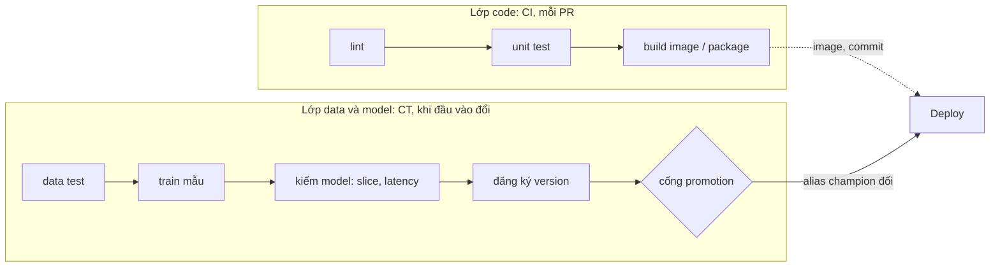
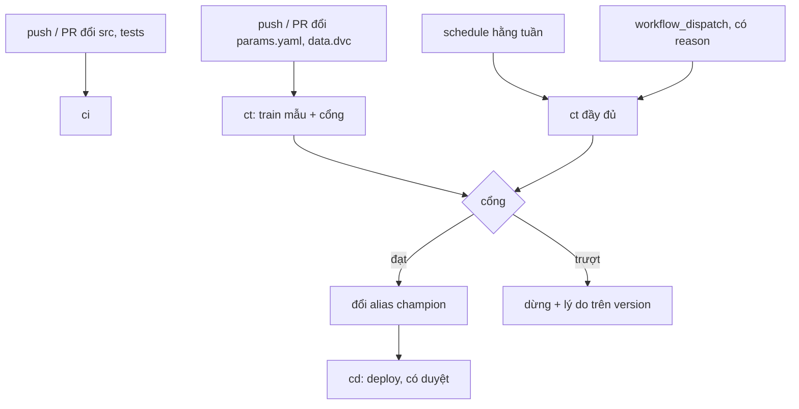

# CI/CD cho ML

Một repo ML có hai thứ cần kiểm soát thay đổi: **code** và **model** (cộng dữ liệu và tham số sinh ra nó). Pipeline CI quen thuộc
(lint, test, build) bảo vệ code; nó không nói gì về việc model mới có đáng thay model đang chạy không, hay thứ vừa train có phải thứ
đang được deploy không. Module này dựng cả hai lớp trên GitHub Actions, chạy thử ngoại tuyến bằng `act`, và dừng lâu nhất ở
**chỗ hai lớp nối nhau**, nơi pipeline xanh vẫn có thể giao sai thứ. Ví dụ xuyên suốt là repo `etalite` (ETA taxi NYC, train mẫu
trên 4 000 chuyến thật của tháng 3/2019) và cổng promotion ở module 04.

Sau module này bạn sẽ:

- Tách CI cho code khỏi pipeline cho data/model (CT), viết trigger đúng (path filter, schedule, `workflow_dispatch`) và nói được chi phí của từng lựa chọn.
- Viết cổng promotion thành job: challenger tệ hơn thì pipeline đỏ và job deploy không chạy.
- Dùng secrets, OIDC, `permissions`, cache và artifact giữa job mà không để lộ hay giao nhầm.
- Chạy workflow cục bộ bằng `act` (ngoại tuyến) và biết nó **không** kiểm được gì.
- Chọn giữa GitHub Actions, GitLab CI, Jenkins và CML bằng ràng buộc thật.

## 0. Cài đặt

Bài tập chạy workflow thật bằng `act` trong một runner image nhỏ build tại chỗ, không cần GitHub, không cần tài khoản, không kéo
action từ xa. Cần Docker (đã có từ module 02).

| Công cụ | Phiên bản đã kiểm | Tối thiểu | Ghi chú |
| --- | --- | --- | --- |
| `act` | 0.2.89 (phát hành 2026-06-01) | 0.2.80 | Bản cố ý chọn: các bản mới hơn phát hành chưa đủ 2 tuần lúc kiểm |
| Docker Engine | 29.9 | 24.0 | Runner của `act` là container |
| Image `mlops-act-runner:1` | `python:3.12.11-slim` + `uv` 0.11.33 + `git` | đúng tag này | Build từ `setup/mlops/act-runner/Dockerfile`, test tự build lần đầu |
| `ruff` | 0.17.1 (phát hành 2026-10-15) | 0.8 | Test chuẩn bị bằng `uv pip install --target`, cache ở `~/.cache/mlops-ex/` |
| `uv` | 0.11 | 0.5 | Có sẵn trong môi trường của repo |

Cài `act` vào `~/.local/bin` (không cần `sudo`), kiểm checksum từ tệp `checksums.txt` của chính bản phát hành **trước** khi giải nén:

```bash
cd "$(mktemp -d)" &&
curl -fsSLO https://github.com/nektos/act/releases/download/v0.2.89/act_Linux_x86_64.tar.gz &&
curl -fsSLO https://github.com/nektos/act/releases/download/v0.2.89/checksums.txt &&
sha256sum --check --ignore-missing checksums.txt &&
mkdir -p ~/.local/bin && tar -xzf act_Linux_x86_64.tar.gz act && install -m 0755 act ~/.local/bin/act &&
act --version
```

Dòng `sha256sum` phải in `act_Linux_x86_64.tar.gz: OK` (hash kỳ vọng
`0191d6f1f3b716b5c55820032605d05fc3c1cdbf581ebeff655019e5dd1524c0`); lỗi thì dừng, đừng cài. `act --version` phải in `act version 0.2.89`.
Máy ARM thay `x86_64` bằng `arm64` và dùng dòng tương ứng trong cùng tệp checksum.

Build runner image (tuỳ chọn, test tự làm nếu chưa có) và thử một workflow:

```bash
docker build -t mlops-act-runner:1 setup/mlops/act-runner
uv run pytest tracks/mlops/modules/08-cicd-for-ml/exercises/basic/01-ci-workflow-green-red -q
```

Gỡ cài đặt:

```bash
rm ~/.local/bin/act && docker rmi mlops-act-runner:1 && rm -rf ~/.cache/mlops-ex
```

Thiếu `act`, test chạy workflow **skip** kèm trỏ về mục này; skip không tính là đạt. Test cần dữ liệu thật thì tải trước:
`uv run python data/download_dataset.py nyc-tlc`.

## 1. Ôn nhanh: Docker và CI cơ bản

Phần này chỉ ôn. Cách viết workflow cơ bản, image, registry, và CI cho pipeline dữ liệu đã có ở module DE
`tracks/data-engineer/modules/08-devops-for-data`; đọc lại nếu chưa nhớ. Điều **khác** ở đây: CI của code là điều kiện cần,
không đủ. Bài Basic 01 chỉ ôn một workflow CI (ruff, pytest, build) rồi chuyển ngay sang chứng minh nó đỏ khi cần đỏ.

| Khái niệm | Một dòng | Điều dễ quên |
| --- | --- | --- |
| Workflow, job, step | Tệp YAML; job chạy trên runner riêng; step chạy tuần tự trong job | Hai job không chung ổ đĩa trên runner thật |
| `needs` | Job sau chỉ chạy khi job trước xanh | Không có `needs` thì chạy song song |
| `runs-on` | Loại runner | `ubuntu-latest` đổi theo thời gian; ghim phiên bản công cụ, không ghim runner |
| Mã thoát | Step đỏ khi lệnh thoát khác 0 | `|| true` biến cổng thành trang trí |

## 2. Hai lớp: CI cho code, CT cho data và model



| | Lớp code (CI) | Lớp data/model (CT) |
| --- | --- | --- |
| Chạy khi | Mỗi PR, mỗi push đụng `src/`, `tests/` | Đổi `params.yaml`, `data.dvc`, hay theo lịch |
| Câu hỏi | Code này có phá thứ đang chạy không? | Model mới có đáng thay model đang chạy không? |
| Thời gian | Phút | Phút (mẫu) đến giờ (đầy đủ) |
| Chặn gì | Merge | Đổi alias, deploy |
| Kết quả | Image, package | Version trong registry kèm quyết định |

**Train mẫu trên PR, train đầy đủ theo lịch.** Train đầy đủ cho mỗi PR là đốt tiền; không train gì trên PR nghĩa là tham số hỏng
chỉ lộ ra vào thứ Hai tuần sau. Train mẫu (vài nghìn dòng, vài phút, CPU) bắt được lỗi cấu hình, lỗi schema, loss không giảm;
nó **không** thay cho cổng promotion trên tập đánh giá thật, chỉ là lớp rào đầu tiên.

**Cổng promotion là một job.** Cổng của module 04 (`decide_promotion`) là hàm thuần; ở đây nó thành bước CI: đọc số đo của
challenger và champion, thoát 0 hoặc 1. Chính mã thoát làm cổng có tác dụng: job đỏ thì job `deploy` `needs` nó không chạy.
Hai lỗi kinh điển là cổng chỉ in cảnh báo mà thoát 0, và cổng so với số "champion" lưu từ tháng trước trên dữ liệu khác.

### Chỗ hai lớp nối nhau

Mỗi lớp xanh riêng không chứng minh gì về thứ được **giao** giữa chúng. Ba chỗ nối đáng kiểm:

1. **Từ train sang deploy:** model nào được deploy có đúng là model vừa qua cổng không? Một định danh ổn định (version, digest) ở cả hai đầu và bước kiểm ở đầu ra.
2. **Từ code sang model:** image service được build từ commit nào, và model được train từ commit nào? Lineage (module 04) trả lời nếu bạn ghi nó.
3. **Từ cổng sang alias:** ai và cái gì được phép đổi alias `champion`? Nếu mọi job có quyền đổi, cổng chỉ là khuyến nghị.

Dấu hiệu một hệ thống thiếu bằng chứng ở chỗ nối: log chỉ nói "deployed ok" mà không nói **cái gì**. Một thói quen rẻ: in định danh model ở cả
hai đầu (log của train, log của deploy, response của service) để người trực đối chiếu được trong 30 giây. Bài Intermediate 03 là
một sự cố ở đúng chỗ này.

## 3. Trigger và CD khi alias đổi



| Trigger | Dùng cho | Cạm bẫy |
| --- | --- | --- |
| `push` + `branches` | Kiểm sau merge | Không giới hạn nhánh thì train trên mọi nhánh thử nghiệm |
| `pull_request` | Kiểm trước merge | Từ fork không nhận secrets |
| `paths` / `paths-ignore` | Chỉ chạy khi đổi đầu vào liên quan | Quên một đầu vào thật (vd. `train.py`): thay đổi đi qua mà không ai train lại. Check bắt buộc mà workflow bị lọc mất sẽ kẹt ở trạng thái chờ |
| `schedule` (cron, UTC) | Dữ liệu đổi không kèm commit; kiểm trôi dạt | Chỉ chạy trên nhánh mặc định, có thể trễ, bị tắt khi repo yên tĩnh 60 ngày; tránh 00:00 UTC |
| `workflow_dispatch` | Chạy tay, chạy lại có tham số | Bắt `reason` để có dấu vết |
| `repository_dispatch`, `workflow_run` | Móc workflow này vào sự kiện ngoài (vd. registry đổi alias) | Dễ tạo vòng lặp; chạy với quyền của repo gốc |

Bộ lọc `paths` dùng glob của GitHub: `*` không vượt `/`, `**` vượt qua. `src/*` không khớp `src/etalite/model.py`; `src/**` khớp.
Một workflow có `paths` chạy khi **ít nhất một** tệp đổi khớp.

### CD khi alias đổi

Ở module 04, service đọc `models:/taxi-eta@champion`; đổi alias là đổi model đang phục vụ. Hai cách làm CD:

| Cách | Cơ chế | Được | Mất |
| --- | --- | --- | --- |
| Pull | Service poll alias và tự nạp lại (module 04, 07) | Không cần pipeline deploy, đổi nhanh | Không có điểm duyệt, khó audit |
| Push | Đổi alias phát sự kiện, workflow `cd` chạy deploy (smoke test, canary) | Có cổng duyệt, có log, có môi trường `production` có reviewer | Thêm một pipeline phải duy trì |

Đội nào cũng cần ít nhất: ai được đổi alias (một tài khoản dịch vụ, sau cổng), alias đổi thì cái gì xảy ra, và cách rollback (đổi alias về
version trước, không build lại). Chạy `concurrency` theo tên model để hai lần đổi alias không chồng nhau, và đừng huỷ giữa chừng một lần deploy đang chạy.

## 4. Secrets, OIDC, cache và artifact giữa job

**Secrets.** Giá trị lưu ở GitHub, đưa vào job qua `${{ secrets.X }}`. Quy tắc:

- Truyền qua `env:` của **bước cần nó**, không nhúng vào dòng lệnh; không in ra, kể cả khi gỡ lỗi.
- Runner che giá trị khi nó xuất hiện **nguyên văn** trong log (thấy `***`). Bản cắt, đảo, base64 hay in từng ký tự thì lọt. Che log là lưới đỡ, không phải hàng rào.
- PR từ fork không nhận secrets theo mặc định. Đừng "sửa" điều đó bằng `pull_request_target` rồi checkout mã của PR: đó là đường vào kinh điển cho người ngoài chạy mã với đặc quyền (bài Advanced 02).
- Secrets là điều kiện: thiếu secret thì bước deploy phải **đỏ**, không được lặng lẽ bỏ qua.

**OIDC (khái niệm).** Thay vì lưu khoá cloud dài hạn thành secret, job xin một token ngắn hạn từ GitHub (cần `permissions: id-token: write`); cloud được
cấu hình tin GitHub với điều kiện (repo nào, nhánh nào, environment nào) rồi đổi token đó lấy credential tạm. Không có khoá dài hạn nào để lộ
hay xoay vòng, và cloud audit được "workflow nào đã làm gì". Đổi lại phải cấu hình quan hệ tin cậy một lần. Bài tập không chạy OIDC (cần cloud thật) nhưng bài Advanced 02 bắt bạn nhận ra khoá dài hạn là lỗi.

**`permissions`.** `GITHUB_TOKEN` mặc định có thể có quyền ghi rộng. Đặt `permissions: contents: read` ở cấp workflow và nâng riêng từng job.

**Cache dependency.** `cache` lưu thư mục (vd. cache của `uv`) theo một khoá thường là hash của lockfile: lần sau khớp khoá thì khôi phục, nhanh hơn. Cache là
**tối ưu best-effort**: có thể mất bất cứ lúc nào, có giới hạn dung lượng và thời hạn. Chỉ dùng cho thứ tái tạo được (dependency), không bao giờ cho thứ mà đúng/sai phụ thuộc vào nó (model, dữ liệu).

**Artifact giữa job.** Trên runner thật hai job ở hai máy khác nhau, nên thứ nào job sau cần phải được job trước **đưa ra**: upload/download artifact
(có tên, thời hạn giữ `retention-days`, giới hạn dung lượng), job output cho giá trị nhỏ (một id, một đường dẫn), hay đẩy lên kho ngoài (MLflow, S3, DVC remote) rồi job sau tải theo
tham chiếu. Model ML thường lớn: đẩy vào registry/artifact store của module 04 hợp lý hơn artifact của CI. `act --bind` cho mọi job chung một thư mục, tiện nhưng
**không giống** runner thật; đó là một trong các giới hạn ở mục sau.

| Cần chuyển | Cách | Lưu ý |
| --- | --- | --- |
| Một giá trị nhỏ (id, version) | Job output | Tối đa vài MB, là chuỗi |
| Tệp trung bình, vòng đời một lần chạy | Artifact của CI | Có hạn lưu; tên phải duy nhất trong lần chạy |
| Model, dữ liệu | Registry, DVC remote, S3 | Có version, có lineage, sống lâu hơn pipeline |
| Dependency | Cache | Chỉ tối ưu tốc độ, phải chạy đúng cả khi cache trống |

## 5. Chạy local với act và giới hạn của nó

`act` đọc `.github/workflows/`, dựng container làm runner và chạy các job. Vòng phản hồi vài giây thay vì commit rồi chờ. Trong khoá học
workflow chỉ có bước `run:` và chạy ngoại tuyến:

```bash
act push -P ubuntu-latest=mlops-act-runner:1 --pull=false --bind
act -l                                   # liệt kê job của mọi workflow
act push -W .github/workflows/ct.yml -j train      # một job (kèm các job nó needs)
act push --dryrun                        # kiểm cấu trúc, không chạy lệnh
act push -s REGISTRY_TOKEN=abc           # secrets
act push --env GITHUB_RUN_NUMBER=11      # giả lập số lần chạy
```

`mlopskit.act_run(workdir, *args)` làm đúng những việc đó, kèm dọn container; bài tập chạy `act` qua nó.

Giới hạn thật, nên đọc kỹ trước khi tin một lần `act` xanh:

| Giới hạn | Hệ quả |
| --- | --- |
| Runner image khác `ubuntu-latest` thật (ở đây tối giản) | Công cụ có sẵn trên GitHub có thể không có ở đây và ngược lại; xanh local chưa chắc xanh thật |
| `--bind` cho các job chung một thư mục | Đúng trên máy bạn, sai trên runner thật: bug "quên đưa artifact ra" không lộ |
| `paths:`/`branches:` không được đánh giá như máy chủ | Phải mô phỏng bộ lọc trong test (bài Intermediate 01) hoặc thử trên GitHub thật |
| Không OIDC, không environment có reviewer, quyền `GITHUB_TOKEN` chỉ mô phỏng | Phần bảo mật không kiểm được ở đây |
| `uses:` action từ xa cần mạng và image lớn | Bài tập tránh bằng bước `run:`; thực tế bạn sẽ dùng `actions/checkout`, `setup-uv` |
| `-j` vẫn chạy các job mà nó `needs` | Không cô lập hẳn được một job |
| Che secret khớp nguyên văn | Giống GitHub: bản biến đổi lọt log |

Quy tắc: dùng `act` để lặp nhanh và bắt lỗi cấu trúc, lỗi mã thoát; dùng một lần chạy trên runner thật để kiểm điều gì **chỉ** runner thật mới nói được.

## 6. GitLab CI, Jenkins, CML và chạy trên GitHub thật

| Tiêu chí | GitHub Actions | GitLab CI | Jenkins | CML (Iterative) |
| --- | --- | --- | --- | --- |
| Mô hình | SaaS hay self-hosted runner, YAML | SaaS hay self-managed, YAML | Tự vận hành, Jenkinsfile + plugin | Lớp trên GitHub/GitLab CI |
| Điểm mạnh | Hệ sinh thái action, tích hợp GitHub | Pipeline tích hợp sâu với repo, registry, môi trường | Linh hoạt tối đa, chạy trong mạng kín | Đăng báo cáo metric/biểu đồ vào PR, cấp runner GPU theo yêu cầu |
| Điểm yếu | Gắn với GitHub; chi phí phút runner | Gắn với GitLab | Vận hành, plugin, bảo mật là việc của bạn | Không phải hệ CI riêng; cần CI nền |
| Hợp khi | Code đã ở GitHub | Công ty đã dùng GitLab | Đã có Jenkins, yêu cầu mạng kín | Muốn báo cáo model ngay trong PR |

Chọn bằng ràng buộc: công cụ **đã có** runner, quyền truy cập và thói quen của đội thường thắng công cụ "tốt hơn trên giấy". Khái niệm gần như chuyển được:
`needs` thành `needs:` của GitLab, `paths` thành `rules: changes`, `schedule` thành pipeline schedule, OIDC thành ID token của GitLab, secrets thành CI/CD variables
(masked). CML không thay CI: nó thêm lệnh để đăng bảng so sánh model, biểu đồ vào comment PR, tiện cho bước "xem challenger so với champion" mà không phải mở MLflow.
Ở phỏng vấn, câu trả lời tốt nêu hai ràng buộc cụ thể và một điều bạn chấp nhận mất.

### Chạy trên GitHub thật (tuỳ chọn)

Khoá học không bắt buộc, nhưng đáng thử một lần:

1. Tạo repo riêng tư, chép các workflow của bạn từ bài Intermediate 01, 02 vào `.github/workflows/`.
2. Thay bước ngoại tuyến bằng bước thật: `actions/checkout` (ghim sha), `astral-sh/setup-uv`, `uv sync --frozen`, rồi các lệnh bạn đã viết.
3. Thêm secret thử trong Settings, đẩy một PR đổi `src/` rồi một PR đổi `params.yaml`; xem workflow nào chạy. Đây là lần kiểm `paths` thật.
4. Cấu hình environment `production` có reviewer cho job deploy.

Phút runner miễn phí có hạn với repo riêng tư; repo công khai thì không giới hạn kiểu đó. Không đẩy dữ liệu hay khoá thật lên repo thử.

## 7. Tài liệu tham khảo

- GitHub, Workflow syntax (`on`, `paths`, `needs`, `permissions`, `concurrency`): https://docs.github.com/en/actions/writing-workflows/workflow-syntax-for-github-actions
- GitHub, Security hardening for GitHub Actions: https://docs.github.com/en/actions/security-for-github-actions/security-guides/security-hardening-for-github-actions
- GitHub, OpenID Connect trong Actions: https://docs.github.com/en/actions/security-for-github-actions/security-hardening-your-deployments/about-security-hardening-with-openid-connect
- GitHub, Dependency caching: https://docs.github.com/en/actions/writing-workflows/choosing-what-your-workflow-does/caching-dependencies-to-speed-up-workflows
- act: https://nektosact.com/
- Google, MLOps: continuous delivery and automation pipelines in ML: https://cloud.google.com/architecture/mlops-continuous-delivery-and-automation-pipelines-in-machine-learning
- GitLab CI/CD: https://docs.gitlab.com/ci/ ; Jenkins: https://www.jenkins.io/doc/ ; CML: https://cml.dev/doc
- Module DE `tracks/data-engineer/modules/08-devops-for-data` (ôn CI cơ bản); module MLOps 04 (registry, cổng promotion)
