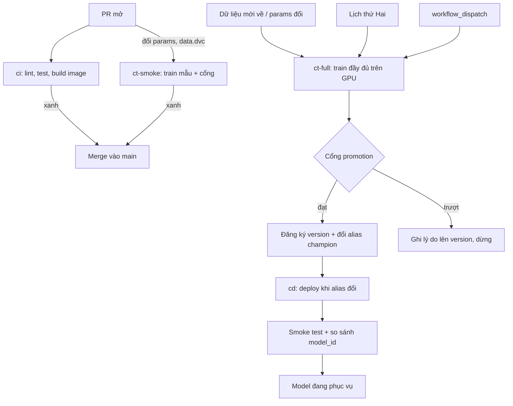

# Thiết kế CI, CT, CD cho dịch vụ ETA

## 1. Bối cảnh

Dịch vụ ETA taxi NYC do đội 5 người vận hành. Code đổi liên tục (10 đến 20 PR mỗi ngày), dữ liệu đổi theo tháng và không đi kèm
commit, model được train lại hằng tuần hoặc khi dữ liệu hay tham số đổi. Train đầy đủ cần GPU và 40 phút; train mẫu trên CPU chỉ
4 phút nên chạy được trên mọi PR đụng tới tham số. Dữ liệu nội bộ không được rời mạng công ty và ngân sách runner có hạn, nên việc
nặng (train đầy đủ) chạy trên runner tự host, còn việc nhẹ (lint, test, train mẫu) chạy trên runner của GitHub. Model lên
production bằng cách đổi alias `champion` trong registry; service đọc alias đó, nên đổi alias là sự kiện quan trọng nhất của hệ thống.

## 2. Sơ đồ

## 3. Các workflow

| Workflow | Trigger | Chặn merge hay deploy | Thời gian ước tính |
| --- | --- | --- | --- |
| ci | `pull_request`, `push` với `paths`: `src/**`, `tests/**`, `pyproject.toml` | Chặn merge (check bắt buộc) | 3 phút |
| ct-smoke | `pull_request` với `paths`: `params.yaml`, `data.dvc`, `train.py` | Chặn merge: cổng trên mẫu nhỏ | 6 phút |
| ct-full | `schedule` hằng tuần, `workflow_dispatch` (có `reason`), `push` main với `paths` của dữ liệu | Không chặn merge; kết quả là version trong registry | 40 phút (GPU, self-hosted) |
| promotion | job cuối của `ct-full`, quyết định đổi `alias` hay không | Cổng so với champion; trượt thì không đổi alias | 2 phút |
| cd-deploy | `repository_dispatch` hay `workflow_dispatch` do hook khi đổi `alias` champion | Cần duyệt (environment `production` có reviewer) rồi mới chạy | 8 phút |

## 4. Chỗ hai lớp nối nhau

- Đổi `alias` `champion` là sự kiện duy nhất kích hoạt `cd-deploy`; đội không deploy bằng tay từ laptop. Hook của registry gửi
  `model_version` và `digest` của artifact, không gửi "mới nhất".
- Hai đầu kiểm cùng một định danh: `ct-full` ghi `git sha`, `data_version` và `digest` model lên version; `cd-deploy` tải model
  theo `digest` đó, kiểm lại digest sau khi tải, rồi sau khi deploy gọi `/version` của service và so `model_id` với `digest`.
- Image service build ở `ci` gắn `commit sha` và chỉ dùng cho deploy khi sha đó có mặt trên `main` và khớp `git_commit` trong
  lineage của model; model train từ cây thư mục bẩn bị cổng từ chối.
- `ct-full` và `cd-deploy` dùng chung `concurrency` theo tên model: không có hai lần đổi alias chồng nhau; lần deploy đang chạy
  được hoàn tất (không huỷ giữa chừng), lần sau xếp hàng.
- Thay đổi loại model, tập feature hay nguồn dữ liệu cần reviewer ký trước khi cổng cho phép đổi alias; ngoại lệ có hạn.

## 5. Secrets, quyền, OIDC

- `permissions: contents: read` ở cấp workflow, nâng riêng từng job khi cần (vd. `id-token: write` cho job lấy token cloud).
- Truy cập registry, kho dữ liệu và cloud bằng OIDC: job nhận token ngắn hạn theo danh tính workflow, không có khoá dài hạn trong
  secrets. Quan hệ tin cậy ở phía cloud giới hạn theo repo, nhánh `main` và environment `production`.
- PR từ `fork` không nhận secrets và không chạy trên runner tự host; workflow dùng `pull_request`, không dùng `pull_request_target` cho
  code của PR. PR từ nhánh nội bộ chạy `ct-smoke` trên runner của GitHub với dữ liệu mẫu công khai.
- Action của bên thứ ba ghim theo commit sha; không `curl | bash`; secrets chỉ qua `env:` của bước cần, không in ra log, và
  kiểm log định kỳ.

## 6. Chi phí và rủi ro

- Runner `self-hosted` cho GPU và dữ liệu nội bộ: chỉ nhận workflow từ nhánh `main` và `workflow_dispatch`, chạy trong container dùng
  một lần; rủi ro là một PR độc hại chạy mã trên máy trong mạng nội bộ nên không bao giờ gán nhãn runner cho PR từ fork.
- `cache` dependency theo hash của lockfile cho `ci` và `ct-smoke` (giảm 2 phút mỗi lần); dữ liệu và model đi qua artifact hoặc
  DVC remote, không qua cache vì cache có thể mất bất cứ lúc nào.
- `concurrency` huỷ lần chạy `ci` cũ khi có push mới trên cùng PR (tiết kiệm phút runner), nhưng không bao giờ huỷ `ct-full` và `cd-deploy`.
- Đặt `timeout-minutes` cho mọi job; job train treo trên GPU là chi phí lớn nhất. Cảnh báo khi `ct-full` không chạy quá 10 ngày:
  lịch của GitHub tắt khi repo yên tĩnh lâu.
