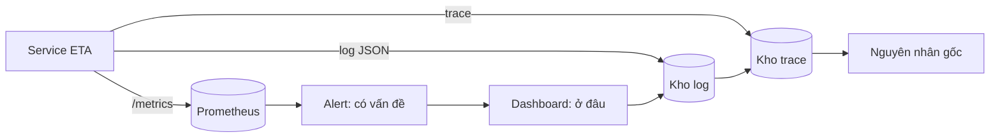
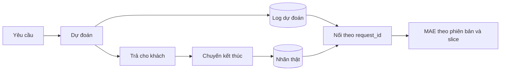
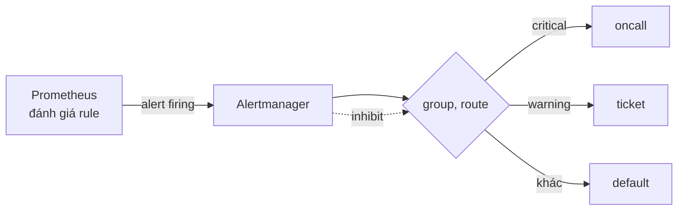
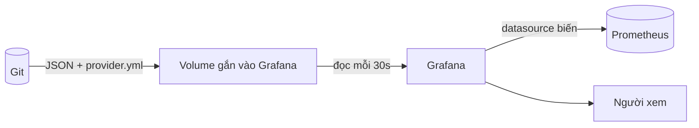

# Monitoring và observability cho ML

Model của bạn đã lên production và HTTP trả 200 đều đặn. Chiều thứ Ba, khách hàng báo app luôn hiện "xe tới sau 16 phút". Không
alert nào kêu, không dashboard nào đỏ, vì service đang chạy đúng theo nghĩa kỹ thuật: nó trả lời nhanh, không lỗi, và trả
sai. Phần khó của monitoring ML nằm ở đó: ngoài câu hỏi "service có sống không" còn có "nó đang trả lời gì, và có còn đáng tin không".
Module này dựng phần quan sát cho service ETA taxi NYC từ metric tới alert tới dashboard, và dạy cách kiểm từng mắt xích bằng test.

Bài tập Basic và Intermediate 02, 03, Advanced chạy không cần stack. Bài Intermediate 01 (Grafana) cần profile `monitoring`:

```bash
nice -n 15 docker compose -f setup/mlops/compose.yaml --profile monitoring up -d --wait
```

Sau module này bạn sẽ:

- Phân biệt monitoring và observability, và chọn đúng loại tín hiệu (metric, log, trace) cho từng câu hỏi.
- Instrument một service FastAPI bằng `prometheus_client`: RED, histogram độ trễ, metric của model, không nổ cardinality.
- Ghi log dự đoán có cấu trúc đủ để nối nhãn về muộn và đo chất lượng thật.
- Viết alert rule theo triệu chứng, kiểm bằng `promtool test rules`, định tuyến bằng Alertmanager, và dựng SLO với burn-rate.
- Đưa dashboard vào Git (Grafana provisioning) và kiểm chúng bằng chính Grafana.
- Chẩn đoán một alert im lặng trong khi service lỗi thật.

## 0. Cài đặt

Ba dịch vụ quan sát chạy trong stack `setup/mlops` ở profile `monitoring`; công cụ kiểm rule (`promtool`) chạy trong chính image
Prometheus. Không cài gì lên máy ngoài Docker và các gói Python đã có trong môi trường của repo.

| Công cụ | Phiên bản đã kiểm | Dùng ở | Cổng mặc định |
| --- | --- | --- | --- |
| Prometheus (và `promtool`) | v3.5.0 (`prom/prometheus:v3.5.0`) | Basic 03, Intermediate 03, Advanced 01 | 29090 |
| Alertmanager | v0.34.1 (`prom/alertmanager:v0.34.1`) | Intermediate 02 (`amtool`) | 29093 |
| Grafana | 12.1.0 (`grafana/grafana:12.1.0`), đăng nhập `admin`/`admin` | Intermediate 01 | 23000 |
| `prometheus_client` | 0.26.0 (ghim ở môi trường repo bằng `prometheus-client>=0.21`) | Basic 01 | |

Các image được ghim theo tag trong `setup/mlops/compose.yaml`; xác minh nội dung bằng digest (`docker image inspect --format
'{{index .RepoDigests 0}}' prom/prometheus:v3.5.0`) và so với digest trên trang phát hành của Docker Hub nếu bạn cần chặt hơn. Không có tệp nhị phân nào tải qua `curl`.

Bật stack và kiểm:

```bash
docker compose -f setup/mlops/compose.yaml --profile monitoring up -d --wait
curl -s http://127.0.0.1:29090/-/ready && curl -s http://127.0.0.1:29093/-/ready && curl -s http://127.0.0.1:23000/api/health
```

Ba lệnh in `Prometheus Server is Ready.`, `OK` và JSON có `"database": "ok"`. Đổi cổng qua `MLOPS_PROMETHEUS_PORT`, `MLOPS_ALERTMANAGER_PORT`, `MLOPS_GRAFANA_PORT` trong `setup/.env`
(thêm `--env-file setup/.env` trước `-f`).

Gỡ: `docker compose -f setup/mlops/compose.yaml --profile monitoring stop prometheus alertmanager grafana` để dừng giữ dữ liệu, hoặc
`docker compose -f setup/mlops/compose.yaml --profile monitoring down -v` để xoá cả volume (cẩn thận: lệnh này cũng xoá MLflow nếu bạn
chạy chung stack).

## 1. Monitoring, observability và ba loại tín hiệu

**Monitoring** trả lời câu hỏi bạn đã biết để hỏi: "tỉ lệ lỗi bao nhiêu, độ trễ p95 bao nhiêu". Bạn chọn trước chỉ số và ngưỡng.
**Observability** là khả năng trả lời câu hỏi bạn chưa nghĩ tới ("vì sao đúng các chuyến từ sân bay JFK lúc 3 giờ sáng ETA lại lệch?")
từ dữ liệu hệ thống đã phát ra, mà không phải sửa code rồi deploy lại. Monitoring là tập con có kế hoạch; observability là việc phát đủ
dữ liệu có ngữ cảnh để điều tra cái bất ngờ.

| Tín hiệu | Trả lời | Giá | Điểm yếu | Ví dụ ở ETA |
| --- | --- | --- | --- | --- |
| Metric | "Bao nhiêu, nhanh cỡ nào, xu hướng?" | Rẻ, gom sẵn, số series quyết định chi phí | Mất chi tiết từng yêu cầu | Tỉ lệ 5xx, p95 độ trễ, phân phối ETA |
| Log | "Chuyện gì đã xảy ra với yêu cầu này?" | Tăng theo lượng yêu cầu | Khó tổng hợp, có dữ liệu cá nhân | Dòng log dự đoán có `request_id` |
| Trace | "Thời gian đi đâu trong chuỗi gọi?" | Đắt nếu lấy hết, cần lấy mẫu | Cần instrument toàn đường | Yêu cầu qua gateway, feature, model |



Quy trình điều tra thường đi từ trái sang phải: alert (metric) báo có chuyện, dashboard (metric) khoanh vùng, log cho thấy yêu cầu
cụ thể, trace cho thấy bước nào chậm. Quyết định thực tế: **alert chỉ dựa trên metric**, vì metric rẻ, nhanh và ổn định; log và trace là để
điều tra sau khi có alert.

## 2. Metric: RED cho service, và metric cho model

### RED cho service

| Chữ | Ý nghĩa | Metric | Truy vấn điển hình |
| --- | --- | --- | --- |
| **R**ate | Yêu cầu mỗi giây | `http_requests_total` | `sum(rate(http_requests_total[5m]))` |
| **E**rrors | Tỉ lệ yêu cầu lỗi | cùng counter, lọc `status` | `sum(rate(...{status=~"5.."}[5m])) / sum(rate(...[5m]))` |
| **D**uration | Phân phối độ trễ | `http_request_duration_seconds` (histogram) | `histogram_quantile(0.95, sum by (le) (rate(..._bucket[5m])))` |

Ba quyết định hay sai:

- **Dùng histogram, không dùng summary, cho độ trễ.** Quantile của summary tính trong từng instance và **không thể gộp** (trung
  bình của p95 không phải p95). Histogram gộp được vì chỉ cộng bucket. Đổi lại phải chọn bucket sớm: đặt quanh SLO (ví dụ 250 ms) chứ
  không dùng mặc định cho service mili-giây.
- **Counter phải qua `rate()` hoặc `increase()`.** Giá trị thô của counter chỉ đi lên và reset khi tiến trình khởi động lại.
- **`rate()` cần cửa sổ ít nhất 4 lần khoảng scrape**, không thì đồ thị giật hoặc trống.

### Metric của model

RED không thấy lỗi kiểu "model sai". Thêm ba thứ rẻ mà hiệu quả:

| Metric | Loại | Cho biết | Bắt được sự cố |
| --- | --- | --- | --- |
| `eta_prediction_seconds` | histogram | Phân phối giá trị dự đoán | Model sai version trả 999 giây, tiền xử lý hỏng làm mọi dự đoán dồn về một giá trị |
| `eta_fallback_total` | counter | Số lần phải dùng heuristic thay model | Model không nạp được nhưng service vẫn "sống" |
| `eta_model_info{version=...}` | info (gauge luôn bằng 1) | Phiên bản model đang chạy | Rollout dở dang, hai phiên bản cùng chạy |

Hai ý quan trọng: tỉ lệ fallback tăng nghĩa là chất lượng dịch vụ giảm dù HTTP vẫn 200, nên nó xứng đáng có alert riêng; và info metric
cho phép join phiên bản vào mọi đồ thị (`* on() group_left(version) eta_model_info`). Chất lượng thật (MAE) cần nhãn, thứ về muộn: đó là việc của log
dự đoán (phần 3) và của module 10; phân phối dự đoán là tín hiệu **sớm** thay thế, với đánh đổi nhiều dương tính giả.

### Cardinality: cái giá của label

Mỗi tổ hợp giá trị label là một **chuỗi thời gian** riêng, tốn bộ nhớ trong Prometheus. Số series của một metric xấp xỉ **tích số
giá trị** của các label (cộng `instance` và `job` do Prometheus gắn; histogram nhân thêm số bucket cộng ba). `route` có 4 giá trị
và `status` có 8 giá trị thì 32 series mỗi instance; thêm `request_id` thì số series bằng số yêu cầu và Prometheus hết bộ nhớ trong vài giờ.

| Nên làm label | Không bao giờ làm label |
| --- | --- |
| Mẫu đường dẫn (`/predict`), phương thức, lớp trạng thái | `request_id`, `user_id`, `trip_id`, địa chỉ IP, email |
| Phiên bản model, tên model, vùng | URL đầy đủ có tham số, thời gian, văn bản tự do |
| Slice có số giá trị nhỏ và cố định (borough, giờ trong ngày) | Mọi thứ có số giá trị không chặn được |

Đường dẫn không khớp route nào (do bot quét) phải gom về một giá trị cố định như `unmatched`. Quy tắc kiểm nhanh: nếu bạn không
liệt kê được hết các giá trị của label ngay bây giờ, đừng để nó làm label. Chi tiết từng yêu cầu thuộc về log (phần 3).

## 3. Log dự đoán có cấu trúc để nối nhãn về sau

Metric không trả lời được "dự đoán cho chuyến này là gì và thực tế ra sao". Với ML, log dự đoán là nguồn đo chất lượng duy nhất khi
nhãn về muộn (thời gian chuyến thực tế biết sau 30 đến 90 phút). Mỗi dự đoán ghi một dòng JSON:

| Trường | Vì sao |
| --- | --- |
| `ts` (UTC, ISO 8601) | Nối theo thời gian, cắt cửa sổ đánh giá |
| `request_id` | Khoá nối với nhãn và với trace |
| `model_version` | So chất lượng theo phiên bản, truy ngược sự cố |
| `prediction`, `fallback` | Giá trị trả đi và nó có phải heuristic không |
| `features` (allow-list) | Tính slice, kiểm skew; **không** có PII |



Quyết định cần cân:

- **Allow-list thay vì deny-list** cho feature: trường mới mặc định không vào log cho tới khi có người thêm.
- **Nối có kế toán**: đếm dự đoán chưa có nhãn, nhãn mồ côi, dòng hỏng. `orphan_labels` tăng thường là log mất hoặc `request_id` bị đổi giữa hệ thống.
- **Retry tạo dòng trùng**: giữ bản mới nhất theo `ts`, nếu không MAE bị đếm hai lần.
- **Retention theo mục đích**: log dự đoán giữ đủ lâu cho nhãn muộn nhất cộng thời gian kiểm toán; log truy cập ngắn hơn.
- **Chi phí**: ghi cả thân yêu cầu thì log phình và vi phạm quyền riêng tư; chọn trước trường cần.

## 4. Alert tốt và Alertmanager

### Một alert tốt trả lời ba câu

Nó đánh thức người trực khi nào, người đó phải làm gì, và có thể bỏ qua an toàn không. Từ đó ra các quy tắc:

| Quy tắc | Lý do |
| --- | --- |
| **Theo triệu chứng, không theo nguyên nhân.** Cảnh báo tỉ lệ lỗi và độ trễ người dùng thấy, không phải "CPU 85%" | CPU cao mà khách không bị ảnh hưởng là nhiễu; khách bị ảnh hưởng mà CPU thấp thì alert nguyên nhân im lặng |
| **Có `for`** (vài phút) | Một đợt lỗi thoáng qua không đánh thức ai; đánh đổi là phát hiện chậm hơn |
| **Có `severity` và `runbook_url`** | `severity` quyết định đi đâu; runbook cho người trực lúc 3 giờ sáng biết bước đầu tiên |
| **Chia cho tổng, so tỉ lệ** | 50 lỗi/phút là thảm hoạ ở 100 yêu cầu/phút và là nhiễu ở 100 000 |
| **Mỗi cách hỏng một alert** | Mất toàn bộ số đo (`absent()`) là chuyện khác với tỉ lệ lỗi cao; một biểu thức không phục vụ cả hai |
| **Không có traffic ≠ lỗi** | Không có yêu cầu thì tỉ lệ lỗi không xác định, không phải 100% |

Alert chưa từng bắn chưa phải alert đã được kiểm: nó có thể đúng hoặc vô dụng. Hãy kiểm cả ca bắn lẫn ca im bằng
`promtool test rules` (bài Basic 03 và Intermediate 03): ca im luôn qua, chỉ ca bắn mới chứng minh rule làm được việc.



### Alertmanager: gom, định tuyến, im bớt

- **Route** theo nhãn (`severity`): critical tới người trực với `group_wait` ngắn (biết sớm), warning tới ticket với `group_wait` dài
  (gom nhiều vào một). Cảnh báo không khớp route nào rơi về receiver mặc định; đừng để nó biến mất.
- **`group_by`** (`alertname`, `service`) quyết định các cảnh báo nào gộp thành một thông báo.
- **Inhibit** làm im cảnh báo phụ khi có cảnh báo nặng hơn: critical của một service im warning của đúng service đó
  (`equal: [service]`). Thiếu `equal` thì một critical làm im warning của mọi service.
- **`repeat_interval`** nhắc lại: ngắn cho critical (chưa ai xử lý), dài cho warning (tránh spam ticket).

### SLO và burn rate

Cảnh báo "lỗi hơn 5%" bỏ lọt sự cố rỉ rả (1% suốt 3 ngày đốt hết error budget mà không alert nào kêu). SLO 99.5% trong 30 ngày cho
**error budget** 216 phút; **burn rate** là tốc độ đốt so với mức "vừa hết đúng cuối kỳ". Cảnh báo bằng hai cửa sổ (1h và 5m cho burn
rate 14.4) vừa đủ nhạy với sự cố lớn vừa tự tắt nhanh sau khi sửa (bài Advanced 01).

## 5. Dashboard as code: Grafana provisioning

Dashboard sửa bằng chuột là thứ không ai review, không ai khôi phục khi mất volume. Grafana nạp dashboard từ đĩa qua **provisioning**:
một tệp provider nói thư mục nào chứa JSON, Grafana đọc và đồng bộ.



- **Provider** (`type: file`, `path`, `folder`) với `allowUiUpdates: false` và `disableDeletion: true`: sửa phải đi qua Git, không xoá nhầm trên UI.
- **Datasource là biến** (`${datasource}`): một JSON chạy được ở mọi môi trường dù uid khác nhau; đừng commit nguyên bản export có uid
  cứng và `id`.
- **Kiểm bằng chính Grafana**: đẩy dashboard qua API với uid riêng và chạy từng biểu thức qua `/api/ds/query`; PromQL sai bị bắt trước khi ai mở dashboard lúc sự cố.
- **Một dashboard, một câu hỏi.** Dashboard tổng chỉ chứa tín hiệu vàng (RED, phiên bản model, phân phối dự đoán, fallback); chi tiết
  ở dashboard con. Đồ thị counter thô và `[5m]` ghi cứng là hai lỗi thường gặp (dùng `$__rate_interval`).

## 6. Ôn nhanh: trace với OpenTelemetry

Phần này chỉ ôn. Mô hình dữ liệu (trace, span, attribute), `TracerProvider`, exporter, lấy mẫu theo trace và che PII đã học ở AE 20
([mục 3](../../../ai-engineer/modules/20-evaluation-production/README.md)); đọc lại nếu bạn chưa nhớ. Điểm cần mang sang ML cổ điển:

- Trace trả lời "thời gian đi đâu", rất hợp cho chuỗi gateway, lấy feature, model; metric chỉ cho biết p95 xấu đi.
- Gắn `request_id` vào span, log và response header để một khiếu nại của khách nối được tới đúng trace và đúng dòng log dự đoán.
- Lấy mẫu theo đuôi (tail-based) giữ đúng trace lỗi và chậm; lấy mẫu theo đầu rẻ hơn nhưng bỏ lỡ chính những trace cần xem.

## 7. Chọn công cụ, đánh đổi và lỗi hay gặp

| Nhu cầu | Prometheus + Alertmanager + Grafana (tự host) | Dịch vụ quản lý (Datadog, Grafana Cloud, CloudWatch...) |
| --- | --- | --- |
| Chi phí | Không tiền bản quyền, tốn người vận hành | Trả theo series, log, host; dễ bất ngờ khi cardinality tăng |
| Kiểm soát dữ liệu | Toàn bộ trong mạng của bạn | Dữ liệu ra ngoài |
| Quy mô lớn, nhiều năm lưu trữ | Cần Thanos hoặc Mimir, thêm việc | Có sẵn |
| Chuẩn mở | PromQL, OpenMetrics, OpenTelemetry | Thường mở, nhưng truy vấn riêng gây khoá nhà cung cấp |

Quyết định đơn giản: bắt đầu từ ràng buộc (dữ liệu có được rời mạng, ai vận hành, ngân sách), rồi mới tới tính năng. Dù chọn gì, giữ
instrument ở dạng chuẩn (OpenMetrics, OpenTelemetry) để có đường thoát.

Lỗi hay gặp:

- Alert theo nguyên nhân (CPU, RAM) làm người trực mệt và bỏ qua alert thật.
- Nổ cardinality vì một label mới thêm lúc 17 giờ thứ Sáu; chặn bằng test CI đếm series của `/metrics`.
- Chỉ có RED, không có metric của model: sự cố "trả sai mà vẫn 200" không ai thấy.
- Alert không runbook, không severity, không ai sở hữu.
- Dashboard chỉ sống trong UI; mất volume là mất hết.
- Một alert duy nhất cho mọi cách hỏng, và không có alert cho chính việc số đo biến mất.

## 8. Tài liệu tham khảo

- Prometheus, Instrumentation và best practices đặt tên metric, label: https://prometheus.io/docs/practices/naming/ và https://prometheus.io/docs/practices/instrumentation/
- Prometheus, Alerting rules và unit testing rules: https://prometheus.io/docs/prometheus/latest/configuration/alerting_rules/ và https://prometheus.io/docs/prometheus/latest/configuration/unit_testing_rules/
- Prometheus, Alertmanager (route, inhibit, `amtool`): https://prometheus.io/docs/alerting/latest/configuration/
- Grafana, Provisioning dashboards: https://grafana.com/docs/grafana/latest/administration/provisioning/#dashboards
- `prometheus_client` (Python): https://prometheus.github.io/client_python/
- Google SRE Workbook, Alerting on SLOs: https://sre.google/workbook/alerting-on-slos/
- Tom Wilkie, The RED Method: https://grafana.com/blog/2018/08/02/the-red-method-how-to-instrument-your-services/
- Sculley et al., Hidden Technical Debt in Machine Learning Systems (2015): https://papers.nips.cc/paper/2015/hash/86df7dcfd896fcaf2674f757a2463eba-Abstract.html
- OpenTelemetry: https://opentelemetry.io/docs/ ; module AE 20: `tracks/ai-engineer/modules/20-evaluation-production`
