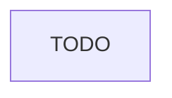

# Thiết kế quan sát (observability) cho nền tảng ETA và giá cước

## 1. Bối cảnh và giả định

TODO

## 2. Kiến trúc

## 3. Danh mục metric và ngân sách series

| Metric | Loại | Label | Series tối đa |
| --- | --- | --- | --- |
| TODO | TODO | TODO | TODO |

## 4. Alert và runbook

| Alert | Triệu chứng | Severity | for | Runbook |
| --- | --- | --- | --- | --- |
| TODO | TODO | TODO | TODO | TODO |

## 5. Log và trace

- TODO

## 6. Rủi ro và việc còn mở

- TODO
