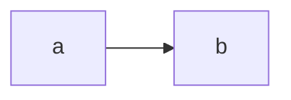

# Thiết kế quan sát

## 1. Bối cảnh và giả định

Cần giám sát.

## 2. Kiến trúc

## 3. Danh mục metric và ngân sách series

| Metric | Loại | Label | Series tối đa |
| --- | --- | --- | --- |
| req | counter | request_id(1000000) | 1000000 |
| cpu | gauge | - | 1 |

## 4. Alert và runbook

| Alert | Triệu chứng | Severity | for | Runbook |
| --- | --- | --- | --- | --- |
| HighCPU | CPU trên 80% | critical | 0m | wiki |

## 5. Log và trace

- Ghi mọi thứ.

## 6. Rủi ro và việc còn mở

Không có.
