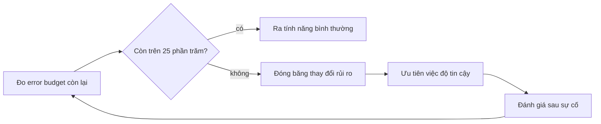

# SLO cho service ETA

## 1. SLI và SLO

Service ETA trả thời gian đến dự kiến cho app đặt xe; mỗi yêu cầu lỗi nghĩa là một khách không biết xe tới khi nào. SLO là
lời hứa có số, đo ở phía người dùng chứ không phải ở CPU: bao nhiêu phần trăm yêu cầu thành công, bao nhiêu nhanh đủ, và dự
đoán còn đủ tươi. Ba SLI dưới đây chọn vì mỗi cái tương ứng với một cách khách hàng thấy hỏng: không có kết quả, kết quả
chậm, kết quả từ model cũ. Cửa sổ 30 ngày trượt để cân giữa nhạy với sự cố và không bị một ngày xấu đè bẹp.

| SLI | Định nghĩa (PromQL) | SLO | Cửa sổ |
| --- | --- | --- | --- |
| Khả dụng | `1 - sum(rate(http_requests_total{route="/predict",status=~"5.."}[30d])) / sum(rate(http_requests_total{route="/predict"}[30d]))` | 99.5% | 30d |
| Độ trễ | tỉ lệ `/predict` nhanh hơn 300 ms: `sum(rate(http_request_duration_seconds_bucket{route="/predict",le="0.25"}[30d])) / sum(rate(http_request_duration_seconds_count{route="/predict"}[30d]))` | 95% | 30d |
| Không dùng fallback | `1 - sum(rate(eta_fallback_total[30d])) / sum(rate(eta_prediction_seconds_count[30d]))` | 99% | 30d |

## 2. Error budget

Error budget là phần không hoàn hảo được phép: `(1 - SLO) x cửa sổ`. Với khả dụng 99.5% trong 30 ngày (43 200 phút) ta có
0.5% x 43 200 = 216 phút "lỗi toàn phần" tương đương. Budget không phải hạn mức để dùng cạn: nó là cái để cân giữa tốc độ ra
tính năng và độ tin cậy.

| Cửa sổ | SLO khả dụng | Budget (phút) |
| --- | --- | --- |
| 30d | 99.5% | 216 |
| 7d | 99.5% | 50.4 |
| 1d | 99.5% | 7.2 |

## 3. Burn-rate alert

Burn rate là tốc độ đốt budget so với tốc độ "vừa đủ hết đúng cuối cửa sổ". Burn rate 1 nghĩa là hết đúng sau 30 ngày. Alert
dùng hai cửa sổ: cửa sổ dài xác nhận sự cố đủ nặng, cửa sổ ngắn (một phần mười hai) xác nhận nó **còn đang diễn ra**, để alert tự tắt nhanh sau khi sửa.

| Mức | Burn rate | Cửa sổ dài | Cửa sổ ngắn | % budget tiêu | Hành động |
| --- | --- | --- | --- | --- | --- |
| Cháy nhanh | 14.4 | 1h | 5m | 2 | page: đánh thức người trực |
| Cháy vừa | 6 | 6h | 30m | 5 | page hoặc ticket gấp trong giờ làm việc |
| Cháy chậm | 1 | 72h | 6h | 10 | ticket: xử lý trong tuần |

Ngưỡng của burn rate 14.4 trên SLO 99.5% là tỉ lệ lỗi `14.4 x 0.005 = 7.2%`; của burn rate 6 là `3%`. Các hằng số đó nằm trong
`slo.rules.yml`.

## 4. Quy trình khi budget cạn

- Khi budget còn dưới 25%: **freeze** mọi thay đổi không liên quan tới độ tin cậy (đổi model, đổi dependency) cho tới khi hồi phục.
- Ngoại lệ do giám đốc sản phẩm và kỹ sư trưởng cùng ký, ghi rõ vì sao và hạn.
- Mỗi lần budget bị đốt hơn 20% trong một sự cố, bắt buộc viết postmortem không đổ lỗi trong 5 ngày làm việc.

## 5. Giới hạn và rủi ro

- Khả dụng đo từ phía server bỏ sót yêu cầu không bao giờ tới được server (lỗi mạng, DNS); bổ sung probe từ bên ngoài.
- Lượng traffic quá thấp làm tỉ lệ nhiễu: một lỗi trong 20 yêu cầu là 5%; ban đêm cần ngưỡng theo số lỗi tuyệt đối hoặc gộp cửa sổ.
- SLO không nói gì về chất lượng dự đoán: service trả 200 nhưng ETA sai 10 phút vẫn "khả dụng"; cần metric chất lượng model (module 10).
