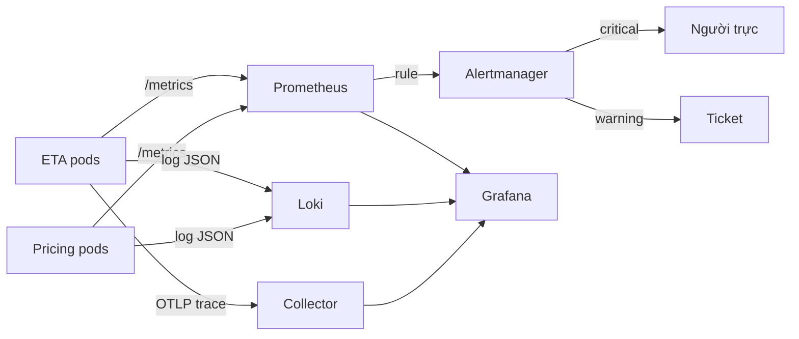

# Thiết kế quan sát (observability) cho nền tảng ETA và giá cước

## 1. Bối cảnh và giả định

Công ty taxi chạy hai service ML trên cùng cụm: ETA (khoảng 20 pod, 400 yêu cầu mỗi giây giờ cao điểm) và giá cước (10 pod, 80
yêu cầu mỗi giây). Hiện chỉ có CPU và RAM của node; hai lần gần đây khách báo sự cố trước khi đội biết (một lần model sai
version trả ETA 999 giây, một lần ETA đúng nhưng chậm gấp ba). Nhãn thật (thời gian chuyến thực tế) về sau 30 đến 90 phút.
Giả định: một Prometheus 512 MB cho cả hai service, ngân sách 20 000 series; một người trực mỗi tuần; trace có sẵn nhưng chưa
ai dùng. Mục tiêu: người trực biết trong 5 phút khi khách bị ảnh hưởng, và biết service đang chạy model nào.

## 2. Kiến trúc

## 3. Danh mục metric và ngân sách series

Số series đã tính cả label `instance` do Prometheus gắn (20 pod ETA, 10 pod giá cước); histogram nhân thêm số bucket cộng
`+Inf`, `_sum`, `_count`. Không metric nào có label theo yêu cầu, người dùng hay chuyến.

| Metric | Loại | Label | Series tối đa |
| --- | --- | --- | --- |
| http_requests_total | counter | method(2), route(4), status(8), instance(20) | 1280 |
| http_request_duration_seconds | histogram | method(2), route(4), instance(20) | 1920 |
| eta_prediction_seconds | histogram | model_version(2), instance(20) | 440 |
| eta_fallback_total | counter | model_version(2), instance(20) | 40 |
| eta_model_info | info | version(2), training_data(2), instance(20) | 80 |
| pricing_surge_multiplier | histogram | city(5), instance(10) | 650 |
| eta_labels_pending | gauge | - | 1 |
| process_resident_memory_bytes | gauge | instance(30) | 30 |
| kube_pod_container_status_restarts_total | counter | pod(30) | 30 |

## 4. Alert và runbook

| Alert | Triệu chứng | Severity | for | Runbook |
| --- | --- | --- | --- | --- |
| ETAHighErrorRate | Hơn 5% yêu cầu /predict trả 5xx trong 5 phút | critical | 5m | https://runbooks.example.com/eta/high-error-rate |
| ETAErrorBudgetFastBurn | Đốt error budget 14.4 lần nhanh hơn mức cho phép (cả cửa sổ 1h và 5m) | critical | 2m | https://runbooks.example.com/eta/budget-fast-burn |
| ETALatencyP95High | p95 của /predict vượt 300 ms | warning | 10m | https://runbooks.example.com/eta/latency |
| ETAPredictionShift | Trung vị phân phối dự đoán 1 giờ lệch hơn 25% so với 7 ngày | warning | 15m | https://runbooks.example.com/eta/prediction-shift |
| ETAFallbackRateHigh | Hơn 5% dự đoán dùng heuristic thay model | warning | 10m | https://runbooks.example.com/eta/fallback |
| ETAMetricsAbsent | Mất metric: absent của http_requests_total, service chết hoặc scrape hỏng | warning | 5m | https://runbooks.example.com/eta/metrics-absent |
| ETALabelJoinStalled | Không có nhãn mới nối được vào log dự đoán trong 2 giờ | warning | 30m | https://runbooks.example.com/eta/label-join |

## 5. Log và trace

- Log dự đoán dạng JSON một dòng, có `request_id`, `model_version`, `prediction`, `fallback`, và chỉ các feature trong allow-list; không có PII.
- Retention: log dự đoán 90 ngày (đủ để nhãn muộn nối về và để kiểm toán), log truy cập 14 ngày, metric 15 ngày tại chỗ rồi tải xuống lưu trữ dài hạn bản đã giảm độ phân giải.
- Trace dùng tail-based sampling: giữ 100% trace có lỗi hoặc chậm hơn 1 giây, 5% còn lại; sampling theo đầu (head) đơn giản hơn nhưng mất đúng những trace cần nhất.
- `request_id` đi xuyên trace, log và response header để một khiếu nại của khách nối được tới đúng trace và đúng dòng log dự đoán.
- Dashboard một trang mỗi service: RED, phiên bản model, phân phối dự đoán, fallback; chi tiết nằm ở dashboard con.

## 6. Rủi ro và việc còn mở

- Cardinality tăng ngầm khi ai đó thêm label mới: thêm kiểm tra CI đếm series của `/metrics` trong test tải và chặn khi vượt ngân sách.
- Alert dựa trên so sánh với 7 ngày trước nhiễu quanh ngày lễ và sự kiện; cần mùa vụ hoặc ngưỡng tạm điều chỉnh.
- Một Prometheus là điểm hỏng đơn: chấp nhận ở quy mô này, nhưng cần alert meta (Prometheus tự giám sát) và kế hoạch HA khi vượt ngân sách series.
- Nhãn về muộn 30 đến 90 phút nên alert chất lượng chỉ phát hiện trễ; phân phối dự đoán là tín hiệu sớm thay thế, với đánh đổi nhiều dương tính giả.
