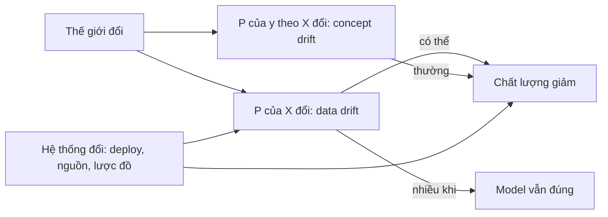
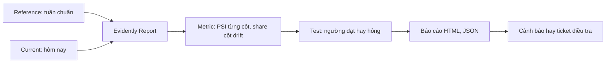
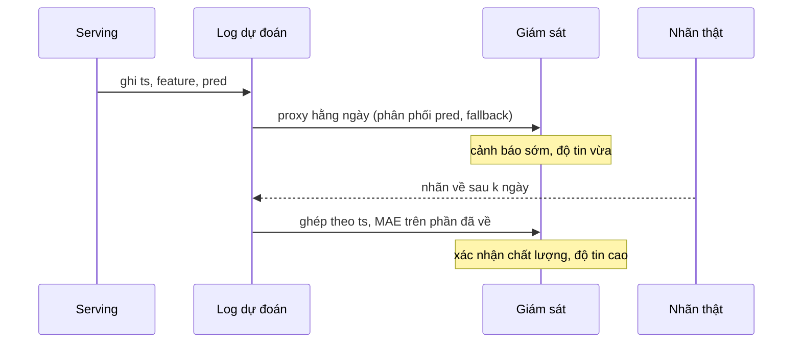
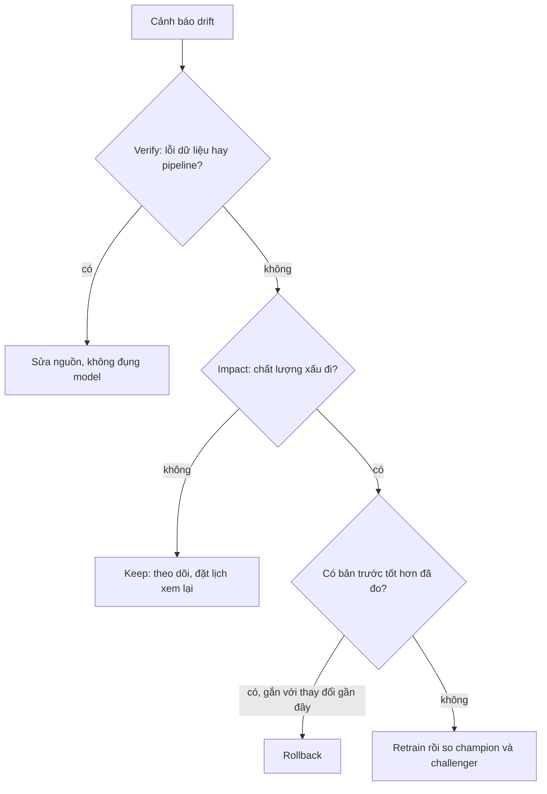

# Drift, nhãn về muộn và xử lý sự cố

Model ETA đúng hôm nay không có nghĩa là đúng tháng sau. Thế giới đổi (mùa, lễ, dịch bệnh), dữ liệu đổi (nguồn, lược đồ), và đôi khi chính hệ thống của bạn đổi. Module này dạy cách phát hiện thay đổi (Evidently, PSI, KS,
classifier phân biệt hai tập), cách sống với nhãn về muộn, và quan trọng nhất là cách **quyết định**: giữ nguyên, rollback hay retrain. Nguyên tắc xuyên suốt: *drift không phải là chất lượng giảm*. Dữ liệu thật là NYC Yellow Taxi
2019 (đổi mùa) và 2020 (cú sốc COVID), nên bạn thấy cả drift vô hại lẫn drift gây thiệt hại thật.

## 0. Cài đặt

Evidently nằm trong môi trường mặc định của `pyproject.toml`, cài qua `uv`, không cần `sudo` hay script tải ngoài.

| Công cụ | Phiên bản đã kiểm | Mức tối thiểu cho bài tập |
| --- | --- | --- |
| `evidently` | 0.7.23 | 0.7.0 (API `Report`, `Dataset`, `presets` của dòng 0.7) |
| `scikit-learn` | 1.9.1 | 1.5 |
| `scipy` | 1.18.1 | 1.13 |
| `plotly` | 5.24.1 (Evidently yêu cầu `plotly<6`) | không cần gọi trực tiếp |

`uv sync --frozen` kiểm hash từng gói theo `uv.lock` trước khi cài, đó là bước kiểm checksum:

```bash
uv sync --frozen
uv run python -c "import evidently; print(evidently.__version__)"   # 0.7.23 (xem lưu ý bên dưới)
```

**Lưu ý tương thích.** Evidently 0.7.23 nạp `pandas.core.dtypes.common.infer_dtype_from_object`, hàm đã bị `pandas` 3 gỡ khỏi đường dẫn này; `import evidently` trần sẽ báo `ImportError` trên môi trường `pandas` 3.1.
Các bài và test trong module vá bằng bốn dòng chạy **trước** khi nhập Evidently (một vá tương thích, không đổi hành vi tính toán; nếu bản Evidently sau này tự xử lý, đoạn vá không còn tác dụng):

```python
import pandas.core.dtypes.common as pandas_common
from pandas.api.types import pandas_dtype

if not hasattr(pandas_common, "infer_dtype_from_object"):
    pandas_common.infer_dtype_from_object = lambda x: pandas_dtype(x).type
```

Dữ liệu: `uv run python data/download_dataset.py nyc-tlc` và `... nyc-tlc-2020` (đã có thì bỏ qua). Test đọc dữ liệu qua `mlopskit.real_month`, có kiểm sha256.
Gỡ: xoá `evidently` khỏi `pyproject.toml` rồi `uv sync`.

## 1. Các loại drift và vì sao drift không bằng chất lượng giảm

Gọi $$X$$ là feature, $$y$$ là nhãn, $$\hat{y}$$ là dự đoán. Có bốn thứ có thể đổi (ba loại hay được gọi là drift cộng label drift):

| Loại | Cái gì đổi | Ví dụ ETA | Model còn đúng? |
| --- | --- | --- | --- |
| Data drift (covariate shift) | $$P(X)$$ | tháng 12 nhiều chuyến cuối năm hơn tháng 7 | thường còn, nếu quan hệ giữ nguyên |
| Prediction drift | $$P(\hat{y})$$ | dự đoán trung bình bỗng cao hơn 38% | chưa biết; là proxy sớm |
| Label drift | $$P(y)$$ | thời lượng thật đổi | chưa biết |
| Concept drift | $$P(y \mid X)$$ | cùng cự ly và giờ nhưng đường vắng nên đi nhanh hơn | **không**: kiến thức đã học thành sai |

Cái làm đau là concept drift, và nó thường *không* hiện trên phân phối đầu vào. Trên NYC TLC 2020-02 sang 2020-04, PSI cao nhất chỉ 0.152 nhưng MAE tăng 62% (bài notebook). Ngược lại, đổi mùa 2019-07 sang 2019-12 cho PSI gần 0 và MAE chỉ tăng 11%.
Một dashboard chỉ có PSI sẽ không phân biệt được hai chuyện đó, và có chiều ngược lại: drift rất lớn mà model vẫn đúng (mùa lễ).



Hệ quả thực dụng: *drift là tín hiệu để điều tra, không phải lý do để hành động*. Phản xạ "thấy drift thì retrain" tốn tiền, có thể làm model tệ hơn (train trên một tuần lễ bất thường) và che mất nguyên nhân thật.

## 2. Ôn PSI và KS, và giới hạn khi mẫu lớn

Phần ôn: PSI chia dữ liệu thành bin rồi cộng $$(c_i - r_i)\ln(c_i / r_i)$$; KS đo khoảng cách lớn nhất giữa hai hàm phân phối tích luỹ. Cách cài từ đầu và ngưỡng 0.1, 0.25 đã có ở
[module Data Science 14 phần 5](../../../data-science/modules/14-mlops-for-ds/README.md); ở đây chỉ nhắc ba giới hạn dẫn tới quyết định thiết kế.

1. **Mẫu lớn làm p-value vô nghĩa.** Với $$n$$ hàng trăm nghìn, KS cho p-value gần 0 cho độ lệch hoàn toàn vô hại (bài `01-psi-ks-match-evidently`: lệch 0.03 độ lệch chuẩn trên 200 000 dòng, p-value dưới 0.001, PSI dưới 0.01).
   Cảnh báo theo *độ lớn* (PSI, khoảng cách) cộng *tác động*, không theo p-value.
2. **PSI phụ thuộc cách chia bin.** Evidently dùng bin rộng bằng nhau (Sturges), nhiều bài viết dùng quantile; cùng dữ liệu cho hai số khác nhau (`fare_amount` COVID: 0.005 và 0.050). Ghi cách chia vào tài liệu giám sát; ngưỡng 0.25 chỉ có nghĩa với một cách chia.
3. **Từng cột một.** PSI/KS xem từng phân phối biên, bỏ sót thay đổi trong quan hệ giữa các cột (phần 4).

Đánh đổi chọn thước đo: PSI nhanh, dễ giải thích với người ngoài ngành, nhưng cần ngưỡng và cách chia bin; KS không cần bin nhưng nhạy quá mức khi $$n$$ lớn; khoảng cách Wasserstein có đơn vị của dữ liệu nên dễ gắn với ngưỡng nghiệp vụ ("lệch hơn 1 phút");
kiểm cho biến phân loại dùng chi-square hoặc Jensen-Shannon.

## 3. Evidently 0.7: report, preset và test

Evidently 0.7 chia việc thành `Dataset` (dữ liệu kèm định nghĩa kiểu cột), `Report` (danh sách metric hoặc preset) và `Snapshot` (kết quả của `Report.run`). Thứ tự đối số của `run` là **hiện tại trước, tham chiếu sau**.

```python
from evidently import Dataset, Report
from evidently.metrics import DriftedColumnsCount, ValueDrift
from evidently.presets import DataDriftPreset
from evidently.tests import lt

report = Report([DataDriftPreset(method="psi")])
snapshot = report.run(Dataset.from_pandas(current), Dataset.from_pandas(reference))
per_column = {m["config"]["column"]: m["value"] for m in snapshot.dict()["metrics"] if "column" in m["config"]}
snapshot.save_html("drift.html")
```

- **Preset** (`DataDriftPreset`) gói sẵn một nhóm metric: đếm cột drift, drift từng cột (`method="psi"` hay `"ks"`, `"wasserstein"`...). Dùng khi muốn một báo cáo nhanh, không cần chọn từng metric.
- **Metric đơn** (`ValueDrift`, `DriftedColumnsCount`) dùng khi chỉ quan tâm vài cột hoặc muốn đặt ngưỡng riêng.
- **Test** biến metric thành điều kiện đạt hay hỏng: `Report([...], include_tests=True)` cùng `tests=[lt(0.1)]` trên metric. Kết quả `snapshot.dict()["tests"]` có `status`; đưa vào CI hay job định kỳ để hỏng thì cảnh báo.

```python
checks = Report(
    [DriftedColumnsCount(method="psi", tests=[lt(2)]), ValueDrift(column="trip_distance", method="psi", tests=[lt(0.1)])],
    include_tests=True,
)
result = checks.run(Dataset.from_pandas(current), Dataset.from_pandas(reference)).dict()
failed = [t["name"] for t in result["tests"] if t["status"] != "SUCCESS"]
```

Hai lưu ý khi dùng: (1) kiểu cột do Evidently suy ra từ dữ liệu; một cột mã số như `PULocationID` có nhiều hơn 20 giá trị bị coi là số, và PSI trên mã vùng không có nghĩa, nên khai báo nó là phân loại trong `DataDefinition`; (2) PSI của Evidently dùng
bin rộng bằng nhau, nên cột đuôi dài (cự ly chuyến có chuyến hàng trăm dặm) cho số khác PSI quantile. Bài `01-psi-ks-match-evidently` bắt bạn khớp từng số.



## 4. Drift đa biến: classifier phân biệt hai tập

Hai cột có thể giữ nguyên phân phối biên mà quan hệ giữa chúng đổi (tương quan đổi dấu, cự ly và giá cước không còn đi cùng nhau). PSI từng cột không thấy. Giải pháp: gộp dữ liệu tham chiếu (nhãn 0) và hiện tại (nhãn 1), train một classifier
phân biệt chúng và đo AUC bằng cross-validation.

$$
\mathrm{AUC} \approx 0.5 \Rightarrow \text{không phân biệt được};\qquad \mathrm{AUC} \to 1 \Rightarrow \text{hai tập khác nhau rõ rệt}
$$

Trên NYC TLC (bốn feature, mẫu 20 000 dòng): 2019-07 sang 2019-12 cho AUC khoảng 0.52, 2020-02 sang 2020-04 khoảng 0.73. `feature_importances_` của classifier chỉ ra cột đóng góp nhiều nhất vào việc phân biệt: điểm bắt đầu của "drift đến từ đâu".

Đánh đổi: nhạy với mọi loại khác biệt (kể cả vô hại), tốn một lần fit, khó giải thích hơn PSI, và AUC cao chỉ nói "khác", không nói "tệ". Luôn kèm cross-validation: AUC của model trên dữ liệu đã học gần như luôn cao.

## 5. Nhãn về muộn và ước lượng chất lượng khi chưa có nhãn

ETA có nhãn sau vài phút đến một ngày; tín dụng, quảng cáo, churn có nhãn sau hàng tuần. Trong khoảng đó bạn phải dùng **proxy**:

| Proxy | Bắt cái gì | Cạm bẫy |
| --- | --- | --- |
| Phân phối dự đoán so với baseline | model đổi hành vi (dữ liệu hoặc phiên bản mới) | baseline phải **cùng thứ** trong tuần để loại mùa vụ |
| Tỉ lệ fallback, timeout, thiếu feature | hệ thống lùi về nhánh dự phòng | phải có đo ngay từ đầu |
| Tỉ lệ thiếu và khoảng giá trị của feature | nguồn đổi | cần baseline từng cột |
| MAE trên phần nhãn đã về | chất lượng thật nhưng cũ | mô phỏng không được dùng nhãn "chưa về" (rò rỉ tương lai) |
| Shadow model hoặc model trước | so trực tiếp trên cùng lưu lượng | tốn tính toán gấp đôi |



Bài `02-label-delay-proxy-monitor` dựng ba mảnh này. Thiết kế đúng là hai tầng: proxy cho phản ứng nhanh, nhãn cho quyết định; đừng retrain khẩn chỉ vì proxy đỏ khi nhãn sắp về trong vài giờ và chi phí chờ thấp.

## 6. Khung quyết định: detect, verify, impact, decide

Bốn bước, theo thứ tự, không bỏ bước:

1. **Detect.** Tín hiệu từ PSI, proxy, AUC miền. Xác nhận trước rằng bản thân giám sát không sai (cỡ mẫu, baseline, ngày lễ).
2. **Verify.** Tín hiệu có thật không? Loại trừ lỗi dữ liệu và pipeline: deploy hay thay đổi nguồn gần đây, tỉ lệ thiếu, khoảng giá trị, số cột bị chạm có hợp lý không, thời điểm gãy đột ngột hay trôi dần. Nhiều "drift" kết thúc ở bước này.
3. **Impact.** Chất lượng có giảm không? Nhãn đã về thì MAE (tổng và theo lát cắt) so với baseline; chưa về thì proxy; có shadow thì so trực tiếp.
4. **Decide.** Chọn hành động rẻ nhất, ít rủi ro nhất mà có bằng chứng.

| Hành động | Khi nào | Bằng chứng cần có | Rủi ro |
| --- | --- | --- | --- |
| Giữ nguyên (`keep`) | tín hiệu là lỗi đã sửa, hoặc drift lớn nhưng MAE không xấu đi | nhãn hoặc proxy tốt cho thấy không giảm | chậm bắt concept drift: đặt lịch xem lại |
| `rollback` | vấn đề bắt đầu cùng một thay đổi gần đây và có bản trước tốt hơn đã đo | so sánh cùng lưu lượng (shadow, A/B) | bản trước có thể cũ; giải quyết triệu chứng không giải quyết nguyên nhân |
| `retrain` | chất lượng giảm thật, không có bản trước tốt hơn, thế giới đổi bền vững | MAE xấu đi có hệ thống | train trên giai đoạn bất thường; tốn thời gian; phải qua cổng champion/challenger |



Bài `03-drift-decision-scenarios` cho ba tình huống có số liệu với ba đáp án khác nhau (giữ, rollback, retrain) và bắt bạn dẫn số đo làm bằng chứng, trong đó có một ca drift lớn mà MAE không xấu đi. Bài `01-tlc-seasonal-vs-covid` cho bạn thấy trên dữ liệu thật
rằng cỡ drift đầu vào và cỡ thiệt hại không đi cùng nhau.

## 7. Runbook, on-call, postmortem không đổ lỗi và so sánh công cụ

**Runbook** là thứ người trực lúc 3 giờ sáng, chưa từng thấy hệ thống, làm theo được. Mỗi bước là một câu hỏi có/không kèm hành động tiếp theo; thứ tự theo khung ở phần 6; ngưỡng truy được về dữ liệu bình thường chứ không phải con số tròn tự nghĩ ra.
Nhánh mặc định không được là "retrain".

**On-call.** Phân mức theo tác động (cảnh báo drift đơn lẻ là cấp thấp; thêm MAE xấu đi hay fallback tăng thì cấp cao), có người chủ model, đường leo thang tới đội data và nền tảng, và mẫu cập nhật trạng thái đều đặn.
Một cảnh báo hay bắn giả là nợ kỹ thuật: sửa ngưỡng hay baseline thay vì tắt tiếng.

**Postmortem không đổ lỗi** hỏi "hệ thống nào để chuyện này xảy ra", không hỏi "ai làm". Có tóm tắt, tác động bằng số, dòng thời gian (vai trò, không tên), nguyên nhân là chuỗi điểm hệ thống, điều tốt và may, hành động có chủ sở hữu, hạn và cách kiểm.
Hành động mơ hồ ("theo dõi sát hơn") là dấu hiệu postmortem hình thức. Hai bài Advanced của module luyện đúng hai tài liệu này.

**So sánh công cụ giám sát ML.**

| Công cụ | Điểm mạnh | Hạn chế | Hợp khi |
| --- | --- | --- | --- |
| Evidently (mã nguồn mở) | báo cáo, preset, test, chạy trong pipeline của bạn, không khoá nhà cung cấp | tự lo lưu trữ, lịch chạy, giao diện lâu dài | đội tự vận hành, muốn kiểm soát |
| NannyML (mã nguồn mở) | ước lượng hiệu năng khi chưa có nhãn (CBPE, DLE), drift đa biến | phạm vi hẹp hơn, ít tích hợp | nhãn trễ nhiều tuần, cần ước lượng chất lượng |
| WhyLabs, Arize (dịch vụ) | giao diện, cảnh báo, lưu lịch sử, theo dõi nhiều model sẵn | chi phí, dữ liệu rời khỏi hạ tầng, ràng buộc nhà cung cấp | nhiều model, ít người vận hành |
| Prometheus và Grafana tự dựng | gom được cùng metric hệ thống, rẻ | tự viết thống kê drift | metric đơn giản, đã có stack giám sát |

Không có công cụ "đúng" tuyệt đối. Chọn theo ai vận hành, dữ liệu có được rời hạ tầng không, nhãn trễ bao lâu, và có bao nhiêu model; thước đo (PSI, bin, ngưỡng) quan trọng hơn thương hiệu.

## 8. Tài liệu tham khảo

- Evidently, tài liệu dòng 0.7 (Report, Presets, Tests): https://docs.evidentlyai.com
- Evidently, mã nguồn: https://github.com/evidentlyai/evidently
- NannyML, tài liệu (CBPE, DLE, drift đa biến): https://nannyml.readthedocs.io
- Rabanser, Günnemann, Lipton, *Failing Loudly: An Empirical Study of Methods for Detecting Dataset Shift*, NeurIPS 2019.
- Lipton, Wang, Smola, *Detecting and Correcting for Label Shift with Black Box Predictors*, ICML 2018.
- Google, *Rules of Machine Learning* (đặc biệt phần monitoring): https://developers.google.com/machine-learning/guides/rules-of-ml
- Google SRE Book, chương *Postmortem Culture: Learning from Failure*: https://sre.google/sre-book/postmortem-culture/
- NYC TLC Trip Record Data: https://www.nyc.gov/site/tlc/about/tlc-trip-record-data.page
