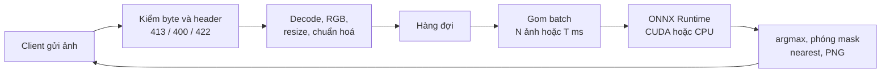
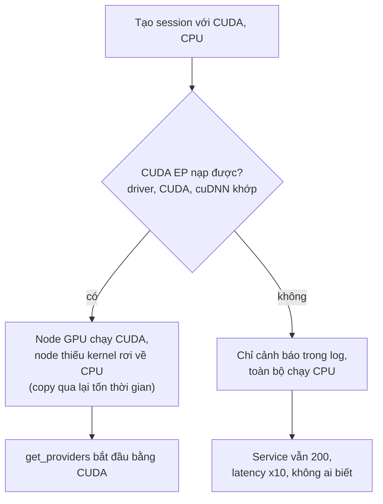
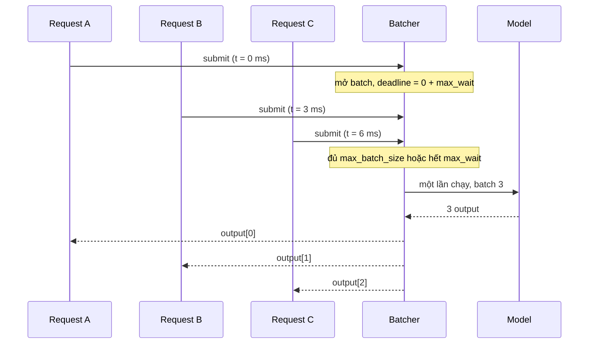

# Deploy model Deep Learning

Model ETA của capstone là vài trăm cây quyết định, nặng vài MB, dự đoán một dòng mất chưa tới một mili giây trên CPU. Model ảnh thì khác: tệp vài chục tới vài trăm MB, mỗi request là một ảnh phải decode, resize, chuẩn hoá, chạy hàng tỉ phép nhân trên GPU, rồi hậu xử lý thành mask. Module này đưa một model phân đoạn ảnh (**SegFormer-b0** trên **Oxford-IIIT Pets** kèm trimap) lên production: export ONNX và kiểm sai số, ONNX Runtime trên CPU và CUDA, dynamic batching, benchmark đúng cách, sống với GPU 4 GB (batch size, FP16, OOM), quantization INT8, và khi nào cần Triton hay TensorRT. Bài tập dùng một model conv tí hon sinh ngay trong test để chạy nhanh trên CPU; model SegFormer thật chỉ cần cho bài portfolio.

## 0. Cài đặt

Môi trường mặc định (`uv sync`) đã đủ cho mọi bài trên CPU. Đường GPU nằm trong project riêng `setup/gpu` (torch CUDA 12.6, `onnxruntime-gpu`), không trộn vào môi trường mặc định vì torch CPU và torch CUDA là hai bản build khác nhau, còn `onnxruntime` và `onnxruntime-gpu` cùng ghi vào thư mục `onnxruntime/`.

| Gói | Phiên bản đã kiểm | Ở đâu |
| --- | --- | --- |
| `torch` | 2.14.1 (`+cpu`) | môi trường mặc định |
| `onnx` | 1.23.2 | mặc định và `setup/gpu` |
| `onnxruntime` | 1.31.0 (CPU) | môi trường mặc định |
| `transformers` | 5.22 | mặc định và `setup/gpu` |
| `torch` | 2.14.1 (`+cu126`) | `setup/gpu` |
| `onnxruntime-gpu` | 1.29.0 (bản CUDA 12, feed chính thức của ONNX Runtime) | `setup/gpu` |

Cài và kiểm (uv kiểm hash từng gói theo `uv.lock`, không có bước `curl | sudo`):

```bash
uv sync --frozen
uv run python -c "import torch, onnx, onnxruntime as ort; print(torch.__version__, onnx.__version__, ort.__version__, ort.get_available_providers())"

uv sync --frozen --project setup/gpu
uv run --project setup/gpu python setup/gpu/check_gpu.py
uv run --project setup/gpu python -c "import onnxruntime as ort; print(ort.get_available_providers())"
```

Dòng cuối phải có `CUDAExecutionProvider`. Driver laptop 550 hỗ trợ tối đa CUDA 12.4, nên `onnxruntime-gpu` trên PyPI (từ 1.28 build cho CUDA 13, cần driver ≥ 580) không dùng được; `setup/gpu` lấy bản CUDA 12 từ feed chính thức. Không có GPU NVIDIA: bỏ qua dòng `setup/gpu`, mọi test GPU tự skip với thông báo "Không có CUDA", phần còn lại chạy bằng CPU. Test GPU gọi môi trường này qua `mlopskit.gpu_python(script, cwd)`; Docker trên máy học **không** có NVIDIA runtime, nên không bài bắt buộc nào chạy GPU trong container.

Dữ liệu (lần đầu, khoảng 800 MB ảnh và 19 MB trimap):

```bash
uv run python data/download_dataset.py oxford-pets
uv run python data/download_dataset.py oxford-pets-trimaps
```

Thư mục trimap giải nén có cả tệp AppleDouble `._*.png` của macOS: luôn lọc theo tên.

**Bước chuẩn bị cho bài portfolio (chạy một lần, không phải bài học):** không có checkpoint SegFormer công khai cho trimap Pets, nên module cấp script fine-tune `segformer-b0` từ checkpoint công khai `nvidia/mit-b0` trên một tập con nhỏ:

```bash
S=tracks/mlops/modules/11-deep-learning-serving/exercises/advanced/01-segformer-portfolio-service/starter/finetune_segformer.py
uv run --project setup/gpu python $S --device cuda
uv run python $S --log-only
```

Trên RTX 3050 Laptop 4 GB: khoảng 1 phút, bộ nhớ GPU đỉnh khoảng 635 MiB, mIoU val khoảng 0.78. Đường CPU: `uv run python $S --device cpu --train 300 --size 192` (vài chục phút tuỳ máy, chất lượng thấp hơn nhưng đủ cho serving). Kết quả nằm trong `data/raw_models/` (bị `.gitignore`): thư mục Hugging Face, tệp ONNX, `meta.json`, và một run MLflow local (`data/raw_models/mlflow.db`, artifact ở `data/raw_models/mlartifacts/`). Không có artifact nào được host sẵn. Gỡ: `rm -rf data/raw_models setup/gpu/.venv`.

## 1. Serving model Deep Learning khác model tabular ở đâu

| Khía cạnh | Model tabular (ETA) | Model ảnh (SegFormer) |
| --- | --- | --- |
| Kích thước artifact | vài MB | 15 MB (b0) tới vài trăm MB, tải và nạp mất giây |
| Đầu vào | JSON vài số | ảnh vài trăm KB tới vài MB, phải decode, resize, chuẩn hoá |
| Chi phí một dự đoán | micro giây trên CPU | hàng chục ms trên GPU, hàng trăm ms trên CPU |
| Batch | gần như không quan trọng | quyết định throughput: GPU rảnh nếu chạy từng ảnh |
| Phần cứng | CPU bất kỳ | GPU với bộ nhớ hữu hạn; batch, độ phân giải, precision cùng tranh 4 GB |
| Lỗi thường gặp | skew feature | skew tiền xử lý (quên chuẩn hoá, sai thứ tự kênh, resize khác), OOM, khởi động lạnh |
| Đầu ra | một số | mask cùng kích thước ảnh, phải phóng về và mã hoá PNG |



Ba hệ quả thực tế:

- **Tiền xử lý là một phần của model.** Mean/std, kích thước input, thứ tự kênh, kiểu nội suy đi cùng artifact (trong `meta.json` hay model card), không hard-code rời rạc trong service. Đổi một chi tiết không gây lỗi, chỉ làm mask tệ đi âm thầm.
- **Kiểm đầu vào trước khi tốn tiền.** Đọc header ảnh rẻ; decode một ảnh 20 000×20 000 có thể ăn vài GB RAM. Giới hạn byte, giới hạn cạnh lấy từ phân phối dữ liệu thật (bài Basic 03: 99% ảnh Pets có cạnh dài ≤ 636 px, lớn nhất 3 264 px).
- **Khởi động lạnh đắt.** Tạo session, cấp phát arena, khởi tạo CUDA context, chọn thuật toán conv đều diễn ra ở lần chạy đầu. Warmup trước khi báo `/readyz` (module 07) càng quan trọng với model ảnh.

## 2. Ôn ONNX và export đúng: opset, dynamic axes, kiểm sai số

ONNX (định dạng graph mở) và lý do service viết bằng ngôn ngữ khác gọi được model đã học ở [DS 14, phần 6](../../../data-science/modules/14-mlops-for-ds/README.md) và [AE 03](../../../ai-engineer/modules/03-computer-vision/README.md) (export YOLO). Phần này chỉ thêm ba điều mà serving production đòi hỏi.

**Opset** là phiên bản bộ toán tử. Opset mới có thêm op hoặc đổi ngữ nghĩa (ví dụ `Resize` đã đổi cách tính toạ độ qua các opset). Chọn opset mà runtime production hỗ trợ, ghim nó, và `verify` từ chối artifact có opset thấp hơn mức tối thiểu.

**Dynamic axes.** Exporter TorchScript (`dynamo=False`) chạy model với input mẫu và ghi lại graph; trục nào không khai báo động sẽ bị ghi thành hằng số:

```python
torch.onnx.export(
    model, (torch.zeros(2, 3, 64, 64),), "seg.onnx",
    opset_version=17,
    input_names=["pixel_values"], output_names=["logits"],
    dynamic_axes={"pixel_values": {0: "batch"}, "logits": {0: "batch"}},
    dynamo=False,
)
```

Quên `dynamic_axes` thì model chạy tốt với batch lúc export và gãy ngay khi bật dynamic batching. Dùng batch mẫu 2 (không phải 1) để exporter không chuyên biệt hoá nhánh nào cho batch 1. Trong torch 2.14 exporter mặc định là `dynamo=True` và cần gói `onnxscript`; module dùng exporter TorchScript vì nó ổn định với model conv và SegFormer, không thêm dependency.

**Kiểm sai số là cổng, không phải tuỳ chọn.** Export "thành công" không có nghĩa là đúng: op được thay bằng xấp xỉ, trọng số nhầm checkpoint, hay lỗi chỉ hiện ở batch khác. `verify` chạy cùng input qua PyTorch và ONNX Runtime trên **nhiều** batch size và so:

$$\max_i \lvert y^{\text{torch}}_i - y^{\text{onnx}}_i \rvert \le \text{atol}$$

| So sánh | Ngưỡng hợp lý | So trên |
| --- | --- | --- |
| FP32 PyTorch và FP32 ONNX Runtime CPU | `atol` cỡ `1e-4` | logits |
| FP32 CPU và FP32 CUDA | cỡ `1e-3` (thứ tự cộng khác) | logits |
| FP32 và FP16 / INT8 | không so logits | mask: mIoU giảm ≤ ngưỡng ghi trong model card |

`verify` chạy trong CI khi export và lúc service khởi động (trước `/readyz`); fail thì không nhận traffic.

## 3. ONNX Runtime: execution provider CPU, CUDA và đường fallback

ONNX Runtime chia graph cho các **execution provider** theo thứ tự ưu tiên bạn đưa: node nào provider đầu hỗ trợ thì chạy ở đó, còn lại rơi xuống provider sau. CPU luôn đứng cuối làm lưới an toàn.

```python
def pick_providers(available):
    preferred = ["CUDAExecutionProvider"] if "CUDAExecutionProvider" in available else []
    return preferred + ["CPUExecutionProvider"]

session = ort.InferenceSession("seg.onnx", providers=pick_providers(ort.get_available_providers()))
print(session.get_providers())
```



Bẫy lớn nhất: CUDA EP không nạp được (sai phiên bản CUDA, thiếu cuDNN, driver cũ) thì ONNX Runtime **chỉ cảnh báo** và chạy hết trên CPU. Vì vậy:

- Log `session.get_providers()` lúc khởi động; nếu cấu hình đòi GPU mà provider đầu không phải CUDA thì `/readyz` đỏ.
- Test GPU kiểm `get_providers()[0] == "CUDAExecutionProvider"`, không tin danh sách đã yêu cầu.
- Với `onnxruntime-gpu` cài từ pip, gọi `ort.preload_dlls()` trước khi tạo session để nạp CUDA và cuDNN từ các gói `nvidia-*` trong cùng môi trường; thiếu bước này hoặc phiên bản các gói đó không khớp (log báo `libcublasLt.so.12: cannot open shared object file` hay `undefined symbol`) là kịch bản fallback điển hình.
- Ghim cặp `onnxruntime-gpu` với CUDA của driver (bảng ở mục 0 là ví dụ thật: bản PyPI mới không chạy được với driver 550).
- Theo dõi copy giữa host và device: node không có kernel CUDA nằm giữa graph làm dữ liệu chạy qua lại PCIe; `SessionOptions.log_severity_level=1` in phân chia node theo provider.

Các provider khác đáng biết: `TensorrtExecutionProvider` (build engine TensorRT bên trong ONNX Runtime), `OpenVINOExecutionProvider` (CPU/iGPU Intel), `CoreMLExecutionProvider` (Apple). Cấu hình CUDA EP có `gpu_mem_limit` (trần arena) và `arena_extend_strategy`, hữu ích khi nhiều process chung một card.

## 4. Dynamic batching: gom request theo kích thước và thời gian

GPU chạy một ảnh và tám ảnh mất thời gian gần nhau vì phần lớn chi phí là khởi chạy kernel và đọc trọng số. Request từ người dùng lại đến từng cái một. **Dynamic batching** giữ request trong một cửa sổ rất ngắn để chạy chung:



Cài đặt bằng `asyncio` (bài Intermediate 02): mỗi request tạo một `Future`, đưa `(item, future)` vào hàng đợi; một task nền lấy item đầu, chờ thêm tới khi đủ `max_batch_size` hoặc hết `max_wait_ms`, chạy model **ngoài event loop** (`asyncio.to_thread`), rồi trả từng kết quả vào đúng future. Lỗi của một lần chạy được đặt vào các future của lần chạy đó.

| Tham số | Ảnh hưởng | Cách chọn ban đầu |
| --- | --- | --- |
| `max_batch_size` | throughput, latency mỗi lần chạy, bộ nhớ đỉnh | đầu gối của đường cong throughput theo batch (mục 5) |
| `max_wait_ms` | latency thêm vào lúc tải thấp, độ lớn batch lúc tải vừa | 5–10% ngân sách p95 |
| Độ dài hàng đợi | thời gian chờ trước khi vào batch | giới hạn; đầy thì trả 503 sớm (load shedding) |

Đo `batch_size` thực tế thành histogram: nếu batch trung bình gần 1 thì batching không giúp gì, chỉ cộng thêm `max_wait_ms` vào latency. Triton và TorchServe có dynamic batching sẵn với đúng hai tham số này (`max_batch_size`, `max_queue_delay_microseconds` của Triton).

## 5. Benchmark latency và throughput đúng cách

Số benchmark sai phổ biến hơn số benchmark đúng. Quy tắc của harness (bài Basic 02):

1. **Warmup và loại bỏ**: vài lần chạy đầu gồm cấp phát arena, chọn thuật toán cuDNN, nạp kernel; đưa vào số đo làm p95 xấu giả tạo.
2. **Tách chuẩn bị dữ liệu khỏi vòng đo**: đo model thì chỉ đo `session.run`. Đo end-to-end (decode, resize, HTTP) là một benchmark khác, đặt tên rõ.
3. **Phân vị, không trung bình**: báo p50, p95 (và p99 nếu đủ mẫu). SLO viết theo phân vị.
4. **Throughput từ tổng thời gian đo**:

$$\text{throughput} = \frac{\text{batch} \times \text{số lần đo}}{\sum \text{latency}}$$

   không phải `batch / p50` (bỏ qua đuôi chậm).
5. **Theo batch size**: một bảng batch 1, 4, 8, 16, 32 cho thấy đầu gối của đường cong, nơi throughput gần bão hoà mà latency vẫn chấp nhận được.
6. **Đồng bộ GPU**: PyTorch CUDA bất đồng bộ, phải `torch.cuda.synchronize()` trước khi dừng đồng hồ; ONNX Runtime `run()` đã chờ output về host.
7. **Ghi cấu hình**: CPU, số luồng (`intra_op_num_threads`), GPU, driver, phiên bản runtime, kích thước input. Máy đang tải nặng thì chạy lại; số không kèm cấu hình là số không tái lập được.

Benchmark model đơn lẻ trả lời "model nhanh cỡ nào"; load test HTTP với nhiều client đồng thời (k6, module 07) trả lời "service chịu được bao nhiêu". Cần cả hai: batching chỉ phát huy khi có request đồng thời.

## 6. Bộ nhớ GPU 4 GB, FP16 và quantization INT8

Bộ nhớ GPU khi suy luận gồm: CUDA context (300–500 MB, trước khi nạp gì), trọng số, **activation** (tỉ lệ với batch × độ phân giải), workspace của cuDNN, và phần cache của allocator. Với laptop, màn hình cũng lấy một phần. Ước lượng thô activation:

$$M_{\text{act}} \approx \text{batch} \times \sum_{\text{tensor}} \text{số phần tử} \times \text{byte mỗi phần tử}$$

Nhân đôi cạnh ảnh thì activation tăng khoảng bốn lần. Ước lượng từ graph (shape inference, bài Intermediate 03) là điểm khởi đầu; con số dùng thật phải **đo** trên đúng card bằng `torch.cuda.max_memory_allocated` (PyTorch) hoặc `nvidia-smi` (ONNX Runtime), vì runtime dùng lại bộ nhớ giữa các tensor, còn cuDNN cấp thêm workspace.

| Hiện tượng | Nguyên nhân | Xử lý |
| --- | --- | --- |
| `CUDA out of memory` ở batch lớn | activation vượt phần trống | đo bộ nhớ theo batch, chọn batch vừa với biên an toàn, giảm độ phân giải |
| OOM dù tổng trống còn nhiều | **phân mảnh**: không có khối liền đủ lớn | kích thước batch/ảnh ổn định, `PYTORCH_CUDA_ALLOC_CONF=expandable_segments:True`, khởi động lại theo lịch nếu cần |
| `nvidia-smi` báo đầy dù model nhỏ | allocator giữ cache để dùng lại | đo bằng `max_memory_allocated`; `gpu_mem_limit` cho ONNX Runtime |
| FP16 không giảm bộ nhớ như kỳ vọng | layout NCHW, cuDNN chuyển sang NHWC cho Tensor Core | `channels_last`, đo lại |

Số đo thật trên RTX 3050 Laptop (model tí hon, ảnh 128×128, batch 64): FP32 230 MiB, FP16 214 MiB, FP16 + `channels_last` 115 MiB. FP16 chỉ giảm gần nửa khi layout phù hợp: **đo, đừng nhân 0.5**.

**Quantization INT8** giảm kích thước tệp khoảng bốn lần cho trọng số và thường tăng tốc trên CPU:

| Kiểu | Cách làm | Ưu | Nhược |
| --- | --- | --- | --- |
| Dynamic (`quantize_dynamic`) | trọng số INT8 sẵn; activation lượng tử hoá lúc chạy | không cần dữ liệu hiệu chỉnh, một dòng lệnh | tốn tính min/max mỗi lần, lợi nhiều với MatMul hơn Conv |
| Static (`quantize_static`, QDQ) | hiệu chỉnh thang activation trên vài trăm ảnh thật | nhanh hơn, giữ chất lượng tốt hơn với Conv, chạy được trên TensorRT | cần tập hiệu chỉnh đại diện, dễ sai khi dữ liệu lệch |
| Quantization-aware training | học với lượng tử hoá giả | chất lượng tốt nhất | phải train lại |

Đánh đổi chất lượng phải đo trên **nhiệm vụ** (mIoU, IoU từng lớp, nhất là lớp hiếm như viền) và ghi ngưỡng chấp nhận vào model card, ví dụ "mIoU giảm không quá 0.02". Bài Intermediate 03 dùng đúng ngưỡng đó; với model tí hon INT8 dynamic giảm tệp từ 78 KB xuống 28 KB mà mIoU gần như không đổi.

## 7. Triton, TensorRT và các lựa chọn khác

Tách hai tầng: **server** (nhận request, batching, nhiều model, metrics) và **runtime** (chạy graph trên phần cứng).

| Lựa chọn | Tầng | Mạnh | Giá phải trả | Khi nào chọn |
| --- | --- | --- | --- | --- |
| ONNX Runtime + FastAPI | runtime + server tự viết | đơn giản, CPU và GPU, dễ debug, một ngôn ngữ | tự viết batching, metrics | một vài model, đội nhỏ, cần đường CPU |
| NVIDIA Triton Inference Server | server | dynamic batching, ensemble, nhiều backend (ONNX Runtime, TensorRT, PyTorch, Python), metrics Prometheus, gRPC | cấu hình `config.pbtxt`, image lớn, vận hành thêm một hệ | nhiều model chung GPU, throughput cao, cần gRPC |
| TensorRT | runtime | nhanh nhất trên GPU NVIDIA, FP16/INT8, fuse layer | engine gắn với kiến trúc GPU, phiên bản TensorRT và dải shape lúc build; build lại khi đổi | batch job lớn, shape ổn định, latency rất chặt |
| TorchServe / BentoML / Ray Serve | server | gần hệ sinh thái Python, handler tuỳ ý | hiệu năng phụ thuộc handler | đội thuần PyTorch, logic tiền xử lý phức tạp |
| KServe (module 13–14) | điều phối trên K8s | autoscale, canary, chuẩn giao thức V2 | cần cluster | nền tảng nhiều đội |

Model phân đoạn hiện đại để so sánh (chỉ trong bảng, không có bài):

| Model | Tham số | Ghi chú cho GPU 4 GB |
| --- | --- | --- |
| SegFormer-b0 | khoảng 3.7 triệu | train và serve thoải mái; dùng trong module |
| SegFormer-b2 | khoảng 27 triệu | serve được ở 512 px với batch nhỏ |
| SAM 2 (Hiera tiny tới large) | khoảng 39 tới 224 triệu | image encoder ở 1024 px, quá nặng cho serving 4 GB; hợp làm công cụ tạo nhãn trên GPU lớn hơn |

Quy tắc thực dụng: bắt đầu bằng ONNX Runtime sau một service đơn giản, đo; chỉ chuyển sang Triton hay TensorRT khi số đo chỉ ra nút thắt mà chúng giải được, và khi đội sẵn sàng vận hành thêm độ phức tạp.

## 8. Tài liệu tham khảo

- [ONNX Runtime: Execution Providers](https://onnxruntime.ai/docs/execution-providers/) và [CUDA Execution Provider](https://onnxruntime.ai/docs/execution-providers/CUDA-ExecutionProvider.html)
- [ONNX Runtime: Quantize ONNX models](https://onnxruntime.ai/docs/performance/model-optimizations/quantization.html)
- [PyTorch: torch.onnx](https://docs.pytorch.org/docs/stable/onnx.html)
- [ONNX operator changelog (opset)](https://onnx.ai/onnx/operators/)
- [PyTorch: CUDA memory management](https://docs.pytorch.org/docs/stable/notes/cuda.html#memory-management) và [channels_last](https://docs.pytorch.org/tutorials/intermediate/memory_format_tutorial.html)
- [NVIDIA Triton: Dynamic Batcher](https://docs.nvidia.com/deeplearning/triton-inference-server/user-guide/docs/user_guide/model_configuration.html#dynamic-batcher)
- [NVIDIA TensorRT Developer Guide](https://docs.nvidia.com/deeplearning/tensorrt/latest/)
- Xie et al., [SegFormer: Simple and Efficient Design for Semantic Segmentation with Transformers](https://arxiv.org/abs/2105.15203), NeurIPS 2021; [model card `nvidia/mit-b0`](https://huggingface.co/nvidia/mit-b0)
- Ravi et al., [SAM 2: Segment Anything in Images and Videos](https://arxiv.org/abs/2408.00714), 2024
- Parkhi, Vedaldi, Zisserman, Jawahar, [The Oxford-IIIT Pet Dataset](https://www.robots.ox.ac.uk/~vgg/data/pets/), CVPR 2012
